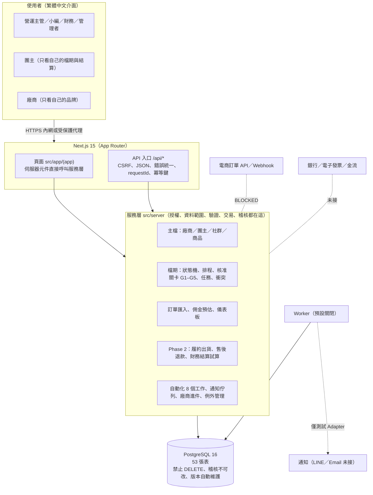
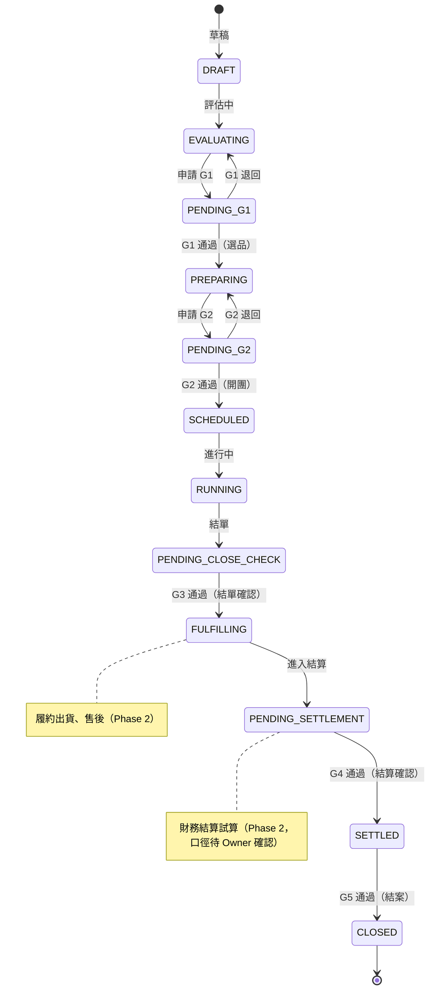
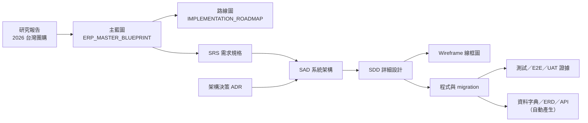

# group-buying-operations

團購營運研究與 **團購 ERP** 的主要空間：規格文件（藍圖、路線圖、研究）＋ Phase 1 MVP 的實作與紀錄。

> **狀態（2026-10-28）**：Phase 1 MVP ＋ Phase 2 切片（履約出貨、售後、財務結算試算）已建置完成，只含虛構 DEMO 資料，可在本機／隔離環境操作。**尚未部署正式環境、未連任何正式資料或真實通知。** 完成度與證據見 [功能完成矩陣](docs/FEATURE_STATUS_MATRIX.md)、[測試報告](docs/TEST_REPORT.md)、[已知問題](docs/KNOWN_ISSUES.md)。
>
> | 項目 | 數字（以 CI 為準） |
> |---|---|
> | 自動化測試 | 16 檔 310 項（真實 PostgreSQL，含安全審查與 API 模糊測試）＋ E2E 49 項 |
> | 資料表／遷移 | 53 張表、12 支 migration |
> | API 端點 | 130 個（[清單](docs/generated/API_ENDPOINTS.md)） |
> | 角色／權限 | 6 種角色、43 項權限 |
>
> 📌 **進行中的整理**：SRS／SAD／SDD／線框圖已補齊並併入主分支（見下方「文件地圖」）。這些是對**已完成系統的逆向整理並與程式核對**，不是事前設計。

## 快速開始（本機）

```bash
npm ci
cp .env.example .env.local     # 編輯密碼與密鑰（不要提交）
npm run db:migrate && npm run db:seed
npm run db:seed:demo           # 選擇性：虛構的 [DEMO] 示範資料
npm run dev                    # http://localhost:3000
```

完整步驟、還原與環境變數：[docs/DEPLOYMENT.md](docs/DEPLOYMENT.md)。驗證：`npm run typecheck && npm run lint && npm test && npm run build`。

## 線上預覽（唯讀、免登入）

各角色登入後的介面，整理在**一個公開頁面**（頂端切換角色）：<https://ws19135.github.io/group-buying-operations/>

> 需要先在倉庫設定啟用 GitHub Pages（步驟見 [docs/SNAPSHOT_SITE.md](docs/SNAPSHOT_SITE.md)）；未啟用前這個網址打不開。內容是唯讀快照，資料皆為虛構，按鈕與表單不會動作。

## 一圖看懂

### 系統架構



### 檔期生命週期（14 種狀態，關卡 G1–G5 只能經核准流程）



任何未進入履約的狀態都可「暫緩」或「取消」；進入履約後不可取消，須走售後流程。倒退一律要填原因。

### 角色與資料範圍

| 角色 | 能做什麼 | 看不到 |
|---|---|---|
| 系統管理者 | 全部，含使用者、稽核、自動化 | — |
| 營運主管 | 除使用者管理與佣金規則設定外的全部；G1／G2／G3／G5 核准 | — |
| 營運小編 | 日常建檔、排檔期、派任務、申請核准、匯入訂單、出貨、處理售後 | 成本、目標營收、稽核、佣金 |
| 財務 | 成本、訂單、佣金設定、結算確認（G3／G4 核准）、入帳／費用／發票紀錄、完成退款 | 不能編輯檔期與主檔 |
| 團主 | 自己被指派的檔期、任務、儀表板、預估佣金、已確認的結算摘要 | 他人資料（回 404）、成本、內部備註 |
| 廠商 | 自己品牌的商品、檔期、任務回填 | 他人資料、成本、佣金、內部備註 |

## 文件地圖

> 圖例：✅ 已完成｜⚠️ 僅部分涵蓋。「性質」欄說明文件是事前設計、逆向整理，還是由程式自動產生。



| 類別 | 文件 | 狀態 | 性質 |
|---|---|---|---|
| **需求** | [SRS 需求規格](docs/spec/SRS.md)（功能／非功能需求、使用案例、驗收條件、追溯） | ✅ | 逆向整理＋與程式核對 |
| | [需求追溯矩陣](docs/REQUIREMENTS_TRACEABILITY_MATRIX.md) | ✅ | 需求 → 實作 → 測試 → 狀態 |
| | [功能完成矩陣](docs/FEATURE_STATUS_MATRIX.md) | ✅ | 38 項功能的實作狀態與證據 |
| | [主藍圖](docs/ERP_MASTER_BLUEPRINT.md)、[研究報告](docs/2026-taiwan-group-buying-complete-research.md) | ✅ | 事前規劃 |
| **架構** | [SAD 系統架構](docs/spec/SAD.md) | ✅ | 逆向整理 |
| | [架構說明](docs/ARCHITECTURE.md) | ✅ | 邏輯架構、核心不變條件、安全基線 |
| | [架構決策 ADR-001～019](docs/ARCHITECTURE_DECISIONS.md) | ✅ | 自行做的決定與待 Owner 裁決事項 |
| **設計** | [SDD 詳細設計](docs/spec/SDD.md)（各模組、狀態機、序列圖、權限矩陣） | ✅ | 逆向整理 |
| | [資料字典](docs/generated/DATA_DICTIONARY.md)、[ERD](docs/generated/ERD.md)、[API 端點](docs/generated/API_ENDPOINTS.md) | ✅ | 由程式與資料庫自動產生 |
| | [工作流程映射](docs/WORKFLOW_MAPPING.md)、[Dashboard 規格](docs/DASHBOARD_SPEC.md)、[自動化](docs/AUTOMATION.md)、[API 說明](docs/API.md) | ✅ | 設計說明 |
| | [Phase 2：履約](docs/phase2/FULFILLMENT.md)、[售後](docs/phase2/AFTERSALES.md)、[財務](docs/phase2/FINANCE.md) | ✅ | 模組設計與限制 |
| **介面** | [Wireframe 線框圖與畫面清單](docs/wireframes/WIREFRAMES.md)、[現況實畫面](docs/wireframes/AS_BUILT_SCREENS.md) | ✅ | 低擬真線框＋現況截圖 |
| | [UAT 證據（含截圖）](docs/UAT_EVIDENCE.md) | ✅ | 驗收畫面 |
| **規劃** | [實作路線圖 P0–P7](docs/IMPLEMENTATION_ROADMAP.md) | ✅ | 階段、交付物、Exit Criteria |
| | [2026-11-03 內部討論一頁說明](docs/BRIEFING_2026-11-03.md)、[示範帳號與權限](docs/DEMO_ACCOUNTS.md) | ✅ | 討論用 |
| **品質** | [測試報告](docs/TEST_REPORT.md)、[已知問題](docs/KNOWN_ISSUES.md)、[安全審查](docs/phase2/SECURITY_REVIEW.md) | ✅ | 驗證結果與限制 |
| **盤點與紀錄** | [現況盤點](docs/CURRENT_STATE_AUDIT.md)、[複用與缺口矩陣](docs/REUSE_GAP_MATRIX.md)、[開發紀錄](docs/DEVELOPMENT_LOG.md) | ✅ | 過程紀錄 |
| **部署** | [部署與還原](docs/DEPLOYMENT.md)、[示範環境](docs/DEMO_DEPLOYMENT.md) | ✅ | 本機與示範 |

> **誠實說明**：本專案是先寫程式、再補文件，不是 SRS → SAD → SDD → 程式的順序。SRS／SAD／SDD／線框圖屬事後整理，已逐項與程式核對，核對不到的標示在文件內，不會寫成事前設計。

## 技術與結構

Next.js 15 + TypeScript + PostgreSQL 16 模組化單體；服務層 `src/server`、頁面 `src/app`、migration `migrations/`。架構細節與決策：[架構說明](docs/ARCHITECTURE.md)、[ADR](docs/ARCHITECTURE_DECISIONS.md)。

## 目前沒做（原因）

| 項目 | 原因 |
|---|---|
| 電商訂單 API／Webhook | 尚未決定平台，沒有憑證（BLOCKED） |
| 真實 LINE／Email 通知 | 沒有憑證，需 Owner 授權（BLOCKED） |
| 廠商入口（對外填寫） | 涉及對外存取，需 Owner 解凍 |
| 結算正式公式（階梯、扣項、分潤順序） | 屬 Owner 決策；目前只有「試算」，頁面明示口徑待確認 |
| 歷史資料遷移、SSO／MFA、備份還原演練、Production 部署 | 需要真實資料或 Owner 授權 |

## 開始閱讀

| 順序 | 文件 | 用途 |
| ---: | --- | --- |
| 1 | [團購 ERP 主藍圖](docs/ERP_MASTER_BLUEPRINT.md) | 第 1–9 章整體架構、角色、流程、Dashboard、資料與技術邊界 |
| 2 | [ERP 導入路線圖](docs/IMPLEMENTATION_ROADMAP.md) | P0–P7 階段、交付物、Exit Criteria 與 Owner 決策 |
| 3 | [ERP 開發紀錄](docs/DEVELOPMENT_LOG.md) | 已完成工作、來源限制、驗證證據與後續紀錄格式 |
| 4 | [2026 台灣團購經營完整研究報告](docs/2026-taiwan-group-buying-complete-research.md) | 市場、12 階段 SOP、Gate、KPI、法規與管理系統研究基礎 |

## 圖表原始碼

- [端到端團購流程 Mermaid 原始碼](diagrams/group-buying-end-to-end.mmd)
- [團購營運資料關聯 Mermaid 原始碼](diagrams/group-buying-data-flow.mmd)

## 使用方式

若要規劃或審核 ERP，從「團購 ERP 主藍圖」開始；若要理解市場與營運依據，再回到完整研究報告。GitHub 會原生顯示文件中的 Mermaid 圖；需要在其他工具重用流程圖時，可直接複製 `diagrams/` 內的 `.mmd` 原始碼。

## 變更邊界

- 文件中的「建議」與「待決策」不代表已實作或已上線。
- 正式程式、正式資料、退款、撥款、權限開放與 Production 部署需另行授權及驗收。
- 已核准的既有系統規格不得因主藍圖而被默默覆蓋；差異應先列出並由 Owner 決定。

## 版本基準

- 報告彙整日：2026-10-28
- 法規與官方來源核對日：2026-10-28
- 法規資訊僅供營運規劃；實際個案仍應由法務、會計或主管機關確認。
