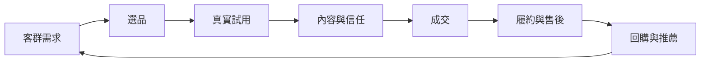
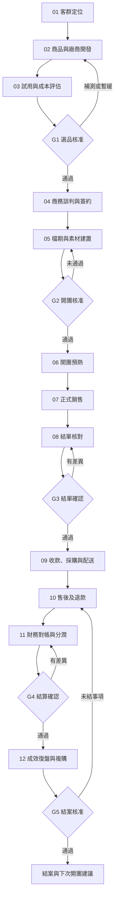
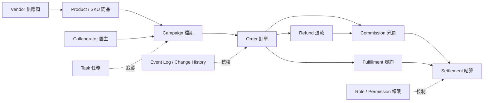

# 2026 台灣團購經營完整研究報告

> 市場經營模式 × 標準作業流程 SOP × 銷售心法 × 營運管理 × 數據分析 × 系統設計

研究範圍：台灣社群團購、KOL／KOC 團購、品牌合作團購、團媽經營及團購代營運。彙整日期：2026 年 10 月 28 日。

> 法規資訊僅供營運規劃，不構成法律或稅務意見。實際執行前，應依交易模式、商品類別與最新法令向法務、會計或主管機關確認。

## 目錄

1. [研究摘要與核心結論](#一研究摘要與核心結論)
2. [台灣市場六種團購模式](#二台灣市場六種團購模式)
3. [端到端團購 SOP：12 階段](#三端到端團購-sop12-階段)
4. [十二階段深度操作方法](#四十二階段深度操作方法)
5. [團購經營十大心法](#五團購經營十大心法)
6. [財務模型與分潤設計](#六財務模型與分潤設計)
7. [12 項營運 KPI](#七12-項營運-kpi)
8. [角色分工與交付文件](#八角色分工與交付文件)
9. [法規與風險查核](#九法規與風險查核)
10. [團購管理系統設計](#十團購管理系統設計)
11. [導入路線圖](#十一導入路線圖)
12. [研究資料來源與閱讀連結](#十二研究資料來源與閱讀連結)
13. [經營結論](#十三經營結論)
14. [AI Agent 完整工作指令](#附錄ai-agent-完整工作指令)

## 一、研究摘要與核心結論

團購並非單純以低價促銷，而是結合客群信任、選品、內容說服、銷售轉換、商品履約、售後及長期複購的營運模式。SHOPLINE 公開平台資料指出，其使用團購功能的商家有相當比例與 KOL／網紅合作；平台樣本不代表全台市場占比。

| 核心能力 | 經營重點 |
| --- | --- |
| 選品力 | 找到符合真正需求的商品 |
| 信任力 | 讓推薦具有可信度 |
| 內容力 | 將產品價值轉換成購買理由 |
| 成交力 | 降低決策及下單阻力 |
| 履約力 | 讓供貨、出貨、售後穩定運作 |
| 複購力 | 累積客戶，延續長期營收 |

**核心觀點：**短期成果是單檔業績，長期價值是能持續找到好商品、有效成交、準確履約並促成回購的營運系統。



## 二、台灣市場六種團購模式

| 模式 | 做法 | 主要收益 | 核心風險 |
| --- | --- | --- | --- |
| KOL／KOC 分潤團購 | 品牌提供商品與專屬賣場，創作者導購 | 成交抽成或合作費 | 歸因與業績差異 |
| 團媽／社群主團購 | 在 LINE、Facebook 等固定社群經營 | 分潤或價差 | 社群信任與客服量 |
| 自營進貨團購 | 先批貨再收款、出貨 | 進銷價差 | 庫存、滯銷與資金 |
| 品牌自營團購 | 品牌直接向會員或社群販售 | 商品毛利 | 價格衝突與獲客成本 |
| 代營運／團購經紀 | 為品牌媒合團主、排檔及管理專案 | 服務費或分潤 | 多方責任和對帳 |
| 社區／企業集單 | 集合需求與供應商議價 | 價差或服務費 | 最低採購量與配送安排 |

### 三種金流結構

| 結構 | 收款與結算 | 開團前必須釐清 |
| --- | --- | --- |
| 品牌直收 | 消費者付款給品牌，品牌按約定向團主支付分潤 | 實際銷售者、發票、退貨與客服責任 |
| 團主收款 | 消費者付款給團主，團主與廠商結算貨款 | 收款、開票、採購、退款與售後責任 |
| 代營運居中 | 品牌、代營運團隊與團主依合約分工 | 各方權責、資料歸屬、對帳與付款流程 |

開團前務必明確指定實際銷售者、收款方、發票、退貨與客服責任。

## 三、端到端團購 SOP：12 階段



> 可獨立重用的 Mermaid 原始碼：[group-buying-end-to-end.mmd](../diagrams/group-buying-end-to-end.mmd)

| 階段 | 關鍵執行任務 | 必須留下的紀錄／產出 |
| --- | --- | --- |
| 01 客群定位 | 研究客群輪廓、消費動機、價格帶、活躍平台及商品需求 | 客群研究、需求清單 |
| 02 商品與廠商開發 | 審核供應商背景、品牌授權、貨源、合作條件、品質、庫存及合規性 | 廠商資料表、商品／SKU 主檔 |
| 03 試用與成本評估 | 樣品試用、競品比較、毛利試算及銷售驗證 | 試用報告、毛利試算、可行性評估 |
| 04 商務談判與簽約 | 明訂售價、分潤、最低量、運費、交期、退換貨、付款和素材授權 | 合約、核准的合作條件 |
| 05 檔期與素材建置 | 設定活動日期、商品組合、價格、連結、追蹤碼、FAQ、預熱及銷售素材 | 活動主檔、素材包、賣場與測試紀錄 |
| 06 開團預熱 | 以需求教育、真實使用分享、問答互動預先建立認知 | 預熱素材、互動紀錄／數據 |
| 07 正式銷售 | 正式上線、監控訂單與轉換、回應疑慮、檢查價格和庫存 | 每日銷售、訂單、客服紀錄 |
| 08 結單核對 | 確認截止時間、有效訂單、未付款、取消與需求量 | 結單快照、有效訂單、採購或備貨清單 |
| 09 收款、採購與配送 | 依現貨直寄、預購代發或集貨模式作業，追蹤配送與簽收 | 出貨單、物流、履約與簽收紀錄 |
| 10 售後及退款 | 處理瑕疵、遺失、延遲、退換貨與客訴，依法律及約定提供解決方案 | 售後案件、退款紀錄 |
| 11 財務對帳與分潤 | 核對有效淨銷售額、折扣、退款、成本、佣金與付款 | 對帳單、結算單、付款證明 |
| 12 成效復盤與複購 | 分析商品、團主、供應商績效，整理顧客回饋與下次開團建議 | 檔期結案報告、SOP 修訂、下團建議 |

### 五個必要的營運 Gate

| Gate | 通過條件 | 未通過的處理 |
| --- | --- | --- |
| G1 選品核准 | 商品資料、供應能力與風險已審查 | 補測、退回選品或暫緩 |
| G2 開團核准 | 合約、價格、素材、庫存與賣場測試全部通過 | 不得正式發布，退回修正 |
| G3 結單確認 | 訂單、付款與數量已核對 | 不得產生採購及履約指示 |
| G4 結算確認 | 有效訂單、退款、分潤基礎和差異處理完成 | 不得核准付款 |
| G5 結案核准 | 未解客訴、款項及供應商爭議已有明確處理方式 | 留在追蹤狀態，不得假結案 |

這些 Gate 屬於本報告建議的管理制度，不是所有市售團購平台都採用的統一標準。

## 四、十二階段深度操作方法

### 客群研究與需求矩陣

調查年齡、職業、家庭型態、生活習慣、消費動機、購買阻力、消費頻率、價格敏感度及活躍平台。

**經營心法：**先找到穩定客群需求，再尋找商品；不是先有高佣金商品才找人買。

### 選品評分卡與供應商審查

| 評分項目 | 建議權重 |
| --- | ---: |
| 客群需求 | 25% |
| 品質與安全 | 25% |
| 利潤及價格競爭力 | 20% |
| 供應履約 | 15% |
| 內容展示 | 10% |
| 複購潛力 | 5% |

每項以 1–5 分評估，`總分＝Σ（權重 × 分數 ÷ 5）`。80 分以上可進入商務審查，65–79 分補測，低於 65 分暫緩；食品安全與法規是不得用總分抵銷的必要條件。

**首次合作十二問：**商品來源與檢驗？團購價及最低價？MOQ？現貨與預購交期？庫存與超賣處理？誰出貨？誰收款及開票？退貨、瑕疵、運損如何分擔？是否授權素材及提供試用品？分潤基礎及時間？是否有排他及價格保護？缺貨延遲如何處理？

### 試用驗證

| 面向 | 驗證重點 |
| --- | --- |
| 商品 | 品質、規格、包裝、使用限制 |
| 客戶 | 收貨後能否順利使用，是否容易誤解 |
| 內容 | 能否示範商品差異與使用情境 |
| 商業 | 預估毛利、需求、退貨、供應風險 |

新商品優先小團測試，保健食品、食品、醫材及兒童用品須額外審核法規。

### 組合及定價策略

單品優惠降低首購門檻；多件組與家庭組提升客單與物流效率；混搭組帶動交叉銷售；滿額贈與免運門檻提高訂單金額。同步檢視商品成本、運費補貼、平台金流、佣金、退貨成本和通路價格衝突。

### 十四天示範檔期

| 時段 | 任務 |
| --- | --- |
| D-6～D-4 | 商品教育、痛點、試用素材 |
| D-3～D0 | 預熱、FAQ、組合、倒數 |
| D1 | 開團、主推內容、下單測試 |
| D2～D5 | 使用情境、疑慮解答、適量提醒 |
| D6～D7 | 截止通知、客服收尾、確認結單 |

此為規劃範例，非統一市場標準。

**五種必要素材：**問題型（痛點）、體驗型（實際使用）、比較型（規格及價值）、信任型（證據與真實回饋）、行動型（優惠與購買流程）。

**內容轉換順序：**需求 → 價值 → 信任 → 排除疑慮 → 購買。

### 銷售監控與售後例外

每日看有效訂單、營收、客單、轉換及目標達成；檢查曝光、點擊、素材效果；監控庫存、延誤及客服異常。

| 例外 | 必要處理 |
| --- | --- |
| 未付款 | 設定提醒與保留期限 |
| 超賣 | 停賣，提供退款或替代方案 |
| 延遲 | 主動告知原因、影響與新時程 |
| 破損／運損 | 保留照片、物流與包裝證據 |
| 退貨 | 回寫佣金、庫存、淨銷售額與結算 |

現貨、預購和集貨模式需分別建立履約路徑。

## 五、團購經營十大心法

| # | 心法 | 實務意義 |
| ---: | --- | --- |
| 1 | 信任比流量重要 | 客群契合比粉絲數更有決定性 |
| 2 | 需求比低價重要 | 從客戶問題選品，不靠無止盡降價 |
| 3 | 真實比話術重要 | 真實試用、明確限制、透明合作 |
| 4 | 少而精 | 主打品與少量組合可降低選擇負擔 |
| 5 | 爆單不等於賺錢 | 連同淨利、退貨和履約衡量 |
| 6 | 節奏比刷屏重要 | 教育、成交、提醒適度安排 |
| 7 | 售後是下次成交的起點 | 主動回報交期與處理異常 |
| 8 | 合法累積顧客資料 | 以回購名單降低一次性流量依賴 |
| 9 | 把團主視為夥伴 | 透明數據、合理條件、準時結算 |
| 10 | 每檔累積 Know-how | 結案、回顧、更新 SOP |

### 經營成熟度三層

| 層級 | 重點 |
| --- | --- |
| 交易型 | 著重價格和成交 |
| 信任型 | 著重選品、內容、服務和回購 |
| 系統型 | 將供應商、任務、結算與分析標準化 |

## 六、財務模型與分潤設計

### 常見合作方式

固定佣金 CPS、達標階梯抽成、固定合作費、固定費加分潤、保底抵佣、進銷價差。需明確註明「保底抵佣」與「保底加佣」不同。

### 核心公式

| 指標 | 公式 |
| --- | --- |
| 有效淨銷售額 | 合格商品銷售額－取消與退款等約定扣項 |
| 團主佣金 | 約定分潤基礎 × 佣金率 |
| 檔期貢獻利潤 | 有效淨銷售額－商品成本－佣金－金流／履約變動費－固定物流費－行銷費 |
| 貢獻利潤率 | 檔期貢獻利潤 ÷ 有效淨銷售額 |

計算規則須另定義含稅、折扣、運費、部分退貨和跨期退款。

### 假設案例

| 項目 | 數值 |
| --- | ---: |
| 原始訂單 | NT$300,000 |
| 退貨取消率 | 5% |
| 有效淨銷售額 | NT$285,000 |
| 商品成本率 | 55% |
| 團主分潤率 | 15% |
| 其他變動費率 | 3% |
| 固定履約費 | NT$12,000 |
| 行銷費 | NT$10,000 |

`檔期貢獻利潤＝285,000 × 27%－22,000＝NT$54,950`

`貢獻利潤率＝54,950 ÷ 285,000 ≈ 19.3%`

此為假設案例，非市場平均。

## 七、12 項營運 KPI

| KPI | 定義／公式 | 用途 |
| --- | --- | --- |
| GMV | 成立訂單商品交易額 | 衡量交易規模 |
| 有效淨銷售額 | 依約定扣除取消退款等 | 供結算使用 |
| CVR | 有效訂單 ÷ 有效訪客 | 衡量轉換 |
| AOV | 淨銷售額 ÷ 有效訂單數 | 衡量客單 |
| 達成率 | 有效營收 ÷ 活動目標 | 衡量目標進度 |
| 退貨率 | 退貨訂單 ÷ 已履約訂單 | 衡量商品／期待落差 |
| 出貨準時率 | 準時出貨 ÷ 應出貨訂單 | 衡量履約品質 |
| 客訴率 | 客訴訂單 ÷ 有效訂單 | 衡量服務與品質風險 |
| 分潤成本率 | 佣金 ÷ 有效淨銷售額 | 衡量合作成本 |
| 貢獻利潤率 | 檔期貢獻利潤 ÷ 淨銷售額 | 衡量真實獲利 |
| 回購率 | 期間重複購買客戶 ÷ 合格客戶 | 衡量顧客留存 |
| 團主重開率 | 期間再次合作團主 ÷ 合格合作團主 | 衡量夥伴留存 |

### 儀表板分層

| 使用者 | 建議視圖 |
| --- | --- |
| 管理層 | 淨銷售、利潤、風險 |
| PM | 檔期狀態、未完成任務、異常 |
| 商品 | SKU 銷售、退貨 |
| 團主 | 導購及分潤 |
| 供應商 | 出貨準時與客訴 |

高營收低毛利應檢查成本；高流量低成交應檢查客群及內容；高成交高退貨應優先查品質或期待落差。

## 八、角色分工與交付文件

| 角色 | 主責 |
| --- | --- |
| 品牌／廠商 | 品質、供貨、授權；並依交易型態負責出貨與售後 |
| 代營運 PM | 商務協調、排程、素材管理、銷售監控、異常追蹤、對帳及結案分析 |
| 團購主 | 客群溝通、體驗內容、推廣及回饋 |
| 財務 | 對帳、分潤、退款、付款與憑證 |
| 客服／履約 | 訂單、出貨、到貨、退換貨、客訴與例外追蹤 |

實際收款、開票和退款責任必須依合約及法律核定，不得只依角色名稱推斷。

### 每檔必備文件

| 階段 | 文件／紀錄 |
| --- | --- |
| 合作前 | 廠商資料及合作條件表、商品與試用資料卡 |
| 開團前 | 檔期任務清單、素材合法審查紀錄、賣場和追蹤測試紀錄 |
| 銷售中 | 每日銷售表、客服與異常紀錄 |
| 結單履約 | 結單快照、出貨與售後表 |
| 財務結案 | 財務結算單、結案與回購評估報告 |

## 九、法規與風險查核

官方來源核對日：2026 年 10 月 28 日。

| 領域 | 營運重點 | 核對來源 |
| --- | --- | --- |
| 稅務 | 網路銷售貨物、勞務之稅籍登記及營業稅規則需按現行財政部公告與個別經營型態判斷。自 2025-01-01 起，全部於網路銷售者每月銷售額未超過貨物 NT$100,000、勞務 NT$50,000，可暫免辦稅籍登記；超過標準即應辦理。營利所得仍須依規定申報。 | [財政部：境內網路交易應注意事項](https://www.etax.nat.gov.tw/etwmain/tax-info/network-transaction-taxtation-area/seller/notice) |
| 消保 | 通訊交易原則有七日解除權，不能因稱為團購或預購就一律排除。例外須符合法規列舉情形且事前告知。 | [消費者保護法第 18、19 條](https://law.moj.gov.tw/LawClass/LawAll.aspx?PCode=J0170001)、[通訊交易解除權合理例外情事適用準則](https://law.moj.gov.tw/LawClass/LawAll.aspx?pcode=J0170012) |
| 廣告／薦證 | KOL 商業推薦應依適用規範適當揭露利益關係，且薦證內容須忠實反映真實意見、發現或親身體驗；限時限量與折扣不得誤導。 | [公平會：薦證廣告規範說明](https://www.ftc.gov.tw/internet/main/doc/docDetail.aspx?docid=13021&mid=1707&uid=165) |
| 食品／保健品 | 不可作不實、誇張、易生誤解或醫療效能宣稱；另須確認食品標示、保存、冷鏈與商品類別要求。 | [食品安全衛生管理法第 28 條](https://law.moj.gov.tw/LawClass/LawAll.aspx?pcode=L0040001)、[食品廣告認定準則](https://law.moj.gov.tw/LawClass/LawAll.aspx?pcode=L0040140) |
| 個資 | 購買資料、電話及地址之蒐集、處理、利用和保護須具特定目的與合法基礎，並採適當安全措施。 | [個人資料保護法](https://law.moj.gov.tw/LawClass/LawAll.aspx?PCode=I0050021) |

### 通訊交易七日解除權的合理例外

易於腐敗、保存期限較短或解約時即將逾期；依消費者要求所為之客製化給付；報紙、期刊或雜誌；經消費者拆封之影音商品或電腦軟體；符合規定的數位內容或線上服務；已拆封之個人衛生用品；國際航空客運服務。除符合類型外，企業經營者仍須事前告知，才能排除七日解除權。

## 十、團購管理系統設計

### 六大模組

| 模組 | 管理範圍 |
| --- | --- |
| 供應商管理 | 資格、合約、履約 |
| 商品管理 | SKU、規格、成本、售價、素材 |
| 團主管理 | 客群、合約、績效 |
| 檔期管理 | 排程、任務、核准、狀態 |
| 交易售後 | 訂單、出貨、退款、客訴 |
| 財務分析 | 分潤、結算、利潤、回購 |



> 可獨立重用的 Mermaid 原始碼：[group-buying-data-flow.mmd](../diagrams/group-buying-data-flow.mmd)

資料關聯：`Vendor → Product／SKU → Campaign → Collaborator → Order → Fulfillment → Refund → Commission → Settlement`。另建立任務、事件日誌、變更歷史及權限控制。

**優先自動化：**開團前檢查、檔期提醒、業績同步、結單對帳、結案報表。對退款、撥款、正式發布、Production 更新等高風險操作設置核准和稽核。

## 十一、導入路線圖

| 階段 | 工作 | 驗收重點 |
| --- | --- | --- |
| 一 | 盤點流程、角色與例外 | 現況、責任與痛點有證據 |
| 二 | 標準化供應商、商品、團主及檔期欄位 | 欄位定義一致、必填規則明確 |
| 三 | 建立 Gate、狀態機、任務提醒及異常追蹤 | 狀態可測、例外可追蹤 |
| 四 | 驗證結算公式與訂單狀態 | 退款、部分退貨、跨期結算可重算 |
| 五 | 建立營運儀表板與成效模型 | KPI 定義一致且可追溯 |
| 六 | 依歷史資料優化 SOP 與自動化 | 以結案證據持續改善 |

## 十二、研究資料來源與閱讀連結

### 市場與操作參考

| 來源 | 連結 |
| --- | --- |
| SHOPLINE 團購解決方案 | https://shopline.tw/group-buying |
| SHOPLINE 團購活動操作 | https://support.shoplineapp.com/hc/zh-tw/articles/53112941106969 |
| GoBoss 社群團購 SOP | https://www.goboss.tw/social-group-buying-guide/ |
| 團購廠商洽談指南 | https://taolilife.com/wholesale/find-supplier |
| ECPRO 社群電商經營 | https://ecpro.tw/social-commerce-group-buying/ |

市場與業者文章用於理解操作實務，不代表官方規範或全台市場統計。

### 官方法規來源

| 主題 | 來源 |
| --- | --- |
| 網路交易稅務 | [財政部稅務入口網](https://www.etax.nat.gov.tw/etwmain/tax-info/network-transaction-taxtation-area/seller/notice) |
| 消費者保護法 | [全國法規資料庫](https://law.moj.gov.tw/LawClass/LawAll.aspx?PCode=J0170001) |
| 七日解除權例外 | [通訊交易解除權合理例外情事適用準則](https://law.moj.gov.tw/LawClass/LawAll.aspx?pcode=J0170012) |
| 薦證廣告 | [公平交易委員會規範說明](https://www.ftc.gov.tw/internet/main/doc/docDetail.aspx?docid=13021&mid=1707&uid=165) |
| 食品廣告 | [食品安全衛生管理法](https://law.moj.gov.tw/LawClass/LawAll.aspx?pcode=L0040001)、[食品廣告認定準則](https://law.moj.gov.tw/LawClass/LawAll.aspx?pcode=L0040140) |
| 個人資料 | [個人資料保護法](https://law.moj.gov.tw/LawClass/LawAll.aspx?PCode=I0050021) |

## 十三、經營結論

把團購從仰賴個人經驗的工作提升成可複製、可交接、可驗證、可分析的制度：先解決「怎麼賣得好」，再確保「怎麼做得穩」，最後透過數據與合作資產實現「怎麼持續成長」。

## 附錄｜AI Agent 完整工作指令

### 角色與總任務

角色：資深團購營運顧問、流程架構師、ERP 分析師與數據策略顧問。

任務：以本報告為參考，盤點既有系統與流程，建立可落地的 SOP、角色責任矩陣、端到端流程圖、Gate 與任務表、資料模型與欄位字典、售後及例外處理規範、分潤對帳規則、KPI 儀表板、系統差距分析、分階段導入驗收計畫。

原則：區分市場發現、建議制度、既有已核准規格與待驗證假設；不得擅自覆蓋已核准架構；計算、狀態與權限必須可測；在授權範圍內自主完成分析、文件與驗證，不要每小步停下；正式退款、撥款、生產環境寫入及不可逆作業須取得 Owner 明確授權。交付時分列完成項目、驗證證據、阻擋、待決策及合併的 Owner-only 行動。

### 可直接複製的完整指令

```text
團購經營 SOP 與管理系統規格化任務

你是一位資深團購營運顧問、商業流程架構師、ERP 系統分析師及數據策略顧問。

【任務目標】
以本次《2026 台灣團購經營完整研究報告》為參考，建立一套可用於企業實際營運、具備制度化管理能力的團購經營 SOP。

【執行範圍】
1. 梳理品牌／供應商、團購主、營運 PM、財務及客服的責任分工。
2. 建立從客群研究、選品、廠商合作、商品試用、商務審查、檔期企劃、預熱、銷售、結單、履約、售後、分潤到結案的完整流程。
3. 區分品牌直收、團主收款、自營批貨及代營運合作模式。
4. 設計每個階段的進入條件、必填資料、作業任務、核准閘門、退出條件與異常處理。
5. 建立供應商、商品、團主、檔期、訂單、售後、財務、績效的資料模型與欄位字典。
6. 設計可追溯、可核對的訂單及分潤計算規則。
7. 設計團購 KPI 儀表板與結案報告標準。
8. 盤點適合自動化的流程、提醒及報表。
9. 建立合規查核清單，並標示需要法務、財務或主管確認的事項。

【工作原則】
- 先盤點既有流程與系統，不得假設所有業務模式一致。
- 已存在且已核准的系統規格不得擅自覆蓋。
- 清楚區分市場研究發現、建議制度、既有系統現況及尚未驗證的假設。
- 優先沿用既有資料架構，避免重複設計功能。
- 所有計算公式、資料欄位、狀態轉移與權限規則都必須可測試。
- 對於退款、正式撥款、生產環境更新及不可逆變更，未取得授權不得執行。
- 在授權範圍內自主完成分析、文件整理、驗證及證據更新，不要每完成一步就停止詢問。

【必須交付】
1. 完整團購 SOP
2. 角色責任矩陣
3. 端到端流程圖
4. 各階段任務與 Gate 清單
5. 資料模型及欄位字典
6. 例外與風險處理規格
7. 分潤與結算規則
8. KPI 與營運報表設計
9. 系統功能缺口分析
10. 分階段導入與驗收計畫

最後提供執行摘要，區分已完成、待驗證、存在阻擋、需要 Owner 決策的事項，並盡可能將 Owner-only 行動整合成一次清單。
```
