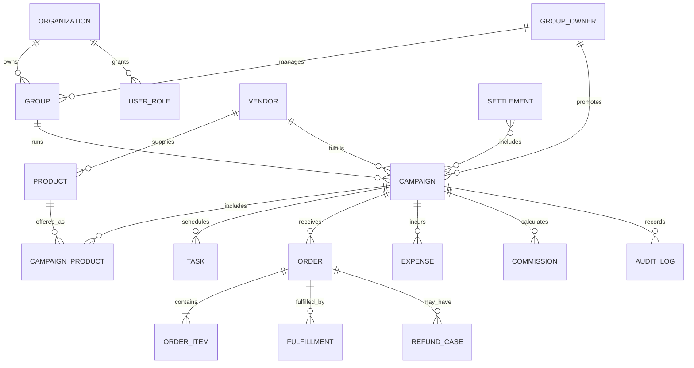
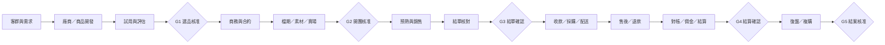
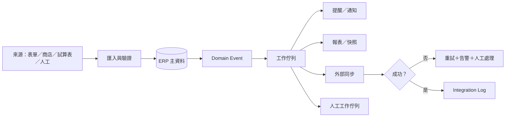
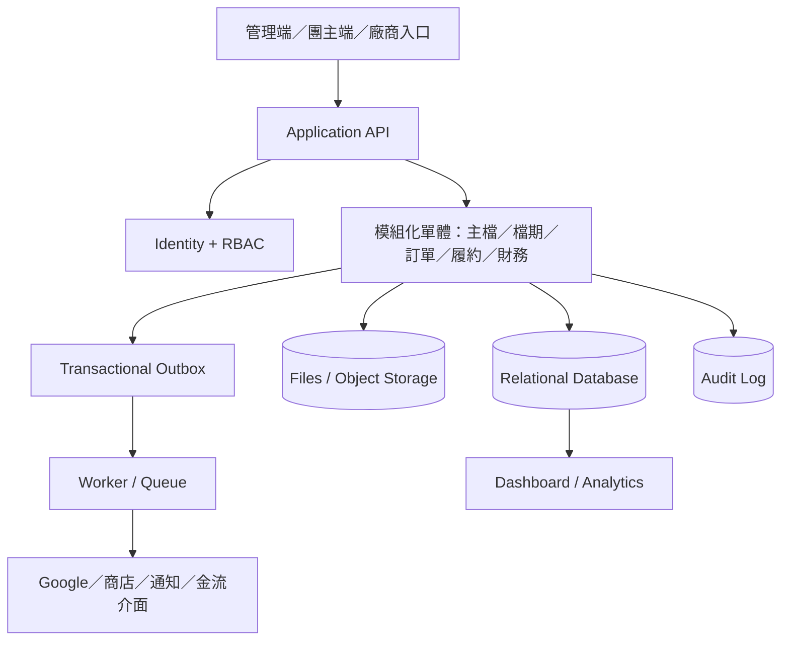

# 團購 ERP 主藍圖

> 版本：v0.1（規劃基準）  
> 整理日期：2026-10-28  
> 文件狀態：供需求確認與開發拆解；不是已上線功能說明  
> 適用範圍：多團購群組、多團主、多廠商、多檔期的營運管理

## 文件定位

本文件把既有團購研究、正在運作的 Google Sheets／Apps Script 流程，以及實際團購代營運 SOP 收斂成一份 ERP 主藍圖。目標不是立刻重寫既有系統，而是先建立共同語言、單一資料模型、狀態與 Gate、儀表板及分階段導入邊界。

規劃來源：

- [2026 台灣團購經營完整研究報告](2026-taiwan-group-buying-complete-research.md)
- `ws19135/zhaocai-groupbuy-system`：既有招財兔團購管理系統的 SRS、SAD、SDD、資料模型與開發路線
- `ws19135/groupbuy-flow-sop`：廠商填表、試用排程、案主進度視圖與實際踩雷紀錄
- 原始對話需求：管理不同團購群組、排程、廠商進度，並讓管理者與團主看到即時業績及後續狀態

### 規格層級

| 標記 | 意義 |
| --- | --- |
| **既有已核准** | 既有系統已確認或正在使用的規則；新系統不可默默改掉 |
| **主藍圖建議** | 本文件為跨群組 ERP 提出的共通設計，仍需 Owner 確認 |
| **待決策** | 會影響資料、權限、金流或技術選型，開發前必須拍板 |

---

## 第 1 章｜產品願景、問題與成功定義

### 1.1 一句話願景

**每一檔團只登記一次，後續的排程、任務、業績、廠商進度、履約、售後與結算都由同一筆資料驅動；管理者看全局，團主只看自己，異常會主動浮出來。**

### 1.2 要解決的核心問題

1. 同一檔團的資料散落在 LINE、Email、試算表、表單與個人腦中。
2. 檔期、試用、素材、出貨、請款與結算由不同人維護，日期與狀態容易不一致。
3. 管理者無法一眼看出哪一團卡住、卡在誰、下一步是什麼。
4. 團主只能等人工回報，無法自行查看即時業績、分潤預估與履約進度。
5. 廠商晚寄、素材未齊、超賣、退款、對帳差異等例外沒有統一追蹤方式。
6. 業績和結算口徑不一致，報表數字無法追溯到原始訂單與調整紀錄。

### 1.3 產品原則

- **一檔團一個主識別碼**：同一檔期的資料以 `Campaign` 為核心，不再用商品名稱當唯一鍵。
- **一處輸入、多處使用**：主資料只維護一次，其他畫面與報表均為視圖或衍生資料。
- **狀態必須有下一步**：每個狀態都要能回答「目前在哪裡、誰負責、何時到期、下一步是什麼」。
- **自動化處理搬運，人負責判斷**：提醒、同步、試算與報表可自動；核准、退款、撥款與正式發布保留人工確認。
- **例外是一級資料**：延誤、缺貨、客訴、退貨與對帳差異不可只寫在聊天訊息。
- **數字可重算、操作可追溯**：儀表板每個 KPI 都能回到來源資料、公式、更新時間與調整歷程。
- **先制度化再技術化**：未確認的流程不直接寫成程式。

### 1.4 成功指標

| 面向 | 建議指標 | MVP 驗收方向 |
| --- | --- | --- |
| 資料完整 | 開團必填完整率、主檔重複率 | 開團前 Gate 能阻擋缺漏；同一檔不重複建檔 |
| 排程透明 | 逾期任務數、無負責人任務數 | 管理者與負責人都能看到逾期與下一步 |
| 營運效率 | 每檔重複輸入次數、人工彙報時間 | 同一資料只登記一次；週報可由系統產生 |
| 業績可見 | 訂單／營收同步延遲、數據覆蓋率 | 儀表板清楚顯示更新時間與資料來源 |
| 履約品質 | 準時出貨率、客訴率、退款率 | 異常能綁定訂單、廠商與檔期 |
| 財務可信 | 結算差異率、重算一致率 | 相同資料與版本可重算出相同結果 |

### 1.5 本階段不做

- 不在本文件中切換 LIVE、部署正式服務或搬動正式資料。
- 不假設所有團購都使用同一收款、發票、出貨或分潤模式。
- 不把廠商回填直接視為會計已確認入帳。
- 不將銀行候選配對、退款或撥款做成無人審核的全自動動作。
- 不把招財兔既有內部帳務規則直接擴張成所有團購群組的共通規則。

---

## 第 2 章｜使用者、組織與權限

### 2.1 組織層級

```text
Organization（營運公司／品牌方）
└── Group（團購群組／社群／通路）
    ├── GroupOwner（團主／合作推廣者）
    └── Campaign（單一檔期）
        ├── Vendor（廠商）
        ├── Product / SKU（商品）
        └── Tasks / Orders / Fulfillment / Settlement
```

同一團主可以管理多個群組；同一廠商可以參與多個檔期；同一商品可重複開團，但每次開團必須有獨立 `CampaignID`。

### 2.2 角色

| 角色 | 主要工作 | 預設可見範圍 |
| --- | --- | --- |
| Owner／系統管理者 | 組織設定、角色、全局 KPI、核准與稽核 | 全組織 |
| 營運主管 | 資源配置、跨團監控、例外升級 | 被授權的全部群組 |
| 營運 PM | 廠商、商品、檔期、任務、素材與異常追蹤 | 自己負責的檔期 |
| 團主 | 查看自己的檔期、業績、素材、下一步及分潤預估 | 自己／被授權群組 |
| 廠商 | 回填指定檔期的供貨、樣品、庫存、出貨或請款資料 | 單一廠商＋指定檔期 |
| 財務 | 入帳、費用、退款、對帳、結算與付款憑證 | 財務範圍；必要時遮蔽個資 |
| 客服／履約 | 訂單、出貨、退換貨、客訴與異常 | 指定檔期／訂單 |
| 稽核／唯讀 | 查看歷史、Log 與結案資料 | 授權範圍內唯讀 |

### 2.3 權限原則

- 採 **RBAC（角色權限）＋資料範圍**，不可只用「有沒有登入」判斷。
- 團主預設只能看自己的群組與檔期，不可看其他團主的業績、合約或分潤。
- 廠商入口採單筆／單檔授權；外部回填不得直接改寫主檔的金額或入帳狀態。
- 金額覆寫、狀態倒退、跨群組查看、匯出個資與權限變更需額外權限並寫 Audit Log。
- 所有服務帳號、金鑰、Google Sheet ID、真實客戶或訂單資料不得進 Git 儲存庫。

### 2.4 權限矩陣（首版）

| 動作 | Owner | PM | 團主 | 廠商 | 財務 | 客服 |
| --- | :---: | :---: | :---: | :---: | :---: | :---: |
| 建立／編輯檔期 | ✅ | ✅ | 申請／有限欄位 | — | 唯讀 | 唯讀 |
| 核准開團 | ✅ | 依授權 | — | — | — | — |
| 查看即時業績 | ✅ | ✅ | 自己 | — | ✅ | 指定範圍 |
| 更新供貨／出貨 | ✅ | ✅ | 唯讀 | 指定欄位 | 唯讀 | ✅ |
| 確認入帳 | ✅ | — | — | 回填≠確認 | ✅ | — |
| 覆寫結算 | ✅ | 依授權 | — | — | ✅＋原因 | — |
| 查看 Audit Log | ✅ | 自己範圍 | — | — | 財務範圍 | 自己範圍 |

> **待決策：**團主能否自行建立檔期、是否能看成本與淨利、PM 是否可覆寫結算、廠商入口採帳號登入或一次性安全連結。

---

## 第 3 章｜核心領域模型與單一事實來源

### 3.1 核心實體

| 實體 | 用途 | 關鍵欄位示例 |
| --- | --- | --- |
| Organization | 組織／品牌營運主體 | 名稱、時區、幣別、設定 |
| Group | 團購群組或通路 | 名稱、平台、負責人、狀態 |
| User / Role | 使用者與權限 | 身分、角色、資料範圍 |
| GroupOwner | 團主／合作推廣者 | 客群、合約、分潤設定、績效 |
| Vendor | 廠商主檔 | 公司、品牌、窗口、合規、合作狀態 |
| Product / SKU | 商品與規格 | SKU、成本、售價、庫存、素材、法規 |
| Campaign | 一檔團的主檔 | 群組、團主、廠商、日期、狀態、目標 |
| CampaignProduct | 檔期商品與組合 | 檔期價、組合、限量、分潤基礎 |
| Task / Milestone | 任務與里程碑 | 負責人、期限、狀態、依賴、證據 |
| Order / OrderItem | 訂單及明細 | 來源、金額、付款、狀態、歸因 |
| Fulfillment | 履約與物流 | 出貨、追蹤碼、承諾日、簽收 |
| Refund / Case | 退款、客訴與例外 | 類型、責任方、金額、處理時限 |
| Expense | 檔期費用 | 分類、金額、憑證、付款狀態 |
| Commission | 團主佣金試算 | 基礎、費率、扣項、版本 |
| Settlement | 結算批次 | 狀態、納入檔期、試算、覆寫、確認人 |
| Event / AuditLog | 事件與稽核 | 誰、何時、對什麼、前後值、來源 |

### 3.2 關聯圖



### 3.3 識別碼建議

| 實體 | 格式示例 |
| --- | --- |
| 群組 | `GRP-0001` |
| 團主 | `OWN-0001` |
| 廠商 | `VEN-0001` |
| 商品 | `PRD-000001` |
| 檔期 | `CMP-202610-0001` |
| 任務 | `TSK-20261028-0001` |
| 費用 | `EXP-20261028-0001` |
| 結算 | `SET-20261028-0001` |

所有 ID 由系統產生，不依名稱、列號或試算表位置。時區基準為 `Asia/Taipei`；資料庫時間建議存 UTC，畫面依使用者時區顯示。

### 3.4 單一事實來源規則

- `Campaign` 是一檔團的唯一主檔；報表與外部視圖不可反向覆蓋它。
- 外部匯入先寫 `ImportBatch / Staging`，完成驗證、去重與對帳後才進正式資料。
- 訂單、退款、費用與結算保留來源系統、來源 ID、匯入批次與版本。
- 衍生值（達成率、分潤預估、逾期天數）由規則計算，不由多人各自手填。
- 已確認的財務批次不得直接刪除或覆蓋；錯誤用沖銷／調整紀錄修正。

### 3.5 資料字典最低要求

每個欄位需定義：名稱、業務定義、型別、是否必填、來源、可編輯角色、驗證規則、個資等級、保留年限、是否進入 KPI、變更紀錄。開發前先完成 `Campaign`、`Task`、`Order`、`Expense`、`Settlement` 五個核心字典。

---

## 第 4 章｜端到端流程、狀態機與 Gate

### 4.1 十二階段主流程



### 4.2 Campaign 狀態機

| 狀態 | 進入條件 | 必要下一步 |
| --- | --- | --- |
| 草稿 | 已建立基本資料 | 補齊廠商、商品、日期與責任人 |
| 評估中 | 進入試用／成本評估 | 完成選品評分與風險檢查 |
| 待選品核准 | G1 資料齊全 | 核准、補件或暫緩 |
| 籌備中 | G1 通過 | 完成合約、素材、賣場與排程 |
| 待開團核准 | G2 資料齊全 | 核准或退回修正 |
| 已排程 | 開團日已確認 | 預熱、測試連結、確認庫存 |
| 進行中 | 檔期已開始 | 監控業績、庫存、客服與異常 |
| 待結單確認 | 截止時間到 | 核對有效訂單與付款 |
| 履約中 | G3 通過 | 出貨、簽收、售後與退款 |
| 待結算 | 入帳與費用資料可用 | 試算、差異處理、人工確認 |
| 已結算 | G4 通過 | 關閉未結事項、產生結案報告 |
| 已結案 | G5 通過 | 封存並建立下次開團建議 |
| 取消／暫緩 | 具原因與責任人 | 決定恢復、改期或終止 |

狀態只能透過明確事件轉移；任何倒退、跳步或人工覆寫都需原因與 Audit Log。

### 4.3 五個 Gate

| Gate | 系統檢查 | 人工判斷 | 未通過 |
| --- | --- | --- | --- |
| G1 選品核准 | 必填、供貨、試用、毛利、合規 | 品質與客群適配 | 補測／暫緩 |
| G2 開團核准 | 合約、價格、庫存、素材、連結、追蹤 | 是否適合正式發布 | 退回籌備 |
| G3 結單確認 | 訂單、付款、取消、數量差異 | 是否可下採購／履約指示 | 留在待確認 |
| G4 結算確認 | 淨銷售、退款、費用、佣金、差異 | 是否核准結算與付款 | 退回對帳 |
| G5 結案核准 | 未結客訴、款項與爭議 | 是否可封存並評估重開 | 留在追蹤 |

### 4.4 任務與排程引擎

- 任務模板依檔期類型產生，例如：寄樣、試用、試用回饋、素材、開團、直播、催單、結單、出貨、請款。
- 任務支援相對日期（前一任務完成後 N 天）、固定日期與逐檔覆寫。
- 改動關鍵日期時，系統先顯示受影響任務，再由使用者確認是否連動。
- 每項任務需有負責人、期限、狀態、輸入、交付證據與逾期升級規則。
- 「案主未回覆試用結果」「廠商晚寄」等卡點要成為可追蹤的 Blocker，不是只有備註。

### 4.5 例外流程

| 例外 | 系統動作 | 必須保留 |
| --- | --- | --- |
| 廠商晚寄／延遲 | 重算受影響日期、通知負責人、標記風險 | 原日期、新日期、原因、承諾人 |
| 庫存不足／超賣 | 停止可售量更新、建立處理批次 | 受影響訂單、選項與通知紀錄 |
| 素材／價格錯誤 | 觸發暫停發布或下架建議 | 錯誤版本、修正人、核准人 |
| 退款／部分退貨 | 回寫淨銷售、庫存、佣金與結算差額 | 原訂單、退款原因、金額、證據 |
| 對帳差異 | 建立差異案件，不自動確認入帳 | 候選、信心、人工決定與原因 |
| 客訴／運損 | 綁定訂單、廠商與責任方 | SLA、照片／物流證據、處理結果 |

---

## 第 5 章｜功能模組與儀表板

### 5.1 功能模組

| 模組 | 核心能力 | MVP |
| --- | --- | :---: |
| 組織／群組／權限 | 群組、團主、角色、資料範圍 | ✅ |
| 廠商／商品主檔 | 廠商、商品、SKU、合規、合作紀錄 | ✅ |
| 檔期與任務 | 排程、狀態、Gate、任務、素材、異常 | ✅ |
| 業績與訂單 | 訂單匯入、歸因、GMV、淨銷售、目標 | ✅ |
| 履約與售後 | 庫存、出貨、簽收、退款、客訴 | 第二階段 |
| 財務與結算 | 費用、入帳、佣金、批次結算、憑證 | 第二階段 |
| 自動化中心 | 提醒、同步、失敗重試、人工工作佇列 | ✅（基礎） |
| 報表與復盤 | 儀表板、結案報告、團主／廠商績效 | ✅（基礎） |
| 稽核與設定 | Audit Log、規則版本、整合設定 | ✅ |

### 5.2 管理者 Dashboard

第一屏回答五個問題：

1. 本月總業績、有效淨銷售與目標達成率是多少？
2. 有幾檔正在跑、即將開始、待結算或逾期？
3. 哪些檔期卡住、卡在哪個人或廠商？
4. 哪些團的庫存、退款、客訴或毛利有風險？
5. 接下來 7／14／30 天有哪些關鍵節點與資源衝突？

建議元件：

- KPI 卡：GMV、有效淨銷售、訂單數、AOV、達成率、退款率、貢獻利潤率。
- 檔期管線：按狀態顯示數量與金額。
- 今日待辦：逾期、今日到期、等待他人與待核准。
- 業績走勢：實際對目標、按群組／團主／廠商切分。
- 風險清單：資料缺漏、供貨延遲、超賣、異常退款、對帳差異。
- 近期排程：甘特圖或行事曆，顯示依賴與衝突。

### 5.3 團主 Dashboard

- 自己的進行中／即將開始／已結束檔期。
- 即時業績、訂單數、目標達成、熱門 SKU 與最後更新時間。
- 待完成事項、素材與核准狀態。
- 出貨、售後與退款摘要。
- 分潤預估、已確認結算與付款狀態；預估與正式數字必須清楚區分。

### 5.4 PM、廠商與財務視圖

- **PM：**檔期管線、任務、缺件、逾期、例外與待核准。
- **廠商：**被授權檔期的樣品、庫存、出貨、回填與待辦，不顯示其他廠商或內部成本。
- **財務：**待入帳、對帳差異、退款、費用缺憑證、待結算與已確認批次。

### 5.5 「即時」的定義

畫面必須顯示 `資料截至時間`、`來源`、`同步狀態`。首版建議以 5–15 分鐘內同步或來源平台 webhook 為目標；無 API 的平台以排程匯入或人工上傳處理，不宣稱秒級即時。

---

## 第 6 章｜自動化與整合設計

### 6.1 自動化優先順序

| 優先 | 自動化 | 原因 |
| ---: | --- | --- |
| 1 | 開團前完整度與 Gate 檢查 | 直接降低漏資料與錯誤發布 |
| 2 | 任務、到期與逾期提醒 | 解決最常見的人工作業斷點 |
| 3 | 訂單／業績同步與去重 | 讓 Dashboard 有可信數字 |
| 4 | 結單快照與差異檢查 | 避免後續採購、履約與結算用錯數量 |
| 5 | 出貨／售後異常彙整 | 讓例外主動浮出 |
| 6 | 結算試算與結案報告 | 節省整理時間但保留人工核准 |

### 6.2 事件驅動流程



### 6.3 整合介面

| 類別 | 首版介面 | 邊界 |
| --- | --- | --- |
| Google Workspace | Sheets 匯入／匯出、Calendar、Email | 不直接把試算表列號當主鍵 |
| 電商／訂單來源 | CSV、API、Webhook | 保留來源 ID、批次、去重鍵 |
| 通知 | Email、LINE 或工作平台 | 通知失敗不回滾主交易；需可重送 |
| 檔案 | 雲端物件儲存／Drive 連結 | 憑證與素材需存權限及版本 |
| 銀行／金流 | 首版人工匯入或既有介面 | 只產候選，不自動確認入帳 |

### 6.4 自動化安全欄杆

- 每個 Job 具冪等鍵，重跑不得產生重複訂單、任務、通知或結算。
- 匯入先驗證後寫入；錯誤列留在待處理區，不能安靜消失。
- 自動更新需保存前後值、規則版本、來源與執行批次。
- 涉及退款、正式撥款、對外發布、權限與 Production 寫入時必須有人核准。
- 任何同步都需有成功數、失敗數、略過數與可重試清單。

### 6.5 從既有流程保留的實務

- 保留「內部主檔」與「團主／案主外部視圖」的資料隔離概念。
- 保留逐檔覆寫日期，但覆寫必須有原因，且不可破壞其他檔期的預設規則。
- 取消以品名或資料列位置當關聯鍵，全面改用不可變 ID。
- 重建或遷移前先讀取既有人工欄位；不可用空白或預設值覆蓋。
- 測試資料不得流入團主、廠商或正式通知管道。

---

## 第 7 章｜業績、KPI 與財務口徑

### 7.1 KPI 定義

| KPI | 公式 | 主要來源 |
| --- | --- | --- |
| GMV | 成立訂單商品交易額 | OrderItem |
| 有效淨銷售額 | 成交額－取消－退款－約定扣項 | Order / Refund |
| 訂單數 | 符合口徑的有效訂單筆數 | Order |
| AOV | 有效淨銷售額 ÷ 有效訂單數 | 衍生 |
| CVR | 有效訂單 ÷ 有效訪客 | 流量＋Order |
| 達成率 | 有效淨銷售額 ÷ 檔期目標 | Campaign |
| 出貨準時率 | 準時出貨訂單 ÷ 應出貨訂單 | Fulfillment |
| 退款率 | 退款訂單 ÷ 已履約訂單 | Refund / Fulfillment |
| 客訴率 | 客訴訂單 ÷ 有效訂單 | Case / Order |
| 佣金成本率 | 團主佣金 ÷ 有效淨銷售額 | Commission |
| 貢獻利潤 | 淨銷售－商品成本－佣金－變動費－固定履約費－行銷費 | Settlement / Expense |
| 回購率 | 期間內重複購買客戶 ÷ 合格客戶 | Customer / Order |

### 7.2 財務規則版本化

每個檔期需保存適用的計算版本：含稅／未稅、折扣、運費、取消、部分退款、跨期退款、佣金基礎、費率與四捨五入。規則變更只影響指定生效日後的檔期；歷史資料使用原版本重算。

### 7.3 結算流程

1. 凍結結單快照與資料截至時間。
2. 驗證有效訂單、退款、入帳、費用與憑證完整度。
3. 依檔期規則版本試算佣金與淨利。
4. 顯示自動值、人工覆寫值、生效值與差異。
5. 覆寫必填原因；確認前可重算，確認後不得直接覆蓋。
6. 確認後產生結算批次、明細、Audit Log 與對外可見狀態。
7. 後續退款以調整批次處理，不回頭改掉已確認歷史。

### 7.4 數據品質

- 儀表板不只顯示數字，也顯示資料完整率、同步失敗與待對帳筆數。
- 所有聚合數字可下鑽到檔期、訂單與來源批次。
- 報表需區分「預估」「截至目前」「已確認」「已付款」。
- 每日或結單時保存快照，避免來源平台後續改值造成歷史報表漂移。

---

## 第 8 章｜技術架構、安全與可維運性

### 8.1 建議的邏輯架構



首版建議採 **模組化單體＋背景工作佇列＋關聯式資料庫**，先避免微服務的部署與資料一致性成本。介面與事件邊界保留，等訂單量、團隊或整合數量真的超過單體負荷時再拆分。

### 8.2 與既有系統的關係

- Google Sheets／Apps Script 可在過渡期繼續運作，作為來源或特定流程工具，不直接被強制停用。
- 新 ERP 先以只讀匯入、對帳與 Dashboard 驗證口徑，再逐模組接管寫入。
- `zhaocai-groupbuy-system` 的已核准流程與狀態屬特定既有系統；遷移時建立對照表，不直接覆寫或改名正式資料。
- **待決策：**最終技術棧、雲端供應商、登入方式、資料庫與既有 Google Workspace 的主從關係。

### 8.3 安全基線

- SSO／OAuth 或受管理的帳號登入；管理者啟用 MFA。
- 後端強制資料範圍，不只靠前端隱藏按鈕。
- 個資、財務資料與憑證依敏感度分級；傳輸與靜態資料加密。
- 機密放 Secret Manager／環境變數，不進程式碼、文件或前端。
- 外部連結具到期、撤銷、單一範圍與使用紀錄；公開入口需限速與濫用防護。
- 重要操作採雙步確認；權限變更、資料匯出、金額覆寫與批次確認需 Audit Log。
- 備份需實際演練還原；保留 RPO／RTO 與事故回報流程。

### 8.4 非功能目標（初版）

| 項目 | 初版目標 |
| --- | --- |
| 可用性 | 主要工作時段可用；關鍵失敗有降級或人工處理方式 |
| 效能 | 一般清單與 Dashboard 互動在可接受等待內；大報表走非同步 |
| 一致性 | 財務與狀態轉移採交易；外部同步採最終一致＋可重試 |
| 可觀測性 | Request ID、Job ID、錯誤率、同步延遲、失敗佇列與告警 |
| 測試 | 狀態機、公式、權限、匯入去重與結算有自動測試 |
| 資料保護 | 最小權限、遮蔽敏感欄位、可追蹤匯出 |

---

## 第 9 章｜導入策略、驗收與待決策

### 9.1 導入原則

1. 先確認角色、流程、狀態、欄位與計算口徑，再開始正式開發。
2. 先做平行讀取與對帳，不直接替換現行主流程。
3. 每一階段以真實但去識別化的情境驗收，通過後才進下一階段。
4. 逐群組導入；首個試點完成結案後才擴大。
5. 保留回滾路徑；正式資料遷移需備份、試跑、差異報告與 Owner 核准。

詳細階段、交付物與 Exit Criteria 見 [IMPLEMENTATION_ROADMAP.md](IMPLEMENTATION_ROADMAP.md)。

### 9.2 MVP 建議範圍

- 組織、群組、團主、廠商、商品與檔期主檔。
- 角色權限與資料範圍。
- 檔期狀態機、五個 Gate、任務模板、逾期與例外追蹤。
- 訂單／業績匯入、基本去重與管理者／團主 Dashboard。
- Audit Log、同步狀態與待處理佇列。
- 結案報告雛形。

履約細節、完整售後、銀行對帳與正式結算可在核心資料與 Dashboard 口徑穩定後分階段加入。

### 9.3 驗收情境

| 情境 | 驗收重點 |
| --- | --- |
| 新團建立 | 缺欄阻擋、ID 唯一、正確帶入群組／團主／廠商 |
| 日期延誤 | 顯示受影響任務、確認後連動、保留前後值 |
| 團主查看 | 只能看到自己的團，數字與管理端同口徑 |
| 業績匯入 | 重跑不重複、錯誤列進待處理、可追溯來源 |
| 退款 | 淨銷售與佣金預估同步調整，保留原訂單 |
| 權限 | 未授權角色無法經 API 讀取或改寫資料 |
| 結算 | 試算可重算、覆寫有原因、確認後不可直接覆蓋 |
| 稽核 | 能查到誰在何時改了什麼以及前後值 |

### 9.4 開發前必須拍板

1. ERP 的首個試點群組、Owner、PM、團主與財務角色名單。
2. 團主可見資料：是否包含成本、淨利、退款明細與佣金預估。
3. 訂單與業績來源、同步頻率及各平台可取得欄位。
4. 三種金流模式中，首版要支援哪些；發票、退款與售後責任歸屬。
5. `Campaign`、`Order` 與結算的正式口徑及歷史資料遷移範圍。
6. 既有 Google Sheets／Apps Script 與新 ERP 的過渡期主從關係。
7. 技術棧、登入方式、部署環境、備份與資安責任人。

### 9.5 主要風險

| 風險 | 對策 |
| --- | --- |
| 不同群組流程差異被硬塞成同一套 | 共用核心＋可設定任務模板與規則版本 |
| 歷史資料名稱不一致、缺唯一鍵 | 遷移對照表、來源 ID、隔離待處理資料 |
| Dashboard 看似即時但資料已過期 | 顯示截至時間、同步狀態與失敗告警 |
| 自動化把錯誤放大 | Staging、Gate、冪等、人工工作佇列與回滾 |
| 團主或廠商看到不該看的資料 | 後端資料範圍、權限測試與稽核 |
| 結算規則中途改變 | 規則版本化、快照、調整批次與雙人驗收 |
| 重建／遷移覆蓋人工資料 | 先讀回、欄位映射、差異報告、備份與試跑 |

---

## 附錄 A｜規劃與既有系統的對照

| 主藍圖概念 | 既有實務來源 | 處理方式 |
| --- | --- | --- |
| 一檔團一主檔 | GroupBuy_Master／一檔團一列 | 保留概念，改用不可變 ID |
| 狀態機與結算 | 招財兔 SRS／SDD | 保留已核准規則，另做跨群組可設定化 |
| 案主／團主視圖 | groupbuy-flow-sop 案主表 | 納入團主 Dashboard 與資料範圍 |
| 自動排程 | 試用品可寄出日驅動 11 步 | 改為任務模板、依賴與逐檔覆寫 |
| 待處理安全網 | 表單回覆_待處理 | 升級為 Import Error／Human Task Queue |
| 五個營運 Gate | 完整研究報告 | 納入狀態機與核准流程 |
| 雙 Log／軟刪除 | 招財兔既有規格 | 擴充成不可竄改的 Audit Log 與調整紀錄 |

## 附錄 B｜文件維護規則

- 本文件記錄共通主藍圖；已核准的詳細欄位與 API 規格應另立 SRS／SAD／SDD。
- 每次需求拍板需註明日期、決策者、影響章節與是否需要資料遷移。
- 實作進度與證據寫入 [DEVELOPMENT_LOG.md](DEVELOPMENT_LOG.md)，不要把「建議」改寫成「已完成」。
- 若規格與既有正式系統不一致，先列差異與選項，不直接修改正式程式或資料。
