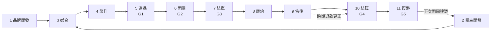
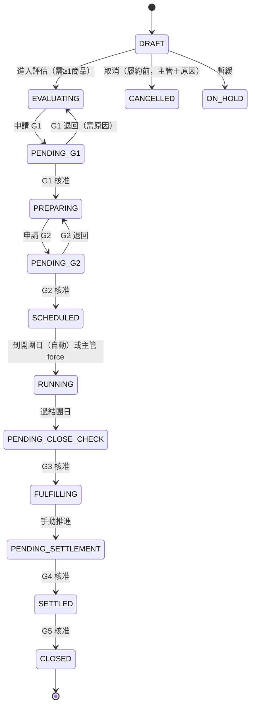
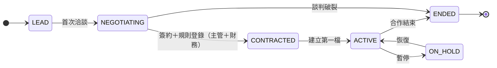

# 01 三種商業模式的營運 SOP（11 階段）

> **狀態：PROPOSED（待 Owner 確認）。** 本文件是規劃：不修改任何已核准的 SRS／SAD／SDD，不改程式，不改 G1–G5 的核准語意。
> **標示規則**：未證實的商業假設標 `【假設 A-1x】`；需要 Owner 決定的標 `【決策 B-xx】`（本文件使用 A-10～A-19、B-18～B-27，彙整於 §10 與 [08](08-RISKS_GAPS_DECISIONS.md)）；`PROPOSED` ＝建議新增、現況沒有。
> **名詞與代碼**沿用 [02](02-MODEL_AND_RESPONSIBILITY.md)、[04](04-FINANCE_AND_COMMISSION.md)：模式標籤 `AGENCY`／`KOL_CPS`／`MOM_GROUP`（可重疊）、金流 `BRAND_COLLECTS`／`HOST_COLLECTS`／`COMPANY_ESCROW`、履約 `BRAND_SHIPS`／`COMPANY_DC`／`HOST_PICKUP`、合作案 `engagement`、費用規則 `fee_rule`。
> **現況依據**（唯讀盤點，本文件所有「現況」都以這些檔案為準）：`src/server/workflow/template-default.ts`（15 步任務、8 階段）、`src/server/workflow/state.ts`（14 狀態、轉移）、`src/server/modules/gates.ts`（G1–G5 檢查與核准）、`src/server/modules/automation.ts`（8 個自動化工作、例外類型）、`src/server/modules/conflicts.ts`、`docs/phase2/SEGMENT_FIT.md`（SOP 01，已實作）、`docs/2026-taiwan-group-buying-complete-research.md` §三～§九、`docs/spec/SRS.md` UC-01～UC-21。

## 1. 總覽：11 階段與現行系統的對照

使用者要求的 11 階段，在研究報告是 12 階段（客群定位～成效復盤）、在系統是 15 個任務／8 階段／14 狀態／5 個關卡。下表標出每個階段**可直接沿用**、**需擴充**，或目前**只能在系統外人工**進行。

| # | 本文件階段 | 研究報告 12 階段 | 現行任務（`template-default.ts`） | 現行檔期狀態（`state.ts`） | 現行關卡 | 現況判定 |
|---|---|---|---|---|---|---|
| 1 | 品牌開發 | 02 商品與廠商開發（前半） | 無（任務從檔期建立才產生） | —（廠商狀態：PROSPECT→CONTACTED→ACTIVE→PAUSED／BLACKLISTED，`vendors`） | — | **部分沿用**：廠商主檔、進件（`vendor_intake`）；洽談與合作案**系統外人工**；`engagement` **需新增** |
| 2 | 團主開發 | 01 客群定位 | 無 | —（團主狀態：ACTIVE／PAUSED／ENDED，`hosts`） | — | **部分沿用**：團主主檔、客群分析（SOP 01，已實作）；團主開發管線（潛在→接觸→試用）**需新增** |
| 3 | 媒合 | 01～02 銜接 | 無 | DRAFT（邀請團主） | G1 檢查「至少一位團主已確認」 | **可直接沿用**：邀請團主（`campaign_hosts` INVITED／CONFIRMED／DECLINED／NO_RESPONSE）、衝突偵測（`conflicts.ts`）、適配評估（SOP 01） |
| 4 | 談判 | 04 商務談判與簽約 | 無 | —（`agreements` 僅有資料表，無介面） | — | **需擴充**：`fee_rule`、合作案條款；合約與核准的合作條件目前**系統外人工**（FR-MD-14 NOT_STARTED） |
| 5 | 選品 | 02～03 試用與成本評估 | 1 廠商寄樣、2 試用品到貨與試用、3 團主試用回饋、4 **G1 開團審核**、5 試用品回收（選擇性） | DRAFT→EVALUATING→PENDING_G1→PREPARING | **G1** | **可直接沿用**（商品審核、試用、G1）；模式專屬檢查**需擴充** |
| 6 | 開團 | 05 檔期與素材建置、06 開團預熱、07 正式銷售 | 6 圖文素材、7 **G2 開團前檢查**、8 正式開團、9 Live Talk（選擇性）、10 社群話題曝光、11 結團前催單 | PREPARING→PENDING_G2→SCHEDULED→RUNNING | **G2** | **可直接沿用**；KOL 揭露、歸因連結等模式檢查**需擴充** |
| 7 | 結單 | 08 結單核對 | 12 **G3 結單確認** | RUNNING→PENDING_CLOSE_CHECK→（G3）FULFILLING | **G3** | **可直接沿用**（訂單 CSV 匯入、G3） |
| 8 | 履約 | 09 收款、採購與配送 | 無對應任務（履約屬 Phase 2 模組） | FULFILLING | — | **可直接沿用**：出貨批次、出貨單、庫存紀錄（`fulfillment.ts`）；履約模式欄位**需擴充**；金流屬系統外 |
| 9 | 售後 | 10 售後及退款 | 無對應任務（售後屬 Phase 2 模組） | FULFILLING～PENDING_SETTLEMENT | — | **可直接沿用**：案件、退款申請（`aftersales.ts`）；責任方與模式分流**需擴充** |
| 10 | 結算 | 11 財務對帳與分潤 | 13 廠商後台報表結算、14 開發票請款 | FULFILLING→PENDING_SETTLEMENT→（G4）SETTLED | **G4**（現行無對應任務；以檢查「請款任務已完成」為 BLOCK） | **部分沿用**：結算試算、入帳／發票／費用紀錄（Phase 2）；階梯、保底、品牌端應收、更正**需擴充**（見 04） |
| 11 | 復盤 | 12 成效復盤與複購 | 15 **G5 復盤與結案** | SETTLED→（G5）CLOSED | **G5** | **可直接沿用**（G5、SOP 01 結案回寫）；三層 KPI 看板**需擴充**（見 03） |

> 階段 1～4 **在現行系統沒有檔期狀態與任務**（檔期從 DRAFT 才開始）。這是最大缺口，§9 提出最小可行流程。階段 5～11 的狀態與關卡現行完整，本文件只**加上模式差異的檢查條件**，不改它們。

### 1.1 通用規則（三種模式都適用，現況已實作者標 ✅）

| 規則 | 現況 |
|---|---|
| 每個狀態變更與關卡決定都寫稽核（前後值、操作者、原因） | ✅ `audit_logs`（`gates.ts` `setStatus`、`decideApproval`） |
| GATE 類轉移不能用「變更狀態」繞過；倒退需填原因 | ✅ `transitionCampaign` |
| 取消僅限進入履約前，且需營運主管／管理者與原因；取消會一併取消未完成任務、待核准申請、已排定曝光並結案例外 | ✅ `cancelCampaign` |
| 暫緩／恢復需原因；恢復回到暫緩前狀態 | ✅ `holdCampaign`、`resumeCampaign` |
| 核准後調整日期 → 開立 `SCHEDULE_CHANGED_AFTER_APPROVAL` 例外 | ✅ `campaigns.ts` |
| 逾期任務、團主未回覆、開團前檢查失敗 → 自動開立例外（預設停用、需手動啟用） | ✅ `automation.ts`（`overdue_detection`、`task_reminders`、`prelaunch_check`） |
| 通知只走測試 Adapter，不對真人發送 | ✅ `NOTIFY_ADAPTER=test` |

## 2. 角色與外部方

系統角色（`permissions.ts`）：`SYSTEM_ADMIN` 系統管理者、`OPS_MANAGER` 營運主管、`OPS_EDITOR` 營運小編、`FINANCE` 財務、`HOST` 團主（含 KOL／團媽，用團主帳號登入，只看自己的資料）、`VENDOR` 廠商（＝品牌，唯讀＋回填自己的任務；廠商入口未解凍）。外部方：**品牌**（`vendors`，多數情況不登入系統）、**KOL／KOC**、**團媽／社群主**（三者在系統都是 `hosts`，以 `partner_type` 區分）。

表中 **R**＝負責執行、**A**＝最終負責（簽核）；責任細節與帳務責任預設值見 [02](02-MODEL_AND_RESPONSIBILITY.md) §6。

## 3. 各階段 SOP

### 階段 1：品牌開發

| 項目 | 內容 |
|---|---|
| 目的 | 找到可合作的品牌，確認供貨能力、品質、合規，建立廠商主檔與合作意向 |
| 負責人 | R：營運小編；A：營運主管；外部：品牌（提供資料）。`VENDOR` 帳號在此階段不存在（尚未合作） |
| 輸入 | 品牌名單／進件表單、公司資料、商品與認證資料 |
| 步驟 | ① 建立廠商（狀態 PROSPECT）或由進件自動建檔（`vendor_intake`：去重、配對）② 洽談，狀態 CONTACTED ③ 補齊公司全名、統編、類別、主要聯絡人（G1 的 `vendor_info` 提醒會檢查）④ 取得品質／合規資料（商品的檢驗／認證備註）⑤ 初步條件（服務費、金流、履約）記錄為合作案草稿 `PROPOSED` ⑥ 合作確認 → 廠商 ACTIVE |
| 驗收條件 | 廠商主檔完整（公司全名、統編、類別、主要聯絡人皆有）；至少一筆聯絡人；合規資料已登錄或明列待補；廠商狀態 ACTIVE |
| 系統狀態與紀錄 | 廠商狀態 PROSPECT→CONTACTED→ACTIVE（✅ `vendors.status`）；封存＝軟刪除，有未結案檔期不可封存；變更寫稽核。**合作案狀態與品牌端條款：PROPOSED（見 §9）** |
| 現況 | 廠商 CRUD、聯絡人、待補資料提示、進件、重複偵測（FR-MD-01～06）已實作；暫停／黑名單廠商不能建立新檔期（FR-MD-06） |

| 差異檢查 | `AGENCY` | `KOL_CPS` | `MOM_GROUP` |
|---|---|---|---|
| 品牌端必要資料 | 服務費條款與付款條件【決策 B-18】；授權素材範圍；供貨量與交期 | 推廣分潤條款；是否提供專屬連結／折扣碼；樣品與素材授權 | 供貨價或分潤條款；是否同意團主收款（`HOST_COLLECTS`） |
| 必須事先確認的責任 | 收款方、發票、退貨、客服（[02](02-MODEL_AND_RESPONSIBILITY.md) §6.1） | 品牌是否直收、是否接受 KOL 揭露要求 | 團主收款時的發票與退款責任書面確認 |
| 合規重點 | 品牌授權、商品檢驗 | 廣告內容真實、不得誇大（研究報告 §九 薦證） | 食品／保健品標示與宣稱；七日解除權例外須事前告知 |

| 異常 | 處理 |
|---|---|
| 品牌資料不齊 | G1 以 WARN 提醒（現況）；ACTIVE 廠商缺欄位列為待補（DQ-08） |
| 品牌被暫停／黑名單 | 不可建立新檔期；進行中檔期 G1 的 `vendor_ok` 為 BLOCK（✅） |
| 重複品牌 | 自然鍵（正規化名稱／統編）擋下並回報既有 ID（✅） |

### 階段 2：團主開發

| 項目 | 內容 |
|---|---|
| 目的 | 找到與品牌客群相符、可信賴的團主，並知道他的受眾是誰、資料是否足夠 |
| 負責人 | R：營運小編；A：營運主管；外部：團主（KOL／KOC／團媽／社群主） |
| 輸入 | 團主名單、社群資訊、歷史成交資料（若有）、客群觀察 |
| 步驟 | ① 建立團主（合作對象類型 `partner_type`）② 建立「客群分析」：輪廓、動機、阻力、品類、通路、觀察來源，標示事實／估計／未知（✅ UC-19）③ 連結所屬社群與可承接檔期 ④ 管線狀態：潛在→接觸→試用→合作中（**PROPOSED**，§9）⑤ 合作條件初談（分潤類型、保底）→ 進入談判階段 |
| 驗收條件 | 團主主檔完整；客群分析狀態非「未建立」（團主清單「客群分析」欄）；合作對象類型已填；至少一個所屬社群 |
| 系統狀態與紀錄 | 團主狀態 ACTIVE／PAUSED／ENDED（✅）；客群分析、證據、連結寫稽核；封存為軟刪除 |
| 現況 | ✅ 團主 CRUD、社群、可承接區間、客群分析（`segments.ts`）、適配評估（`fit.ts`）；❌ 沒有團主管線狀態；`hosts.partner_type` 缺 `KOC`（02 §2） |

| 差異檢查 | `AGENCY` | `KOL_CPS` | `MOM_GROUP` |
|---|---|---|---|
| 評估重點 | 團主清單的量與品質能否滿足品牌檔期 | 粉絲信任度、**歷史導購歸因資料**（逐單歸因）、內容品質 | 社群規模與活躍、**客服承載能力**、收款意願與能力 |
| 建檔必填（建議） | 合作對象類型 | 合作對象類型＝KOL／KOC；歸因方式（專屬連結／碼）；稅務身分 | 合作對象類型＝團媽／社群主；是否收款；社群規則 |
| 風險標示 | 無 | 揭露能力與過往紀錄 | 過往客訴與退款紀錄 |

| 異常 | 處理 |
|---|---|
| 客群資料不足 | 適配評估標示「資料不足」（不當 0 分）；團主清單顯示「未建立」 |
| 團主暫停／結束 | 不可封存若仍參與未結案檔期（✅ FR-MD-05）；預設評估只納入 ACTIVE |

### 階段 3：媒合

| 項目 | 內容 |
|---|---|
| 目的 | 把品牌的檔期與合適的團主配對，確認團主意願與檔期可行 |
| 負責人 | R：營運小編；A：營運主管；C：品牌（可否決團主）、團主（回覆邀請）【假設 A-11】 |
| 輸入 | 品牌商品、候選團主、適配評估、團主可承接區間 |
| 步驟 | ① 建立檔期（DRAFT；選廠商、商品、日期）② 商品頁「候選團主適配」或檔期「客群適配」產生評估，營運主管覆核（✅ UC-20、UC-21）③ 邀請團主（`campaign_hosts` INVITED）④ 衝突偵測（同商品重複開團、同社群重疊、團主不可承接、團主同時多檔）⑤ 團主回覆 CONFIRMED／DECLINED（婉拒需原因）／NO_RESPONSE |
| 驗收條件 | 至少一位團主 CONFIRMED（G1 BLOCK）；無高風險衝突（G2 BLOCK，可填原因放行）；適配評估已產生並覆核（**查閱用，不影響關卡**，D-19） |
| 系統狀態與紀錄 | 檔期 DRAFT；邀請狀態 INVITED→CONFIRMED／DECLINED／NO_RESPONSE；回覆與原因寫稽核；移出團主需原因 |
| 現況 | ✅ 全部已實作（`campaigns.ts`、`conflicts.ts`、`fit.ts`）；❌ 檔期沒有指向合作案（`engagement`）的欄位；❌ 每位團主的費用規則綁定（`fee_rule`）無處記 |

| 差異檢查 | `AGENCY` | `KOL_CPS` | `MOM_GROUP` |
|---|---|---|---|
| 媒合依據 | 品牌需求量 × 團主組合 | 品類與內容適配；歸因方式可行 | 客群適配、社群內是否已有競品檔期（`COMMUNITY_OVERLAP`） |
| 額外確認 | 品牌對團主名單的同意（【假設 A-11】） | 品牌是否同意該 KOL；是否需專屬連結／碼 | 團主是否收款；客服責任誰承擔 |
| 責任欄位（PROPOSED） | 金流、履約模式預設自合作案 | 同左＋歸因方式 | 同左＋`seller_party`、`collector` |

| 異常 | 處理 |
|---|---|
| 團主 NO_RESPONSE | `task_reminders`／`overdue_detection` 超過期限開立 `HOST_NO_RESPONSE` 例外（✅，預設停用）；負責人跟進或換團主 |
| 同商品／同社群重複開團 | 衝突 HIGH，G2 BLOCK（可填原因放行）（✅） |
| 團主不可承接該期間 | 衝突 HIGH（✅） |

### 階段 4：談判

| 項目 | 內容 |
|---|---|
| 目的 | 把「誰收多少、誰付多少、誰負責什麼」寫成可執行的條款：品牌端服務費、團主端分潤（固定費／分潤／階梯／保底／混合）、金流、履約、退貨、客服、揭露 |
| 負責人 | R：營運主管（談判）、財務（C：規則可算性）；A：營運主管；外部：品牌、團主 |
| 輸入 | 適配評估、歷史績效、合作案草稿 |
| 步驟 | ① 擬定品牌端費用規則與團主端費用規則（規則型別見 [04](04-FINANCE_AND_COMMISSION.md) §3）② 指定責任欄位：實際銷售者、收款方、發票、退貨、客服、履約、分潤付款方、揭露責任 ③ 財務以範例金額試算確認條款可算（離線原型已驗證六種型態）④ 雙方確認（系統外簽約）⑤ 把核准的條款登錄為 `fee_rule` 版本並綁定合作案／檔期團主 |
| 驗收條件 | 每條腿都有費用規則且版本化；階梯寫明累進或全額累進；保底寫明抵佣或加佣與門檻（【決策 B-02】【決策 B-03】）；責任欄位全部有值；已簽約文件連結（`agreements.document_url`）留存 |
| 系統狀態與紀錄 | 合作案狀態 LEAD→NEGOTIATING→CONTRACTED→ACTIVE→ENDED（**PROPOSED**，§9）；規則版本不可覆寫舊版（比照 `commission_rules.rule_version`） |
| 現況 | ❌ 合約僅 `agreements` 資料表，無 CRUD；✅ `commission_rules` 單一費率（`HOST_DEFAULT`／`CAMPAIGN_HOST`）；❌ 階梯、保底、固定費、品牌端規則皆無（見 04 §7） |

| 差異檢查 | `AGENCY` | `KOL_CPS` | `MOM_GROUP` |
|---|---|---|---|
| 必談條款 | 服務費型態與基礎；付款時點；誰付團主分潤 | 分潤型態（常見階梯）；歸因規則與優先序（【決策 B-14】）；揭露責任 | 分潤或價差；團主收款時的對帳與付款；退款責任 |
| 金額紅線 | 服務費不得以 GMV 認列為公司收入 | KOL 分潤付款方（公司或品牌） | 價差若由公司參與須另定（【假設 A-06】） |
| 需人工核准 | 條款登錄（營運主管＋財務） | 同左 | 同左 |

| 異常 | 處理 |
|---|---|
| 條款在檔期開始後變更 | 新增規則版本，不覆寫舊版；已確認結算以當時版本為準；更正走 04 §4.2 |
| 條款無法被系統表達（例如保底加封頂） | 列為待確認需求，不先做；暫以覆寫＋調整項處理並必填原因 |

### 階段 5：選品

| 項目 | 內容 |
|---|---|
| 目的 | 決定這個商品值不值得開團：品質、供貨、試用回饋、客群適配、合規 |
| 負責人 | R：營運小編（寄樣追蹤）、廠商＝品牌（寄樣）、團主（試用與回饋）；A：營運主管（G1） |
| 輸入 | 商品與規格、試用品、適配評估、廠商資料 |
| 步驟 | 對應現行任務：①**廠商寄樣**（VENDOR，7 天）→②**試用品到貨與試用**（HOST，14 天）→③**團主試用回饋・確認是否開團**（HOST，3 天）→④**開團審核（G1 選品核准）**（OPS_MANAGER，1 天）；⑤試用品回收（VENDOR，選擇性，7 天）。流程：檔期 DRAFT→EVALUATING（至少一個商品）→申請 G1（PENDING_G1）→核准 PREPARING／退回 EVALUATING |
| 驗收條件 | **G1 BLOCK**：前置任務完成、廠商狀態可合作、至少一個商品且規格啟用、至少一位團主已確認；**G1 WARN**：廠商資料完整（`gates.ts` `runGateChecks`）。適配評估已覆核屬查閱，不納入檢查（D-19） |
| 系統狀態與紀錄 | 狀態 DRAFT→EVALUATING→PENDING_G1→PREPARING；核准紀錄含檢查快照（`check_snapshot`）；退回需原因；核准者 SYSTEM_ADMIN／OPS_MANAGER；可設定「申請人≠核准人」 |
| 現況 | ✅ 全部（`lifecycle.test.ts` 涵蓋）；商品審核 DRAFT→PENDING_REVIEW→APPROVED（`products.review`） |

| 差異檢查（**PROPOSED**；以 WARN 先行，不改 G1 語意【決策 B-19】） | `AGENCY` | `KOL_CPS` | `MOM_GROUP` |
|---|---|---|---|
| 合約與條款 | 合作案條款已確認（有 `fee_rule` 版本）；品牌授權素材 | 同左；KOL 分潤規則已確認 | 同左；團主收款責任書面確認 |
| 商品與合規 | 商品檢驗／認證備註已登錄（SOP 01 硬性檢查「合規」） | 同左；**試用品是否需揭露為贈品／業配** | 同左；食品保健品宣稱審查 |
| 適配 | 適配評估已覆核 | 同左；歷史歸因資料是否足夠 | 同左；客服承載能力已確認 |

| 異常 | 處理 |
|---|---|
| 試用回饋逾期 | `task_reminders` 催辦、`overdue_detection` 開立例外、必要時 `HOST_NO_RESPONSE`（✅，預設停用） |
| 試用不通過 | 退回 EVALUATING 或取消檔期（需營運主管＋原因） |
| 品牌改價、改規格 | 商品改回待審；規格停用會讓 G1 `has_products` 不通過 |

### 階段 6：開團

| 項目 | 內容 |
|---|---|
| 目的 | 把素材、賣場、價格、庫存、曝光安排備齊，通過開團核准後上線並持續銷售 |
| 負責人 | R：營運小編（素材、曝光）、團主（Live Talk、貼文）、品牌（賣場、價格、庫存）；A：營運主管（G2） |
| 輸入 | G1 通過的檔期、素材授權、賣場與追蹤設定 |
| 步驟 | 對應現行任務：⑥圖文素材準備（OPS_EDITOR，7 天）→⑦**開團前檢查（G2 開團核准）**（OPS_MANAGER）→⑧正式開團・群組內曝光（OPS_EDITOR）→⑨Live Talk（HOST，選擇性）→⑩社群話題曝光（OPS_EDITOR）→⑪結團前催單（OPS_EDITOR）。狀態 PREPARING→PENDING_G2→SCHEDULED→（到開團日自動或主管手動）RUNNING |
| 驗收條件 | **G2 BLOCK**：已設定開團日與結團日、開團日不早於今天、所有商品審核通過、每個商品有團購價、至少一位團主已確認、已排定曝光、無高風險衝突（可填原因放行）；**WARN**：無中度衝突（`gates.ts`） |
| 系統狀態與紀錄 | 曝光安排 PLANNED→DONE／MISSED／CANCELLED；核准後改日期開立 `SCHEDULE_CHANGED_AFTER_APPROVAL` 例外；提前開團需營運主管＋原因（`force`） |
| 現況 | ✅ 全部；`prelaunch_check` 檢查失敗開立 `PRELAUNCH_CHECK_FAILED`（HIGH）；`campaign_status_progress` 到日自動開團 |

| 差異檢查（**PROPOSED**，WARN 先行【決策 B-19】） | `AGENCY` | `KOL_CPS` | `MOM_GROUP` |
|---|---|---|---|
| 歸因與追蹤 | 賣場與追蹤測試已留紀錄 | **每位 KOL 的專屬連結／折扣碼已建立並測試**；歸因方式（`attributions.method`＝CODE／LINK）已寫入合約 | 群組內單一歸屬；若多團主同群組，歸因規則已定 |
| 內容與法遵 | 素材合法審查紀錄 | **薦證與利益關係揭露文字已審**（任務證據連結＋審稿人）【決策 B-20】；限時限量不誤導 | 群組公告規則；食品保健品不實宣稱審查 |
| 帳務責任 | 金流、發票、退貨、客服責任已指定 | 品牌直收時確認 KOL 不碰款項 | **團主收款**：收款帳務、發票、退款流程已與團主確認【決策 B-21】 |
| 庫存與價格 | 品牌確認庫存與價格 | 同左 | 同左；價格一致（避免價格衝突） |

| 異常 | 處理 |
|---|---|
| 素材延誤 | 任務逾期例外；G2 前置任務未完成則 BLOCK |
| 品牌斷貨／價格變更 | 見 §4 E-05、E-08 |
| 開團日當天曝光未執行 | 曝光標 MISSED；負責人補發並記錄原因 |

### 階段 7：結單

| 項目 | 內容 |
|---|---|
| 目的 | 在結團後核對訂單、付款與數量，凍結「這檔賣了多少」，才產生採購、履約與結算依據 |
| 負責人 | R：營運小編（匯入訂單）、財務（核對）；A：營運主管（G3，財務亦可核准） |
| 輸入 | 品牌後台訂單報表（CSV）、團主歸因資料、退款資料 |
| 步驟 | 結團日後狀態自動／手動推進 PENDING_CLOSE_CHECK→匯入訂單（去重、錯誤佇列、checksum、`data_as_of`）→⑫**結單核對（G3）**→核准後 FULFILLING |
| 驗收條件 | **G3 BLOCK**：已過結團日、前置任務完成；**WARN**：已有訂單資料、訂單資料截至結團日之後 |
| 系統狀態與紀錄 | 匯入批次與錯誤可追溯；訂單 `data_origin`；歸因 `attributions`（`CODE`／`LINK`／`MANUAL`／`IMPORT`） |
| 現況 | ✅ CSV 匯入（FR-ORD）；❌ 電商 API／Webhook BLOCKED；❌ 沒有「結單快照」表（以匯入批次與 `data_as_of` 替代）；❌ 退款事件日期（04 §5.2） |

| 差異檢查 | `AGENCY` | `KOL_CPS` | `MOM_GROUP` |
|---|---|---|---|
| 對帳來源 | 品牌後台報表＝唯一來源 | 品牌後台＋**每位 KOL 的歸因明細**；未歸因淨銷售需歸零或解釋（管理端已列「未歸因淨銷售」） | 品牌後台；**團主收款時另需團主的收款回報**【假設 A-14】 |
| 驗收加項（PROPOSED） | 品牌確認結單數字 | KOL 分潤基礎與歸因結果已確認 | 團主收款金額與訂單核對一致 |
| 常見差異 | 取消／未付款 | 歸因爭議、重複歸因 | 團主私下收款與訂單不一致 |

| 異常 | 處理 |
|---|---|
| 匯入失敗／部分成功 | 錯誤佇列逐筆處理；G3 WARN「資料不新」 |
| 訂單資料延遲 | 不可核准 G3 之前補齊；負責人確認品牌報表時間 |
| 歸因對不上 | 見 §4 E-01 |

### 階段 8：履約

| 項目 | 內容 |
|---|---|
| 目的 | 依履約模式把貨送到消費者手上，並留下可追蹤的出貨與簽收紀錄 |
| 負責人 | R：品牌（`BRAND_SHIPS`）或營運小編（`COMPANY_DC`）或團主（`HOST_PICKUP`）；A：營運主管；`VENDOR` 目前只能唯讀（廠商入口未解凍） |
| 輸入 | G3 通過的結單資料 |
| 步驟 | 建立出貨批次（ORDER 或寄樣 SAMPLE）→出貨單（物流商、追蹤碼）→PENDING→PACKED→SHIPPED→DELIVERED／EXCEPTION／CANCELLED；簽收確認；庫存異動（只增不改） |
| 驗收條件 | 全部出貨單為 DELIVERED 或有原因的 CANCELLED；EXCEPTION 皆有處理；追蹤碼不重複（物流商＋追蹤碼唯一） |
| 系統狀態與紀錄 | 檔期 FULFILLING；出貨狀態機；例外原因必填；庫存異動 append-only（資料庫觸發器） |
| 現況 | ✅ `fulfillment.ts`（FR-FUL）；❌ 履約模式欄位（`BRAND_SHIPS`／`COMPANY_DC`／`HOST_PICKUP`）；❌ 不接物流 API；❌ 團主／廠商不能自行簽收 |

| 差異檢查 | `AGENCY` | `KOL_CPS` | `MOM_GROUP` |
|---|---|---|---|
| 典型履約 | 品牌直寄或公司集貨 | 品牌直寄 | 團主集貨自取／配送，或品牌直寄 |
| 準時基準 | 以合約交期（出貨準時率，見 03） | 同左 | 同左；自取需定取貨期限 |
| 加項檢查（PROPOSED） | 公司集貨時庫存與出貨對得起來 | 無 | 團主集貨時簽收回報完成 |

| 異常 | 處理 |
|---|---|
| 出貨延遲／缺貨 | 見 §4 E-05；無自動偵測（現況沒有出貨逾期例外） |
| 運損／遺失 | 出貨單 EXCEPTION（必填原因）→ 轉售後案件 |
| 追蹤碼重複 | 資料庫唯一索引擋下 |

### 階段 9：售後

| 項目 | 內容 |
|---|---|
| 目的 | 處理瑕疵、遺失、延遲、退換貨、客訴與退款，依法律與合約提供解決方案，並讓每筆退款可追溯 |
| 負責人 | R：營運小編（建案、協調）；A：營運主管（退款核准）；財務（退款完成，`refund.complete`）；第一線責任方依模式不同（品牌／團主）；外部：品牌（商品問題）、團主（第一線客服） |
| 輸入 | 消費者問題（去識別化買家代號）、訂單、出貨紀錄 |
| 步驟 | 建立案件（REFUND／COMPLAINT／EXCHANGE／OTHER，優先度）→處理紀錄（內部／對外）→狀態 OPEN→IN_PROGRESS→WAITING_VENDOR→RESOLVED→CLOSED；退款申請 PENDING→核准／退回→財務完成；退款不得大於訂單金額；是否寫回訂單預設關閉 |
| 驗收條件 | 案件有負責人與到期日；退款有核准人與完成人；案件文字無電話／Email；已完成退款與案件關聯 |
| 系統狀態與紀錄 | `service_cases`、`case_events`（append-only）、`refund_requests`；稽核含前後值 |
| 現況 | ✅ `aftersales.ts`（FR-AFT）；❌ 逾期案件只在畫面標示、未接例外自動化（KNOWN_ISSUES P2-5）；❌ 不處理真實金流退款；❌ 責任方欄位與模式分流 |

| 差異檢查 | `AGENCY` | `KOL_CPS` | `MOM_GROUP` |
|---|---|---|---|
| 第一線客服 | 公司協調，品牌處理商品問題【假設 A-17】 | 品牌（KOL 只回應內容疑問） | **團主**（量大）；超過門檻升級給公司 |
| 退款責任 | 品牌 | 品牌 | 團主收款時由團主；否則品牌 |
| 影響分潤 | 退款扣減 NSV，影響品牌服務費與團主分潤（04 §4） | 同左；退款歸因回原 KOL | 同左 |
| 法遵 | 七日解除權不得一律排除（研究報告 §九） | 同左 | 同左；食品易腐等例外須事前告知 |

| 異常 | 處理 |
|---|---|
| 退款爆量 | 見 §4 E-06 |
| 案件逾期 | 畫面標示；建議接例外自動化（【決策 B-27】） |
| 結算後才發生退款 | 見 §4 E-07（跨期更正） |

### 階段 10：結算

| 項目 | 內容 |
|---|---|
| 目的 | 依合約算出品牌應付公司的服務費、公司應付團主的分潤、公司的貢獻利潤，確認後鎖定，付款與入帳核對 |
| 負責人 | R：營運小編（廠商後台結算、請款）、財務（試算、確認、付款核對）；A：財務＋營運主管（G4：SYSTEM_ADMIN、FINANCE 可核准） |
| 輸入 | 結單訂單與歸因、費用規則版本、退款、費用紀錄 |
| 步驟 | 對應現行任務：⑬廠商後台報表結算（OPS_EDITOR，14 天）→⑭開發票請款（OPS_EDITOR，14 天）；財務開立結算試算（草稿）→覆寫／調整項（必填原因）→確認並鎖定→付款／入帳紀錄與人工核對；檔期 PENDING_SETTLEMENT→（G4）SETTLED |
| 驗收條件 | **G4 BLOCK**：請款任務完成；**WARN**：結算試算已確認（現行**不自動串接** G4，D-07）；結算確認前試算未過期（`STALE_CALCULATION` 比對） |
| 系統狀態與紀錄 | 結算 DRAFT→CONFIRMED→（VOID）；確認後資料庫層鎖定；調整項 append-only；付款 `payments`、發票 `invoices`、費用 `expenses`（皆作廢不刪除） |
| 現況 | ✅ `settlements.ts`、`finance.ts`（單一費率）；❌ 階梯／保底／固定費／混合、品牌端應收、更正項（04 §7）；❌ 不接銀行、電子發票、金流 |

| 差異檢查 | `AGENCY` | `KOL_CPS` | `MOM_GROUP` |
|---|---|---|---|
| 公司收入來源 | 品牌端服務費（04 §2） | 品牌端推廣分潤（公司可抽差額） | 品牌分潤或團主端差額 |
| 團主分潤 | 若付款方＝公司，為公司成本 | 同左；階梯常見 | 同左；團主自留價差不進公司帳 |
| 付款核對 | 品牌付款入帳（`IN`、VENDOR）；團主付款出帳（`OUT`、HOST） | 同左；KOL 稅務與扣繳資料 | 團主收款時，公司向團主收取應繳部分（`IN`、HOST）【假設 A-14】 |
| 需人工核准 | 確認、作廢、覆寫、更正（見 §7） | 同左 | 同左 |

| 異常 | 處理 |
|---|---|
| 試算過期（訂單或規則變動） | 412 `STALE_CALCULATION`，重新試算 |
| 負結算（超領） | 見 04 §4.3 與 §4 E-07 |
| 付款對不上 | `UNMATCHED` 清單；財務人工核對 |

### 階段 11：復盤

| 項目 | 內容 |
|---|---|
| 目的 | 檢討這檔做得如何：商品、團主、品牌、模式的成效，回寫預測與實際的差距，給下次開團建議並修訂 SOP |
| 負責人 | R：營運小編、營運主管；A：營運主管（G5） |
| 輸入 | 結算結果、KPI、售後與例外、適配評估 |
| 步驟 | ⑮**復盤與結案（G5 結案核准）**（OPS_MANAGER）→檔期 SETTLED→CLOSED；按「回寫結案成效」把實際淨銷售、訂單數、退款率、目標達成寫回適配評估（✅ UC-21）；團主客群資料修正；下次開團建議 |
| 驗收條件 | **G5 BLOCK**：無未結的高風險例外、無未完成任務；結案報告（以任務證據連結留存） |
| 系統狀態與紀錄 | 檔期 CLOSED（終態）；結案回寫寫稽核（`fit.outcome`）；重複回寫冪等 |
| 現況 | ✅ G5、結案回寫；❌ 結案報告範本；❌ 三層 KPI 看板（03）；❌ 自動提醒回寫（D-20） |

| 差異檢查 | `AGENCY` | `KOL_CPS` | `MOM_GROUP` |
|---|---|---|---|
| 復盤重點 | 品牌滿意度、服務費抽成率、貢獻利潤率 | 每位 KOL 的歸因業績、分潤成本率、揭露合規紀錄 | 客服量、退款率、重開意願 |
| 回寫與修正 | 適配評估對照實際；品牌下次開團建議 | 歸因規則是否需修訂 | 客群資料修正（事實／估計） |

## 4. 三種模式專屬異常處理

偵測欄：**現有**＝系統已會自動開例外（`automation.ts` 或相關模組，預設停用）；**可新增**＝現有資料足以偵測，需新增工作；**人工**＝沒有資料或屬現場判斷。時限與門檻是建議值，均標 `【決策 B-23】`。

| # | 異常 | 適用模式 | 偵測 | 處理人（R／A） | 建議時限 | 升級路徑 |
|---|---|---|---|---|---|---|
| E-01 | 歸因爭議／重複歸因（同一單多個連結／碼） | `KOL_CPS`（主）、`MOM_GROUP` | **人工**（現有歸因有 `method` 與 `share_percent`，無爭議旗標）；未歸因淨銷售管理端已顯示 | 營運小編／營運主管 | 3 個工作日 | 主管裁決；依合約歸因優先序【決策 B-14】；調整分攤並留稽核 |
| E-02 | 揭露（薦證）未完成或內容爭議 | `KOL_CPS` | **人工**（PROPOSED 檢查項：G2 WARN 揭露任務完成） | 營運小編審稿／營運主管 | 開團前 | 暫緩該 KOL 曝光（曝光 CANCELLED 並記原因）；必要時檔期 ON_HOLD；法遵問題轉系統外專業處理 |
| E-03 | 團媽收款糾紛（收款、對帳、退款不一致） | `MOM_GROUP`（`HOST_COLLECTS`） | **人工**；可新增：團主收款回報與訂單差異 | 營運主管／財務 | 5 個工作日 | 暫停該團主後續檔期（團主 PAUSED，不可封存若仍有檔期）；書面責任書面確認；法律諮詢 |
| E-04 | 客服爆量／客訴率異常 | `MOM_GROUP`、`KOL_CPS` | **可新增**：案件數 ÷ 有效訂單數（資料有：`service_cases`、`orders`）；現有只在畫面標示逾期 | 營運小編／營運主管 | 24 小時內認領 | 增派人力；通知品牌；超過門檻暫緩曝光 |
| E-05 | 品牌斷貨／缺貨／延遲出貨 | 全部 | **人工**（庫存異動不隨出貨自動扣；無出貨逾期偵測）；可新增：出貨單超過計畫日未出貨 | 營運小編／品牌 | 當日回報 | 檔期 ON_HOLD（需原因）或縮量；通知團主公告；退款處理；【決策 B-24】 |
| E-06 | 退款爆量 | 全部 | **可新增**：退款率（`refund_amount`）超過門檻；現有 Dashboard 有退款率 KPI | 營運主管／財務 | 次日 | 查品質或期待落差（研究報告 §七）；暫停曝光；分潤基礎預估重算；【決策 B-25】 |
| E-07 | 結算後的跨期退款／更正 | 全部（階梯、保底最敏感） | **可新增**：已確認結算的檔期出現新退款完成 | 財務／營運主管 | 下個結算期 | 產生更正項（重算再扣差額，04 §4.2）；超過門檻雙人核准【決策 B-06】；負結算依 B-07 |
| E-08 | 價格衝突（同商品多團主售價不一致，或與品牌其他通路衝突） | `AGENCY`、`MOM_GROUP` | **人工**（現有衝突偵測不含價格） | 營運小編／品牌 | 開團前 | G2 前修正；品牌決定；曝光暫停 |
| E-09 | 團主未回覆邀請／試用回饋逾期 | 全部 | **現有**：`HOST_NO_RESPONSE`、`TASK_OVERDUE` | 負責人／營運小編 | 逾期後依設定升級 HIGH | 換團主、改檔期；NO_RESPONSE 累計影響團主評估 |
| E-10 | 核准後改日期 | 全部 | **現有**：`SCHEDULE_CHANGED_AFTER_APPROVAL` | 營運主管 | 當日 | 預覽影響、通知相關方；必要時重新申請關卡 |
| E-11 | 開團前檢查失敗 | 全部 | **現有**：`PRELAUNCH_CHECK_FAILED`（HIGH） | 營運小編 | 開團日前 | 補齊後重檢；必要時提前暫緩 |
| E-12 | 通知多次失敗（DEAD） | 全部 | **現有**：`NOTIFICATION_DEAD` | 營運小編 | 當日 | 改用人工聯繫 |
| E-13 | 品牌被暫停／黑名單 | 全部 | **現有**：G1 `vendor_ok` BLOCK、新檔期擋下 | 營運主管 | 立即 | 進行中檔期暫緩；評估退款與通知 |
| E-14 | 訂單資料延遲或匯入錯誤 | 全部 | **現有**：Dashboard 資料品質警告（3 天未更新、匯入錯誤） | 營運小編 | 次日 | 向品牌索取報表；G3 WARN |
| E-15 | 保底／階梯合約的業績落差（遠低於保底或剛好差一級） | `AGENCY`、`KOL_CPS` | **可新增**（需 `fee_rule`） | 財務／營運主管 | 結單前 | 通知雙方預估金額；列為決策依據，**不自動調整金額** |

## 5. 模式重疊時的合併規則

同一檔可同時含 `AGENCY`、`KOL_CPS`、`MOM_GROUP` 標籤（[02](02-MODEL_AND_RESPONSIBILITY.md) §2.1、§4）。

| 規則 | 說明 |
|---|---|
| 檢查條件取聯集 | 標籤各自要求的檢查全部要通過；同一件事不重複檢查。例：`AGENCY`＋`KOL_CPS` ＝ 品牌條款已確認 **且** KOL 專屬連結已測試 **且** 揭露已審 |
| 責任以「腿」為單位 | 品牌端責任（服務費、發票、貨款）由品牌腿決定；每位團主的責任（分潤、揭露、客服）由該團主的腿決定，不因同檔有其他模式而改變 |
| 責任衝突仲裁（【決策 B-22】） | 預設：① 合約欄位明定者為準；② 欄位未填則**更嚴格的要求優先**（例如任一腿要求揭露，就要揭露）；③ 仍衝突（如兩方都主張收款）→ 開立例外，由營運主管決定並寫入稽核，**在決定前不得通過 G2** |
| 金流模式取最保守 | 同檔多位團主金流不同時（有的 `HOST_COLLECTS`、有的 `BRAND_COLLECTS`），以每位團主的腿各自對帳；公司帳不得把團主收款視為公司代收款 |
| 異常歸屬 | 異常記在該團主的腿；若影響整檔（品牌斷貨），記在品牌腿並通知所有團主 |
| 主模式與報表 | 可加總報表用主模式；不可加總視角用參與模式（[03](03-KPI_DICTIONARY.md)） |

## 6. 任務、負責人、驗收條件、狀態與操作紀錄對照

### 6.1 現有 15 個任務（`template-default.ts`，模板 GROUPBUY_STANDARD v1）

| # | 任務（stepKey） | 階段 | 負責角色 | 類型 | 前置 | 預設天數 | 驗收（現況） |
|---|---|---|---|---|---|---|---|
| 1 | 廠商寄樣（SAMPLE_SHIP） | 籌備與寄樣 | VENDOR | TASK | 檔期的「試用品可寄出日」 | 7 | 任務完成＋證據備註 |
| 2 | 試用品到貨與試用（TRIAL_ARRIVAL） | 試用與回饋 | HOST | TASK | 1 | 14 | 同上 |
| 3 | 團主試用回饋・確認是否開團（TRIAL_FEEDBACK） | 試用與回饋 | HOST | TASK | 2 | 3 | 同上；逾期會催辦與開例外 |
| 4 | 開團審核（G1 選品核准）（LAUNCH_APPROVAL） | 開團審核 | OPS_MANAGER | GATE G1 | 3 | 1 | G1 檢查＋核准 |
| 5 | 試用品回收（SAMPLE_RECOVERY，選擇性） | 開團審核 | VENDOR | TASK | 3 | 7 | 檔期標「需回收」才建立 |
| 6 | 圖文素材準備（CREATIVE_ASSETS） | 素材與賣場準備 | OPS_EDITOR | TASK | 4 | 7 | 任務完成 |
| 7 | 開團前檢查（G2 開團核准）（PRELAUNCH_CHECK） | 素材與賣場準備 | OPS_MANAGER | GATE G2 | 6 | — | G2 檢查＋核准 |
| 8 | 正式開團・群組內曝光（LAUNCH） | 開團與曝光 | OPS_EDITOR | TASK | 7 | — | 任務完成；曝光 DONE |
| 9 | Live Talk（LIVE_TALK，選擇性） | 開團與曝光 | HOST | TASK | 7 | — | 檔期有 Live Talk 日才建立 |
| 10 | 社群話題曝光（TOPIC_PROMO） | 開團與曝光 | OPS_EDITOR | TASK | 7 | — | 任務完成 |
| 11 | 結團前催單（CLOSING_REMINDER） | 銷售與催單 | OPS_EDITOR | TASK | 8 | — | 任務完成 |
| 12 | 結單核對（G3 結單確認）（CLOSE_CONFIRM） | 結單與請款 | OPS_MANAGER | GATE G3 | 過結團日 | — | G3 檢查＋核准 |
| 13 | 廠商後台報表結算（VENDOR_SETTLE） | 結單與請款 | OPS_EDITOR | TASK | 結團日+1 | 14 | 任務完成 |
| 14 | 開發票請款（INVOICE_REQUEST） | 結單與請款 | OPS_EDITOR | TASK | 13 | 14 | 任務完成；G4 的 BLOCK 檢查 |
| 15 | 復盤與結案（G5 結案核准）（CLOSURE_REVIEW） | 復盤與結案 | OPS_MANAGER | GATE G5 | 14 | — | G5 檢查＋核准 |

> 現況觀察：①**G4 沒有對應任務**，它以「檢查請款任務」與核准者（SYSTEM_ADMIN、FINANCE）運作（`gates.ts`、`permissions.ts`）。②模板中**沒有履約、售後任務**（這兩段由 Phase 2 模組承擔，不是任務）。③階段 1～4 沒有任務。

任務與操作紀錄：任務狀態 TODO／IN_PROGRESS／BLOCKED／WAITING_APPROVAL／DONE／SKIPPED／CANCELLED（`labels.ts`）；指派、改日期、完成、證據備註皆寫稽核；日期變更先預覽再確認，手動鎖定與已完成任務不被覆寫；責任角色只能完成自己角色的任務（營運主管可代，依 `task.complete`）。

### 6.2 建議新增任務（**PROPOSED**；需 Owner 核准才進模板，模板為版本化資料，新增不影響既有檔期【決策 B-26】）

| # | 建議任務 | 掛在階段 | 負責人（R／A） | 前置 | 適用 | 驗收條件 | 備註 |
|---|---|---|---|---|---|---|---|
| N-1 | 條款確認與規則登錄 | 4 談判 → G1 前 | 營運主管／財務 | 合作案 CONTRACTED | 全部 | 品牌端與每位團主的 `fee_rule` 版本已綁定；責任欄位完整；簽約文件連結 | 需 `engagement`、`fee_rule`（05） |
| N-2 | KOL 專屬連結／碼建立與測試 | 6 開團（G2 前） | 營運小編／品牌 | 6 圖文素材 | `KOL_CPS` | 每位 KOL 有連結或碼；測試下單可歸因；證據連結 | 對應 `attributions.method` |
| N-3 | 揭露文字審核 | 6 開團（G2 前） | 營運小編／營運主管 | 6 | `KOL_CPS`（亦可 `MOM_GROUP`） | 揭露文字已審、留存審稿人與日期 | 法遵；責任在團主，公司審稿【假設 A-13】 |
| N-4 | 團主收款責任確認 | 6 開團（G2 前） | 營運主管／團主 | 4 條款 | `MOM_GROUP`（`HOST_COLLECTS`） | 發票、退款、客服責任書面確認；對帳方式 | — |
| N-5 | 客服 SOP 與升級窗口確認 | 6 開團（G2 前） | 營運小編／團主／品牌 | 7 | `MOM_GROUP`、`KOL_CPS` | 客服窗口、時限、升級路徑已溝通 | 對應 E-04 |
| N-6 | 品牌庫存與價格確認 | 6 開團（G2 前） | 品牌／營運小編 | 6 | 全部 | 庫存、價格、交期有確認紀錄 | 對應 E-05、E-08 |
| N-7 | 結單歸因確認 | 7 結單（G3 前） | 營運小編／營運主管 | 過結團日 | `KOL_CPS`（亦可 `MOM_GROUP`） | 未歸因淨銷售已解釋；歸因結果已確認 | 對應 E-01 |
| N-8 | 履約完成確認 | 8 履約 | 營運小編 | G3 | 全部 | 全部出貨單完成或有原因取消 | 現行靠模組狀態，無任務 |
| N-9 | 結算確認與付款核對 | 10 結算 | 財務／營運主管 | 13、14 | 全部 | 結算已確認；付款已核對 | 現行以 G4 WARN 提示 |
| N-10 | 結案報告 | 11 復盤 | 營運小編／營運主管 | 結算 | 全部 | 報告連結；成效回寫完成 | 對應研究報告 §八「每檔必備文件」 |

### 6.3 建議新增關卡檢查項（**PROPOSED；不得未經 Owner 核准就改 G1–G5 語意**）

現行 G1–G5 的核准者、狀態轉移、BLOCK 檢查**不動**。下列檢查只在 Owner 明確核准【決策 B-19】後才加入，且**建議先以 WARN 上線**（WARN 只提醒、不擋核准；`CheckItem.level` 現況已支援 `WARN`），觀察一段時間再決定是否升為 BLOCK。

| 關卡 | 建議檢查項 | 級別（建議起點） | 適用模式 | 資料來源 |
|---|---|---|---|---|
| G1 | 合作案條款已確認（有 `fee_rule` 版本） | WARN | 全部 | `engagement`、`fee_rule`（新增） |
| G1 | 適配評估已覆核 | WARN | 全部 | `product_fit_assessments`（已有，D-19） |
| G2 | 每位 KOL 專屬連結／碼已測試 | WARN | `KOL_CPS` | N-2 任務 |
| G2 | 揭露文字已審 | WARN | `KOL_CPS` | N-3 任務 |
| G2 | 團主收款責任已確認 | WARN | `MOM_GROUP` | N-4 任務 |
| G2 | 金流、履約、發票、退貨、客服責任欄位完整 | WARN | 全部 | 合作案／檔期責任欄位（新增） |
| G3 | 歸因已確認、未歸因淨銷售已解釋 | WARN | `KOL_CPS`、`MOM_GROUP` | `attributions` |
| G4 | 結算試算已確認（現行 WARN 恆為 false，文字已過時；見 SRS 落差 G-01） | WARN | 全部 | `settlements` |
| G5 | 結案報告與成效回寫完成 | WARN | 全部 | N-10 任務、`fit.outcome` |

## 7. 需要人工核准的操作

下表「已實作」者以程式為準。**任何撥款、對外發送、不可逆變更都不在系統內自動執行**；系統目前沒有金流與銀行整合。

| 操作 | 階段 | 核准者（現況／建議） | 現況 |
|---|---|---|---|
| 廠商轉為 ACTIVE／暫停／黑名單 | 1 | 營運主管 | 寫入需 `vendor.write`；主管審視（建議） |
| 條款與費用規則登錄 | 4 | 營運主管＋財務（建議） | **PROPOSED**；現行佣金規則只有 FINANCE／SYSTEM_ADMIN 能寫（`commission.write`） |
| G1 選品核准 | 5 | SYSTEM_ADMIN、OPS_MANAGER | ✅ |
| 適配評估覆核 | 3、5 | OPS_MANAGER、SYSTEM_ADMIN（`fit.review`） | ✅（僅記錄意見） |
| G2 開團核准（含高風險衝突放行原因） | 6 | SYSTEM_ADMIN、OPS_MANAGER | ✅ |
| 提前開團（`force`） | 6 | OPS_MANAGER、SYSTEM_ADMIN＋原因 | ✅ |
| G3 結單確認 | 7 | SYSTEM_ADMIN、OPS_MANAGER、FINANCE | ✅ |
| 取消檔期 | 全程（履約前） | OPS_MANAGER、SYSTEM_ADMIN＋原因 | ✅ |
| 暫緩／恢復檔期 | 全程 | `campaign.transition`＋原因 | ✅ |
| 退款核准 | 9 | `refund.approve`（OPS_MANAGER、SYSTEM_ADMIN） | ✅（是否禁止本人核准：待決策 D-09） |
| 退款完成 | 9 | FINANCE、SYSTEM_ADMIN（`refund.complete`） | ✅ |
| 結算確認、作廢（已確認） | 10 | FINANCE、SYSTEM_ADMIN（`settlement.confirm`） | ✅ |
| 結算覆寫、調整項 | 10 | FINANCE、SYSTEM_ADMIN（`finance.write`），必填原因 | ✅ |
| G4 結算確認 | 10 | SYSTEM_ADMIN、FINANCE | ✅（不自動串接，D-07） |
| 結算更正項（跨期退款） | 10 | 財務＋營運主管（建議，超過門檻） | **PROPOSED**（04 §4.2、B-06） |
| 負結算處置 | 10 | 財務＋營運主管 | **PROPOSED**（B-07） |
| G5 結案核准 | 11 | SYSTEM_ADMIN、OPS_MANAGER | ✅ |
| 評分設定調整（適配權重） | 3、5 | SYSTEM_ADMIN、OPS_MANAGER（`fit.config`） | ✅ |
| 任何對外通知發送、真實撥款、Production 部署 | — | **Owner 另行明確核准** | 本規劃不執行 |

## 8. 狀態與操作紀錄總表（三模式共用）

| 紀錄類型 | 內容 | 位置 |
|---|---|---|
| 稽核 | 誰、何時、動作、前後值、原因、來源 | `audit_logs`（不可改不可刪）；檔期異動紀錄分頁 |
| 核准 | 申請人、核准人、說明、檢查快照 | `approvals` |
| 任務 | 狀態、完成人、證據備註、日期（含人工鎖定） | `tasks` |
| 例外 | 類型、嚴重度、負責人、處理與結案說明 | `exceptions` |
| 事件 | 狀態變更、核准申請、日期變更 | `events`（交易式 outbox） |
| 財務 | 結算、調整、付款、發票、費用 | `settlements`、`settlement_adjustments`、`payments`、`invoices`、`expenses` |
| 客群與適配 | 客群、證據、評估版本、覆核、成效回寫 | `customer_segments` 等 5 表（SOP 01） |

## 9. BD 前段（品牌開發、團主開發、媒合、談判）的最小可行流程

現況：檔期從 DRAFT 開始；廠商有 PROSPECT→CONTACTED→ACTIVE，團主只有 ACTIVE／PAUSED／ENDED；沒有合作案、條款、管線。【假設 A-10：階段 1～4 目前在系統外（試算表、LINE、郵件）進行，系統沒有對應紀錄。】

### 9.1 建議的最小資料與狀態（**PROPOSED**；資料模型細節見 05，決策 B-18）

| 實體 | 狀態（建議） | 進入條件 | 負責人 | 驗收 |
|---|---|---|---|---|
| 品牌（`vendors`，現有） | PROSPECT→CONTACTED→ACTIVE→PAUSED／BLACKLISTED（✅ 現有） | 現有 | 營運小編／營運主管 | 現有 FR-MD-03、06 |
| 團主管線（**新增**欄位或狀態，如 `pipeline_stage`） | LEAD 潛在→CONTACTED 已接觸→TRIAL 試用→ACTIVE 合作中→（PAUSED／ENDED 現有） | 建立團主時預設 LEAD | 營運小編／營運主管 | 客群分析至少部分完成才可轉 TRIAL；轉 ACTIVE 需合作對象類型與一個社群 |
| 合作案（**新增** `engagement`） | LEAD→NEGOTIATING→CONTRACTED→ACTIVE→ENDED（另可 ON_HOLD） | 品牌 CONTACTED 以上 | 營運主管（A）、財務（C） | CONTRACTED：品牌端費用規則已登錄＋簽約文件連結＋責任欄位完整；ACTIVE：第一檔檔期建立 |
| 檔期團主合約（**新增**欄位／綁定） | INVITED→CONFIRMED（現有）＋團主端 `fee_rule` 綁定 | 合作案 ACTIVE | 營運小編 | CONFIRMED 前必須有團主端規則（建議 G1 WARN） |

### 9.2 最小可行流程

1. 品牌進件或手動建立 → 廠商 PROSPECT（現有）。
2. 營運小編洽談，廠商 CONTACTED，建立合作案 LEAD→NEGOTIATING。
3. 團主端：建立團主與客群分析（現有），管線 LEAD→CONTACTED→TRIAL。
4. 營運主管與財務談判條款，在系統登錄 `fee_rule`（品牌端＋預計的團主端），合作案 CONTRACTED。
5. 建立檔期並掛到合作案，進入階段 3 媒合（現有流程）。

驗收條件：合作案狀態變更全部寫稽核；CONTRACTED 之前不可建立掛在該合作案下的檔期（建議規則）；沒有費用規則的合作案在看板列為「條款未登錄」（不得用單一費率默默代替）。

## 10. 本文件提出的決策與假設彙整

### 10.1 假設（未經證實）

| 編號 | 假設 | 若不成立的影響 |
|---|---|---|
| A-10 | 階段 1～4（品牌開發、團主開發、媒合洽談、談判）目前在系統外進行，系統沒有對應紀錄 | 若已有他處系統／表格，需先盤點並決定整合或沿用 |
| A-11 | 品牌對團主名單有否決權，媒合時需品牌同意 | 若品牌無否決權，媒合只需團主同意，G1 前不需品牌確認 |
| A-12 | KOL 逐單歸因靠專屬連結／折扣碼，由品牌賣場提供；訂單匯入時帶 `host_id`（現行 CSV 欄位已支援，歸因 method 有 CODE／LINK） | 若品牌賣場無法提供歸因資料，KOL 分潤只能以人工或估計，E-01 風險升高 |
| A-13 | KOL 的揭露責任在 KOL，公司負責審稿與留存證據 | 若法律責任歸屬不同，審稿流程與責任矩陣需調整（需法務確認） |
| A-14 | 團媽收款（`HOST_COLLECTS`）時，公司看不到實際收款資料，對帳依團主回報與訂單核對 | 若有可取得的收款資料，可自動對帳 |
| A-15 | 三種模式共用現行 15 步任務與天數，模式差異以「檢查條件」與條件式任務表達，不另建三套模板 | 若流程差異大，需版本化多套模板（現有機制支援，但沒有編輯介面） |
| A-16 | 品牌後台報表（CSV）是訂單的唯一來源；KOL／團媽的歸因資料由品牌端或團主回報提供 | 若品牌不願提供，需要訂單串接（API／Webhook，目前 BLOCKED） |
| A-17 | 團媽模式下第一線客服由團主承擔，公司只在升級時介入；代營運模式由公司協調、品牌處理商品問題 | 若公司承擔全部客服，客服人力成本要進貢獻利潤（B-10） |
| A-18 | 同檔多位團主時，品牌對 G1 選品只決策一次，不逐團主 | 若需逐團主選品，G1 檢查與核准需按團主拆分（改變語意，須 Owner 核准） |
| A-19 | 試用流程（寄樣→試用→回饋）三種模式都適用；KOL 的試用內容須揭露為贈品或業配 | 若 KOL 不經試用直接開團，需允許略過任務並留原因 |

### 10.2 決策（需 Owner 決定；格式：選項｜目前預設）

| 編號 | 決策 | 選項 | 目前預設 |
|---|---|---|---|
| B-18 | 階段 1～4（BD 前段）是否在 ERP 內建最小流程 | A) 新增合作案狀態與團主管線（§9）B) 維持系統外表格 C) 完整 CRM | A（最小可行），B 為現況 |
| B-19 | 模式專屬檢查如何納入 G1～G5 | A) 不納入，只當任務與看板提示 B) **WARN 先行**（§6.3）C) 直接 BLOCK | B；**任何改動需 Owner 明確核准，G1–G5 語意現況不變** |
| B-20 | KOL 揭露（薦證）的審稿責任、留存格式與核准者 | A) 小編審、主管於 G2 確認 B) 僅團主自負 C) 法務審 | A |
| B-21 | 是否允許團主收款（`HOST_COLLECTS`），及允許時的要求 | A) 允許＋G2 WARN＋書面責任確認 B) 不允許 C) 僅限信任團主 | A |
| B-22 | 模式重疊時責任衝突的仲裁規則 | A) 合約欄位優先→更嚴格者優先→例外交主管 B) 一律交主管 | A |
| B-23 | 異常時限與升級門檻（E-01～E-15 的天數、客訴率、退款率） | 採 §4 建議值／調整／沿用現行 `HIGH_AFTER_LATE_DAYS` | 現有例外維持現行設定；新增異常的門檻待定 |
| B-24 | 品牌斷貨／缺貨時的處置權責 | A) 營運主管決定暫緩或縮量 B) 小編可自行暫緩 | A（現行暫緩需原因，小編有 `campaign.transition` 權限） |
| B-25 | 退款爆量的觸發門檻 | 固定百分比／相對全體平均倍數／不設 | 不設（待 Owner 給數值；本文不杜撰數字） |
| B-26 | 模式專屬任務如何落地 | A) 同一模板＋條件式任務（建議）B) 三套版本化模板 | A（假設 A-15） |
| B-27 | 逾期售後案件是否接例外自動化（KNOWN_ISSUES P2-5）並設客服 SLA | 接／不接 | 接（建議；預設仍停用、需手動啟用） |

> 本文件同時**沿用而未重述**的既有待決策：D-07（結算確認是否自動推進 G4）、D-09（退款核准者可否為申請者本人）、D-19（適配評估是否納入 G1 檢查）、D-20（成效回寫是否排進自動化）；財務相關見 04 的 B-01～B-15；分類與主模式見 02 的 B-16、B-17。
