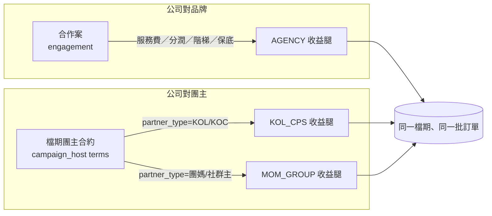
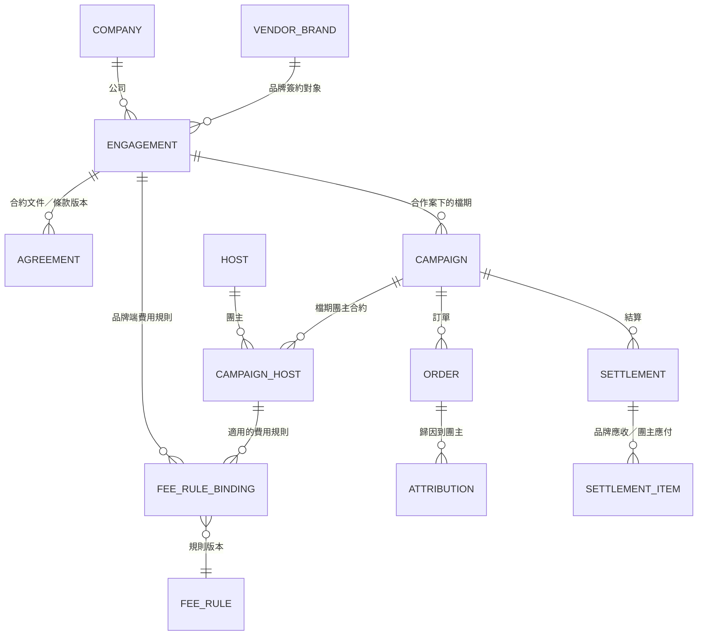

# 02 商業模式分類與公司／品牌／團主責任矩陣

> **狀態：PROPOSED（待 Owner 確認）。** 本文件是規劃，不修改任何已核准的 SRS／SAD／SDD，也沒有改動程式。
> **標示規則**：未經證實的商業假設一律標 `【假設 A-xx】`；需要 Owner 決定的事標 `【決策 B-xx】`，全部彙整在 [08](08-RISKS_GAPS_DECISIONS.md)。
> 名詞對照：本文的「品牌」＝系統的廠商（`vendors`）；「團主」＝`hosts`（含 KOL、KOC、團媽、社群主）；「公司」＝使用本 ERP 的營運組織。

## 1. 先講結論

1. 三種模式（代營運／團購經紀、KOL／KOC 分潤、團媽／社群主）**不是三個互斥的分類**，而是同一檔團購上可以同時存在的「收益腿」：
   - 公司對品牌收一條腿（代營運服務費或分潤）；
   - 公司對每位團主付一條腿（KOL 分潤或團媽分潤）。
   所以不要在檔期上放一個單選的「模式」欄位，而是**把每一條腿的合約條件各自記下來**，模式是由這些條件**推導**出來的標籤。
2. 要把「商業模式」拆成**五個獨立維度**，否則會把「誰是什麼人」「誰賣東西」「錢怎麼流」「貨怎麼走」混在一起，後面的收入認列與 KPI 一定算錯：
   公司商業模式、合作夥伴類型、交易模式、金流模式、履約模式（§2）。
3. **品牌代收付的金額不是公司收入。** 公司收入只認服務費／分潤（代理人淨額法）；GMV、淨銷售額、代收款、公司營業收入、貢獻利潤是五個不同的數字（見 [04](04-FINANCE_AND_COMMISSION.md) §1）。這點會決定看板與結算的每一個公式。

## 2. 五個維度

| # | 維度 | 回答的問題 | 取值（代碼 → 說明） | 掛在哪裡（建議） | 現況 |
|---|---|---|---|---|---|
| D1 | **公司商業模式（收益腿）** | 公司從這筆合作賺什麼錢？ | `AGENCY` 代營運／團購經紀：向品牌收服務費或分潤｜`KOL_CPS` KOL／KOC 分潤團購：公司或品牌依成交付分潤給創作者｜`MOM_GROUP` 團媽／社群主團購：依成交付分潤或賺價差 | 由「合作案」與「檔期團主合約」推導，不是單選欄位 | 無。`campaigns.campaign_type` 只是自由文字，預設 `STANDARD` |
| D2 | **合作夥伴類型** | 對方是誰？ | 品牌端：`BRAND` 品牌方、`SUPPLIER` 供應商／工廠、`DISTRIBUTOR` 代理商。團主端：`KOL`、`KOC`、`GROUP_MOM` 團媽、`COMMUNITY_OWNER` 社群主、`OTHER` | 品牌端新增 `vendors.party_type`；團主端沿用 `hosts.partner_type`（SOP 01 已建立，缺 `KOC`） | 部分：`hosts.partner_type` 有 4 值，缺 KOC；`vendors` 沒有類型 |
| D3 | **交易模式** | 誰是法律上的銷售者？公司是代理還是自營？ | `AGENT` 代理／居間（公司不持有貨權，收服務費）｜`PRINCIPAL` 自營買賣（公司進貨再賣，賺價差）【假設 A-01：本規劃的三種模式都屬 AGENT；PRINCIPAL 標為 COULD，不納入第一階段】 | 合作案 | 無 |
| D4 | **金流模式** | 消費者的錢先進誰的口袋？ | `BRAND_COLLECTS` 品牌直收｜`HOST_COLLECTS` 團主收款｜`COMPANY_ESCROW` 代營運居中（公司代收代付） | 合作案預設，檔期可覆寫 | 無（研究報告 §二有三種結構的定義，系統沒有欄位） |
| D5 | **履約模式** | 貨從哪裡到消費者手上？ | `BRAND_SHIPS` 品牌直寄｜`COMPANY_DC` 公司集貨代發｜`HOST_PICKUP` 團主集貨自取／配送；另有「現貨／預購」旗標 | 合作案預設，檔期可覆寫 | 部分：履約模組有出貨批次與出貨單，沒有履約模式欄位 |

### 2.1 這五個維度怎麼組出「三種模式」

推導規則（`【假設 A-02】`，因為「同一位團主在不同檔期可能扮演不同角色」，所以以**檔期團主合約**為準，`hosts.partner_type` 只是預設值）：

| 條件 | 該檔的模式標籤 |
|---|---|
| 公司與品牌簽有服務費／分潤條款（合作案有向品牌收費的條件） | 含 `AGENCY` |
| 檔期團主的角色為 KOL／KOC，且有分潤條款 | 含 `KOL_CPS` |
| 檔期團主的角色為團媽／社群主，且有分潤或價差條款 | 含 `MOM_GROUP` |
| 以上同時成立 | 多個標籤（重疊） |
| 都不成立（沒有任何收費或分潤條款） | `UNCLASSIFIED`，看板要列出「未分類檔期」，不能默默算進任何一類 |

**主模式（primary_mode）**：為了讓 L2 看板的三種模式「可加總」，每檔另外記一個主模式。規則必須是「算得出來」的（團主分潤是成本腿，不能拿來比收入大小），所以採用：

1. 該檔所屬合作案有**向品牌收費的條款** → 主模式 `AGENCY`；
2. 否則取該檔**歸因淨銷售額最大的團主腿**的模式（KOL／KOC → `KOL_CPS`；團媽／社群主 → `MOM_GROUP`）；平手時以 `KOL_CPS` > `MOM_GROUP`；
3. 沒有任何條款 → `UNCLASSIFIED`（不計入任何一類，另列）。

主模式只用於「可加總的分類報表」；「參與模式」（含任何標籤）用於「不可加總的視角」，看板必須明示兩者差異（見 [03](03-KPI_DICTIONARY.md) §1.3）。`【決策 B-28】`（取代原 B-16；規則由 KPI 字典撰寫時發現原寫法不可計算而修正）

## 3. 三種模式特徵

| 項目 | 代營運／團購經紀 `AGENCY` | KOL／KOC 分潤 `KOL_CPS` | 團媽／社群主 `MOM_GROUP` |
|---|---|---|---|
| 公司賣的是什麼 | 專案管理服務：媒合團主、排檔期、素材、監控、對帳 | 創作者導購的成交（公司可能是媒合方或帳務方） | 社群信任下的重複成交與客服量 |
| 對品牌的收益 | 服務費（固定／分潤／階梯／保底／混合） | 品牌付的推廣分潤（公司可抽差額） | 品牌付的分潤或供貨價差 |
| 對團主的成本 | 視合約：公司付或品牌直付 | 成交分潤或固定合作費（含階梯） | 成交分潤或價差；常見保底抵佣少 |
| 歸因方式 | 以檔期為單位，不需要逐單歸因 | **必須逐單歸因**（專屬連結、折扣碼）；歸因爭議是最大風險 | 以社群為單位的群組團購；一單通常歸給單一團主 |
| 典型金流 | 代營運居中或品牌直收 | 品牌直收（創作者不碰錢）或公司居中 | 團主收款（團主與品牌自行結算）或公司居中 |
| 典型履約 | 品牌直寄或公司集貨 | 品牌直寄 | 團主集貨／自取或品牌直寄 |
| 客服與售後 | 公司協調，品牌處理商品問題 | 品牌處理；創作者只回應內容疑問 | **團主第一線客服量大**，信任風險最高 |
| 法遵重點 | 合約權責、資料歸屬 | **薦證與利益關係揭露**（研究報告 §八）、廣告內容真實 | 團主收款時的發票與退款責任 |
| 核心風險 | 多方責任與對帳不清 | 歸因錯誤、揭露不足、爆量客服 | 團主收款風險、客服與信任損耗 |
| 要特別檢查的條件（建議，需 Owner 核准才可納入關卡） | 品牌合約與服務費條款已確認；授權素材；供貨量與交期 | 專屬連結／碼已建立且測試過；揭露文字已核；歸因規則寫入合約 | 團主收款責任與發票歸屬已明定；客服 SOP 與退款流程已溝通；群組公告規則 |

> 以上特徵來自研究報告（`docs/2026-taiwan-group-buying-complete-research.md` §二、§六、§八）與既有 SOP；沒有新增業務事實。標為「典型」的是概括，個案以合約為準。

## 4. 重疊情境（同一合作案不只一種模式）

| 情境 | 說明 | 建模方式 | 看板怎麼算 |
|---|---|---|---|
| S1 代營運 + KOL | 公司替品牌操盤，邀請 KOL 帶貨；品牌付公司服務費，公司付 KOL 分潤 | 合作案有品牌端費用規則；檔期團主（KOL）有團主端費用規則；付款方＝公司 | 標籤 `AGENCY`＋`KOL_CPS`；公司營業收入＝品牌服務費；KOL 分潤是公司成本；L1 只算一次 |
| S2 代營運 + 團媽 | 同上，但團主是團媽，社群內成交 | 同上，團主 `partner_type=GROUP_MOM` | 標籤 `AGENCY`＋`MOM_GROUP` |
| S3 品牌自簽 KOL，公司只做帳務 | 品牌直接給 KOL 分潤，公司向品牌收服務費 | 團主分潤付款方＝`BRAND`（不是公司成本） | 標籤 `AGENCY`＋`KOL_CPS`；貢獻利潤不扣 KOL 分潤（見 04 §2.2） |
| S4 純團媽分潤，無品牌服務費 | 公司只是媒合，向團主抽成或賺價差 | 只有團主端規則 | 標籤 `MOM_GROUP`；公司營業收入＝公司從團主分潤中的差額（需有品牌端分潤與團主端分潤的差額規則） |
| S5 同一團主兩檔扮演不同角色 | 團主平常是團媽，某檔以 KOL 身分導購 | 角色記在檔期團主合約，不記在團主主檔 | 各檔各自歸類 |
| S6 一檔多團主、模式混搭 | 兩位 KOL＋一位團媽同檔 | 每位團主一條腿 | 主模式取收入最大者；「參與模式」同時計入三類，且標示不可加總 |

## 5. 關係模型（品牌、公司、團主）

- **合作案（`engagement`）**：公司與一個品牌之間的商務關係與條款（期間、範圍、金流／履約預設、品牌端費用規則、發票責任）。檔期掛在合作案底下。這是現行系統缺的實體（見 [05](05-DATA_MODEL_GAP.md)）。
- **費用規則（`fee_rule`）**：把「固定費／分潤／階梯／保底」做成**版本化、可綁定到合作案或檔期團主**的規則；現行 `commission_rules` 只能表達「單一費率 × 淨銷售」，是它的特例。
- 品牌 ↔ 公司 ↔ 團主**不直接互相連結**，一律透過「合作案／檔期團主合約」，這樣條款變更有版本、結算能引用當時的版本。

## 6. 責任矩陣

圖例：**R**＝負責執行｜**A**＝最終負責（簽核）｜**C**＝須諮詢／確認｜**I**＝須知會｜—＝不適用。預設值為建議，**個案以合約為準**；`【決策 B-17】` 預設值需 Owner 確認。

### 6.1 交易與帳務責任（每檔必須在開團前指定，研究報告 §二：「開團前務必明確指定實際銷售者、收款方、發票、退貨與客服責任」）

| 責任事項 | 欄位建議 | 代營運（公司居中）預設 | KOL（品牌直收）預設 | 團媽（團主收款）預設 |
|---|---|---|---|---|
| 實際銷售者（法律上） | `seller_party` | 品牌 | 品牌 | 團主或品牌（依合約，**高風險，需確認**） |
| 收款方 | `collector` | 公司（代收代付） | 品牌 | 團主 |
| 發票開立方 | `invoicer` | 品牌（公司開服務費發票給品牌） | 品牌 | 團主或品牌（需確認） |
| 退貨／退款處理 | `refunder` | 品牌（公司協調） | 品牌 | 團主收款時由團主，否則品牌 |
| 售後與客服（商品問題） | `after_sales_owner` | 品牌；公司第一線轉單 | 品牌 | 團主第一線，品牌後援 |
| 履約與出貨 | `fulfiller` | 品牌或公司集貨 | 品牌 | 品牌或團主 |
| 分潤／服務費的付款方 | `commission_payer` | 公司付團主；品牌付公司 | 品牌付 KOL（或公司付） | 品牌／公司付團主，或團主自留價差 |
| 薦證與利益關係揭露 | `disclosure_owner` | 團主（公司審稿） | KOL，**必須揭露** | 團主（群組公告） |

### 6.2 營運活動 RACI（以 SOP 階段為單位，細節見 [01](01-OPERATING_SOP.md)）

| 活動 | 公司（營運 PM／主管／財務） | 品牌 | KOL／KOC | 團媽／社群主 |
|---|---|---|---|---|
| 品牌開發與簽約 | R/A | C（簽約） | — | — |
| 團主開發與評估 | R/A | I | C | C |
| 媒合與邀請 | R/A | C（可否決團主） | C | C |
| 談判：費用規則、保底、階梯 | R/A（財務 C） | C | C | C |
| 選品與 G1 | R（小編）／A（主管） | C（供貨與樣品） | C（試用回饋） | C（試用回饋） |
| 素材與內容 | A（審稿） | R（授權素材）／C | R（創作，**含揭露**） | R（貼文與公告） |
| 價格、庫存、賣場 | C | R/A | — | — |
| 開團與曝光 | R/A（排程） | C | R | R |
| 銷售監控與催單 | R | C（庫存） | R | R |
| 結單核對（G3） | R/A（主管＋財務） | C（後台報表） | I | I |
| 履約出貨 | C（追蹤） | R/A（直寄）或 C | — | R（集貨時） |
| 售後與退款 | R（協調）／A（主管） | R（商品問題） | C | R（第一線） |
| 結算與付款（G4） | R（財務）／A（財務＋主管） | C（對帳確認） | C（確認分潤） | C（確認分潤） |
| 復盤與結案（G5） | R/A | C | I | I |

### 6.3 收益、成本與分潤歸屬（概念表，數值見 [04](04-FINANCE_AND_COMMISSION.md)）

| 項目 | 屬於誰的收入 | 屬於誰的成本 | 是否進公司營業收入 |
|---|---|---|---|
| 消費者付款（GMV） | 品牌（代理模式下） | — | **否** |
| 品牌付給公司的服務費／分潤 | 公司 | 品牌 | **是** |
| 公司付給團主的分潤 | 團主 | 公司 | 否（是公司成本） |
| 品牌直接付給團主的分潤 | 團主 | 品牌 | 否（不是公司成本，也不是公司收入） |
| 團主自留的價差（團媽收款） | 團主 | 品牌（供貨價較低） | 否 |
| 公司墊付的運費、行銷、樣品 | — | 公司（若合約未轉嫁品牌） | 否（是變動成本；若向品牌請款則為公司收入的一部分，需合約明定） |
| 退款 | — | 依責任方（品牌／團主／公司） | 影響分潤基礎（見 04 §4） |

## 7. 未證實的商業假設

| 編號 | 假設 | 若不成立的影響 |
|---|---|---|
| A-01 | 三種模式都屬代理（AGENT）：公司不持有貨權、不承擔庫存 | 若有自營進貨，需 PRINCIPAL 模式與總額法認列，收入與毛利公式不同 |
| A-02 | 模式由「檔期團主合約」推導，可重疊；團主主檔的類型只是預設 | 若 Owner 要求單選分類，看板會失去重疊資訊 |
| A-03 | 公司向品牌收的費用是「服務費／分潤」，從品牌的銷售額計算 | 若公司是向消費者收款再付貨款（進銷），則屬 PRINCIPAL |
| A-04 | 團主分潤的計算基礎預設為有效淨銷售額（扣退款）而非 GMV | 基礎不同，所有分潤與看板的公式都要換（決策 B-01） |
| A-05 | 現有 DEMO 與流程的 15 步任務可作為三模式的共同骨架，模式差異以「檢查條件」表達，不另建流程 | 若模式流程差異大，需要多套流程模板（系統已支援版本化模板，但無編輯介面） |
| A-06 | 公司尚無自營或批貨模式；團媽「價差」只是團主自留，不進公司帳 | 若公司參與價差，需新增進銷價差的收入認列 |
