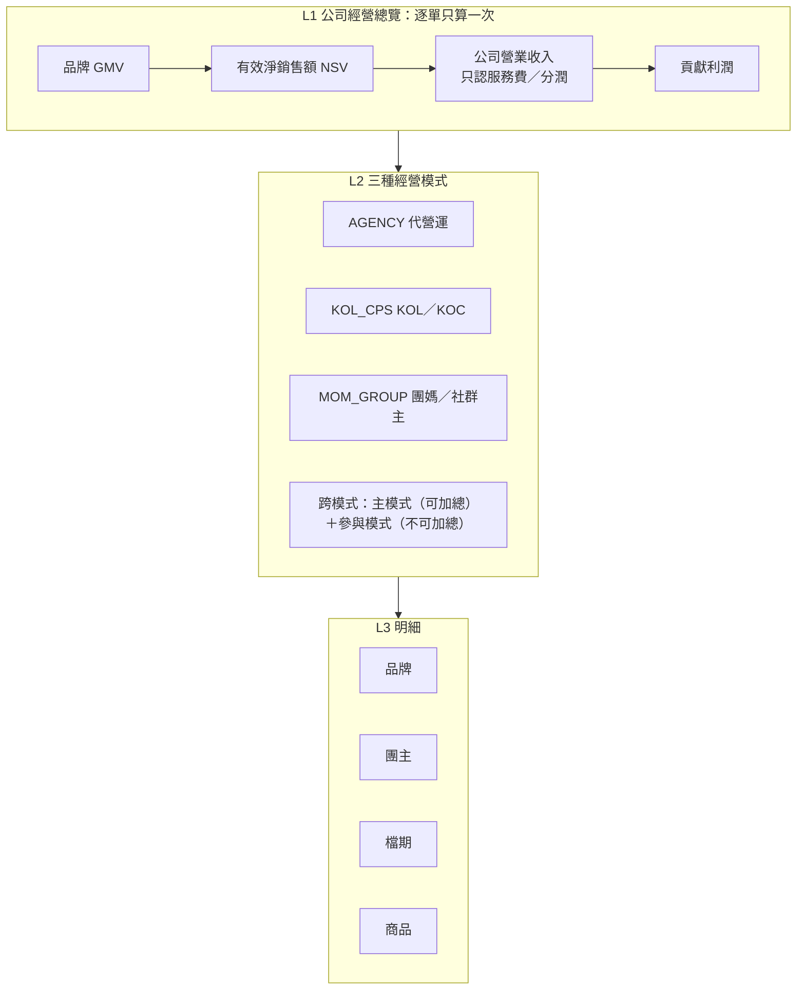
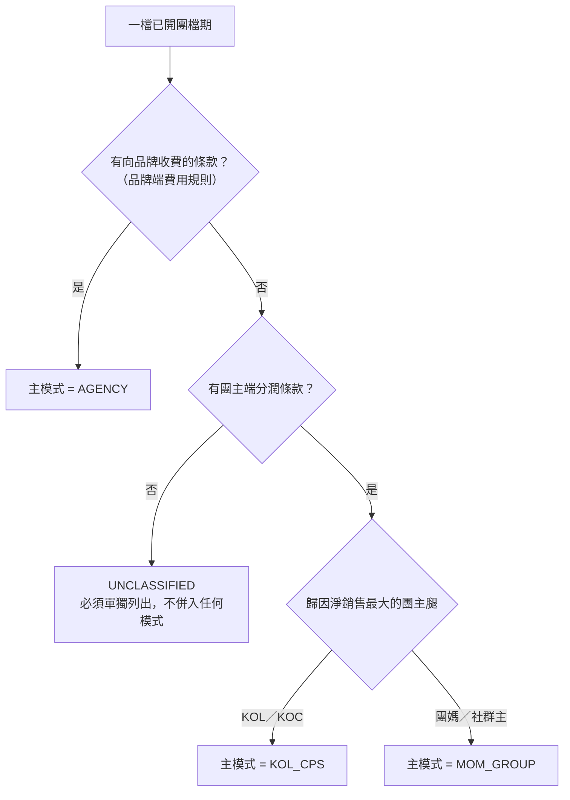

# 03 KPI 定義字典（三層管理看板）

> **狀態：PROPOSED（待 Owner 確認）。** 本文件是規劃，不修改任何已核准的 SRS／SAD／SDD，也沒有改動程式。
> 名詞、代碼與公式與 [02 商業模式分類與責任矩陣](02-MODEL_AND_RESPONSIBILITY.md)、[04 財務與分潤模型](04-FINANCE_AND_COMMISSION.md) 一致：**品牌 GMV、有效淨銷售額（NSV）、代收款、公司營業收入、貢獻利潤是五個不同的數字，任何看板都不得把 GMV 或代收款標示為公司收入。**
> 未證實的商業假設標 `【假設 A-2x】`，需 Owner 決定的事標 `【決策 B-xx】`（本文件使用 A-20～A-29、B-28～B-37；沿用 02、04 已有的 A-01～A-06、B-01～B-17 時會註明）。

## 0. 速覽

| 層級 | 對象 | KPI 數 | 已實作 | 部分 | 新增 |
|---|---|--:|--:|--:|--:|
| L1 公司經營總覽 | 公司整體（逐單只算一次） | 29 | 18 | 3 | 8 |
| L2 三種經營模式績效 | AGENCY／KOL_CPS／MOM_GROUP＋跨模式 | 30 | 2 | 6 | 22 |
| L3 品牌、團主、檔期、商品 | 逐品牌／逐團主／逐檔期／逐商品 | 41 | 15 | 9 | 17 |
| **合計** | | **100** | **35** | **18** | **47** |

- 「已實作」＝程式已能算出且有測試鎖定（以 `src/server/lib/kpi.ts`、`src/server/modules/dashboard.ts`、`dashboard-extra.ts` 等為準）；「部分」＝資料或一部分口徑已有，缺模式／付款方／來源訂單等新欄位；「新增」＝需要新增計算，其中標「資料已有」者只需新查詢，標「需新資料」者要先擴充資料模型（見 [05](05-DATA_MODEL_GAP.md)）。
- 口徑狀態：**已核准 0 項**（Owner 尚未核准任何 KPI 口徑；SRS §9 D-05 仍待決）；現行口徑 35 項（已實作且有測試鎖定，等 D-05／D-06 一併確認）；暫定 5 項（`vendorSuccess`、`onTimeLaunch`、`productRepeat` 相關，見 B-30）；PROPOSED 60 項。

## 1. 使用說明與共通規則

### 1.1 欄位與代碼

| 欄位 | 說明 |
|---|---|
| ID | L1 `K1-nn`；L2 `K2-AG-nn`（代營運）、`K2-KC-nn`（KOL／KOC）、`K2-MG-nn`（團媽／社群主）、`K2-X-nn`（跨模式）；L3 `K3-BR-nn`（品牌）、`K3-HO-nn`（團主）、`K3-CA-nn`（檔期）、`K3-PR-nn`（商品） |
| 公式 | 沿用已實作口徑者與程式一致；新增者標 PROPOSED。金額單位 TWD 整數；比率以小數運算、畫面顯示百分比 |
| 資料來源 | 具體「資料表.欄位」；標「新增：」者表示現行資料庫沒有，需求見 [05](05-DATA_MODEL_GAP.md) |
| 分母 | 比率類 KPI 的分母；「—」表示不是比率；分母為 0 一律顯示「—」（無值），不得顯示 0% |
| 期間 | `M` 下單時間所屬的台北日曆月；`W` 台北週一至週日；`S` 結算確認日所屬月（更正歸「更正登記月」）；`C` 檔期生命週期累計；`R90` 滾動 90 天；`AS` 截至查詢時點（存量） |
| 更新 | 這是**目標頻率**。`I` 即時＝**最近一次匯入的資料截至時間**（不是逐秒，現行系統所有看板皆為查詢當下計算，DASHBOARD_SPEC §1）；`D` 每日（建議由 worker 排程，見 §7）；`E` 事件觸發（結算確認、更正、核准當下）；`Mo` 月結後 |
| 資料品質規則 | 代碼定義於 §6：`DQ-NULL`、`DQ-DEMO`、`DQ-FRESH`、`DQ-RATE`、`DQ-CLASS`、`DQ-SMALL`、`DQ-STALE-CALC`、`DQ-TRACE`、`DQ-RESTATE` |
| 適用模式 | `ALL`／`AGENCY`／`KOL_CPS`／`MOM_GROUP`；括號為附加條件（例如金流模式） |
| 現況 | 已實作／部分／新增，並指出程式位置 |
| 口徑狀態 | 已核准（Owner 明確核准，目前 0 項）／現行口徑／暫定／PROPOSED |

### 1.2 計入銷售的訂單範圍（全部 KPI 共用，沿用 `kpi.ts`）

計入銷售狀態：`PAID`、`PARTIAL_REFUND`、`REFUNDED`；`PENDING`（未付款）與 `CANCELLED`（取消）**不計入任何銷售指標**。有效訂單＝`PAID`、`PARTIAL_REFUND`（全額退款不算）。四個名詞的先後順序：品牌 GMV → 有效淨銷售額 → 公司營業收入 → 貢獻利潤，**不得互相替代或混稱**；代收款是負債，只出現在 K1-17，不進任何損益類 KPI。

### 1.3 重疊與主模式：L1 逐單只算一次，L2 兩種視圖

三種模式可以在同一檔重疊（02 §2、§4）。為了不重複計算又保留重疊資訊，規則如下：

| 視圖 | 規則 | 可否加總 | 用途 |
|---|---|---|---|
| **L1（公司整體）** | 逐單只算一次，不分模式 | 是（基準） | 公司經營總覽 |
| **L2 主模式視圖（預設）** | 每檔只歸入一個**主模式**，三模式＋「未分類」加總＝L1 | **是**，必須能與 L1 對帳 | 比較三種模式的規模與獲利 |
| **L2 參與模式視圖** | 檔期含某模式標籤就計入該模式，重疊檔期會出現在多個模式 | **否**，畫面必須標「不可加總」並列「重疊調整」 | 回答「這個模式實際參與了多少交易」 |

**主模式的可計算規則（`【決策 B-28】`）**：02 §2.1 寫「取公司營業收入貢獻最大的那條腿」，但團主腿是**成本腿**，字面上無法互相比較，所以本字典提出下列可計算版本，請 Owner 確認：

選項：**A）上圖（預設）**——公司的收入來自品牌端條款，有收費條款就是代營運；**B）** 照 02 字面，以各腿貢獻金額比較（需先定義腿貢獻，較複雜）；**C）** 讓使用者手動指定主模式。

**算例**（虛構數字，與 04 的 V25／V26 一致；C-A 即 04 的範例）：

| 檔期 | 模式標籤 | 主模式（規則 A） | NSV | 品牌端服務費（公司營業收入） | 團主分潤（付款方＝公司） | 變動成本 | 貢獻利潤 |
|---|---|---|--:|--:|--:|--:|--:|
| C-A | AGENCY＋KOL_CPS | AGENCY | 270,000（GMV 300,000、退款 30,000） | 40,500（15%） | 21,600（8%） | 5,000 | 13,900 |
| C-B | AGENCY＋MOM_GROUP | AGENCY | 100,000 | 12,000（12%） | 6,000（6%） | 1,000 | 5,000 |
| C-C | MOM_GROUP（品牌只付分潤） | MOM_GROUP | 50,000 | 5,000（10%） | 3,000（6%） | 500 | 1,500 |
| **L1 合計** | | | **420,000** | **57,500** | **30,600** | **6,500** | **20,400** |

- L1：NSV 420,000；公司營業收入 57,500（**不是** GMV）；抽成率（K1-09）＝57,500 ÷ 420,000 ＝ 13.69%；貢獻利潤率（K1-13）＝20,400 ÷ 57,500 ＝ 35.48%。
- L2 **主模式視圖**（可加總）：AGENCY（C-A＋C-B）NSV 370,000、營業收入 52,500、貢獻利潤 18,900（率 36.00%）；MOM_GROUP（C-C）NSV 50,000、營業收入 5,000、貢獻利潤 1,500（率 30.00%）。NSV 合計 370,000＋50,000＝420,000＝L1 ✓；貢獻利潤 18,900＋1,500＝20,400＝L1 ✓。
- L2 **參與模式視圖**（不可加總）：AGENCY 370,000（C-A、C-B）；KOL_CPS 270,000（C-A）；MOM_GROUP 150,000（C-B、C-C）。三者相加 790,000 ≠ 420,000；差額 370,000＝重疊檔期被重複計入的部分（C-A 的 270,000 出現在 AGENCY 與 KOL_CPS、C-B 的 100,000 出現在 AGENCY 與 MOM_GROUP），畫面以「重疊調整 −370,000」收斂回 420,000。

### 1.4 退款與更正的期間歸屬（引用 04 §4，`【決策 B-04】` 未定前採下列預設）

| 類別 | KPI | 歸期規則 | 理由 |
|---|---|---|---|
| 銷售類 | K1-01～K1-07、K2-X-01 等 | 以**訂單的下單時間**歸期；退款**回溯**到原訂單所屬期間（現行 `orders.refund_amount` 是累計值，沒有退款事件日期） | 與現行 `kpi.ts` 一致；代價是歷史月份的 NSV 會被事後退款「重述」（`DQ-RESTATE`） |
| 結算類 | K1-08～K1-13、K1-15、K1-25 | 以**結算確認日**歸期；跨期退款產生的**更正項登記在更正當期**，不改已鎖定的舊結算（04 §4.2：重算再扣差額） | 結算確認後即鎖定（`settlements_guard`），不應回頭改舊期金額 |
| 現金類 | K1-16、K1-17 | 以**入帳／付款日**歸期 | 是現金流，與損益期間無關 |

跨期退款算例（04 的 V17／V18／V19）：11 月檔期，11 月底結算 NSV 250,000 → 團主分潤 17,000（11 月 K1-15）；12/10 發生 60,000 退款。結果：**11 月 NSV 被重述為 190,000**（銷售類，回溯）；**12 月出現 −4,800 的更正項**（結算類，更正當期），累計 12,200＝一次用最終 NSV 算完的金額。看板必須同時顯示兩個口徑並加註「銷售類重述、結算類更正」，否則 11 月的銷售與 11 月的分潤成本會對不起來。

## 2. L1 公司經營總覽

> 對象：營運主管、管理者、財務。範圍＝使用者資料範圍（營運小編只含自己負責的檔期，看板需標「範圍內」；公司營業收入與貢獻利潤需 `finance.read`，營運小編不顯示）。

| ID | 名稱 | 公式 | 資料來源 | 分母 | 期間 | 更新 | 資料品質規則 | 適用模式 | 現況 | 口徑狀態 |
|---|---|---|---|---|---|---|---|---|---|---|
| K1-01 | 品牌 GMV | Σ `gross_amount`（計入銷售訂單）。**品牌的交易額，不是公司收入** | `orders.gross_amount`、`orders.status ∈ {PAID,PARTIAL_REFUND,REFUNDED}`、`orders.ordered_at` | — | M／W | I | DQ-NULL、DQ-DEMO、DQ-FRESH | ALL | 已實作：`kpi.ts` `computeSales().gmv`；`dashboard.ts` `sales.gmv` | 現行口徑（D-05 待確認） |
| K1-02 | 退款金額 | Σ `refund_amount`（同 K1-01 訂單範圍） | `orders.refund_amount` | — | M／W | I | DQ-NULL、DQ-DEMO、DQ-RESTATE | ALL | 已實作：`computeSales().refund`；`sales.refund` | 現行口徑（D-05 待確認） |
| K1-03 | 有效淨銷售額（NSV） | K1-01 − K1-02；分潤基礎的預設候選（B-01） | `orders.gross_amount`、`orders.refund_amount` | — | M／W | I | DQ-NULL、DQ-DEMO、DQ-RESTATE | ALL | 已實作：`computeSales().net`；`sales.net` | 現行口徑（D-05 待確認） |
| K1-04 | 有效訂單數 | 狀態為 PAID 或 PARTIAL_REFUND 的訂單數（全額退款不算） | `orders.status` | — | M／W | I | DQ-NULL、DQ-DEMO | ALL | 已實作：`computeSales().orders`；`sales.orders` | 現行口徑（D-05 待確認） |
| K1-05 | 客單價 AOV | K1-03 ÷ K1-04 | 衍生 | K1-04（為 0 → 無值） | M／W | I | DQ-NULL | ALL | 已實作：`computeSales().aov` | 現行口徑（D-05 待確認） |
| K1-06 | 退款率 | 有退款的訂單數 ÷ 計入銷售的訂單數（研究報告「退貨率」另列為 K3-CA-06） | `orders.refund_amount > 0`、`orders.status` | 計入銷售的訂單數 | M／W | I | DQ-NULL | ALL | 已實作：`computeSales().refundRate`；`sales.refundRate` | 現行口徑（D-05 待確認）；分母見 B-36 |
| K1-07 | 目標達成率 | 與本期重疊且設有目標的檔期：累計 K1-03 ÷ 目標合計（無目標 → 無值，不顯示 0%） | `orders`、`campaigns.target_revenue` | 目標合計 | M | I | DQ-NULL；目標需 `campaign.sensitive.read` | ALL | 已實作：`kpi.ts` `attainment()`；`targets.attainment` | 現行口徑（D-05 待確認） |
| K1-08 | 公司營業收入 | Σ 品牌端費用規則算出並於本期**確認**的金額（固定費＋分潤＋階梯＋保底補足），代理人淨額法。**GMV、NSV、代收款一律不是**（04 §1） | 新增：`settlement_items`（品牌端項目）＋ `fee_rules`＋ `engagements`（見 05）；現行 `settlement_items` 只有團主端 | — | S（結算確認月） | E（結算確認／更正當下） | DQ-NULL（尚無品牌端結算＝「—」不是 0）、DQ-STALE-CALC、DQ-TRACE | ALL | 新增，需新資料：品牌端費用規則與品牌端結算項目 | PROPOSED（B-08、B-29 待決） |
| K1-09 | 抽成率（Take rate） | K1-08 ÷ K1-03；分子分母都只取「本期品牌端結算確認的檔期」，避免期間錯配 | K1-08；`orders`（同檔期） | K1-03（限同一批檔期） | S | E | DQ-NULL、DQ-RESTATE | ALL | 新增（依賴 K1-08） | PROPOSED |
| K1-10 | 應付團主分潤（公司負擔） | Σ 團主端項目（最終佣金＝覆寫 ?? 自動試算＋調整）且付款方＝公司，本期確認；付款方＝品牌者**不計入**（04 §2.2、B-09） | `settlement_items.commission_override`／`commission_auto`、`settlement_adjustments.amount`；新增：付款方欄位 | — | S | E | DQ-NULL、DQ-RATE（無費率不猜） | ALL | 部分：已確認佣金 `adminExtras.finance.confirmedCommission` 已實作，但**不分付款方、單一費率**；付款方需新增欄位 | 現行口徑（D-06 待確認）＋付款方 PROPOSED |
| K1-11 | 直接變動成本 | Σ `expenses.amount`（RECORDED），類別 SHIPPING／MARKETING／SAMPLE／PLATFORM_FEE／OTHER；是否納入金流費、人力 → B-10 | `expenses.amount`、`expenses.category`、`expenses.incurred_on`、`expenses.status` | — | M（發生日） | I | DQ-NULL | ALL | 部分：費用紀錄與彙總已實作（`modules/finance.ts`），但未進損益、未分檔期歸模式 | PROPOSED（B-10 待決） |
| K1-12 | 貢獻利潤 | K1-08 − K1-10 − K1-11 | K1-08、K1-10、K1-11 | — | S | E | DQ-NULL（任一組成為「—」則整體為「—」）、DQ-TRACE | ALL | 新增（依賴 K1-08） | PROPOSED（B-10、B-37） |
| K1-13 | 貢獻利潤率 | K1-12 ÷ K1-08（04 §2.2；研究報告「÷ 淨銷售額」是自營口徑，本字典不採用） | K1-12、K1-08 | K1-08（為 0 → 無值） | S | E | DQ-NULL | ALL | 新增 | PROPOSED |
| K1-14 | 預估佣金（團主端試算） | 歸因淨銷售 × 生效費率，四捨五入到元；無費率 → 無值並計「N 筆未設定費率」。**不是公司成本的最終值** | `orders`、`attributions.share_percent`、`commission_rules` | — | M | I | DQ-RATE、DQ-NULL | ALL | 已實作：`commission-calc.ts`、`adminExtras.finance.estimatedCommission` | 現行口徑（D-06 待確認） |
| K1-15 | 已確認佣金 | 本期確認結算的團主端佣金（覆寫優先） | `settlement_items`、`settlements.status=CONFIRMED`、`settlements.confirmed_at` | — | S | E | DQ-NULL | ALL | 已實作：`adminExtras.finance.confirmedCommission`；需 `finance.read` | 現行口徑（D-06 待確認） |
| K1-16 | 已收款金額 | Σ 有效入帳紀錄（方向 IN）；**是現金，不是收入**；人工入帳 | `payments.amount`、`payments.direction=IN`、`payments.status=ACTIVE`、`payments.paid_on` | — | M（入帳日） | I | DQ-NULL；未核對（UNMATCHED）者另標 | ALL | 已實作：`adminExtras.finance.received`；需 `finance.read` | 現行口徑 |
| K1-17 | 代收款餘額（應付品牌） | 代營運居中：Σ 代收淨額（收款 − 已退款）− 品牌服務費 − 已付品牌款；**負債科目，不進損益**（04 §1、V28） | 新增：`engagements.cash_flow_mode`；`payments`（IN／OUT、VENDOR）；K1-08 | — | AS（截至時點） | D | DQ-NULL、DQ-TRACE；僅 `COMPANY_ESCROW` 檔期 | AGENCY（且金流＝`COMPANY_ESCROW`） | 新增，需新資料：金流模式欄位 | PROPOSED |
| K1-18 | 進行中檔期數／參與團主數 | 狀態 SCHEDULED／RUNNING／PENDING_CLOSE_CHECK／FULFILLING／PENDING_SETTLEMENT 的檔期；團主＝未婉拒者去重 | `campaigns.status`、`campaign_hosts.status` | — | AS | I | DQ-NULL | ALL | 已實作：`dashboard-extra.ts` `overview()` | 現行口徑 |
| K1-19 | 檔期管線 | 各狀態檔期數（14 種狀態） | `campaigns.status` | — | AS | I | — | ALL | 已實作：`dashboard.ts` `pipeline` | 現行口徑 |
| K1-20 | 逾期任務數 | 未完成且 `planned_end` < 今日的任務數（排除取消、暫緩、已結案檔期） | `tasks.status`、`tasks.planned_end`、`campaigns.status` | — | AS | I | DQ-NULL | ALL | 已實作：`dashboard.ts` `tasks.overdue` | 現行口徑 |
| K1-21 | 待核准數 | `approvals.status=PENDING` 的筆數（G1–G5） | `approvals.status` | — | AS | I | — | ALL | 已實作：`dashboard.ts` `pendingApprovals` | 現行口徑 |
| K1-22 | 未結例外 | `exceptions.status<>RESOLVED` 依嚴重度計數 | `exceptions.severity`、`exceptions.status` | — | AS | I | 需 `exception.read` | ALL | 已實作：`dashboard.ts` `exceptions` | 現行口徑 |
| K1-23 | 售後處理中／逾期案件數 | 處理中案件數、`due_date` < 今日且未解決者 | `service_cases.status`、`service_cases.due_date` | — | AS | I | 團主／廠商僅範圍內且無退款金額 | ALL | 已實作：`modules/aftersales.ts` `getAftersalesOverview`（尚未放進 `/dashboard`） | 現行口徑 |
| K1-24 | 應收品牌服務費帳齡 | 未收的品牌端應收款，依「結算確認日起算天數」分 0–14／15–30／31–60／60+ 天 | 新增：品牌端結算項目；`payments`（IN、VENDOR、MATCHED） | — | AS | D | DQ-NULL、DQ-TRACE | AGENCY（含任何收品牌費用的檔期） | 新增，需新資料：品牌端結算項目 | PROPOSED（B-05） |
| K1-25 | 分潤更正金額與更正率 | Σ 更正項金額；更正率＝更正項金額絕對值合計 ÷ 原已確認金額（04 §4.2） | 新增：更正項引用（原結算項目、退款事件）；`settlement_adjustments` | 原已確認的團主端與品牌端金額 | S（更正登記期） | E | DQ-NULL、DQ-TRACE | ALL | 部分：`settlement_adjustments` 已有金額與原因，無「引用原項目與退款事件」 | PROPOSED（B-04、B-06） |
| K1-26 | 未分類檔期數／比例 | 無任何收費或分潤條款（`UNCLASSIFIED`）的檔期數 ÷ 已開團檔期數 | 新增：檔期團主合約的費用規則綁定（見 05） | 已開團檔期數 | AS | D | DQ-CLASS：必須顯示，不得併入任何模式 | ALL | 新增 | PROPOSED（A-02） |
| K1-27 | 模式重疊檔期比例 | 含 2 個以上模式標籤的檔期 ÷ 已分類檔期 | 新增：模式標籤推導（02 §2.1） | 已分類檔期數 | AS | D | DQ-CLASS | ALL | 新增 | PROPOSED（A-02） |
| K1-28 | 資料品質狀態與最近同步 | NO_DATA／DEMO／IMPORT／MIXED；最近匯入批次、資料截至時間、未處理匯入錯誤數、警告 | `orders.data_origin`、`import_batches.status`／`finished_at`／`data_as_of`、`import_errors.status` | — | AS | I | 本身就是品質指標 | ALL | 已實作：`kpi.ts` `dataStatus()`；`dashboard.ts` `dataQuality` | 現行口徑 |
| K1-29 | 資料來源與同步 | 依來源系統與資料性質（DEMO／匯入檔／人工）的訂單數、最後同步、最近訂單 | `orders.source_system`、`orders.data_origin`、`import_batches.finished_at` | — | AS | I | 需 `order.read` | ALL | 已實作：`adminExtras.dataSources` | 現行口徑 |

## 3. L2 三種經營模式績效

> 預設顯示**主模式視圖**（可與 L1 對帳）；切換到**參與模式視圖**時必須顯示「不可加總」警告與重疊調整（§1.3）。模式歸類在檔期團主合約與品牌端費用規則落地前，只能以 `hosts.partner_type` 近似，且 `UNCLASSIFIED` 必須單獨顯示（`DQ-CLASS`，`【假設 A-21】`）。

### 3.1 代營運／團購經紀（AGENCY）

| ID | 名稱 | 公式 | 資料來源 | 分母 | 期間 | 更新 | 資料品質規則 | 適用模式 | 現況 | 口徑狀態 |
|---|---|---|---|---|---|---|---|---|---|---|
| K2-AG-01 | 代營運檔期數與淨銷售（主模式） | 主模式＝AGENCY 的檔期：數量、Σ K1-03 | 新增：`campaigns.primary_mode`（推導，05）；`orders` | — | M | D | DQ-CLASS；與 K2-X-01 對帳 | AGENCY | 新增，需新資料：主模式 | PROPOSED（B-28） |
| K2-AG-02 | 服務費收入 | 主模式＝AGENCY（含參與）之品牌端費用規則算出的確認金額 | 新增：品牌端結算項目、`fee_rules` | — | S | E | DQ-NULL、DQ-TRACE | AGENCY | 新增，需新資料 | PROPOSED |
| K2-AG-03 | 代營運抽成率 | K2-AG-02 ÷ 同批檔期 NSV | K2-AG-02、`orders` | 同批檔期 NSV | S | E | DQ-NULL | AGENCY | 新增 | PROPOSED |
| K2-AG-04 | 代營運貢獻利潤與貢獻利潤率 | K1-12 的 AGENCY 範圍；率＝貢獻利潤 ÷ 服務費收入 | K1-08／K1-10／K1-11 範圍化 | K2-AG-02 | S | E | DQ-NULL | AGENCY | 新增 | PROPOSED（B-09、B-10） |
| K2-AG-05 | 服務費收款及時率 | 品牌端結算確認後 N 天內收款完成的金額 ÷ 應收金額；N 預設 14（沿用任務 `INVOICE_REQUEST` 14 天） | 新增：品牌端應收；`payments`（IN、VENDOR）；`invoices.invoice_date` | 本期到期應收 | S | D | DQ-NULL | AGENCY | 新增 | PROPOSED（B-05） |
| K2-AG-06 | 服務費結構：固定費占比 | 固定費組成 ÷ K2-AG-02（衡量收入對業績的敏感度） | 新增：計算行（04 §5.2） | K2-AG-02 | S | E | DQ-NULL、DQ-TRACE | AGENCY | 新增 | PROPOSED |
| K2-AG-07 | 保底補足金額與占比 | `FLOOR_TOPUP` 行加總；占比＝補足 ÷ K2-AG-02（衡量保底合約風險） | 新增：計算行（04 §3、V07） | K2-AG-02 | S | E | DQ-NULL | AGENCY | 新增 | PROPOSED（B-03） |
| K2-AG-08 | 任務準時完成率（營運 PM） | `completed_at` ≤ `planned_end` 的任務數 ÷ 已到期且完成或逾期的任務數 | `tasks.completed_at`、`tasks.planned_end`、`tasks.status`、`tasks.owner_role` | 已到期任務數 | M | D | DQ-SMALL（分母 < 10 顯示「資料不足」） | ALL（主要用於 AGENCY） | 新增（資料已有，尚無此計算） | PROPOSED |
| K2-AG-09 | 品牌合作成功率 | 已開團檔期 ÷（已開團＋已取消）；評估中、籌備中不計 | `campaigns.status`、`campaigns.vendor_id` | 已開團＋已取消 | AS | I | DQ-SMALL | AGENCY | 已實作（全公司與逐品牌）：`dashboard-extra.ts` `vendorSuccess()`；依模式拆分為新增 | 暫定（B-30） |
| K2-AG-10 | 品牌再開團率（續約代理） | 前 180 天有已開團檔期的品牌中，本期再次開團者占比；系統沒有合約續約資料，故以再開團代理（A-28） | `campaigns.vendor_id`、`campaigns.status`、`campaigns.open_date` | 前 180 天有已開團檔期的品牌數 | M | D | DQ-SMALL | AGENCY | 新增（資料已有） | PROPOSED（A-28） |

### 3.2 KOL／KOC 分潤團購（KOL_CPS）

| ID | 名稱 | 公式 | 資料來源 | 分母 | 期間 | 更新 | 資料品質規則 | 適用模式 | 現況 | 口徑狀態 |
|---|---|---|---|---|---|---|---|---|---|---|
| K2-KC-01 | KOL／KOC 淨銷售（歸因） | 歸屬 KOL 腿團主（`partner_type ∈ {KOL,KOC}`，檔期團主合約為準）的歸因 NSV：Σ (gross−refund)×`share_percent` | `attributions.share_percent`、`orders`、`hosts.partner_type`（KOC 需新增） | — | M | I | DQ-NULL、DQ-DEMO | KOL_CPS | 部分：團主歸因淨銷售 `hostPerformance` 已實作；依模式分群需新增團主類型（KOC）與檔期角色 | PROPOSED（A-02） |
| K2-KC-02 | KOL 分潤成本與分潤成本率 | Σ KOL 腿最終佣金；率＝分潤 ÷ K2-KC-01（研究報告「分潤成本率」） | `settlement_items`（團主端）、K2-KC-01 | K2-KC-01 | S | E | DQ-RATE、DQ-NULL | KOL_CPS | 部分：單一費率試算已實作；階梯／固定費需 `fee_rules` | PROPOSED |
| K2-KC-03 | 歸因覆蓋率 | `attributions.method ∈ {CODE,LINK}` 的歸因淨銷售 ÷ KOL 腿全部歸因淨銷售（越高越可信；手動／匯入歸因視為較弱） | `attributions.method`、`attributions.share_percent`、`orders` | K2-KC-01 | M | D | DQ-NULL；分母 < 10 筆顯示「資料不足」 | KOL_CPS | 新增（`method` 欄位已存在，尚無此計算） | PROPOSED（B-14） |
| K2-KC-04 | 未歸因淨銷售 | K1-03 − Σ 歸因淨銷售（團主加總 ≠ 總額時用來解釋） | `orders`、`attributions` | — | M | I | DQ-NULL | ALL | 已實作：`dashboard.ts` `unattributedNet` | 現行口徑 |
| K2-KC-05 | 薦證揭露完成率 | 已完成「揭露文字已核」的 KOL／KOC 檔期團主數 ÷ KOL／KOC 檔期團主數 | 新增：`campaign_hosts.disclosure_status`（研究報告 §八） | 已開團的 KOL／KOC 檔期團主數 | M | D | DQ-NULL；未填視為未完成，不視為不適用 | KOL_CPS | 新增，需新資料 | PROPOSED（A-26） |
| K2-KC-06 | KOL 單檔產值與目標達成 | 平均每檔歸因 NSV；達成率＝歸因 NSV ÷ `campaign_hosts.target_revenue` | `attributions`、`campaign_hosts.target_revenue` | 有訂單的 KOL 檔期數；目標合計 | M | I | DQ-NULL；目標需 `campaign.sensitive.read` | KOL_CPS | 部分：全公司每檔產值 `campaignOutput` 已實作 | PROPOSED |
| K2-KC-07 | KOL 貢獻利潤 | K1-12 的 KOL_CPS 範圍（付款方＝公司者扣分潤） | K1-08／K1-10／K1-11 範圍化 | K2-KC-04 以外 | S | E | DQ-NULL | KOL_CPS | 新增 | PROPOSED（B-09） |

### 3.3 團媽／社群主團購（MOM_GROUP）

| ID | 名稱 | 公式 | 資料來源 | 分母 | 期間 | 更新 | 資料品質規則 | 適用模式 | 現況 | 口徑狀態 |
|---|---|---|---|---|---|---|---|---|---|---|
| K2-MG-01 | 團媽／社群主淨銷售 | `partner_type ∈ {GROUP_MOM,COMMUNITY_OWNER}` 腿的歸因 NSV | `attributions`、`orders`、`hosts.partner_type` | — | M | I | DQ-NULL、DQ-DEMO | MOM_GROUP | 部分：同 K2-KC-01 | PROPOSED（A-02） |
| K2-MG-02 | 團媽分潤成本率 | Σ 團媽腿最終佣金 ÷ K2-MG-01 | `settlement_items`、K2-MG-01 | K2-MG-01 | S | E | DQ-RATE、DQ-NULL | MOM_GROUP | 部分 | PROPOSED |
| K2-MG-03 | 每百單售後案件（客服量） | 非取消案件數 ÷ 計入銷售訂單數 × 100；案件經檔期歸屬到團主腿 | `service_cases.status`、`service_cases.campaign_id`、`orders` | 計入銷售訂單數 | M | D | DQ-SMALL；多團主檔期按歸因比例攤，或標「未歸屬」（A-27） | MOM_GROUP | 新增（資料已有；`fit.ts` `supplyFor()` 已有品牌層級同口徑） | PROPOSED（A-27） |
| K2-MG-04 | 客訴率 | `case_type=COMPLAINT` 的案件所屬訂單數 ÷ 有效訂單數（研究報告「客訴率」） | `service_cases.case_type`、`service_cases.order_id`、`orders` | K1-04（同範圍） | M | D | DQ-SMALL；`order_id` 空白的案件只計入 K2-MG-03 | ALL（重點在 MOM_GROUP） | 新增（資料已有） | PROPOSED |
| K2-MG-05 | 社群人均產值 | 社群歸因 NSV ÷ `communities.member_count`（成員數為人工填寫，標「估計」） | `attributions.community_id`、`communities.member_count` | `member_count`（空白 → 無值） | M | I | DQ-NULL；成員數屬估計，旁標「人工」 | MOM_GROUP | 部分：社群排行 `communityRank` 已實作，尚無人均 | PROPOSED |
| K2-MG-06 | 團主活躍率（團媽） | 期間內有至少 1 檔已開團且已確認的團媽／社群主數 ÷ 合作中團媽／社群主數（A-29、B-34） | `campaign_hosts.status`、`campaigns.status`、`hosts.status`、`hosts.partner_type` | 合作中團媽／社群主數 | R90 | D | DQ-SMALL | MOM_GROUP | 新增（資料已有） | PROPOSED（B-34） |
| K2-MG-07 | 團主收款檔期對帳完成率 | `HOST_COLLECTS` 檔期中，團主回報金額與訂單淨額已核對一致的檔期數 ÷ 該類已結單檔期數 | 新增：`engagements.cash_flow_mode`；團主回報金額（人工填寫） | `HOST_COLLECTS` 已結單檔期數 | M | D | DQ-NULL | MOM_GROUP（金流＝`HOST_COLLECTS`） | 新增，需新資料 | PROPOSED |

### 3.4 跨模式

| ID | 名稱 | 公式 | 資料來源 | 分母 | 期間 | 更新 | 資料品質規則 | 適用模式 | 現況 | 口徑狀態 |
|---|---|---|---|---|---|---|---|---|---|---|
| K2-X-01 | 模式淨銷售結構（可加總） | 依主模式（AGENCY／KOL_CPS／MOM_GROUP／UNCLASSIFIED）分組的 Σ K1-03；加總必須等於 K1-03 | `campaigns.primary_mode`、`orders` | K1-03 | M | D | DQ-CLASS：未分類必須獨立一列；加總不等於 K1-03 視為資料錯誤 | ALL | 新增，需新資料：主模式 | PROPOSED（B-28） |
| K2-X-02 | 模式淨銷售（參與模式，不可加總） | 含該模式標籤的檔期之 Σ K1-03（重疊檔期會同時出現在多個模式）；另列「重疊調整」使其回到 K1-03 | 模式標籤（02 §2.1）、`orders` | — | M | D | 畫面必須標「不可加總」與重疊調整列 | ALL | 新增 | PROPOSED（B-28） |
| K2-X-03 | 模式貢獻利潤比較（主模式） | K1-12 依主模式分組；加總等於 K1-12 | K1-08／K1-10／K1-11 範圍化 | — | S | E | DQ-CLASS | ALL | 新增 | PROPOSED |
| K2-X-04 | 模式退款率與客訴率比較 | 各模式 K1-06／K2-MG-04（以參與模式計，標不可加總） | `orders`、`service_cases` | 各模式計入銷售訂單數 | M | D | DQ-SMALL | ALL | 新增（資料已有） | PROPOSED |
| K2-X-05 | 適配分與實際成效相關性 | 已回寫成效且已覆核的評估：`total_score` 與團主 NSV／目標達成的相關係數（≥ 10 筆才顯示）；用來檢驗適配規則 | `product_fit_assessments.total_score`、`.outcome`、`.review_decision` | 已回寫成效評估筆數 | R90 | D | DQ-SMALL（< 10 筆顯示「資料不足」，A-24）；不得當作因果 | ALL（SOP 01） | 新增（資料已有：SOP 01 結案回寫） | PROPOSED（A-24） |
| K2-X-06 | 模式別履約準時率與例外率 | 各模式檔期的 K3-CA-06／出貨例外率（參與模式，標不可加總） | `shipments`、`fulfillment_batches.kind` | 各模式應出貨單數 | M | D | DQ-SMALL | ALL | 新增（資料已有） | PROPOSED |

## 4. L3 品牌、團主、檔期及商品績效

### 4.1 品牌（廠商）

| ID | 名稱 | 公式 | 資料來源 | 分母 | 期間 | 更新 | 資料品質規則 | 適用模式 | 現況 | 口徑狀態 |
|---|---|---|---|---|---|---|---|---|---|---|
| K3-BR-01 | 品牌 GMV／NSV／退款率 | K1-01／K1-03／K1-06 依 `campaigns.vendor_id` 分組 | `orders`、`campaigns.vendor_id` | — | M | I | DQ-NULL、DQ-DEMO | ALL | 部分：逐品牌合作進度 `vendors`／`vendorCampaigns` 已實作，尚無逐品牌業績 | PROPOSED |
| K3-BR-02 | 品牌貢獻利潤與抽成率 | K1-12／K1-09 依品牌分組 | K1-08 等範圍化 | — | S | E | DQ-NULL；需 `finance.read` | ALL | 新增 | PROPOSED |
| K3-BR-03 | 品牌合作成功率 | 同 K2-AG-09，逐品牌 | `campaigns.status` | 已開團＋已取消 | AS | I | DQ-SMALL | ALL | 已實作：`vendorSuccess().byVendor` | 暫定（B-30） |
| K3-BR-04 | 供貨出貨準時率 | `shipped_date` ≤ `planned_date` 的出貨單 ÷ 有 `planned_date` 的非取消訂單出貨單（排除寄樣） | `shipments.planned_date`、`shipments.shipped_date`、`shipments.status`、`fulfillment_batches.kind=ORDER` | 有預定日的非取消出貨單 | M | D | DQ-SMALL（< 3 筆；與 SOP 01 `minShipments` 一致）；A-23 | ALL | 新增（資料已有） | PROPOSED（A-23） |
| K3-BR-05 | 出貨例外率 | `status=EXCEPTION` 出貨單 ÷ 非取消訂單出貨單 | `shipments.status` | 非取消訂單出貨單 | M | D | DQ-SMALL | ALL | 部分：`fit.ts` `supplyFor()` 已用於適配評分，尚無看板 | PROPOSED |
| K3-BR-06 | 品牌每百單售後案件 | 非取消的 REFUND／COMPLAINT／EXCHANGE 案件 ÷ 計入銷售訂單 × 100 | `service_cases`、`orders`、`campaigns.vendor_id` | 計入銷售訂單數 | M | D | DQ-SMALL | ALL | 部分：同 `supplyFor()` | PROPOSED |
| K3-BR-07 | 廠商任務逾期數與完成度 | 廠商負責任務的逾期數；各檔期任務完成／總數 | `tasks.owner_role=VENDOR`、`tasks.status`、`tasks.planned_end` | 總任務數 | AS | I | DQ-NULL | ALL | 已實作：`dashboard.ts` `vendors`、`vendorCampaigns` | 現行口徑 |
| K3-BR-08 | 品牌應收帳齡與未收金額 | K1-24 依品牌分組 | 新增：品牌端結算項目、`payments` | — | AS | D | DQ-NULL | AGENCY | 新增，需新資料 | PROPOSED |
| K3-BR-09 | 品牌資料完整度 | ACTIVE 品牌缺公司全名／統編／類別／主要聯絡人的比例 | `vendors`、`vendor_contacts` | ACTIVE 品牌數 | AS | I | DQ-NULL | ALL | 已實作（清單與篩選）：`modules/vendors.ts` `computeVendorMissing`；比例卡為新增 | 現行口徑 |

### 4.2 團主

| ID | 名稱 | 公式 | 資料來源 | 分母 | 期間 | 更新 | 資料品質規則 | 適用模式 | 現況 | 口徑狀態 |
|---|---|---|---|---|---|---|---|---|---|---|
| K3-HO-01 | 團主歸因淨銷售 | `share_percent` 加權的 NSV，依團主 | `attributions`、`orders` | — | M | I | DQ-NULL、DQ-DEMO | ALL | 已實作：`dashboard.ts` `hostPerformance`、`getHostDashboard` `performance` | 現行口徑 |
| K3-HO-02 | 團主有效訂單數 | 歸因訂單數（PAID／PARTIAL_REFUND） | `attributions`、`orders.status` | — | M | I | DQ-NULL | ALL | 已實作：`hostPerformance.orders` | 現行口徑 |
| K3-HO-03 | 團主目標達成率 | 團主歸因 NSV ÷ `campaign_hosts.target_revenue` | `campaign_hosts.target_revenue`、`attributions` | 目標合計 | M | I | DQ-NULL；目標欄位僅內部與本人可見 | ALL | 已實作（團主端）：`getHostDashboard` `myCampaigns.attainment`；管理端逐團主為新增 | 現行口徑 |
| K3-HO-04 | 團主預估與已確認佣金 | 預估：同 K1-14；已確認：同 K1-15，依團主 | `commission_rules`、`settlement_items` | — | M／S | I | DQ-RATE；團主只看自己，且不含他人與成本 | ALL | 已實作：團主端 `commission.estimatedTotal`；管理端逐團主為新增 | 現行口徑（D-06 待確認） |
| K3-HO-05 | 團主分潤成本率 | 團主最終佣金 ÷ 團主歸因 NSV | `settlement_items`、`attributions` | 團主歸因 NSV | S | E | DQ-RATE | ALL | 部分 | PROPOSED |
| K3-HO-06 | 團主退款率 | 團主歸因訂單中有退款者 ÷ 團主歸因計入銷售訂單 | `orders.refund_amount`、`attributions` | 團主歸因計入銷售訂單數 | M | I | DQ-SMALL | ALL | 新增（資料已有） | PROPOSED |
| K3-HO-07 | 邀請回覆率與回覆天數 | 已回覆（CONFIRMED／DECLINED）邀請數 ÷ 邀請數；中位回覆天數＝`responded_at − invited_at` | `campaign_hosts.status`、`.invited_at`、`.responded_at` | 邀請數 | R90 | D | DQ-SMALL | ALL | 部分：待回覆清單已在 `attention`；率與天數為新增 | PROPOSED |
| K3-HO-08 | 團主任務準時率 | `owner_role=HOST` 任務的準時完成率（定義同 K2-AG-08） | `tasks` | 已到期任務數 | M | D | DQ-SMALL | ALL | 新增（資料已有） | PROPOSED |
| K3-HO-09 | 團主重開率 | 前 180 天已合作的團主中，本期再次合作者占比（研究報告「團主重開率」；B-34） | `campaign_hosts`、`campaigns.status` | 前 180 天已合作團主數 | R90 | D | DQ-SMALL | ALL | 新增（資料已有） | PROPOSED（B-34） |
| K3-HO-10 | 團主適配狀態 | 最新評估的總分、建議、信心、完整度、覆核結果；客群分析完整度（未建立／待補／完整） | `product_fit_assessments`、`partner_segment_links`、`segment_*` | — | AS | I | DQ-SMALL；估計與事實分開顯示；**不是績效** | ALL（SOP 01） | 已實作資料與畫面：`modules/fit.ts` `listFit`／`fitOverview`、`modules/segments.ts` `getHostSegments`；看板卡為新增 | 現行（評分權重待 Owner 確認，SEGMENT_FIT D-18） |
| K3-HO-11 | 社群業績排行 | 社群歸因 NSV 與訂單數前 8 名（訂單需帶社群編號才歸因） | `attributions.community_id`、`communities` | — | M | I | DQ-NULL | ALL | 已實作：`adminExtras.communityRank` | 現行口徑 |
| K3-HO-12 | 消費者回購率 | 期間內重複購買的 `buyer_ref` ÷ 期間內合格購買的 `buyer_ref`（B-33） | `orders.buyer_ref`（去識別化） | 合格 `buyer_ref` 數 | R90 | D | DQ-SMALL；跨平台代號是否一致未知，標「估計」 | ALL | 新增（資料已有，可信度待確認） | PROPOSED（B-33） |

### 4.3 檔期

| ID | 名稱 | 公式 | 資料來源 | 分母 | 期間 | 更新 | 資料品質規則 | 適用模式 | 現況 | 口徑狀態 |
|---|---|---|---|---|---|---|---|---|---|---|
| K3-CA-01 | 檔期 GMV／NSV／訂單／AOV | K1-01～K1-05 依檔期 | `orders.campaign_id` | — | C | I | DQ-NULL、DQ-DEMO | ALL | 部分：每檔產值前 8 名 `campaignOutput.top` 已實作 | 現行口徑 |
| K3-CA-02 | 檔期目標達成率 | 檔期累計 NSV ÷ `campaigns.target_revenue` | `campaigns.target_revenue`、`orders` | 目標 | C | I | DQ-NULL；需 `campaign.sensitive.read` | ALL | 已實作：`dashboard.ts` `targets.byCampaign` | 現行口徑 |
| K3-CA-03 | 檔期營業收入與貢獻利潤 | K1-08／K1-12／K1-13 依檔期（研究報告 §六「檔期貢獻利潤」的代理人版本） | 品牌端與團主端結算項目；`expenses.campaign_id` | K1-08 | C | E | DQ-NULL、DQ-TRACE | ALL | 新增（依賴 K1-08） | PROPOSED |
| K3-CA-04 | 銷售節奏 | 開團後前 48 小時 NSV ÷ 檔期 NSV；日別曲線 | `orders.ordered_at`、`campaigns.open_date` | 檔期 NSV | C | D | DQ-SMALL；訂單時間為匯入資料，非即時 | ALL | 新增（資料已有） | PROPOSED |
| K3-CA-05 | 檔期退款金額與型態 | 部分退款／全額退款占比；退款金額 | `orders.status`、`orders.refund_amount` | 計入銷售訂單數 | C | I | DQ-RESTATE | ALL | 部分：退款金額已有，型態拆分為新增 | 現行口徑 |
| K3-CA-06 | 檔期出貨準時率與退貨率（研究報告口徑） | 出貨準時率同 K3-BR-04（限單一檔期）；退貨率＝退貨（REFUND 案件所屬）訂單 ÷ 已履約（出貨單 DELIVERED）訂單（B-36） | `shipments`、`service_cases`、`refund_requests` | 已履約訂單數 | C | D | DQ-SMALL；退貨與退款是不同概念，不得與 K1-06 混用 | ALL | 新增（資料已有） | PROPOSED（B-36） |
| K3-CA-07 | 檔期售後與客訴率 | 每百單案件、客訴率（同 K2-MG-03／K2-MG-04，限單一檔期） | `service_cases` | 計入銷售訂單數 | C | D | DQ-SMALL | ALL | 新增（資料已有） | PROPOSED |
| K3-CA-08 | 任務完成度與逾期 | 完成任務數／總任務數；逾期數；下一個任務與負責角色 | `tasks` | 總任務數 | C | I | — | ALL | 已實作：`dashboard.ts` `vendorCampaigns` | 現行口徑 |
| K3-CA-09 | 結算狀態與更正 | 結算狀態（無／DRAFT／CONFIRMED／VOID）、確認日、更正項筆數與金額 | `settlements.status`、`settlements.confirmed_at`、`settlement_adjustments` | — | C | E | DQ-STALE-CALC | ALL | 部分：結算狀態已實作（`modules/settlements.ts`）；更正引用為新增 | 現行口徑＋更正 PROPOSED |
| K3-CA-10 | 檔期準時開團 | 實際轉為 RUNNING 的日期（台北）≤ `open_date`；沒有狀態轉換事件 → 「資料不足」 | `events.type=campaign.status_changed`、`events.payload.to=RUNNING`、`campaigns.open_date` | 有轉換事件的已開團檔期數 | C | I | DQ-SMALL（沒有事件就不編造） | ALL | 已實作：`dashboard-extra.ts` `onTimeLaunch()`（逐檔為新增） | 暫定（B-30） |
| K3-CA-11 | 結單資料完整度 | 結單後（PENDING_CLOSE_CHECK 起）完全沒有訂單的檔期 | `campaigns.status`、`orders` | 結單後檔期數 | AS | I | — | ALL | 已實作：`attention` 的 `NO_ORDER_DATA` | 現行口徑 |
| K3-CA-12 | 結案復盤完成度 | 已結案（CLOSED／SETTLED）檔期中，已回寫適配成效者占比 | `campaigns.status`、`product_fit_assessments.outcome` | 已結案且有適配評估的檔期數 | C | D | DQ-SMALL | ALL（SOP 01） | 新增（資料已有） | PROPOSED |

### 4.4 商品

| ID | 名稱 | 公式 | 資料來源 | 分母 | 期間 | 更新 | 資料品質規則 | 適用模式 | 現況 | 口徑狀態 |
|---|---|---|---|---|---|---|---|---|---|---|
| K3-PR-01 | 商品淨銷售與銷量 | 品項金額按訂單退款比例折算：Σ `line_amount × (gross−refund)/gross`；銷量 Σ `quantity` | `order_items.line_amount`、`order_items.quantity`、`order_items.sku_id`、`skus.product_id`、`orders` | — | M／C | I | DQ-NULL；`sku_id` 空白的品項無法歸商品，單列「未對應」 | ALL | 部分：`productRepeat()` 內已用同一折算法，僅限復開商品 | 暫定（沿用 `productRepeat` 的折算法，B-30） |
| K3-PR-02 | 商品退款率 | 折算後退款金額 ÷ 品項金額 | `order_items`、`orders.refund_amount` | 商品 GMV | M／C | I | DQ-SMALL | ALL | 新增（資料已有） | PROPOSED |
| K3-PR-03 | 商品復開績效 | 出現在 2 檔以上（不含已取消）的商品：檔數、累計淨銷售額、平均每檔 | `campaign_products`、`campaigns.status`、K3-PR-01 | — | AS | I | DQ-SMALL | ALL | 已實作：`dashboard-extra.ts` `productRepeat()` | 暫定（B-30） |
| K3-PR-04 | SKU 貢獻占比 | SKU 淨銷售 ÷ 商品淨銷售 | `order_items`、`skus` | 商品淨銷售 | C | I | DQ-NULL | ALL | 新增（資料已有） | PROPOSED |
| K3-PR-05 | 商品售罄率 | 銷量 ÷ 檔期限量（`limit_qty`）；沒有限量 → 無值 | `campaign_products.limit_qty`、`order_items.quantity` | `limit_qty` | C | I | DQ-NULL | ALL | 新增（資料已有） | PROPOSED |
| K3-PR-06 | 商品退貨與客訴率 | 案件（有 `order_id`）所屬品項數 ÷ 商品銷量；無法歸屬的案件另列 | `service_cases.order_id`、`order_items` | 商品銷量 | M／C | D | DQ-SMALL；`order_id` 空白的案件單列 | ALL | 新增（資料已有，歸屬不完整） | PROPOSED |
| K3-PR-07 | 商品審核與合規完整度 | `review_status=APPROVED` 比例；有「檢驗／認證／法規備註」比例（SOP 01 硬性檢查的來源） | `products.review_status`、`products.compliance_note` | 進行中檔期的商品數 | AS | I | — | ALL | 已實作資料（`products.ts`、`fit-score.ts` `hardChecks`）；比例卡為新增 | 現行口徑 |
| K3-PR-08 | 商品標價級毛利率 | (團購價 − 成本) ÷ 團購價；**這是標價級參考，不是公司利潤**（代理模式下成本屬品牌）；僅用於自營評估（A-01） | `skus.group_price`、`skus.cost_price`（敏感） | 團購價 | AS | I | 需 `product.cost.read`；團主與廠商看不到 | 自營評估（PRINCIPAL，目前不在範圍） | 新增（資料已有） | PROPOSED（B-15、A-01） |

## 5. KPI 與角色可見性矩陣

依 `src/server/lib/permissions.ts` 的權限與 `scope.ts` 的資料範圍。✅＝可看（範圍內）；◐＝可看但有欄位限制；—＝看不到。「無入口」＝系統目前沒有該角色的看板頁。

| KPI 群組 | 所需權限／範圍 | 系統管理者 | 營運主管 | 營運小編 | 財務 | 團主 | 廠商 |
|---|---|:-:|:-:|:-:|:-:|:-:|:-:|
| 銷售類（K1-01～07、K2 NSV、K3-CA-01、K3-PR-01） | `order.read`；小編＝自己負責的檔期 | ✅ | ✅ | ◐ 範圍內 | ✅ | ◐ 只有自己的歸因（團主 Dashboard） | — 無入口 |
| 目標達成類（K1-07、K3-CA-02、K3-HO-03） | `campaign.sensitive.read` | ✅ | ✅ | — | ✅ | ◐ 只有自己的目標 | — |
| 預估佣金（K1-14、K3-HO-04 預估） | `commission.read` | ✅ | ✅ | — | ✅ | ◐ 只有自己的費率與金額，不含他人 | — |
| 已確認佣金／已收款／結算與更正（K1-15、K1-16、K1-25、K3-CA-09） | `finance.read` | ✅ | ✅ | — | ✅ | ◐ 只有自己的、已確認的結算摘要 | — |
| **公司營業收入、抽成率、貢獻利潤、貢獻利潤率、代收款、應收帳齡**（K1-08～K1-13、K1-17、K1-24、K2-AG-02～07、K3-BR-02／08、K3-CA-03） | `finance.read`（建議再加：不得出現在任何團主或廠商可見的畫面） | ✅ | ✅ | — | ✅ | **—** | **—** |
| 變動成本與費用（K1-11） | `finance.read`；成本欄位 `product.cost.read` | ✅ | ✅ | — | ✅ | — | — |
| 商品標價級毛利（K3-PR-08） | `product.cost.read` | ✅ | ✅ | — | ✅ | — | — |
| 管線、任務、核准、例外（K1-18～22） | `dashboard.admin`、`exception.read` | ✅ | ✅ | ◐ 範圍內 | ◐（例外可讀） | ◐ 只有自己的待辦 | —（廠商只看自己任務，不在看板） |
| 售後（K1-23、K2-MG-03／04、K3-BR-06、K3-CA-07） | `aftersales.read`（外部角色無退款金額與內部備註） | ✅ | ✅ | ✅ | ✅ | ◐ 自己的檔期 | ◐ 自己品牌的檔期（無入口，未來可考慮） |
| 履約（K3-BR-04／05、K3-CA-06） | `fulfillment.read` | ✅ | ✅ | ✅ | ✅ | ◐ 自己的檔期 | ◐ 自己品牌（無入口，未來可考慮） |
| 客群適配（K2-X-05、K3-HO-10、K3-CA-12） | `fit.read`（SOP 01） | ✅ | ✅ | ✅（不可覆核） | — | — | — |
| 資料品質與來源（K1-28、K1-29） | `order.read` | ✅ | ✅ | ◐ 範圍內 | ✅ | ◐ 資料品質提示 | — |

重點原則：(1) **公司收入與貢獻利潤只給有 `finance.read` 的內部角色**；(2) 團主永遠只看自己，不看其他團主、成本、公司收入；(3) 廠商目前沒有任何看板入口（廠商入口屬未解凍範圍，決策 D-14），第 5 節標「無入口」的格子是未來若解凍的建議上限；(4) 營運小編的任何總覽都必須標「範圍內」，不得讓人誤以為是全公司數字。

## 6. 資料品質與信任度規則

| 代碼 | 規則 | 畫面行為 | 依據 |
|---|---|---|---|
| `DQ-NULL` | 沒有資料或分母為 0 → **無值**，顯示「—」或「待串接」，**不是 0** | 數字欄顯示「—」；說明「尚無訂單資料／尚無結算」 | SRS DQ-05；DASHBOARD_SPEC §1 |
| `DQ-DEMO` | 資料來源性質 `data_origin`：DEMO／MIXED | 頁首醒目橫幅「DEMO 資料，不是真實營運數字」；MIXED「請勿作為正式業績」 | `kpi.ts` `dataStatus()` |
| `DQ-FRESH` | 最近一次匯入資料截至超過 3 天，或有未處理匯入錯誤、最近匯入為 PARTIAL／FAILED | 警告條；每個 KPI 旁顯示「資料截至」 | SRS DQ-06 |
| `DQ-RATE` | 沒有適用費率或費用規則 → **不猜**；有銷售但無費率計入「N 筆尚未設定」 | 顯示「—」並列出未設定的團主／檔期 | `commission-calc.ts` |
| `DQ-CLASS` | 檔期無法歸入任何模式 → `UNCLASSIFIED`；模式視圖加總必須＋未分類＝L1 | 未分類獨立一列，且是 K1-26 的警示；不得悄悄併入最大的模式 | 02 §2.1 |
| `DQ-SMALL` | 樣本不足（分母低於門檻，預設 10；出貨與檔期門檻沿用 SOP 01：出貨單 3、檔期 2）→「資料不足」 | 顯示「資料不足（n=…）」，不顯示百分比 | `onTimeLaunch` 的做法；SEGMENT_FIT §4.2 |
| `DQ-STALE-CALC` | 結算試算與最新訂單／規則重算不一致 → 不可確認 | 標「試算過期」，K1-08／K1-12 顯示上次確認值並加註 | `STALE_CALCULATION`（FINANCE.md §2） |
| `DQ-TRACE` | 每個金額型 KPI 可點進明細：規則版本 → 計算行 → 來源訂單 → 匯入批次，各層加總相等 | 「看明細 →」；口徑可展開 | 04 §5；DASHBOARD_SPEC §2 |
| `DQ-RESTATE` | 退款回溯造成歷史期間 NSV 被重述 | 以小標「已含截至 YYYY-MM-DD 的退款」；快照保留「截至日」版本（§7） | §1.4 |

**信任度標示**（每個 KPI 卡的右上角小標，`【假設 A-22】`）：`系統記錄`（訂單、結算、出貨、案件）｜`人工填寫`（客群、成員數、人工入帳；客群另分事實／估計）｜`推導`（比率、相關係數）｜`暫定`（口徑狀態為暫定者）。公司營業收入在品牌端結算尚未落地前**一律顯示「—」**，不得以 GMV、預估佣金或任何替代值填補（`【假設 A-22】`：落地前不提供近似值）。

## 7. 計算方式與效能建議

| 項目 | 現況 | 建議 |
|---|---|---|
| 計算時機 | 所有看板皆為查詢當下對 `orders` 等表彙總（`dashboard.ts` 在資料庫層彙總狀態、不逐筆載入）；沒有快照或快取（FEATURE_STATUS #17 限制） | 資料量小（單月訂單 < 約 5 萬筆）維持即時查詢；L3 逐檔、逐團主明細一律即時 |
| 何時需要快照 | — | ①需要「截至某日」的歷史版本（`DQ-RESTATE`：看 11 月 NSV 在 11 月底與 12 月底的兩個版本）；②結算類 KPI 的月結版本；③查詢超過約 3 秒；④L1／L2 的月度趨勢圖 |
| 快照表（PROPOSED） | — | `kpi_snapshots(organization_id, kpi_id, period_kind, period_key, scope_type, scope_id, mode_view, value, numerator, denominator, as_of, definition_version, data_quality)`；只增不改；`definition_version` 讓口徑變更後新舊值可並存；寫入由每日排程與結算確認／更正事件觸發 |
| 失效與重算 | — | 訂單匯入完成、結算確認或作廢、更正登記時，標記受影響期間與範圍需重算；重算冪等（同一 `kpi_id`＋期間＋範圍＋`as_of` 只有一列） |
| 權限 | 查詢時以 `campaignScope()` 與欄位投影過濾 | **快照也必須帶範圍**：公司營業收入快照只存「公司層級」，查詢時仍需 `finance.read`；不得把含收入的快照給團主或廠商端 API |
| 驗證 | — | 每個 L2 主模式視圖加總對 L1 做對帳測試（K2-X-01、K2-X-03）；每個比率型 KPI 測分母為 0 與樣本不足；每個口徑以手算值寫死在測試裡 |

## 8. 本文件提出的決策與假設

### 8.1 假設（未證實，標在 KPI 的「口徑狀態」或資料品質欄）

| 編號 | 假設 | 若不成立的影響 |
|---|---|---|
| A-20 | 銷售類 KPI 以下單時間歸期，退款回溯原期（沿用現行實作）；結算類以結算確認日歸期，更正歸更正當期 | 若 Owner 要求退款當期扣回（B-04 選項 B），所有銷售類歷史值不再重述，但月 NSV 可能為負 |
| A-21 | 模式歸類由檔期團主合約與品牌端費用規則推導；在這些資料落地前，L2 只能以 `hosts.partner_type` 近似，且未分類須單列 | 近似歸類會把「同一團主不同檔扮演不同角色」誤分類 |
| A-22 | 品牌端結算落地前，公司營業收入與貢獻利潤顯示「—」，不提供近似值；KPI 卡標示信任度（系統記錄／人工填寫／推導／暫定） | 若 Owner 想先看近似值，需明確定義替代口徑（會與正式口徑不同） |
| A-23 | 出貨準時率的分母為「有預定出貨日的非取消訂單出貨單」；寄樣批次不計 | 沒有預定日的出貨單被排除，可能高估準時率 |
| A-24 | 適配分與實際成效相關性需至少 10 筆已回寫成效且已覆核的評估才顯示，且僅供檢驗規則，不作因果推論 | 樣本不足時整張卡顯示「資料不足」 |
| A-25 | KOL 歸因覆蓋率以 `attributions.method ∈ {CODE, LINK}` 視為可信歸因；`MANUAL`、`IMPORT` 視為較弱 | 若匯入資料本身帶專屬碼，需把匯入來源的歸因方式也標準化 |
| A-26 | 薦證揭露完成率需要新增「檔期團主揭露狀態」欄位；未填視為未完成 | 沒有這個欄位就無法計算；也無法稽核揭露責任 |
| A-27 | 團媽客服量以案件所屬檔期歸屬到該檔團主腿；多團主檔期按歸因比例攤，或標「未歸屬」 | 案件沒有 `order_id` 時無法精準歸屬 |
| A-28 | 沒有合約續約資料，品牌續約以「前 180 天有已開團檔期、本期再次開團」代理 | 與真實續約（合約層）可能不同 |
| A-29 | 團主「活躍」＝近 90 天內有至少 1 檔已開團且已確認的檔期 | 90 天是否合適待確認（B-34） |

### 8.2 決策（需 Owner 決定；每項含選項與目前預設）

| 編號 | 決策 | 選項 | 目前預設 | 影響的 KPI |
|---|---|---|---|---|
| B-28 | 主模式的歸屬規則 | A）有品牌端收費條款＝AGENCY，否則依歸因 NSV 最大的團主腿；B）依各腿貢獻金額；C）人工指定 | A | K2-X-01～03、所有 L2 主模式視圖 |
| B-29 | 公司營業收入的歸期 | A）結算確認月；B）檔期結單月；C）開團月 | A | K1-08～K1-13、K2-AG、K3-CA-03 |
| B-30 | 三項暫定 KPI 是否轉為正式，及其口徑 | 廠商合作成功率（已開團 ÷（已開團＋已取消））、檔期準時開團率、商品復開績效：確認／調整／移除 | 維持暫定 | K2-AG-09、K3-BR-03、K3-CA-10、K3-PR-01／03 |
| B-31 | 是否建立 KPI 快照表及何時 | A）只做每日快照（L1／L2）；B）全部 KPI 快照；C）維持即時查詢 | A（待資料量成長後） | §7、所有月趨勢與歷史版本 |
| B-32 | 是否納入「轉換率 CVR」（有效訂單 ÷ 有效訪客，研究報告 12 項 KPI 之一） | A）不納入（沒有訪客資料來源）；B）有流量資料後再做 | A | —（研究報告 KPI 表中的 CVR 暫不實作） |
| B-33 | 回購率的顧客識別 | A）以去識別化 `buyer_ref`，標「估計」；B）不做，直到有穩定顧客代號 | A | K3-HO-12 |
| B-34 | 團主活躍與重開的期間 | 活躍 90 天、重開 180 天／其他天數 | 90／180 | K2-MG-06、K3-HO-09、K2-AG-10 |
| B-35 | 是否設定「模式別目標」（每個模式的營收／貢獻利潤目標） | A）不設；B）設定並顯示達成率 | A | L2 全部（目前沒有模式目標欄位） |
| B-36 | 退貨率與退款率的分母 | A）維持現行退款率（有退款訂單 ÷ 計入銷售訂單），另列研究報告口徑的退貨率（退貨訂單 ÷ 已履約訂單）；B）只留一個 | A | K1-06、K3-CA-06 |
| B-37 | 貢獻利潤是否攤入營運人力與共用成本 | A）不攤（只含直接變動成本）；B）依檔期數或 NSV 攤提 | A（連動 B-10） | K1-12、K1-13、K2-AG-04、K3-CA-03 |

另沿用：B-01（分潤基礎）、B-03（保底定義）、B-04（跨期退款）、B-05（結算時點）、B-06（更正核准）、B-08（收入認列）、B-09（付款方）、B-10（成本範圍）、B-14（歸因優先序）、B-15（自營）、B-16（主模式／參與模式）。

## 9. 與現行程式與文件的落差（盤點發現）

| # | 落差 | 影響 | 建議 |
|---|---|---|---|
| G-K1 | 02 §2.1 的主模式規則「取公司營業收入貢獻最大的那條腿」字面上不可計算（團主腿是成本腿） | L2 主模式視圖無法照字面實作 | 以 §1.3 的規則 A 取代，待 B-28 確認後回頭修 02 |
| G-K2 | `orders.refund_amount` 是累計值，沒有退款事件日期 | 無法做「退款當期」口徑，也無法正確標示 `DQ-RESTATE` 的截至日 | 04 的 `refund_events`（新增資料） |
| G-K3 | 現行 `hosts.partner_type` 只有 4 值（無 KOC），且是團主層級，不是檔期團主合約層級 | L2 的模式歸類只能近似 | 05 的檔期團主角色欄位與 `KOC` |
| G-K4 | 現行 `settlement_items` 只有團主端；沒有品牌端項目、付款方、計算行、來源訂單 | K1-08～K1-13、K1-17、K1-24、K3-CA-03 全部無法計算 | 04 §5.2、05 |
| G-K5 | `vendorSuccess`、`onTimeLaunch`、`productRepeat` 為暫定口徑；`onTimeLaunch` 在 DEMO 資料顯示「資料不足」（沒有狀態轉換事件） | 這三個 KPI 對應的 L2／L3 項目不能當正式績效 | B-30 |
| G-K6 | `getAftersalesOverview` 與 `fit.ts` 的 `listFit`／`fitOverview` 已有資料，但還沒放進 `/dashboard` | K1-23、K3-HO-10 資料已有、畫面為新增 | 路線圖第一階段 |
| G-K7 | 研究報告的「貢獻利潤率＝貢獻利潤 ÷ 淨銷售額」是自營口徑；代理人口徑為「÷ 公司營業收入」（04 §2.2） | 兩個「貢獻利潤率」數字不同，容易被混用 | 本字典 K1-13 採 ÷ 營業收入；若有自營（A-01）另立 KPI |
| G-K8 | 研究報告 12 項 KPI 中的「轉換率 CVR」沒有資料來源（沒有訪客資料）；「回購率」依賴 `buyer_ref` 的一致性 | CVR 不實作；回購率標「估計」 | B-32、B-33 |
| G-K9 | 任務是「一檔一份」，不是每位團主一份（FEATURE_STATUS #15） | K3-HO-08（團主任務準時率）在多團主檔期無法指到單一團主 | 沿用既有限制；或拆任務（既有待決策） |
