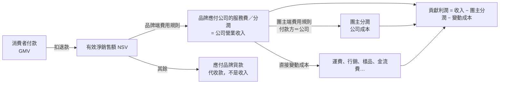
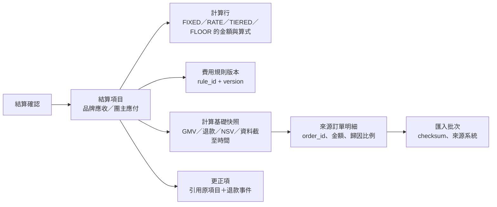
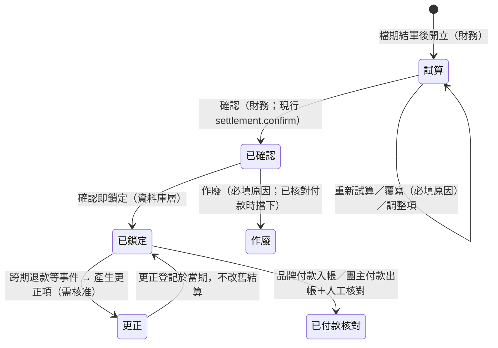

# 04 財務與分潤模型

> **狀態：PROPOSED（待 Owner 確認）。** 金額公式屬 Owner 決策（既有待決策 D-06，見 `docs/spec/SRS.md` §9）。本文件只提出模型與離線驗證結果，**沒有修改任何現行結算邏輯、沒有新增程式進系統、沒有撥款**。
> 對應原型與算例：[`prototype/settlement-model.ts`](prototype/settlement-model.ts)、[`prototype/verify.ts`](prototype/verify.ts)（`npm run verify:biz-model`，28 項算例，結果見 §9）。
> 名詞對照：品牌＝`vendors`；團主＝`hosts`；淨銷售額沿用 `src/server/lib/kpi.ts` 的定義。

## 1. 五個不能混用的數字

| 數字 | 定義 | 是誰的錢 | 現況 | 備註 |
|---|---|---|---|---|
| **品牌 GMV** | Σ 計入銷售訂單的消費者支付總額（狀態 PAID／PARTIAL_REFUND／REFUNDED；取消、未付款不計） | 品牌（代理模式下） | ✅ 已有（`kpi.ts` `gmv`） | **不是公司收入** |
| **有效淨銷售額（NSV）** | GMV − 退款金額 | 品牌 | ✅ 已有（`net`） | 分潤基礎的預設候選（決策 B-01） |
| **代收款（代營運居中時）** | 公司代收消費者款項，尚未支付給品牌的部分 | 負債（應付品牌） | ❌ 無 | 現金帳科目，不進損益 |
| **公司營業收入** | 向品牌（或團主）收取的服務費／分潤／固定費／保底，採**代理人淨額法** | 公司 | ❌ 無（現有「預估佣金」是團主端的佣金，不是公司收入） | 認列時點與稅務由會計師確認（決策 B-08） |
| **貢獻利潤** | 公司營業收入 − 公司負擔的團主分潤 − 直接變動成本 | 公司 | ❌ 無（`expenses` 只做紀錄） | 研究報告 §六的「檔期貢獻利潤」是自營口徑；代理人口徑見 §2.2 |



**硬性規則（寫進驗收條件）**：任何畫面、報表、API 都不得把 GMV、淨銷售額或代收款標示為「公司收入」。`【假設 A-03】`

## 2. 各模式的收益、成本、分潤

### 2.1 收益腿與成本腿

| 模式 | 公司的收益（向誰收、收什麼） | 公司的成本 | 團主分潤的付款方（預設） |
|---|---|---|---|
| 代營運 `AGENCY` | 向品牌收：服務費（固定／分潤／階梯／保底／混合） | 營運人力（不進貢獻利潤，見 B-10）；墊付運費、行銷、樣品；若付團主分潤則為成本 | 視合約：公司或品牌 |
| KOL／KOC `KOL_CPS` | 向品牌收：推廣分潤（公司可抽差額）或固定合作費 | 付給 KOL：成交分潤／固定合作費／階梯；內容與行銷費 | 公司或品牌 |
| 團媽／社群主 `MOM_GROUP` | 向品牌收：分潤；或公司對團主的分潤差額 | 付給團主：分潤（團主自留價差則公司沒有此成本） | 公司、品牌，或團主自留 |

### 2.2 貢獻利潤（代理人口徑）

```
公司營業收入 = Σ 品牌端費用規則算出的金額（服務費／分潤／階梯／保底／混合）
公司負擔的團主分潤 = Σ 團主端費用規則算出的金額，且 付款方 = 公司
貢獻利潤 = 公司營業收入 − 公司負擔的團主分潤 − 直接變動成本
抽成率（Take rate）   = 公司營業收入 ÷ 有效淨銷售額
貢獻利潤率           = 貢獻利潤 ÷ 公司營業收入
```

- 團主分潤付款方＝品牌時，**不扣**（它不是公司成本）；這是 S3 情境（[02](02-MODEL_AND_RESPONSIBILITY.md) §4）。
- 直接變動成本沿用 `expenses.category`：`SHIPPING`、`MARKETING`、`SAMPLE`、`PLATFORM_FEE`、`OTHER`；是否把金流手續費、客服人力、共用人力算進去 → 決策 B-10。
- 若有自營進貨（PRINCIPAL，`【假設 A-01】`），才使用研究報告的自營口徑：`貢獻利潤 = 有效淨銷售額 − 商品成本 − 佣金 − 變動費 − 固定物流費 − 行銷費`；本規劃第一階段不做。

## 3. 費用規則（固定費、純分潤、階梯、保底抵佣、混合）

品牌端與團主端使用**同一套規則表達**，差別只在「綁在合作案」或「綁在檔期團主」。規則由若干**組成項目（component）**組成，版本化、不可覆寫舊版（比照 `commission_rules.rule_version`）。

| 合作方式 | 組成項目 | 公式 | 範例（原型驗證編號） |
|---|---|---|---|
| 固定費 | `FIXED(amount)` | 金額，與業績無關 | 20,000（V02） |
| 純分潤 | `RATE(basis, rate)` | `基礎 × 費率` | 淨銷售 100,000 × 10% = 10,000（V01）；基礎改 GMV 結果不同（V14） |
| 階梯抽成·累進 | `TIERED(MARGINAL, tiers)` | 每級只對落在該級的金額抽成 | 250,000 → 100,000×5% + 150,000×8% = 17,000（V03、V05、V06） |
| 階梯抽成·全額累進 | `TIERED(CLIFF, tiers)` | 達到哪一級，**全額**用該級費率 | 250,000 → 全額 × 8% = 20,000（V04） |
| 保底抵佣 | `FLOOR(OFFSET, amount)` | `max(保底, 其他項目合計)`；分潤用來抵保底，不疊加 | 保底 10,000＋10%：淨銷售 60,000 → 付 10,000（補 4,000）；150,000 → 付 15,000（V07、V08） |
| 保底加佣 | `FLOOR(ADD, amount, threshold)` | `保底 + 超過門檻部分 × 費率`；保底不可被抵銷 | 保底 10,000、門檻 50,000：淨銷售 40,000 → 10,000；150,000 → 10,000 + 10,000 = 20,000（V09、V10） |
| 混合 | `FIXED + RATE/TIERED` | 各項相加 | 固定 5,000 + 3% × 100,000 = 8,000（V13） |

**重要定義爭議（`【決策 B-02】【決策 B-03】`）**：
1. **累進 vs 全額累進**會差到 17,000 對 20,000（同一組階梯、同一業績，V03／V04），合約必須指定。
2. **保底抵佣 vs 保底加佣**：研究報告 §六 已提醒兩者不同（V11：同樣淨銷售 150,000，抵佣付 15,000、加佣付 20,000）。原型證明了一個陷阱：**當加佣門檻剛好等於「保底 ÷ 費率」時，兩者在任何業績下金額相同**（V12），所以合約若只寫「保底加佣」而不寫門檻，雙方可能對金額有不同理解。系統一律要求門檻欄位必填。
3. **分潤基礎**：淨銷售額（扣退款）或 GMV；含稅或未稅（決策 B-01）。系統只支援 `NSV`、`GMV` 兩種基礎；毛利基礎需要商品成本，不納入（`SKU.cost_price` 屬敏感欄位）。

**不採用的做法**：不用「毛利」當分潤基礎；不做「累進＋全額累進」混用；不做「保底＋封頂」（若有此合約，列為待確認需求，不先做）。

## 4. 取消、部分退款、跨期退款與分潤更正

### 4.1 訂單層規則（沿用現行口徑，已實作）

| 情況 | 處理 | 驗證 |
|---|---|---|
| 取消（`CANCELLED`）、未付款（`PENDING`） | 不計入 GMV、NSV、分潤基礎 | V15、V16 |
| 部分退款（`PARTIAL_REFUND`） | 只扣退款額（GMV 計全額，NSV 扣退款） | V15 |
| 全額退款（`REFUNDED`） | GMV 計入、退款全額、NSV 為 0；不算有效訂單 | V15 |
| 退款大於訂單金額 | 拒絕（現行資料庫 CHECK 已擋；原型也拋錯） | V15 |

### 4.2 跨期退款與分潤更正：「重算再扣差額」

問題：檔期結算並確認、鎖定後，才發生退款（例如 12 月退 11 月結算的訂單）。

**建議方法（決策 B-04 的選項 A，推薦）**：
1. 退款**回溯歸到原訂單所屬檔期**（基礎是「截至更正日的累計 NSV」），用同一條規則**對最終基礎重算**；
2. 與「已確認的累計金額」相減，差額就是**更正項**，登記在**更正發生的結算期**（不改已鎖定的舊結算）；
3. 更正項只增不改、必填原因、引用原結算項目與觸發的退款事件。

好處與可驗證性質：
- 累計金額 ＝ 用最終淨銷售額一次算完的金額，不論拆成幾期、更正幾次（V19）；
- 重複執行不會重複扣（V20，冪等）；
- 對階梯、保底都成立：階梯會因為跌回較低級距而多退（V18：17,000 → 12,200，更正 −4,800）；保底則有下限（V21：分潤降到 8,000 低於保底 10,000，更正只有 −5,000，不是 −7,000）。

**替代方案（選項 B）**：退款當期直接扣回「退款額 × 原適用費率」，不重算級距。優點簡單；缺點是階梯與保底下金額不等於一次算完，長期有偏差。若 Owner 選 B，本文 §4.2 與原型的 `correction()` 需改寫。

### 4.3 其他規則（建議）

| 規則 | 說明 | 決策 |
|---|---|---|
| 結算時點 | 以「鑑賞期＋退款受理期結束」為準，而非結單當天，以減少跨期更正；現行 15 步任務的「廠商後台報表結算」是結單後 14 天 | B-05 |
| 更正的核准 | 金額超過門檻（或造成負結算）需財務＋主管雙人核准 | B-06 |
| 負結算（團主應退回超領分潤） | 預設「抵下期應付」，連續兩期無法抵銷才轉為「應收回」並人工處理 | B-07 |
| 多團主分攤 | 沿用 `attributions.share_percent`；分攤用**最大餘數法**，保證加總等於總額（V22） | B-13 |
| 進位 | 每一個組成項目四捨五入到整數元（half-up）；團主間分攤用最大餘數法 | B-12 |

## 5. 可追溯性（每一筆金額都要能回溯到來源資料）

### 5.1 追溯鏈



### 5.2 必須保存的欄位（現況對照見 [05](05-DATA_MODEL_GAP.md)）

| 層級 | 必存內容 | 現況 |
|---|---|---|
| 結算項目 | 規則 ID 與版本、基礎值（GMV、退款、NSV）、資料截至時間、計算行（類型、金額、算式文字） | 部分：已存 `rate_percent`、`rule_id`、`rule_version`、`data_as_of`；沒有計算行 |
| 來源訂單 | 結算項目 ↔ 訂單的關聯（訂單、金額、歸因比例、是否被退款影響） | ❌ 沒有；目前只能以「同一檔期、同一時間點」重算比對（`STALE_CALCULATION` 檢查） |
| 更正項 | 引用原結算項目、觸發的退款事件、更正前後金額 | 部分：`settlement_adjustments` 有金額與原因，沒有引用 |
| 退款事件 | 退款發生日、金額、關聯案件／退款申請 | ❌ `orders.refund_amount` 是累計值，沒有事件日期；售後 `refund_requests` 有完成日，可作為來源 |
| 付款 | 與結算項目的對應與核對狀態 | ✅ `payments.settlement_item_id`、`match_status` |

驗收條件：任選一筆結算金額，能在畫面或 API 上逐層展開到「規則版本 → 計算行 → 來源訂單 → 匯入批次」，且各層加總相等（V23、V24）。

## 6. 品牌端與團主端的結算流程



| 步驟 | 品牌端（應收服務費） | 團主端（應付分潤） | 人工核准 |
|---|---|---|---|
| 1 試算 | 以品牌端規則算 | 以每位團主的規則算 | — |
| 2 覆寫／調整 | 同現行：覆寫與調整項必填原因 | 同左 | 財務 |
| 3 確認 | 開品牌請款（發票紀錄） | 確認分潤，通知團主（測試 Adapter） | 財務＋（對照 G4） |
| 4 付款核對 | `payments(IN, VENDOR)` | `payments(OUT, HOST)` | 財務（人工比對，不接銀行） |
| 5 更正 | 產生更正項 | 產生更正項 | 超過門檻：財務＋主管 |

**需要人工核准的操作（不可自動化）**：確認結算、作廢結算、覆寫金額、更正項（超過門檻）、負結算處置、任何撥款。系統目前沒有金流整合，撥款一律在系統外，系統只記錄與核對（沿用 `FINANCE.md`）。

## 7. 與現行實作的差異

| 面向 | 現行（已實作且已測試） | 本模型需要 | 處理建議 |
|---|---|---|---|
| 費率規則 | `commission_rules`：只有 `HOST_DEFAULT`／`CAMPAIGN_HOST`、單一 `rate_percent`、基礎只有 `NET_SALES` | 固定費、階梯、保底、混合；品牌端規則；付款方；基礎 GMV | **擴充**：新增 `fee_rules` 與組成項目；`commission_rules` 視為「單一費率」特例，保留並相容 |
| 結算 | 每檔、每團主一個項目；`commission_auto`（單一費率）＋覆寫＋調整 | 品牌端項目、計算行、來源訂單、更正引用 | **擴充**：加欄位／子表，不改既有鎖定與冪等機制 |
| 公司收入／貢獻利潤 | 無（財務總覽有試算佣金與費用彙總，不是損益） | 品牌端服務費、貢獻利潤 | **新增**視圖與 KPI（見 [03](03-KPI_DICTIONARY.md)） |
| 退款事件 | `orders.refund_amount` 累計 | 事件日期、事件關聯 | **新增** `refund_events`（可由售後退款完成事件與 CSV 匯入產生） |
| G4 | 人工確認、不自動串接結算 | 無需改（維持決策 D-07） | 不動 |

## 8. 需要的測試案例與驗收條件（實作階段）

| # | 案例 | 驗收條件 |
|---|---|---|
| T-F01 | 六種合作方式各一 | 與 §3 表格金額逐項相同（由手算值寫死在測試裡，不得由被測程式產生） |
| T-F02 | 取消、未付款、部分退款、全額退款混合 | GMV／退款／NSV 與 V15 一致；訂單數規則同現行 `kpi.ts` |
| T-F03 | 跨期退款更正 | 累計＝一次算完；重複執行差額為 0；舊結算仍鎖定不可改 |
| T-F04 | 階梯跌級、保底觸底 | 更正金額為 −4,800、−5,000（與 V18、V21 相同） |
| T-F05 | 多團主分攤 | 加總等於總額；比例不為 100 時拒絕 |
| T-F06 | 追溯 | 任一結算項目可展開到來源訂單；各層加總相等；改動來源後 `STALE_CALCULATION` 擋下確認 |
| T-F07 | 公司收入不含 GMV | 任何報表公司營業收入 ＝ 品牌端費用之和；測試以 GMV 很大、費用很小的資料驗證 |
| T-F08 | 付款方 | 團主分潤付款方＝品牌時，不進貢獻利潤的成本；付款方＝公司時進 |
| T-F09 | 權限 | 團主只看自己的已確認分潤；財務才看品牌端費用；營運主管看彙總；廠商看不到分潤 |
| T-F10 | 鎖定 | 確認後資料庫層禁止改項目與調整（現行觸發器），更正走新增列 |

## 9. 離線驗證結果

執行：`npm run verify:biz-model`（`docs/biz-model/prototype/verify.ts`；純函式、不連資料庫、不接任何服務）。**28 項全部通過**：

| # | 驗證項目 | 預期 | 實際 |
|---|---|---|---|
| V01 | 純分潤 10%：淨銷售 100,000 | 10,000 | 10,000 |
| V02 | 固定費：不論業績 | 20,000 | 20,000 |
| V03 | 階梯（累進）250,000 | 17,000 | 17,000 |
| V04 | 階梯（全額累進）250,000 | 20,000 | 20,000 |
| V05 | 階梯（累進）跨三級 350,000 | 26,000 | 26,000 |
| V06 | 階梯邊界 100,000 | 5,000 | 5,000 |
| V07 | 保底抵佣：分潤 6,000 < 保底 | 10,000 | 10,000 |
| V08 | 保底抵佣：分潤 15,000 > 保底 | 15,000 | 15,000 |
| V09 | 保底加佣：未達門檻 | 10,000 | 10,000 |
| V10 | 保底加佣：超過門檻 | 20,000 | 20,000 |
| V11 | 同業績下抵佣與加佣不同 | 15,000 vs 20,000 | 15,000 vs 20,000 |
| V12 | 門檻 ＝ 保底 ÷ 費率時兩者等價（合約風險） | 相等 | 25,000 = 25,000 |
| V13 | 混合：固定 5,000 + 3% | 8,000 | 8,000 |
| V14 | 分潤基礎 GMV | 2,000 | 2,000 |
| V15 | 取消／未付款不計；部分與全額退款：GMV 350,000、退款 70,000、NSV 280,000 | 350000/70000/280000 | 同 |
| V16 | 計入銷售訂單數 | 4 | 4 |
| V17 | 第 1 期結算 | 17,000 | 17,000 |
| V18 | 跨期退款 60,000 後重算與更正 | −4,800 | −4,800 |
| V19 | 更正後累計 ＝ 一次算完 | 12,200 | 12,200 |
| V20 | 更正冪等 | 0 | 0 |
| V21 | 保底下限：更正只有 −5,000 | −5,000 | −5,000 |
| V22 | 多團主分攤加總 | 10,001 | 10,001 |
| V23 | 計算行加總 ＝ 總額，並帶規則版本 | 24,400 | 24,400 |
| V24 | 來源訂單加總 ＝ 計算基礎 | 280,000 | 280,000 |
| V25 | 公司營業收入只有服務費 40,500，不是 GMV 300,000 | 40,500 | 40,500 |
| V26 | 貢獻利潤 13,900；抽成率 15%；貢獻利潤率 34.32% | 13,900 | 13,900 |
| V27 | 團主分潤由品牌直付時不是公司成本 | 35,500 | 35,500 |
| V28 | 代營運居中：應付品牌 229,500、公司留存 40,500 | 229,500 | 229,500 |

**突變驗證（確認算例不是空轉）**：故意改壞三處——「更正不扣已確認金額」「保底抵佣變成相加」「取消訂單也計入」——算例全部轉紅；還原後 28/28。

### 9.1 這個驗證「沒有」證明什麼

- 它證明**公式在我們寫下的定義下自洽**，不證明這些定義就是公司的合約條款；階梯是累進還是全額累進、保底是抵佣還是加佣，都要 Owner 與合約確認。
- 沒有接資料庫、沒有跑過真實或 DEMO 訂單、沒有稅額與發票邏輯、沒有會計認列（需會計師）。
- 費率、金額全部是範例數字，**不是任何真實合約的條件**。

## 10. 本文件提出的決策（彙整於 [08](08-RISKS_GAPS_DECISIONS.md)）

B-01 分潤基礎（淨銷售／GMV、含稅／未稅）｜B-02 階梯累進方式｜B-03 保底抵佣與保底加佣的合約定義｜B-04 跨期退款處理（重算再扣差額／當期扣回）｜B-05 結算時點｜B-06 更正的核准門檻｜B-07 負結算處置｜B-08 公司營業收入的認列方式與時點（需會計師）｜B-09 品牌服務費與團主分潤的付款方｜B-10 變動成本範圍｜B-11 發票開立方與稅額基礎｜B-12 進位規則｜B-13 多團主分攤基礎｜B-14 KOL 歸因優先序｜B-15 是否納入自營進貨（PRINCIPAL）
