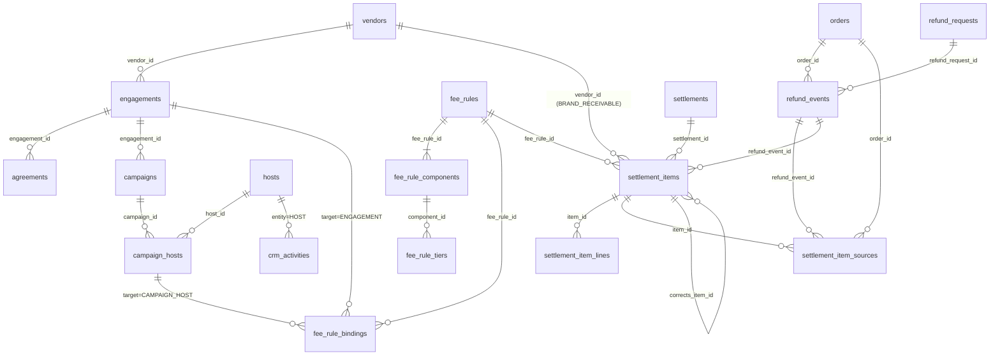

# 05 ERP 資料模型差異分析

> **狀態：PROPOSED（待 Owner 確認）。** 這是「規劃」：沒有修改任何 migration、程式或已核准的 SRS／SAD／SDD。所有「建議」都需要 Owner 確認並走正常的規格→實作流程。
> 依據：`migrations/001`～`013`、`docs/generated/DATA_DICTIONARY.md`（58 張表）、`src/server/lib/kpi.ts`、`src/server/lib/commission-calc.ts`、`src/server/modules/*.ts`。引用的名詞與代碼以 [02](02-MODEL_AND_RESPONSIBILITY.md)、[04](04-FINANCE_AND_COMMISSION.md) 為準。KPI 的來源與口徑細節見 [03](03-KPI_DICTIONARY.md)，營運流程見 [01](01-OPERATING_SOP.md)，實作分期見 [07](07-ROADMAP.md)。
> 標示：`【假設 A-3x】` 未證實的商業假設｜`【決策 B-xx】` 需 Owner 決定（彙整於 [08](08-RISKS_GAPS_DECISIONS.md)）。

## 1. 先講結論

1. **既有 58 張表可以直接承接大部分需求**：品牌（`vendors`）、團主（`hosts`、`host_communities`、`communities`）、客群（SOP 01 的 5 張表）、檔期（`campaigns` 與三張子表）、商品／SKU、訂單／歸因、履約、售後、結算（草稿→確認→鎖定、覆寫、調整項）、入帳／發票／費用、稽核與權限，全部沿用，**不重建、不改語意**。
2. **缺的是「合作條件的結構化」**，不是主檔：
   - 沒有**合作案**（公司 × 品牌的商務關係）；`campaigns` 只有 `vendor_id` 與自由文字的 `campaign_type`（預設 `'STANDARD'`，沒有 CHECK，也沒有任何程式讀取它——只有 `campaigns.ts` 的 INSERT）。
   - 合作條件只存在**文字欄位**（`agreements.terms`、`agreements.commission_note`、`hosts.cooperation_terms`、`vendors.cooperation_note`）或**單一費率**（`commission_rules.rate_percent`，基礎只能是 `NET_SALES`）。
   - 沒有**模式／金流／履約／責任方**欄位，沒有**品牌端應收**，沒有**退款事件日期**，沒有**結算計算行與來源訂單關聯**，沒有**更正引用**，沒有 **KPI 維度快照**。
3. **建議新增 9 張必要新表（另有 1 張選配）、變更 9 張既有表（另有 1 張選配）；只新增可空欄位、放寬 CHECK 或重建索引，不改既有欄位語意**，分 4 批必要 migration（014～017）＋1 批選配（018）。唯一會碰到既有核准規格的地方有兩處：
   - `settlements_campaign_live_uq`（011）限制「同檔期同時只有一份草稿或已確認的結算」，會擋住**更正結算**（§8 衝突 C-1）；
   - 若把模式專屬檢查加進 G1～G5，會改變 `FR-GATE-09` 的檢查清單（§8 衝突 C-5）——**本規劃預設不加**，只在 Owner 核准後才做。
4. **不建議**：新增檔期狀態、拆分 `vendors` 成多張表、把 `hosts` 改成多型別繼承、把 KPI 值存成大寬表。

## 2. 差異總表

判定：**沿用**（不動）｜**擴充**（既有表加欄位／放寬約束／加 API）｜**新增**（新表）。

| # | 需求項 | 現況（檔案） | 判定 | 理由 |
|---|---|---|---|---|
| 1 | 品牌主檔 | `vendors`（002）：名稱、公司全名、統編、類別、狀態 PROSPECT→ACTIVE→PAUSED／BLACKLISTED | 沿用 | 已有 BD 前段狀態；只需加「類型」 |
| 2 | 品牌類型（品牌方／供應商／代理商） | 無 | 擴充 | `vendors.party_type`（可空）；不拆表 |
| 3 | 品牌聯絡人 | `vendor_contacts` | 沿用 | — |
| 4 | 合約文件 | `agreements`（002，僅 Schema、無 API，FR-MD-14 NOT_STARTED） | 擴充 | 加 `engagement_id`、`kind`；補 API；結構化條款不放這裡，放 `fee_rules` |
| 5 | 團主主檔 | `hosts`（002）：狀態 ACTIVE／PAUSED／ENDED、`audience_note`、`cooperation_terms`、`partner_type`（013） | 沿用 | — |
| 6 | 團主類型 KOL／KOC／團媽／社群主 | `hosts.partner_type` CHECK：`GROUP_MOM`、`COMMUNITY_OWNER`、`KOL`、`OTHER`（013）；**缺 `KOC`** | 擴充 | 放寬 CHECK；同步 `segment-vocab.ts` 的 `PARTNER_TYPES` |
| 7 | 團主 CRM 管線（接觸→洽談→試用→合作） | `hosts.status` 只有三種（沒有「潛在」「洽談中」）；無接觸紀錄 | 擴充＋新增 | `hosts.crm_stage`＋`crm_activities` |
| 8 | 社群與通路 | `communities`、`host_communities`、`host_availability` | 沿用 | — |
| 9 | 客群分析 | 013 的 5 張表 | 沿用 | SOP 01 已涵蓋，**不重複設計** |
| 10 | 商務合作案 | **無** | 新增 | `engagements`（§4.3） |
| 11 | 檔期 | `campaigns`（003）14 狀態、`vendor_id`、`campaign_type`（自由文字） | 擴充 | 加 `engagement_id`、`primary_mode`、`cash_flow_mode`、`fulfillment_mode`；`campaign_type` 不再擴用（保留相容） |
| 12 | 檔期團主合約 | `campaign_hosts`：`role`（PRIMARY／CO）、`status`、`target_revenue`、`commission_rule_id`（**無 FK**） | 擴充 | 加 `role_type`、`attribution_method`、`commission_payer`、`disclosure_required` |
| 13 | 商品／SKU | `products`、`skus`（含成本，敏感）、`product_assets` | 沿用 | — |
| 14 | 訂單 | `orders`：`refund_amount` 為**累計值**、無退款日期、無付款方式 | 擴充 | 加 `payment_method`（可空）；退款事件另建表 |
| 15 | 退款事件 | **無**；`refund_requests`（010）有 `completed_at`、`order_id`、`writeback_applied`（預設不寫回） | 新增 | `refund_events`（§4.6） |
| 16 | 歸因 | `attributions`：PK `(order_id, host_id)`、`share_percent`、`method`（CODE／LINK／MANUAL／IMPORT） | 沿用 | 多團主分攤已支援；歸因優先序屬規則（B-14），不是資料欄位 |
| 17 | 履約 | `fulfillment_batches`（kind SAMPLE／ORDER）、`shipments`、`inventory_movements` | 沿用 | 模式放在檔期／合作案，不放在出貨單 |
| 18 | 售後 | `service_cases`、`case_events`、`refund_requests` | 沿用 | 責任方由合作案預設帶出，不改案件表 |
| 19 | 單一費率佣金 | `commission_rules`：`scope_type` HOST_DEFAULT／CAMPAIGN_HOST、`rate_percent`、`basis` 只有 NET_SALES、版本化 | 沿用 | 視為 `fee_rules` 的特例，保留且相容（§4.5） |
| 20 | 結構化費用規則（固定／階梯／保底／混合） | **無** | 新增 | `fee_rules`、`fee_rule_components`、`fee_rule_tiers` |
| 21 | 結算 | `settlements`（DRAFT／CONFIRMED／VOID、每檔期一份「活的」）、`settlement_items`、`settlement_adjustments`（append-only） | 擴充 | 鎖定與冪等機制**不動**；加種類與欄位 |
| 22 | 品牌端應收項目 | `settlement_items.host_id` 可空，但 `(settlement_id, host_id)` 唯一索引對 NULL 不生效 | 擴充 | 加 `item_type`、`vendor_id`，改用新的唯一索引 |
| 23 | 計算行（組成項目的金額與算式） | 無（只有 `commission_auto`、`rate_percent`） | 新增 | `settlement_item_lines` |
| 24 | 來源訂單關聯 | 無（以重算比對偵測過期：`STALE_CALCULATION`） | 新增 | `settlement_item_sources` |
| 25 | 更正（跨期退款） | `settlement_adjustments` 只有金額與原因，無引用；且鎖定後不能新增 | 擴充 | 加 `corrects_item_id`、`refund_event_id`；更正走「更正結算」 |
| 26 | 入帳／付款／發票／費用 | `payments`（IN／OUT、VENDOR／HOST／PLATFORM）、`invoices`、`expenses` | 沿用 | `payments` 已能表達品牌端 IN 與團主端 OUT |
| 27 | 公司營業收入／貢獻利潤 | 無（財務總覽只有試算佣金與費用彙總） | 新增（視圖＋KPI） | 由 `settlement_items`（BRAND_RECEIVABLE／HOST_PAYABLE）＋`expenses` 推導，不另存 |
| 28 | KPI 口徑 | `kpi.ts` 單一來源（`KPI_DEFS`、`SALES_STATUSES`）；`dashboard.ts`、`dashboard-extra.ts` 即時查詢；`daily_summaries`（jsonb 單日） | 擴充＋新增 | 口徑繼續集中在 `kpi.ts`；新增 `kpi_snapshots`（可依維度切分） |
| 29 | 狀態機 | 14 個檔期狀態、G1～G5；結算 3 狀態 | 沿用＋新增 engagement 狀態 | 不新增檔期狀態（§9） |
| 30 | 權限 | 49 項（`permissions.ts`） | 擴充 | 新增約 8 項（§10） |

## 3. 逐項檢視（現有表與欄位、沿用、缺口、最小變更、衝突）

### 3.1 品牌與供應商主檔

| 項目 | 內容 |
|---|---|
| 現有 | `vendors`（`status` PROSPECT／CONTACTED／ACTIVE／PAUSED／BLACKLISTED；`category`、`tax_id`、`company_name`、`cooperation_note`、`internal_note`）；`vendor_contacts`（主要聯絡人唯一）；`agreements`（`title`、`terms`、`commission_note`、`effective_from/to`、`status` DRAFT／ACTIVE／EXPIRED／TERMINATED、`document_url`，**沒有 API 與測試**，只驗證表存在） |
| 可直接沿用 | 全部。廠商的 BD 前段狀態已存在（PROSPECT→CONTACTED→ACTIVE），不需要另建「品牌 CRM」 |
| 缺口 | ① 品牌／供應商／代理商不分（`vendors` 一律叫廠商）；② `agreements` 沒有 API，也沒有和合作案的關聯；③ 沒有合約版本鏈（`version` 只是樂觀鎖） |
| 最小變更 | `vendors.party_type text NULL CHECK IN ('BRAND','SUPPLIER','DISTRIBUTOR')`（空＝未知）；`agreements.engagement_id text NULL REFERENCES engagements(id)`、`agreements.kind text NULL CHECK IN ('MASTER','CAMPAIGN','ADDENDUM')`；補 `agreements` CRUD API（對應 FR-MD-14，現為 COULD） |
| 與核准規格衝突 | 無（FR-MD-01～03 不變；FR-MD-14 由 NOT_STARTED 轉為實作，需更新 SRS 狀態）。`【假設 A-30】`品牌與供應商共用 `vendors`，以 `party_type` 區分即可，不需拆表 |

### 3.2 團主與合作夥伴 CRM

| 項目 | 內容 |
|---|---|
| 現有 | `hosts`（`status` ACTIVE／PAUSED／ENDED；`partner_type` GROUP_MOM／COMMUNITY_OWNER／KOL／OTHER；`audience_note`、`cooperation_terms`、`internal_note`）、`host_communities`、`communities`、`host_availability`（可承接／不可承接區間）、客群 5 張表（`customer_segments`、`segment_preferences`、`partner_segment_links`、`segment_evidence`、`product_fit_assessments`）。團主可見範圍由 `user_scopes` 與 `campaignScope()` 控制 |
| 可直接沿用 | 主檔、社群、可承接檔期、客群與適配評估（團主評估已有 `fit` 模組，**不另做團主評分表**） |
| 缺口 | ① `partner_type` 沒有 **KOC**（研究報告與需求都有 KOL／KOC 兩類）；② 團主沒有 BD 前段狀態：`hosts.status` 沒有「潛在／洽談中／試用中」，也沒有接觸紀錄與下次跟進日；③ `partner_type` 是團主主檔的預設值，但同一團主不同檔期可能扮演不同角色（[02](02-MODEL_AND_RESPONSIBILITY.md) §4 S5），角色要記在檔期團主合約（§3.4） |
| 最小變更 | 放寬 `hosts.partner_type` 的 CHECK 加入 `'KOC'`（PostgreSQL 自動命名的檢查約束，實作時用 `pg_constraint` 查名稱後 `DROP`＋`ADD`；**只放寬，不改既有值語意**），同步 `src/server/lib/segment-vocab.ts` 的 `PARTNER_TYPES`／`PARTNER_TYPE_LABEL` 與 zod；`hosts.crm_stage text NULL CHECK IN ('PROSPECT','CONTACTED','NEGOTIATING','TRIAL','ACTIVE','DORMANT','LOST')`；新增 `crm_activities`（§4.8，通用：團主／廠商／合作案） |
| 與核准規格衝突 | 低。FR-SEG-06（`hosts.partner_type`）的列舉值要加 KOC；`hosts.status` 不動，`crm_stage` 是新欄位，避免改既有三態語意 |

### 3.3 商務合作案（新增）

現況：沒有此實體。檔期只有 `vendor_id`，無法回答「這個品牌這一季的合作條款是什麼」「同一品牌的三檔屬於同一個合作案嗎」「品牌端服務費怎麼算」。

建議最小設計 `engagements`（§4.3）：

| 欄位 | 型別 | 可空 | 約束／說明 |
|---|---|:-:|---|
| `id` | text PK | 否 | `ENG-0001`（`ids.ts` 新增計數器 `ENG`） |
| `organization_id` | text FK | 否 | 多租戶 |
| `vendor_id` | text FK→`vendors` | 否 | 合作品牌 |
| `title` | text | 否 | 例：「[DEMO] 晴空保養 2026 Q4 合作案」 |
| `normalized_title` | text | 否 | 名稱正規化，同品牌同名唯一（未刪除者） |
| `status` | text | 否 | `LEAD`／`NEGOTIATING`／`ACTIVE`／`ON_HOLD`／`ENDED`／`DROPPED`，預設 `LEAD` |
| `transaction_mode` | text | 否 | `AGENT`／`PRINCIPAL`，預設 `AGENT`（`【假設 A-01】`；`PRINCIPAL` 先保留值但不開放使用，B-15） |
| `cash_flow_mode` | text | 是 | `BRAND_COLLECTS`／`HOST_COLLECTS`／`COMPANY_ESCROW`；空＝未定（開團前必須指定） |
| `fulfillment_mode` | text | 是 | `BRAND_SHIPS`／`COMPANY_DC`／`HOST_PICKUP` |
| `host_commission_payer` | text | 是 | `COMPANY`／`BRAND`／`HOST_KEEPS`（[04](04-FINANCE_AND_COMMISSION.md) §2.2；B-09） |
| `responsibilities` | jsonb | 否 | `{"seller_party","collector","invoicer","refunder","after_sales_owner","fulfiller","disclosure_owner"}`，值為 `BRAND`／`COMPANY`／`HOST`；預設 `{}`；對應 [02](02-MODEL_AND_RESPONSIBILITY.md) §6.1（B-17） |
| `effective_from`／`effective_to` | date | 是 | `from ≤ to` |
| `owner_user_id` | text FK→`users` | 是 | 合作案負責人（營運 PM） |
| `note` | text | 是 | 內部備註 |
| `created_*`／`updated_*`／`version`／`deleted_at` | — | — | 沿用標準欄位、`touch_row`、`forbid_delete` 觸發器；只軟刪除 |

為什麼 `responsibilities` 用 jsonb：七個責任欄位彼此獨立、取值相同、會隨合約增減；KPI 與結算**不依賴**它們做運算（運算依賴 `cash_flow_mode`、`host_commission_payer`，這兩個用獨立欄位與 CHECK），所以不需要七個欄位與七個 CHECK。

### 3.4 團購活動與檔期

| 項目 | 內容 |
|---|---|
| 現有 | `campaigns`（`vendor_id`、`campaign_type`、`status` 14 種、`target_revenue`、`workflow_template_id/version`、`workflow_params`）；`campaign_products`（多 SKU）；`campaign_hosts`（`role`、`status`、`target_revenue`、`commission_rule_id`——**沒有外鍵**）；`campaign_placements`；`approvals`（`check_snapshot` jsonb）；`exceptions` |
| 可直接沿用 | 狀態機、關卡、任務、排程、衝突偵測、曝光安排、目標 |
| 缺口 | 無 `engagement_id`；無 `primary_mode`；金流／履約模式沒有檔期層級的覆寫；團主在該檔的**角色**、**歸因方式**、**分潤付款方**、**是否需揭露**沒有欄位；`commission_rule_id` 沒有 FK，無法保證指向存在的規則 |
| 最小變更 | `campaigns.engagement_id text NULL REFERENCES engagements(id)`；`campaigns.primary_mode text NULL CHECK IN ('AGENCY','KOL_CPS','MOM_GROUP')`；`campaigns.cash_flow_mode`、`campaigns.fulfillment_mode`（可空，空＝沿用合作案）；`campaign_hosts.role_type text NULL CHECK IN ('KOL','KOC','GROUP_MOM','COMMUNITY_OWNER','OTHER')`（空＝沿用 `hosts.partner_type`）、`campaign_hosts.attribution_method text NULL CHECK IN ('CODE','LINK','MANUAL','NONE')`、`campaign_hosts.commission_payer text NULL CHECK IN ('COMPANY','BRAND','HOST_KEEPS')`、`campaign_hosts.disclosure_required boolean NOT NULL DEFAULT false`。`campaign_type` 不再擴用、不遷移（保留相容；看板不依賴它） |
| 模式標籤如何產生 | **不存標籤**，由服務層依 `fee_rule_bindings`＋`role_type` 推導（[02](02-MODEL_AND_RESPONSIBILITY.md) §2.1）；只把 `primary_mode` 當快取存下來，規則變動時重算，允許主管覆寫並留稽核（B-28）。`UNCLASSIFIED` 以 `primary_mode IS NULL` 且已有訂單表示，看板列出 |
| 與核准規格衝突 | 低：新增可空欄位，`getCampaign` 欄位投影需補 `engagementId`、`primaryMode` 與（財務敏感）規則摘要，對應 SDD §7.2；`campaign_hosts.commission_rule_id` 補 FK 屬資料修補（須先檢查既有資料），列為 P-B 的選配項，不是必要條件 |

### 3.5 商品與 SKU

| 項目 | 內容 |
|---|---|
| 現有 | `products`（類別、賣點、合規備註、審核狀態）、`skus`（`list_price`、`group_price`、`cost_price`——敏感，`product.cost.read`）、`product_assets` |
| 缺口 | 沒有。三種模式不需要商品層級的新欄位；成本只在自營（PRINCIPAL）才進公式，而 `【假設 A-01】` 第一階段不做 |
| 最小變更 | 無 |
| 衝突 | 無 |

### 3.6 訂單與支付資料

| 項目 | 內容 |
|---|---|
| 現有 | `orders`（`source_system`＋`source_order_id` 去重、`status`、`gross_amount`、`refund_amount`（累計）、`buyer_ref` 去識別化、`data_origin` IMPORT／DEMO／MANUAL、`import_batch_id`）、`order_items`、`attributions`、`import_batches`（`checksum`、`data_as_of`）、`import_errors`。CSV 是唯一進入路徑；API／Webhook 為 BLOCKED（SRS §8） |
| 可直接沿用 | 去重、歸因分攤、匯入批次追溯、資料品質狀態（NO_DATA／DEMO／IMPORT／MIXED） |
| 缺口 | ① **退款沒有事件日期**：`refund_amount` 是累計，無法判斷「退款發生在哪一期」，跨期更正（[04](04-FINANCE_AND_COMMISSION.md) §4.2）做不出來；`refund_requests.completed_at` 有日期，但寫回訂單預設關閉（`writeback_applied=false`），CSV 匯入的退款也沒有日期；② 沒有付款方式（信用卡／轉帳／貨到付款），影響金流手續費與退款處理；③ 沒有「實際收款方」（在檔期／合作案層級，見 §3.3） |
| 最小變更 | 新增 `refund_events`（§4.6）；`orders.payment_method text NULL`（`CARD`／`TRANSFER`／`COD`／`OTHER`）；`orders.refund_amount` **保留為快取**，不改語意，但新增不變式：`Σ refund_events.amount = orders.refund_amount`（由服務層與測試檢查，不用觸發器強迫，避免擋住舊 CSV 匯入） |
| 與核准規格衝突 | `FR-ORD-04`（退款不得大於訂單金額）仍成立；`FR-AFT-*` 退款完成時，除（可選）寫回 `orders.refund_amount`外，**必須同時寫一筆 `refund_events`**，這會改 SDD §17（售後）的完成退款流程。無事件日期的歷史資料以 `source='LEGACY_SNAPSHOT'`、`event_date` = 訂單日、`date_confidence='ASSUMED'` 回填，並在看板標示「日期為推估」（`【假設 A-31】`：歷史退款日期不可考，可接受以訂單日推估，只影響跨期更正的歸期，不影響總額） |

### 3.7 履約與售後

| 項目 | 內容 |
|---|---|
| 現有 | `fulfillment_batches`（`kind` SAMPLE／ORDER、狀態由出貨單彙總）、`shipments`（物流商、追蹤碼、`planned_date`、`shipped_date`、`delivered_date`、`EXCEPTION` 需原因）、`inventory_movements`（append-only）、`service_cases`（REFUND／COMPLAINT／EXCHANGE／OTHER、狀態含 WAITING_VENDOR）、`case_events`、`refund_requests`（REQUESTED→APPROVED→COMPLETED） |
| 可直接沿用 | 全部（出貨、簽收、庫存紀錄、客訴、退款核准與完成） |
| 缺口 | ① 履約模式（品牌直寄／公司集貨／團主自取）沒有欄位——由 `engagements`／`campaigns.fulfillment_mode` 提供，出貨單層級不重複存；② 售後責任歸屬（誰處理、誰承擔退款成本）沒有欄位——由合作案 `responsibilities` 帶出預設，案件層級若要覆寫，另加 `service_cases.responsible_party`（可空，`BRAND`／`COMPANY`／`HOST`，P-C 選配）；③ 團媽模式下「團主第一線客服量」沒有指標來源——`service_cases` 無團主欄位（可由 `campaign_id`＋歸因推得，見 03） |
| 最小變更 | `service_cases.responsible_party text NULL`（選配）；其餘不動 |
| 衝突 | 無（FR-FUL-*、FR-AFT-* 不變）。售後逾期尚未接例外自動化（KNOWN_ISSUES P2-5），屬既有限制 |

### 3.8 分潤與結算

| 項目 | 內容 |
|---|---|
| 現有 | `commission_rules`（單一費率、`basis` 只有 `NET_SALES`、`scope_type` HOST_DEFAULT／CAMPAIGN_HOST、`rule_version`、`effective_from/to`、ACTIVE／ARCHIVED）；`settlements`（`campaign_id`、`period_start/end`、`data_as_of`、`data_status`、DRAFT→CONFIRMED→VOID，確認後鎖定，`settlements_campaign_live_uq`：同檔期同時只有一份草稿或已確認）；`settlement_items`（`host_id` 可空、`net_sales`、`commission_auto`、`commission_override`＋原因、`rate_percent`、`rule_id`、`rule_version`；唯一 `(settlement_id, host_id)`）；`settlement_adjustments`（append-only，金額 ≠ 0、原因必填）；`payments`、`invoices`、`expenses`；`commission-calc.ts` 是 Dashboard 與結算共用的單一定義 |
| 可直接沿用 | 草稿／確認／作廢狀態機、資料庫層鎖定（`settlements_guard`、`settlement_children_guard`、012 的跨結算搬移防護）、覆寫與調整項、`STALE_CALCULATION` 檢查、冪等鍵、入帳與發票紀錄、稽核 |
| 缺口 | ① **費用規則只有單一費率**：沒有固定費、階梯、保底、混合，也沒有 GMV 基礎、付款方、退款政策；② **沒有品牌端**：沒有「品牌應付公司」的項目，所以算不出公司營業收入；③ `settlement_items.host_id` 雖可空，但 `(settlement_id, host_id)` 唯一索引對 NULL 不生效，品牌端項目沒有唯一保護；④ **沒有計算行**：只存最終 `commission_auto`，無法逐項解釋；⑤ **沒有來源訂單關聯**：過期偵測靠重算比對，無法逐層追溯；⑥ **更正做不到**：`settlements_campaign_live_uq` 只允許一份「活的」結算，確認後就不能為同一檔期再開草稿；`settlement_adjustments` 在非草稿結算上被觸發器擋下，也沒有引用 |
| 最小變更 | 新增 `fee_rules`、`fee_rule_components`、`fee_rule_tiers`、`fee_rule_bindings`、`settlement_item_lines`、`settlement_item_sources`（§4.4～4.5）；`settlements.kind`（`REGULAR`／`CORRECTION`，預設 `REGULAR`）並把唯一索引改為只限制 `REGULAR`；`settlement_items.item_type`（`HOST_PAYABLE`／`BRAND_RECEIVABLE`，預設 `HOST_PAYABLE`）、`vendor_id`、`fee_rule_id`、`corrects_item_id`、`refund_event_id`；以 `(settlement_id, item_type, COALESCE(host_id, vendor_id))` 的唯一索引取代只看 host 的保護（新索引，不刪舊索引直到驗證完成） |
| 與核准規格衝突 | **高，需同步修改核准規格**（§8 C-1～C-4）：`FR-FIN-01`（試算「只重用」既有口徑）、`FR-COM-03`（階梯等為 BLOCKED／待 Owner）、SDD §13、§18；同時**金額公式屬 Owner 決策**（D-06＝本規劃 B-01～B-08），**未確認前只能實作到「規則可以存、算式可以預覽」，不能自動產生正式分潤** |

### 3.9 KPI 資料來源與口徑

| 項目 | 內容 |
|---|---|
| 現有 | `src/server/lib/kpi.ts` 是**單一口徑來源**（`SALES_STATUSES`、`computeSales`、`KPI_DEFS`）；`dashboard.ts`／`dashboard-extra.ts` 即時查詢（訂單、檔期、任務、廠商成功率、準時開團率、商品復開等，其中三項為「暫定口徑」）；`daily_summaries`（組織×日期，`metrics` jsonb，只由每日摘要工作寫入）；`events` outbox |
| 可直接沿用 | 銷售口徑、資料品質狀態、期間（台北日曆月）、權限欄位投影（`campaign.sensitive.read`）、「無資料顯示 —、不顯示 0」原則 |
| 缺口 | ① 沒有**公司營業收入／貢獻利潤／抽成率**（無品牌端費用）；② 沒有**依模式切分**（無 `primary_mode`）；③ 沒有**時間序列與歷史快照**：`daily_summaries` 只有每日摘要的 jsonb，無法依維度（模式／品牌／團主／商品）查趨勢，且不能重現「當時的口徑版本」；④ 即時查詢在大量資料下的效能沒有基準（既有 `FEATURE_STATUS` #17 已註記「大量資料未做快照／快取」） |
| 最小變更 | 新增 `kpi_snapshots`（§4.9）：`(organization_id, kpi_key, period_type, period_start, dimension_type, dimension_id)` 為鍵，存分子、分母、值、資料品質與口徑版本；**KPI 定義不入資料庫**，繼續放程式（`KPI_DEFS`，每個 KPI 帶 `formulaVersion`），由 03 的字典為規格來源 |
| 衝突 | 低：`DASHBOARD_SPEC.md` 需新增 L1～L3 章節；`FR-DSH-01～09` 不變 |

## 4. 建議新增／變更的資料表與欄位

> 命名沿用現行風格：`snake_case`、業務 ID 由 `id_counters` 產生、標準欄位 `created_at/by`、`updated_at/by`、`version`、`deleted_at`、`touch_row` 與 `forbid_delete` 觸發器、全部帶 `organization_id`。「影響既有 API／測試」欄指：新增欄位會不會讓既有回應多欄位（既有測試用 `toMatchObject` 居多，風險低，但 `security-fuzz`、欄位投影與快照站要回歸）。

### 4.1 變更既有表（9 張必要＋1 張選配）

| 表 | 變更 | 型別／約束 | 可空 | 影響既有 API／測試 |
|---|---|---|:-:|---|
| `vendors` | `+party_type` | text CHECK IN (`BRAND`,`SUPPLIER`,`DISTRIBUTOR`) | 是 | `vendors` 詳情／列表多一欄；`scenarios`、`rbac` 回歸 |
| `hosts` | `partner_type` CHECK 加 `KOC` | 放寬既有 CHECK | 是 | `segment-vocab`、`hosts` zod、`segments.test.ts` 的非法值測試（`ALIEN` 仍為非法） |
| `hosts` | `+crm_stage` | text CHECK IN (`PROSPECT`,`CONTACTED`,`NEGOTIATING`,`TRIAL`,`ACTIVE`,`DORMANT`,`LOST`) | 是 | 團主列表／詳情多一欄；不改 `status` |
| `agreements` | `+engagement_id`、`+kind` | text FK／CHECK | 是 | 目前無 API，無影響；補 API 後新增測試 |
| `campaigns` | `+engagement_id`、`+primary_mode`、`+cash_flow_mode`、`+fulfillment_mode` | text（FK／CHECK） | 是 | `getCampaign`、列表、`campaignScope` 查詢；`lifecycle`、`scenarios`、`reschedule` 回歸；財務敏感欄位需投影 |
| `campaign_hosts` | `+role_type`、`+attribution_method`、`+commission_payer`、`+disclosure_required` | text CHECK／boolean DEFAULT false | 前三可空 | 邀請團主流程、團主 Dashboard 查詢；`rbac`（團主看不到其他團主）回歸 |
| `orders` | `+payment_method` | text CHECK IN (`CARD`,`TRANSFER`,`COD`,`OTHER`) | 是 | CSV 匯入欄位（新增選填欄，既有 CSV 不受影響）；`orders-dashboard` 回歸 |
| `settlements` | `+kind` | text NOT NULL DEFAULT `'REGULAR'` CHECK IN (`REGULAR`,`CORRECTION`)；**唯一索引 `settlements_campaign_live_uq` 改為 `WHERE kind='REGULAR' AND status IN ('DRAFT','CONFIRMED')`** | 否（有預設） | `finance.test.ts`（唯一性測試要加案例）；SDD §18 |
| `settlement_items` | `+item_type`、`+vendor_id`、`+fee_rule_id`、`+corrects_item_id`、`+refund_event_id` | text／FK；`item_type` NOT NULL DEFAULT `'HOST_PAYABLE'`；`CHECK ((item_type='BRAND_RECEIVABLE') = (vendor_id IS NOT NULL AND host_id IS NULL))` | 後四者可空 | 結算頁／團主「我的結算」查詢要過濾 `item_type`；`finance.test.ts` 回歸；團主只能看到 `HOST_PAYABLE` 且已確認 |
| `settlement_adjustments` | `+kind`、`+corrects_item_id` | `kind` DEFAULT `'MANUAL'` CHECK IN (`MANUAL`,`CORRECTION`) | 後者可空 | 既有調整項不變 |
| `service_cases` | `+responsible_party`（選配） | text CHECK IN (`BRAND`,`COMPANY`,`HOST`) | 是 | 不影響既有 |

合計：**既有表變更 9 張必要（`vendors`、`hosts`、`agreements`、`campaigns`、`campaign_hosts`、`orders`、`settlements`、`settlement_items`、`settlement_adjustments`）＋1 張選配（`service_cases`）**；全部是新增可空欄位、帶預設值的欄位，或放寬／重建約束，沒有任何欄位被刪除或改變語意。

### 4.2 新增表總覽（9 張必要＋1 張選配）

| 表 | 批次 | 用途 |
|---|---|---|
| `engagements` | 014 | 商務合作案 |
| `fee_rules` | 015 | 費用規則主表（版本化） |
| `fee_rule_components` | 015 | 規則的組成項目（FIXED／RATE／TIERED／FLOOR） |
| `fee_rule_tiers` | 015 | 階梯級距 |
| `fee_rule_bindings` | 015 | 規則綁定對象（合作案／檔期團主） |
| `refund_events` | 016 | 退款事件（含日期） |
| `settlement_item_lines` | 016 | 結算項目的計算行 |
| `settlement_item_sources` | 016 | 結算項目的來源訂單 |
| `kpi_snapshots` | 017 | KPI 維度快照 |
| `crm_activities`（選配） | 018 | 團主／品牌／合作案接觸紀錄 |

### 4.3 `engagements`

見 §3.3 欄位表。索引：`(organization_id, vendor_id, status)`；唯一：`(organization_id, vendor_id, normalized_title) WHERE deleted_at IS NULL`。狀態轉移約束由服務層與測試保證（比照商品審核流程），不建觸發器。

### 4.4 `fee_rules`、`fee_rule_components`、`fee_rule_tiers`、`fee_rule_bindings`

| 表 | 欄位 | 型別 | 可空 | 約束／說明 |
|---|---|---|:-:|---|
| `fee_rules` | `id` | text PK | 否 | `FEE-0001` |
| | `direction` | text | 否 | `BRAND_TO_COMPANY`（品牌端應收）／`COMPANY_TO_HOST`（團主分潤，公司付）／`BRAND_TO_HOST`（品牌直付團主，公司只記錄） |
| | `rule_version` | int | 否 | 同一 `rule_group_id` 內遞增；修改＝新增一版並封存舊版（比照 `commission_rules`） |
| | `rule_group_id` | text | 否 | 同一規則的各版本共用 |
| | `effective_from`／`effective_to` | date | 否／是 | 比照 `commission_rules` |
| | `status` | text | 否 | `DRAFT`／`ACTIVE`／`ARCHIVED`；**`DRAFT`→`ACTIVE` 需人工核准**（`fee_rule.approve`） |
| | `refund_policy` | text | 否 | `RECOMPUTE`（重算再扣差額，預設，B-04）／`CLAWBACK` |
| | `settle_after_days` | int | 是 | 結算時點（B-05）；空＝結單後依任務天數 |
| | `rounding` | text | 否 | `HALF_UP`（預設，B-12） |
| | `approved_by`／`approved_at` | text／timestamptz | 是 | `status='ACTIVE'` 時必填（CHECK） |
| `fee_rule_components` | `fee_rule_id` FK、`seq` | — | 否 | `(fee_rule_id, seq)` 唯一 |
| | `type` | text | 否 | `FIXED`／`RATE`／`TIERED`／`FLOOR` |
| | `basis` | text | 是 | `NSV`／`GMV`；`FIXED`、`FLOOR` 為空；`RATE`、`TIERED` 必填（CHECK） |
| | `amount` | bigint | 是 | `FIXED`、`FLOOR` 必填 ≥ 0 |
| | `rate_percent` | numeric(6,3) | 是 | `RATE` 必填，0～100（比照 `commission_rules`） |
| | `tier_mode` | text | 是 | `MARGINAL`／`CLIFF`；`TIERED` 必填（B-02） |
| | `floor_mode` | text | 是 | `OFFSET`／`ADD`；`FLOOR` 必填（B-03） |
| | `floor_threshold` | bigint | 是 | `floor_mode='ADD'` 必填（[04](04-FINANCE_AND_COMMISSION.md) §3：避免與抵佣等價的合約模糊） |
| `fee_rule_tiers` | `component_id` FK、`seq`、`up_to`（bigint，空＝無上限）、`rate_percent` | — | 否／是 | 級距遞增、最後一級 `up_to` 為空（服務層驗證） |
| `fee_rule_bindings` | `fee_rule_id` FK | text | 否 | |
| | `target_type` | text | 否 | `ENGAGEMENT`／`CAMPAIGN_HOST`／`HOST_DEFAULT` |
| | `engagement_id`／`campaign_id`／`host_id` | text FK | 是 | 與 `target_type` 對應的 CHECK（比照 `commission_rules` 的 `scope_type` 檢查） |
| | `effective_from`／`effective_to` | date | 否／是 | |

規則一旦 `ACTIVE`，其 `components`、`tiers` 不可改（觸發器，比照 `settlement_adjustments` 不可變）；要改就新增版本。這點與 `commission_rules`（只有 `status` 與 `note` 可變）一致。

### 4.5 與 `commission_rules` 的關係（避免重複設計）

`commission_rules` **保留**，並維持 Dashboard 與現行結算行為不變。相容策略：
1. `commission-calc.ts` 新增 `pickFeeRule()`：先找 `fee_rule_bindings`，找不到再退回 `pickCommissionRule()`，把舊規則轉成「單一 `RATE`、基礎 `NSV`」的等價規則；
2. 新舊兩邊對同一筆資料算出的金額必須相同（相容測試，T-F01 的子案例）；
3. 切換期間不得同時存在兩套規則對同一檔期同一團主生效（以服務層檢查，違反時 409），避免雙重計算。
`【假設 A-32】`現有 DEMO 規則（`CMR-*`）可無損轉成 `fee_rules`；真實資料尚不存在，所以不需要資料遷移。

### 4.6 `refund_events`

| 欄位 | 型別 | 可空 | 約束／說明 |
|---|---|:-:|---|
| `id` | text PK | 否 | `RFE-000001` |
| `order_id` | text FK→`orders` | 否 | |
| `amount` | bigint | 否 | `> 0` |
| `event_date` | date | 否 | 退款實際發生日（台北日曆日） |
| `date_confidence` | text | 否 | `EXACT`／`IMPORT_DATE`（以匯入日代替）／`ASSUMED`（歷史推估，A-31） |
| `source` | text | 否 | `REFUND_REQUEST`／`IMPORT`／`MANUAL`／`LEGACY_SNAPSHOT` |
| `refund_request_id` | text FK→`refund_requests` | 是 | 來源為售後退款完成時必填 |
| `note` | text | 是 | |
| `created_at`／`created_by` | — | — | **append-only**（比照 `inventory_movements`，`forbid_modify`）；更正退款＝新增反向事件（`amount` 為正，另以 `reverses_id` 連結——選配）|

不變式（服務層＋測試）：`Σ amount per order ≤ orders.gross_amount`；與 `orders.refund_amount` 相等（匯入／售後寫回時同步）。

### 4.7 `settlement_item_lines`、`settlement_item_sources`

| 表 | 欄位 | 型別 | 說明 |
|---|---|---|---|
| `settlement_item_lines` | `id`、`item_id` FK、`seq` | — | |
| | `component_type` | text | `FIXED`／`RATE`／`TIERED`／`FLOOR`／`FLOOR_TOPUP`（與原型 `Line.type` 一致） |
| | `amount` | bigint | 可為負（更正） |
| | `formula_text` | text | 例：「NSV 250000 累進：100000×5%=5000 + 150000×8%=12000」 |
| | `basis_gmv`／`basis_refund`／`basis_nsv` | bigint | 計算基礎快照（行層級，方便對帳） |
| `settlement_item_sources` | `item_id` FK、`order_id` FK | PK 複合 | |
| | `gross`、`refund`、`share_percent` | bigint／bigint／numeric(6,3) | 當時入帳的來源金額與歸因比例 |
| | `refund_event_id` | text FK，可空 | 受哪個退款事件影響 |

兩表比照 `settlement_adjustments`：套用 `settlement_children_guard`（結算非 DRAFT 時鎖定），不得修改或刪除。驗收：任一項目 `Σ lines.amount = 項目金額`、`Σ sources.(gross−refund)×share = 計算基礎 NSV`（對應原型 V23、V24）。資料量：每檔期每團主一筆項目、每筆來源訂單一列，量級同 `order_items`，可接受；若日後訂單上百萬，來源可改存「訂單集合雜湊＋區間」，屬效能優化，不影響本設計。

### 4.8 `crm_activities`（選配，P-E）

`id` `CRM-000001`；`entity_type`（`HOST`／`VENDOR`／`ENGAGEMENT`）＋`entity_id`；`kind`（`NOTE`／`CALL`／`MEETING`／`MESSAGE`／`PROPOSAL`）；`summary`（文字，沿用 `containsPii` 防護）；`occurred_on`；`next_action_on`（可空）；`owner_user_id`；標準欄位；軟刪除。與任務（`tasks`）的差別：任務屬於檔期與流程模板，這裡屬於**尚未成為檔期**的 BD 前段。不建就用 `hosts.crm_stage`＋備註也能跑，但無法算「BD 漏斗」與「跟進逾期」（見 03 與 07 P-E）。

### 4.9 `kpi_snapshots`

| 欄位 | 型別 | 可空 | 說明 |
|---|---|:-:|---|
| `organization_id`、`kpi_key` | text | 否 | `kpi_key` 對應 03 的 KPI 編號與 `KPI_DEFS` |
| `period_type` | text | 否 | `DAY`／`WEEK`／`MONTH` |
| `period_start` | date | 否 | 台北日曆日 |
| `dimension_type` | text | 否 | `COMPANY`／`MODE`／`VENDOR`／`HOST`／`CAMPAIGN`／`PRODUCT` |
| `dimension_id` | text | 否 | `COMPANY` 以組織 ID；`MODE` 為 `AGENCY`／`KOL_CPS`／`MOM_GROUP`／`ALL_PARTICIPATING_*`／`UNCLASSIFIED` |
| `numerator`、`denominator` | numeric | 是 | 比率型 KPI 必存兩者，方便重算與稽核 |
| `value` | numeric | 是 | 無資料＝NULL（不是 0） |
| `data_quality` | text | 否 | `NO_DATA`／`DEMO`／`IMPORT`／`MIXED`（沿用 `kpi.ts` `dataStatus`）＋`warnings` jsonb |
| `formula_version` | text | 否 | 例 `kpi.v1`；口徑變更時遞增，舊快照保留 |
| `source_as_of` | timestamptz | 是 | 來源資料截至（`import_batches.data_as_of`） |
| `generated_at`、`run_id` | — | 否 | 由哪次排程／手動產生（`automation_runs`） |
| 主鍵 | `(organization_id, kpi_key, period_type, period_start, dimension_type, dimension_id, formula_version)` | | 同口徑版本重跑＝覆蓋同一列（冪等）；不同版本並存 |

與 `daily_summaries` 的關係：`daily_summaries` 保留不動（每日摘要通知用）；`kpi_snapshots` 專供看板趨勢與分維度比較。**不取代**即時查詢：L1 當月數字仍可即時查，快照用於歷史與 L2／L3 大量切分。快照是衍生資料，可整批重建，所以允許以「刪除再重建」維護（它不屬於業務資料；比照 `idempotency_keys` 的技術性快取例外，需在 SRS 註明）。

## 5. ERD（只畫新增與關聯）

## 6. Migration 分批建議

原則：**每批獨立可部署、可回退（只加不刪，回退＝停用功能旗標；新表為空時可 `DROP`）、不修改舊 migration 檔（`migrate.ts` 會以 checksum 擋）、不改既有欄位語意、放寬優先於收緊**。所有新表套用 `forbid_delete`；金額相關子表套用結算鎖定觸發器。

| 批 | 檔名（建議） | 內容 | 前置決策 | 回退方式 |
|---|---|---|---|---|
| 014 | `014_engagements_modes.sql` | `engagements`；`vendors.party_type`；`hosts.partner_type` 加 KOC；`agreements.engagement_id/kind`；`campaigns.engagement_id/primary_mode/cash_flow_mode/fulfillment_mode`；`campaign_hosts` 4 欄 | B-28、B-17、B-09 | 欄位皆可空；不使用即回到現狀 |
| 015 | `015_fee_rules.sql` | `fee_rules`、`fee_rule_components`、`fee_rule_tiers`、`fee_rule_bindings`＋不可變觸發器 | B-01～B-03、B-12 | 新表為空時可整批 `DROP`；舊 `commission_rules` 完全不動 |
| 016 | `016_refund_events_settlement_trace.sql` | `refund_events`（含歷史回填）；`orders.payment_method`；`settlements.kind`＋重建唯一索引；`settlement_items` 擴欄；`settlement_adjustments` 擴欄；`settlement_item_lines`、`settlement_item_sources`＋鎖定觸發器；`service_cases.responsible_party`（選配） | B-04～B-08、B-13 | 唯一索引重建前先驗證現有資料；擴欄皆有預設或可空 |
| 017 | `017_kpi_snapshots.sql` | `kpi_snapshots` | B-26～B-35（見 03） | 衍生資料，可 `TRUNCATE` 後重建或 `DROP` |
| 018 | `018_crm.sql`（選配） | `hosts.crm_stage`、`crm_activities` | B-40 | 可空欄位與新表 |

配套：每批都要更新 `docs/generated/*`（`npm run docs:gen`）、`tests/database.test.ts`（表數量與多租戶欄位檢查）、`security-fuzz`（新路由自動納入）、`unit/misc` 權限矩陣鎖定測試。

## 7. 資料品質與完整性規則（新增）

| 規則 | 說明 | 檢查位置 |
|---|---|---|
| DQ-N1 模式未定不開團 | 檔期有訂單但 `primary_mode IS NULL`＝「未分類」，看板列出；已進入 `SCHEDULED` 以後，`cash_flow_mode`／`fulfillment_mode`（檔期或合作案其一）必須有值 | 服務層＋看板警示（是否升級為 G2 BLOCK 需 Owner 核准，C-5） |
| DQ-N2 規則必先核准 | `fee_rules.status='ACTIVE'` 才能用於正式結算；`DRAFT` 只能預覽 | CHECK＋服務層 |
| DQ-N3 計算可重現 | 結算項目的 `Σ lines`、`Σ sources` 與規則版本能重現金額；否則確認被擋 | 擴充 `STALE_CALCULATION` |
| DQ-N4 退款事件加總 | `Σ refund_events = orders.refund_amount`；不符＝資料品質警告 | 匯入／售後寫回時；看板 |
| DQ-N5 付款方一致 | `commission_payer` 與 `fee_rules.direction` 一致（`COMPANY` ↔ `COMPANY_TO_HOST`；`BRAND` ↔ `BRAND_TO_HOST`；`HOST_KEEPS` 不需規則） | 服務層 |
| DQ-N6 不把代收當收入 | 公司營業收入只能由 `BRAND_RECEIVABLE`（與公司向團主收取的項目）加總；任何以 GMV／NSV 直接當收入的查詢都是缺陷 | 單元測試（T-F07）＋程式審查 |
| DQ-N7 空值不等於零 | KPI 無資料為 NULL（沿用既有原則） | `kpi.ts` |

## 8. 與既有 SRS／SAD／SDD 的衝突檢查

**本文件不修改核准規格。** 若實作，需先由 Owner 核准下列修改（規格先行，順序 SRS→SAD→SDD→程式）：

| # | 衝突或影響 | 受影響的核准規格 | 嚴重度 | 處理 |
|---|---|---|:-:|---|
| C-1 | `settlements_campaign_live_uq` 與「更正結算」衝突：同檔期只能有一份活的結算 | SDD §18（結算規則）、SRS FR-FIN-03／FR-FIN-04、`011_finance.sql` | 🔴 高 | 以新 migration 重建唯一索引（限 `kind='REGULAR'`）；更新 SDD §18 與 FR-FIN；`finance.test.ts` 加案例 |
| C-2 | `FR-FIN-01`「結算試算**只重用**既有預估佣金口徑」；`FR-COM-03` 階梯等列為 BLOCKED | SRS §4.9、§4.13；SDD §13、§18；`docs/phase2/FINANCE.md` §1；README／BRIEFING 的「結算口徑待確認」 | 🔴 高 | 需 Owner 先確認 B-01～B-08；確認前只做「規則儲存＋預覽」，不改正式結算 |
| C-3 | 退款完成時要寫 `refund_events`；匯入退款也要產生事件 | SDD §12（訂單匯入）、§17（售後）；FR-AFT-05／FR-ORD-04 | 🟡 中 | 更新兩節流程；保持 `writeback_applied` 預設關閉的既有行為 |
| C-4 | 資料表數量與清單（58 → 67，含選配 68）、ID 前綴（ENG、FEE、RFE、CRM…） | SRS §6.1／§6.2；SAD §7.2；SDD §0.3 | 🟢 低 | 文件同步 |
| C-5 | 模式專屬檢查加入 G1～G5（如 KOL 揭露、專屬連結、金流責任已指定） | SRS FR-GATE-02／FR-GATE-09；SDD §9；ADR-008 | 🔴 高（改變核准語意） | **預設不加**。只作為看板警示與「建議的檢查」；要納入關卡須 Owner 明確核准，且僅以 WARN 起步（比照 SOP 01 的 D-19 做法） |
| C-6 | 權限 49 → 約 57；角色對應表 | SRS §2.2；SDD §1；`unit/misc` 權限矩陣測試 | 🟡 中 | 同步更新並以測試鎖定 |
| C-7 | `getCampaign` 欄位投影新增模式與費用規則摘要（成本敏感） | SDD §7.2（欄位投影）、FR-RBAC-03 | 🟡 中 | 非財務角色看不到費用規則金額；新增 `rbac` 測試 |
| C-8 | `FR-MD-14`（合作協議）由 COULD 轉實作；`FR-MD-09`（團主合作條件結構化）由 PARTIAL 轉實作 | SRS §4.3 | 🟢 低 | 狀態更新 |
| C-9 | KPI：新增 L1～L3 與快照；「即時」定義仍是「最近一次匯入的資料截至時間」 | `DASHBOARD_SPEC.md`、SRS §4.8、SDD §14 | 🟡 中 | 見 03；快照站（`build-snapshot.ts`）需涵蓋新頁面且頁數上限 400 內 |
| C-10 | `campaign_type` 自由文字欄位 | 無核准規格依賴 | 🟢 低 | 保留、不擴用，文件註明「不作為模式來源」 |

另列**現況與規格已存在的落差（非本次引入，但會影響本規劃）**：
- `campaign_hosts.commission_rule_id` 無外鍵（`003_campaigns.sql`），規格 `FR-COM-01` 假設它指向有效規則；
- `settlement_items` 的 `(settlement_id, host_id)` 唯一索引對 `host_id IS NULL` 不生效（011），而欄位本身允許 NULL；
- `agreements` 只有 Schema、無 API、無測試（`FR-MD-14` 已誠實標為 NOT_STARTED）；
- 退款只有累計值，`FR-DSH` 的「本期退款」以**下單時間**歸期（`DASHBOARD_SPEC` §2），與「退款事件發生期」是兩種口徑，看板必須分別標示，否則 L1 的「退款率」與財務的「更正」會對不起來（`【決策 B-38】`）。

## 9. 狀態機與權限差異

### 9.1 狀態機

| 實體 | 現況 | 建議 | 說明 |
|---|---|---|---|
| 檔期 | 14 狀態、G1～G5 | **不新增狀態** | 模式差異用「檢查條件」表達（`runGateChecks` 的 BLOCK／WARN，與 `approvals.check_snapshot`），不拆流程；`【假設 A-33】`15 步任務可作為三模式共同骨架（A-05 的延伸） |
| 合作案 `engagements` | 無 | 新增：`LEAD`→`NEGOTIATING`→`ACTIVE`⇄`ON_HOLD`→`ENDED`；`LEAD`／`NEGOTIATING`→`DROPPED`（需原因） | `ACTIVE` 前必須：已指定品牌、`cash_flow_mode`、至少一條 `ACTIVE` 的 `BRAND_TO_COMPANY` 費用規則（或明確標示「無品牌端收費」）；`ENDED` 時不得有未結案檔期（比照 `archiveVendor`） |
| 費用規則 | `commission_rules` 僅 ACTIVE／ARCHIVED | 新增：`DRAFT`→`ACTIVE`（人工核准）→`ARCHIVED` | ACTIVE 後不可改，要改＝新版本 |
| 結算 | `DRAFT`→`CONFIRMED`→`VOID` | **不變**，加 `kind`；更正結算同樣走此狀態機 | 鎖定與冪等機制沿用 |
| 團主 CRM | `ACTIVE`／`PAUSED`／`ENDED` | 新增 `crm_stage` 欄位，不改 `status` | 兩者獨立：`crm_stage=ACTIVE` 通常對應 `status=ACTIVE`，由服務層提示不一致 |
| 品牌 | PROSPECT→…→BLACKLISTED | 不變 | 已有 BD 前段 |

### 9.2 權限（建議新增；現有 49 項，見 `permissions.ts`）

| 權限 | 用途 | 系統管理者 | 營運主管 | 營運小編 | 財務 | 團主 | 廠商 |
|---|---|:-:|:-:|:-:|:-:|:-:|:-:|
| `engagement.read` | 看合作案（不含費用規則金額） | ✅ | ✅ | ✅（僅自己負責或相關檔期，`campaignScope` 延伸） | ✅ | — | — |
| `engagement.write` | 建立／編輯合作案、狀態轉換 | ✅ | ✅ | ✅（建立與編輯；`ACTIVE`／`ENDED` 轉換需主管） | — | — | — |
| `fee_rule.read` | 看費用規則金額與級距（財務敏感） | ✅ | ✅ | — | ✅ | 僅自己的團主端規則（比照 `commission.read`） | — |
| `fee_rule.write` | 建立／修改 DRAFT 規則 | ✅ | — | — | ✅ | — | — |
| `fee_rule.approve` | `DRAFT`→`ACTIVE`（人工核准；不可核准自己建立者，視 `approval.require_distinct_actor`） | ✅ | ✅ | — | ✅（不可自核） | — | — |
| `kpi.company.read` | L1 公司總覽、L2 模式績效（含公司營業收入、貢獻利潤） | ✅ | ✅ | — | ✅ | — | — |
| `kpi.detail.read` | L3 品牌／團主／檔期／商品績效（依資料範圍；不含公司收入與貢獻利潤） | ✅ | ✅ | ✅（範圍＝自己的檔期） | ✅ | 僅自己（沿用 `dashboard.host`） | 僅自己的品牌（唯讀、無財務） |
| `kpi.snapshot.run` | 手動產生／重建快照 | ✅ | ✅ | — | — | — | — |
| `crm.read`／`crm.write`（P-E） | BD 接觸紀錄 | ✅ | ✅ | ✅ | — | — | — |

原則（沿用既有）：後端強制、前端隱藏只是體驗；團主與廠商**絕不**看到公司營業收入、貢獻利潤、品牌端費用、其他團主的規則；營運小編不看財務敏感數字（與現行 `commission.read`、`campaign.sensitive.read` 一致）。人工核准點見 [07](07-ROADMAP.md)。

## 10. 風險

| 風險 | 說明 | 對策 |
|---|---|---|
| 歷史退款日期不可考 | 造成跨期更正歸期可能有偏差 | `date_confidence` 標示；看板明示；只影響歸期，不影響累計金額（A-31） |
| 規則雙軌 | `commission_rules` 與 `fee_rules` 並存可能重複計算 | 相容層＋互斥檢查（§4.5） |
| 欄位爆炸 | `campaigns`／`campaign_hosts` 欄位變多 | 全部可空、預設沿用上層；以服務層推導 |
| 模式推導錯誤 | 條件沒填就被歸為某類 | 推導不到就顯示 `UNCLASSIFIED`，不猜 |
| 規格與實作不同步 | 本分析若未獲核准就開工 | 路線圖（07）規定每期先改規格、Owner 核准後才寫程式 |

## 11. 本文件提出的決策與假設彙整

假設：**A-30** 品牌與供應商共用 `vendors`，以 `party_type` 區分｜**A-31** 歷史退款日期可以訂單日推估，只影響歸期｜**A-32** 現有 DEMO 規則可無損轉為 `fee_rules`，且真實資料尚不存在（無需資料遷移）｜**A-33** 15 步任務可作為三模式共同骨架，模式差異以檢查條件表達。

決策：**B-38** 看板的退款期間口徑：以「下單時間」（現行）、「退款事件發生期」或兩者並列（建議並列，預設維持下單時間）｜引用 B-01～B-09、B-12、B-13、B-28、B-17（[04](04-FINANCE_AND_COMMISSION.md)、[02](02-MODEL_AND_RESPONSIBILITY.md)）。本文提出的其他選擇（是否補 `commission_rule_id` 外鍵、是否建 `crm_activities`、是否把模式檢查納入 G1～G5）分別歸入 [07](07-ROADMAP.md) 的 B-39～B-47。
