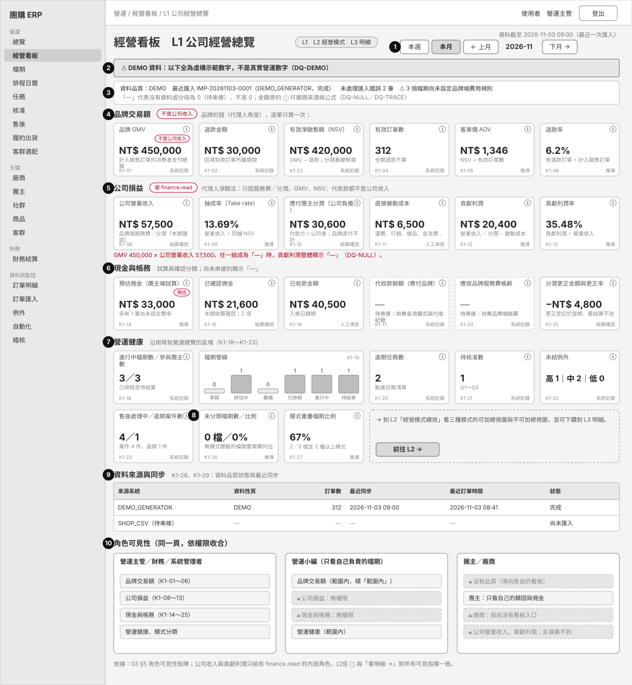
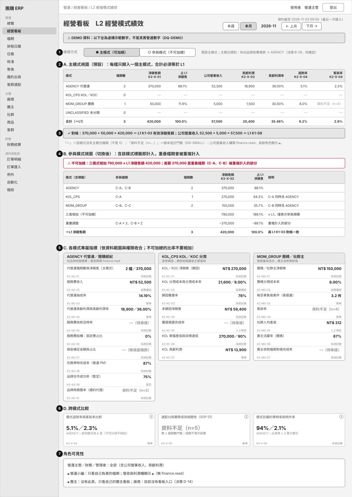
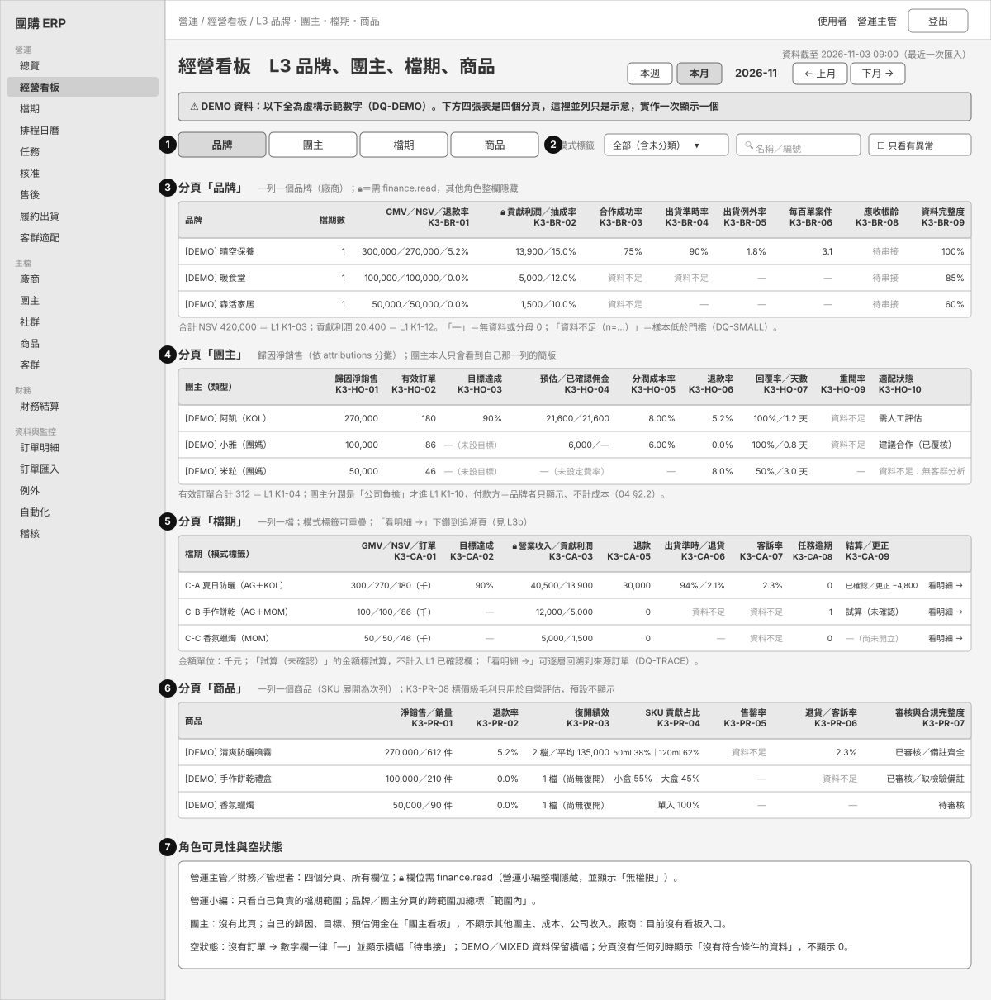
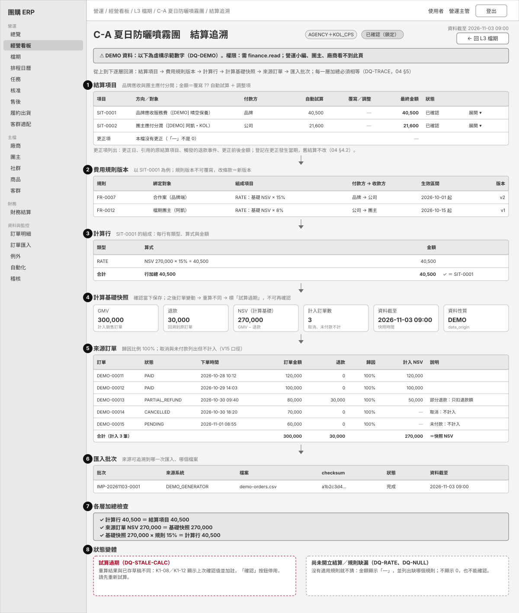

# 06 三層管理看板 Wireframe（L1／L2／L3）

> **狀態：PROPOSED（待 Owner 確認）。** 這是建置前的線框圖與規格，不修改任何已核准的 SRS／SAD／SDD，也沒有改動程式或畫面。
> KPI 的 ID、名稱與口徑一律以 [03 KPI 定義字典](03-KPI_DICTIONARY.md) 為準（本文件不另創 KPI）；模式與名詞以 [02](02-MODEL_AND_RESPONSIBILITY.md)、[04](04-FINANCE_AND_COMMISSION.md) 為準。
> 圖中的所有數字都是**虛構 DEMO**，三層之間互相對得上（L1 淨銷售 420,000＝L2 合計＝L3 品牌合計），但與任何真實營運無關。未證實的假設標 `【假設 A-4x】`，需 Owner 決定的標 `【決策 B-4x／B-5x】`。

## 0. 圖檔與用途

| 圖 | 檔案 | 層級 | 主要使用者 | 回答的問題 |
|---|---|---|---|---|
| L1 | [`wireframes/L1-company-overview.svg`](wireframes/L1-company-overview.svg) | 公司經營總覽 | 營運主管、財務、系統管理者 | 公司整體賺多少？品牌的錢和公司的錢分開看；現金與帳務、營運健康、有多少檔期還沒分類 |
| L2 | [`wireframes/L2-business-models.svg`](wireframes/L2-business-models.svg) | 三種經營模式績效 | 營運主管、財務 | 代營運、KOL／KOC、團媽三種模式各自貢獻多少？主模式（可加總）與參與模式（不可加總）怎麼對帳 |
| L3 | [`wireframes/L3-brand-host-campaign-product.svg`](wireframes/L3-brand-host-campaign-product.svg) | 品牌／團主／檔期／商品 | 營運主管、營運小編（範圍內）、財務 | 哪個品牌、團主、檔期、商品表現好或有問題？ |
| L3b | [`wireframes/L3b-drilldown-campaign.svg`](wireframes/L3b-drilldown-campaign.svg) | 檔期結算追溯下鑽 | 財務、營運主管 | 這筆結算額怎麼來的？逐層回溯到規則版本、計算行、來源訂單、匯入批次 |

導覽：新增「經營看板」入口（`【決策 B-48】`），L1／L2／L3 是同一頁上的三個層級；L3 四個分頁（品牌、團主、檔期、商品）一次顯示一個，圖上並列只是示意。

## 1. 共通規則（三層一致）

| 項目 | 規則 | 依據 |
|---|---|---|
| 期間 | 沿用現有營運總覽：「本週／本月／← 上月／下月 →」；金額類 KPI 的期間定義見 03 §1.1（`M`、`W`、`S`…）；L2、L3 沿用同一個期間參數 `【假設 A-42】` | `dashboard/page.tsx` period-switch |
| 更新時間 | 頁首固定顯示「資料截至 YYYY-MM-DD HH:mm（最近一次匯入）」；系統是查詢當下計算，**「即時」＝最近一次匯入的資料截至時間**，不是逐秒 `【假設 A-43】` | DASHBOARD_SPEC §1；03 §1.1 |
| 資料品質橫幅 | DEMO／MIXED：醒目橫幅「DEMO 資料，不是真實營運數字」；沒有任何訂單：橫幅「待串接」，所有業績類數字顯示「—」；有匯入錯誤或超過 3 天未更新：警告列 | 03 §6 `DQ-DEMO`、`DQ-NULL`、`DQ-FRESH` |
| 「—」不是 0 | 沒有資料、分母為 0、尚未串接、沒有適用規則 → 「—」（灰色）；樣本不足 → 「資料不足（n=…）」；**任何地方都不得把這兩種情況顯示成 0 或 0%** | SRS DQ-05；03 §6 `DQ-NULL`、`DQ-SMALL` |
| 口徑 ⓘ | 每個 KPI 卡右上角有 ⓘ：展開「來源、公式、期間、更新頻率、口徑狀態」；沿用現有 KpiCard 的「口徑」details `【假設 A-49】` | `KpiCard`；03 §1.1 |
| 信任度小標 | 卡片右下角：系統記錄／人工填寫／推導／暫定／結算確認（客群類另標事實／估計） | 03 §6 信任度標示 |
| 公司收入與 GMV 分開 | L1 把「品牌交易額」與「公司損益」分成兩個區塊；GMV 卡片固定帶紅框標籤「不是公司收入」；區塊下方固定一行紅字「GMV 450,000 ≠ 公司營業收入 57,500」 | 04 §1 硬性規則 |
| 不可加總警告 | L2 參與模式視圖頂端固定紅框警告，並列出「三者相加」「重疊調整」「＝L1」三列 | 03 §1.3 |
| 試算與確認 | 試算金額標「試算」，不計入「已確認」欄；試算過期顯示 `DQ-STALE-CALC` 並停用確認 | 03 §6；FINANCE.md §2 |

## 2. L1 公司經營總覽

### 2.1 版面編號對照

| 編號 | 區塊 | 使用的 KPI | 資料來源 | 互動 |
|---|---|---|---|---|
| 1 | 期間切換與資料截至時間 | — | 查詢參數 `month`／`range`；最近一次匯入批次 | 本週／本月／上月／下月；切換後所有區塊重算 |
| 2 | DEMO／待串接橫幅 | K1-28 | `orders.data_origin`、訂單是否存在 | 無 |
| 3 | 資料品質列 | K1-28 | `import_batches`、`import_errors`、費用規則缺漏檢查 | 點批次編號到「訂單匯入」；點警告到缺規則的檔期清單 |
| 4 | 品牌交易額（6 卡） | K1-01 品牌 GMV、K1-02 退款金額、K1-03 有效淨銷售額（NSV）、K1-04 有效訂單數、K1-05 客單價 AOV、K1-06 退款率 | `orders.gross_amount`、`refund_amount`、`status` | 每張卡「看明細 →」到訂單明細（沿用 `/orders?from&to`）；ⓘ 展開口徑 |
| 5 | 公司損益（6 卡，需 `finance.read`） | K1-08 公司營業收入、K1-09 抽成率、K1-10 應付團主分潤（公司負擔）、K1-11 直接變動成本、K1-12 貢獻利潤、K1-13 貢獻利潤率 | 新增：品牌端結算項目、`fee_rules`、`engagements`；`settlement_items`；`expenses`（見 05） | 點卡進 L3 檔期分頁（依該指標排序）；任一組成為「—」則貢獻利潤整體「—」 |
| 6 | 現金與帳務（6 卡） | K1-14 預估佣金、K1-15 已確認佣金、K1-16 已收款金額、K1-17 代收款餘額（應付品牌）、K1-24 應收品牌服務費帳齡、K1-25 分潤更正金額與更正率 | `commission_rules`×`orders`；`settlement_items`；`payments`；新增：金流模式與代收紀錄、品牌端結算 | 到「財務結算」對應分頁；K1-17、K1-24 在未串接前顯示「—／待串接」（虛線卡） |
| 7 | 營運健康（沿用） | K1-18 進行中檔期數／參與團主數、K1-19 檔期管線、K1-20 逾期任務數、K1-21 待核准數、K1-22 未結例外、K1-23 售後處理中／逾期案件數 | 現有營運總覽查詢（`dashboard.ts`）與售後總覽 | 點擊到任務、核准、例外、售後清單（沿用現有連結） |
| 8 | 模式與分類 | K1-26 未分類檔期數／比例、K1-27 模式重疊檔期比例 | 新增：檔期模式標籤（由合作案與檔期團主合約推導） | 「前往 L2 →」；未分類數大於 0 時卡片加警示並連到未分類清單 |
| 9 | 資料來源與同步 | K1-29 資料來源與同步（含 K1-28 狀態） | `orders` 依來源彙整、`import_batches` | 沿用現有「資料來源與同步」表 |
| 10 | 角色可見性 | （全部） | `permissions.ts`、`scope.ts` | 依角色收合，見 §5 |

### 2.2 驗收條件（可寫成 E2E 斷言；測試識別碼為建議，`data-testid`）

| 區塊 | 驗收條件 |
|---|---|
| 1 期間 | 點「上月」後頁首期間文字改變、且「資料截至」仍顯示；網址參數與畫面一致 |
| 2 橫幅 | DEMO 資料庫：頁面出現 `demo-banner`；清空訂單後出現 `nodata-banner` 且 `kpi-K1-01-value` 文字為「—」（不是「0」或「NT$ 0」） |
| 4 品牌交易額 | `kpi-K1-01` 帶標籤「不是公司收入」；K1-03 的值＝K1-01 − K1-02（以資料庫手算值比對）；點「看明細 →」進入 `/orders` 且期間一致 |
| 5 公司損益 | 有 `finance.read`：5 張卡全部可見；用營運小編登入：整區顯示「無權限」且**頁面原始碼不含**公司營業收入數字；沒有任何品牌端結算時，K1-08、K1-09、K1-12、K1-13 全為「—」；K1-08 永遠不等於 K1-01（用 GMV 很大、費用很小的資料驗證） |
| 5 組成缺漏 | 讓 K1-11 無資料（「—」）時，K1-12 貢獻利潤也為「—」 |
| 6 現金與帳務 | K1-17、K1-24 在未串接時顯示「—」並有「待串接」說明；K1-14 帶「預估」標籤且與團主看板同一筆資料相同 |
| 7 營運健康 | 逾期任務數與任務清單 `overdue=1` 的筆數相同；待核准數與核准頁待決定筆數相同 |
| 8 模式 | 建立一檔沒有任何費用規則的檔期後，K1-26 加 1 且該檔出現在未分類清單；K1-26 為 0 時顯示「0 檔／0%」而不是「—」（有檔期可分類，分母不為 0） |
| 9 資料來源 | 有匯入批次時列出來源系統、資料性質、訂單數、最近同步 |
| 10 可見性 | 團主、廠商開啟此頁 → 顯示「沒有權限」（不是空白或 404），導覽沒有「經營看板」 |

## 3. L2 三種經營模式績效

### 3.1 版面編號對照

| 編號 | 區塊 | 使用的 KPI | 資料來源 | 互動 |
|---|---|---|---|---|
| 1 | 檢視方式切換 | K2-X-01／K2-X-02 | 檔期模式標籤與主模式（決策 B-28） | 切換「主模式（可加總）」「參與模式（不可加總）」；預設主模式 `【決策 B-49】` |
| 2 | A 主模式視圖 | K2-X-01 模式淨銷售結構、K2-X-03 模式貢獻利潤比較、K2-X-04 模式退款率與客訴率比較；公司營業收入欄取各模式腿（K2-AG-02 等） | 新增：主模式；`orders`、結算項目、`service_cases` | 點模式列進該模式的 L3 檔期清單；「未分類」列固定顯示，不得併入其他模式 |
| 3 | 對帳列 | 與 K1-03、K1-08 對帳 | 同上 | 一致顯示 ✓；不一致顯示紅色並列出差額與可能原因（未分類、資料不足） |
| 4 | B 參與模式視圖 | K2-X-02 模式淨銷售（參與模式，不可加總） | 同上 | 重疊調整列＝三者相加 − L1；點檔期代碼（C-A…）進該檔 |
| 5 | C 各模式專屬指標 | AGENCY：K2-AG-01～K2-AG-10；KOL_CPS：K2-KC-01～K2-KC-07；MOM_GROUP：K2-MG-01～K2-MG-07 | 03 §3.1～§3.3 各 KPI 的資料來源 | 每列可展開 ⓘ；營收類（K2-AG-02～07 等）需 `finance.read` |
| 6 | D 跨模式比較 | K2-X-04、K2-X-05 適配分與實際成效相關性（SOP 01）、K2-X-06 模式別履約準時率與例外率 | `service_cases`、`orders`；`product_fit_assessments.outcome`；`shipments` | K2-X-05 樣本不足顯示「資料不足（n=…）」 |
| 7 | 角色可見性 | — | 同 L1 | 見 §5 |

### 3.2 對帳與不可加總（本頁最重要的規則）

| 視圖 | 範例數字（圖中） | 規則 |
|---|---|---|
| 主模式（可加總） | AGENCY 370,000＋MOM_GROUP 50,000＋未分類 0＋KOL_CPS 0＝420,000＝L1 K1-03 | 每檔只歸一個主模式；合計必須＝L1，否則整列標紅 |
| 參與模式（不可加總） | AGENCY 370,000＋KOL_CPS 270,000＋MOM_GROUP 150,000＝790,000；重疊調整 −370,000；＝420,000 | 重疊檔期（C-A 含 AGENCY＋KOL_CPS、C-B 含 AGENCY＋MOM_GROUP）在多個模式出現；畫面必須顯示「不可加總」警告與重疊調整列 |

### 3.3 驗收條件

| 區塊 | 驗收條件 |
|---|---|
| 1 切換 | 預設選中「主模式」；切換到參與模式後出現 `participation-warning`（含「不可加總」字樣）；網址或狀態保留選擇 |
| 2/3 主模式與對帳 | 以三檔測資（對應 03 §1.3 算例）驗證：各列 NSV 與營業收入、合計列＝L1；故意新增一檔「無任何模式條款」的檔期 → 「未分類」列出現且合計仍＝L1（未分類單獨計）；沒有主模式檔期的模式列全為「—」 |
| 4 參與模式 | 三者相加＝790,000、重疊調整＝−370,000、結果＝420,000；每列列出參與檔期代碼 |
| 5 專屬指標 | 每列有 KPI ID 小標；K2-AG-05、K2-KC-05、K2-MG-07 未串接時「—（待串接）」；樣本低於門檻時「資料不足（n=…）」；營運小編登入 → 營收與利潤類顯示 🔒 且原始碼不含數字 |
| 6 跨模式 | K2-X-05 在適配評估筆數不足時顯示「資料不足」，且說明「相關不等於因果」 |

## 4. L3 品牌、團主、檔期、商品績效

### 4.1 版面編號對照

| 編號 | 區塊 | 使用的 KPI | 資料來源 | 互動 |
|---|---|---|---|---|
| 1 | 分頁列 | — | — | 品牌／團主／檔期／商品；切換保留期間與篩選 |
| 2 | 篩選 | — | 模式標籤、關鍵字、「只看有異常」 | 模式標籤可選「全部（含未分類）」；異常＝任一指標為警示或「資料不足」以外的紅色狀態 |
| 3 | 品牌分頁 | K3-BR-01 品牌 GMV／NSV／退款率、K3-BR-02 品牌貢獻利潤與抽成率（🔒）、K3-BR-03 品牌合作成功率、K3-BR-04 供貨出貨準時率、K3-BR-05 出貨例外率、K3-BR-06 品牌每百單售後案件、K3-BR-08 品牌應收帳齡與未收金額、K3-BR-09 品牌資料完整度（K3-BR-07 廠商任務逾期數與完成度在品牌詳情頁） | `vendors`、`campaigns`、`orders`、`shipments`、`service_cases`；新增：品牌端結算 | 點品牌名進廠商頁；欄位標頭可排序；合計列對帳 L1 |
| 4 | 團主分頁 | K3-HO-01 團主歸因淨銷售、K3-HO-02 團主有效訂單數、K3-HO-03 團主目標達成率、K3-HO-04 團主預估與已確認佣金、K3-HO-05 團主分潤成本率、K3-HO-06 團主退款率、K3-HO-07 邀請回覆率與回覆天數、K3-HO-09 團主重開率、K3-HO-10 團主適配狀態（K3-HO-08、K3-HO-11、K3-HO-12 在團主詳情） | `attributions`、`orders`、`commission_rules`、`settlement_items`、`campaign_hosts`、`product_fit_assessments` | 點團主名進團主頁；團主類型（KOL／團媽…）以徽章顯示 |
| 5 | 檔期分頁 | K3-CA-01 檔期 GMV／NSV／訂單／AOV、K3-CA-02 檔期目標達成率、K3-CA-03 檔期營業收入與貢獻利潤（🔒）、K3-CA-05 檔期退款金額與型態、K3-CA-06 檔期出貨準時率與退貨率、K3-CA-07 檔期售後與客訴率、K3-CA-08 任務完成度與逾期、K3-CA-09 結算狀態與更正 | `campaigns`、`orders`、`settlement_items`、`shipments`、`service_cases`、`tasks` | **「看明細 →」進入結算追溯頁（L3b）**；檔期名旁顯示模式標籤徽章（AG／KOL／MOM／未分類）`【假設 A-48】` |
| 6 | 商品分頁 | K3-PR-01 商品淨銷售與銷量、K3-PR-02 商品退款率、K3-PR-03 商品復開績效、K3-PR-04 SKU 貢獻占比、K3-PR-05 商品售罄率、K3-PR-06 商品退貨與客訴率、K3-PR-07 商品審核與合規完整度（K3-PR-08 商品標價級毛利率只用於自營評估，預設不顯示） | `order_items`、`skus`、`products`、`campaign_products` | 點商品名進商品頁；SKU 可展開為次列 |
| 7 | 角色與空狀態 | — | — | 見 §5、§6 |

### 4.2 驗收條件

| 區塊 | 驗收條件 |
|---|---|
| 1/2 分頁與篩選 | 切換分頁後期間與模式標籤篩選不變；模式標籤選「未分類」只列沒有模式標籤的檔期 |
| 3 品牌 | 合計 NSV＝L1 K1-03；有 `finance.read` 才出現「貢獻利潤／抽成率」欄；營運小編登入該欄不存在於畫面與原始碼；樣本不足的欄顯示「資料不足」 |
| 4 團主 | 有效訂單合計＝L1 K1-04；沒有設定費率的團主「預估／已確認佣金」顯示「—（未設定費率）」，不是 0；團主本人登入看不到此分頁 |
| 5 檔期 | 每列有「看明細 →」；試算未確認的結算顯示「試算（未確認）」，且該金額不計入 L1 已確認欄；沒有結算的檔期顯示「—（尚未開立）」 |
| 6 商品 | 每個商品至少一列；SKU 貢獻占比合計 100%（有銷售時）；沒有銷售時顯示「—」 |
| 全部 | 分頁沒有任何符合的列時顯示「沒有符合條件的資料」，不顯示 0；每頁預設 50 列 `【假設 A-46】` |

## 5. L3b 結算追溯下鑽（檔期）

| 編號 | 層級 | 內容 | 驗收（逐層加總相等） |
|---|---|---|---|
| 1 | 結算項目 | 品牌應收服務費、團主應付分潤、更正項（沒有更正顯示「—」） | 每項金額＝覆寫 ?? 自動試算 ＋ 調整項 |
| 2 | 費用規則版本 | 規則編號、綁定對象、組成項目、付款方→收款方、生效區間、版本 | 結算項目記錄的規則版本與此處一致 |
| 3 | 計算行 | 類型、算式、金額 | 計算行加總＝結算項目金額 |
| 4 | 計算基礎快照 | GMV、退款、NSV、計入訂單數、資料截至、資料性質 | 快照 NSV × 規則＝計算行 |
| 5 | 來源訂單 | 逐筆訂單、狀態、金額、退款、歸因比例、計入 NSV；取消與未付款列出但標「不計入」 | 計入 NSV 合計＝快照 NSV |
| 6 | 匯入批次 | 批次、來源系統、檔案、checksum 前碼、狀態、資料截至 | 每筆來源訂單都能對到批次 |
| 7 | 各層加總檢查 | 三條 ✓ 檢查 | 任一不相等 → 標紅並停用「確認」 |
| 8 | 狀態變體 | 試算過期（`DQ-STALE-CALC`）、規則缺漏（`DQ-RATE`、`DQ-NULL`） | 過期時確認按鈕停用；缺規則顯示「—」不是 0 |

**E2E 驗收**：用 04 §9 的算例（GMV 300,000／退款 30,000／NSV 270,000／15%）建立一檔，下鑽後五層數字與 04 V24、V25 相同；把其中一筆訂單改成已退款後重新整理，標示「試算過期」。**依賴**：來源訂單與計算行需要 [05](05-DATA_MODEL_GAP.md) 提出的新資料（結算項目↔來源訂單、計算行）；在其落地前，此頁顯示「—／待串接」而不是推測數字 `【假設 A-47】`。

## 6. 權限與可見性

| 區塊 | 系統管理者 | 營運主管 | 營運小編 | 財務 | 團主 | 廠商 |
|---|:-:|:-:|:-:|:-:|:-:|:-:|
| 經營看板入口（導覽） | ✅ | ✅ | ✅（範圍內） | ✅ | — | — |
| L1 品牌交易額、營運健康、模式與分類 | ✅ | ✅ | ◐ 範圍內 | ✅ | — | — |
| L1 公司損益、現金與帳務（含 K1-08～13、K1-17、K1-24） | ✅ | ✅ | 🔒 | ✅ | — | — |
| L2 主模式／參與模式（含營收、利潤欄） | ✅ | ✅ | ◐ 只有範圍內且無營收／利潤欄 | ✅ | — | — |
| L3 品牌、團主、檔期、商品分頁 | ✅ | ✅ | ◐ 範圍內且無 🔒 欄 | ✅ | — | — |
| L3b 結算追溯 | ✅ | ✅ | — | ✅ | — | — |
| 團主看板（既有 `/dashboard/host`） | — | — | — | — | ✅ 只有自己 | — |

- 依據：03 §5 角色可見性矩陣與 `src/server/lib/permissions.ts`。**營運主管目前擁有 `finance.read`**，所以預設可看公司損益；若 Owner 要限縮到「財務＋管理者」，需要新增權限 `【假設 A-45】【決策 B-50】`。
- 實作原則（與現有系統一致）：欄位在**伺服器端**就不產生（不是前端隱藏），並有測試確認原始碼與 API 回應不含該數字。
- 團主與廠商看不到公司營業收入與貢獻利潤，也看不到其他團主；廠商目前沒有看板入口（廠商入口未解凍，決策 D-14）。

## 7. 資料品質與空狀態規則（畫面行為）

| 情況 | 畫面 | 代碼 |
|---|---|---|
| 沒有任何訂單 | 橫幅「待串接」；業績類卡片「—」；不畫圖 | `DQ-NULL` |
| DEMO／MIXED 資料 | 頁首橫幅；每個匯出或截圖都帶橫幅 | `DQ-DEMO` |
| 資料超過 3 天未更新、有匯入錯誤 | 資料品質列警告與連結 | `DQ-FRESH` |
| 沒有適用費率或費用規則 | 金額「—」＋列出缺規則的檔期／團主 | `DQ-RATE` |
| 檔期無法歸類 | 「未分類」獨立一列／一卡；合計仍＝L1 | `DQ-CLASS` |
| 樣本不足 | 「資料不足（n=…）」，不顯示比率 | `DQ-SMALL` |
| 試算過期 | 標示並停用確認；金額顯示上次確認值並加註 | `DQ-STALE-CALC` |
| 退款回溯造成歷史期間重述 | 小標「已含截至 YYYY-MM-DD 的退款」 | `DQ-RESTATE` |
| 無此權限 | 顯示 🔒 與「無權限」；不產生數字 | — |

## 8. 手機版收合原則

| 項目 | 規則 |
|---|---|
| 優先級 | 手機只檢視摘要，不做結算追溯操作 `【假設 A-40】` |
| L1 | 卡片改單欄；順序固定：資料品質列 → 品牌交易額 → 公司損益 → 現金與帳務 → 營運健康；每個區塊可收合，預設只展開「品牌交易額」 |
| L2 | 表格橫向捲動或改為卡片列表；預設只顯示主模式視圖的「模式、檔期數、NSV」三欄；切換參與模式時警告橫幅固定置頂 |
| L3 | 分頁改為下拉選單；表格只保留名稱＋最重要 2 個指標，其餘「展開」 |
| L3b | 手機不提供（顯示「請在桌面開啟」），避免誤讀逐層加總 |
| 共通 | 頁面不得出現水平溢出（沿用現有 E2E 的手機溢出檢查）；DEMO 橫幅與「—」規則不因縮小而省略 |

## 9. 與現有 `/dashboard`（營運主管總覽，已實作）的差異與沿用

現有頁（`src/app/(app)/dashboard/page.tsx`、`DASHBOARD_SPEC.md`）已提供下列區塊；**這份規劃不要求重做它們**，而是讓新看板沿用。

| 現有區塊（testid） | 對應新看板 | 處理 |
|---|---|---|
| 期間切換、資料品質列、DEMO／待串接橫幅（`period-switch`、`data-quality`、`demo-banner`） | L1 編號 1～3 | **直接沿用** |
| `kpi-grid`：GMV、有效淨銷售額、有效訂單數、AOV、退款率、目標達成率 | K1-01～K1-07 | **直接沿用**（目標達成率放在 L1 品牌交易額的延伸或 L3 檔期） |
| `finance-grid`：進行中檔期、預估佣金、已確認佣金、已收款金額 | K1-18、K1-14、K1-15、K1-16 | **直接沿用** |
| `todo-grid`、`pipeline`、`attention`、`overdue-list` | K1-19～K1-22 | **直接沿用**（L1 只放摘要，細節留在原頁） |
| `data-sources` | K1-29 | **直接沿用** |
| `host-performance`、`community-rank` | K3-HO-01／02、K3-HO-11 | **沿用查詢，擴充欄位**（加目標、佣金、退款率、適配狀態） |
| `campaign-output` | K3-CA-01 | **沿用，擴充**（加達成率、營業收入、貢獻利潤） |
| `vendor-progress`、`vendor-success` | K3-BR-07、K3-BR-03／K2-AG-09 | **沿用，擴充**（加品牌 GMV／NSV、出貨、售後、應收） |
| `ontime-launch`、`product-repeat` | K3-CA-10、K3-PR-03 | **沿用** |
| 公司損益（K1-08～K1-13） | L1 編號 5 | **新增**（依賴 05 的品牌端結算、`fee_rules`、`engagements`） |
| 代收款、應收帳齡、更正（K1-17、K1-24、K1-25） | L1 編號 6 | **新增**（依賴金流模式、品牌端結算、更正項） |
| 模式與分類（K1-26、K1-27）、L2 全部 | L1 編號 8、L2 | **新增**（依賴檔期模式標籤與主模式，決策 B-28） |
| L3 品牌／團主／檔期／商品四個分頁 | L3 | **新增頁面**，查詢大量沿用現有 |
| 追溯下鑽 | L3b | **新增**（依賴結算項目↔來源訂單、計算行） |

**入口策略（`【決策 B-48】`）**：A）新增獨立「經營看板」（`/board`，三層分頁），保留現有「營運總覽」作為每日營運頁（預設）；B）把 L1 併入現有 `/dashboard`；C）以新看板取代 `/dashboard`。預設 A：不動已核准且已測試的頁面，風險最低。

## 10. 本文件提出的決策與假設彙整

### 10.1 假設（未證實）

| 編號 | 假設 | 若不成立的影響 |
|---|---|---|
| A-40 | 管理者以桌機為主，手機只檢視摘要 | 若手機要做結算追溯，需另行設計手機版 L3b |
| A-41 | L3 四個分頁一次顯示一個，圖上並列僅為示意 | 若要一頁並列，頁面會很長，需改為摺疊區塊 |
| A-42 | L2、L3 沿用現有營運總覽的期間參數與切換方式 | 若要自訂區間，需新增日期選擇器與快照策略 |
| A-43 | 看板是查詢當下計算，「更新時間」＝資料截至時間，不是逐秒即時 | 若要求即時，需訂單 API／Webhook（目前 BLOCKED） |
| A-44 | 圖中數字純屬示意，三層之間互相對帳（L1＝L2＝L3） | 無；實作時以真實資料與測試資料重建 |
| A-45 | 營運主管具備 `finance.read`，預設可看公司損益 | 若要只給財務與管理者，需新增權限並調整測試 |
| A-46 | L3 每頁預設 50 列、可排序 | 資料量大時需伺服器端分頁與索引 |
| A-47 | 追溯下鑽需要 05 的新資料；落地前顯示「—／待串接」 | 若不新增來源訂單關聯，只能靠重算比對，無法逐層下鑽 |
| A-48 | 檔期模式標籤與主模式以徽章顯示（AG／KOL／MOM／未分類） | 若 Owner 要求單選分類，徽章簡化為單一標籤 |
| A-49 | 「ⓘ」口徑浮層沿用現有 KpiCard 的「口徑」details | 若要更完整的口徑說明，需新增口徑頁（可連結 03） |

### 10.2 決策（需 Owner 決定）

| 編號 | 決策 | 選項 | 目前預設 |
|---|---|---|---|
| B-48 | 看板入口與路由 | A）新增獨立「經營看板」，保留現有營運總覽　B）把 L1 併入現有營運總覽　C）以新看板取代營運總覽 | A |
| B-49 | L2 預設視圖與並排 | A）預設主模式、可切換參與模式　B）預設參與模式　C）兩種並排同時顯示 | A（並排會讓使用者誤把不可加總的數字相加） |
| B-50 | 公司營業收入與貢獻利潤的可見範圍 | A）有 `finance.read` 者（含營運主管）　B）僅財務與系統管理者（新增更窄權限）　C）僅財務 | A（符合現有權限）；若選 B／C 需新增權限與測試 |
| B-51 | 歷史數字的重述與快照 | A）即時查詢＋顯示「已含截至某日的退款」小標　B）每日／每月快照，保留重述前後兩版（對應 03 B-31） | A；資料量變大或需要稽核歷史版本時再做 B |
| B-52 | 匯出與列印 | A）第一版不提供匯出　B）提供 CSV，但公司營業收入、貢獻利潤欄需額外核准並寫稽核　C）提供列印版（帶 DEMO 橫幅） | A（避免未授權外流；匯出個資屬高風險操作，需另行核准） |

## 11. 本文件的驗證與限制

- **圖檔**：4 張 SVG 皆通過 XML well-formed 檢查，並用 Chromium（Playwright）轉成 PNG 逐張目視檢查文字溢出與重疊（見下）。
- **看圖發現並修正的問題**：（1）KPI 卡的說明文字與底部 ID 重疊 → 卡片加高到 112 並調整排版；（2）編號圓圈蓋到區塊標題首字、L3 的圓圈壓到分頁邊緣 → 圓圈左移並調整位置；（3）L1 的營運健康列與模式分類列混在一起、K1-23 孤立一格 → 拆成「營運健康」與「模式與分類」兩個區塊；（4）L3 表格原本放入「資料不足（n=…）」超出 80px 欄寬 → 改為「資料不足」，樣本數放在說明列；（5）L3b 的標題同時有圓圈編號與①②重複 → 移除重複編號。
- **未驗證**：這些是靜態線框，沒有互動原型；實際畫面的像素與元件（沿用現有 `KpiCard`、`Table`、`Card`）要在實作時對照設計系統；E2E 驗收條件是規格，尚未寫成測試；所有數字是虛構的，只驗證了三層之間互相對得上（L1＝L2＝L3；來源訂單加總＝快照 NSV＝計算行基礎）。
