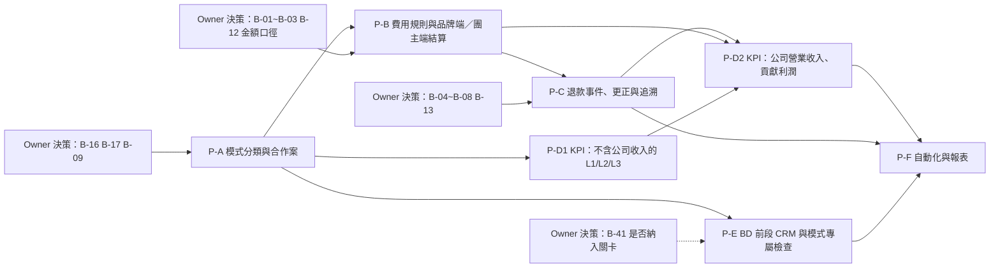

# 07 功能開發與驗收路線圖

> **狀態：PROPOSED（待 Owner 確認）。** 這是實作規劃，不是承諾，也不是授權：本文件沒有修改任何程式、migration 或核准規格。每個 Phase 開工前，必須先完成「規格更新→Owner 核准→才寫程式」（SRS→SAD→SDD→實作，repo 既有守則）。
> 依據：[02 模式與責任](02-MODEL_AND_RESPONSIBILITY.md)、[04 財務與分潤](04-FINANCE_AND_COMMISSION.md)、[05 資料差異](05-DATA_MODEL_GAP.md)；KPI 見 [03](03-KPI_DICTIONARY.md)、SOP 見 [01](01-OPERATING_SOP.md)、看板見 [06](06-DASHBOARD_WIREFRAMES.md)、決策彙整見 [08](08-RISKS_GAPS_DECISIONS.md)。
> 標示：`【假設 A-3x】`未證實假設｜`【決策 B-xx】`需 Owner 決定｜工作量 **S／M／L 是相對大小的估計，不是承諾**（`【假設 A-34】`：以 SOP 01 的實作為參照，S≈1／4、M≈1／2、L≈1 個 SOP 01 的工作量；實際會隨 Owner 決策與資料而變）。

## 1. 先講結論

1. 建議分 **6 個 Phase**：P-A 模式分類與合作案 → P-B 費用規則與品牌端／團主端結算 → P-C 退款事件、更正與追溯 → P-D KPI 看板（L1／L2／L3）與快照 → P-E BD 前段 CRM 與模式專屬檢查 → P-F 自動化與報表。
2. **可以立刻做、不需等金額決策的**：P-A（分類與合作案）、P-D 中「不含公司收入」的 KPI（GMV、淨銷售、訂單、退款率、履約與售後指標）、P-E 的 CRM。**必須等 Owner 確認金額口徑才能進入「正式」的**：P-B、P-C，以及 P-D 的公司營業收入／貢獻利潤。
3. 在金額口徑確認前，P-B／P-C 只做到「**規則可以儲存、算式可以預覽、與手算值比對**」，不產生正式分潤、不自動寫入確認結算（repo 守則：碰金額公式先停下來問 Owner）。
4. 所有 Phase 都遵守既有鐵則：只用 DEMO／測試資料、只軟刪除、不公開部署、不接真實金流、不寄真實通知、不放機密、驗證必須實際跑過並讀回、測試 mock 要照真實 API 且改好後用舊錯誤版本要轉紅。

## 2. 現況盤點：沿用／擴充／缺少

| 面向 | 可直接沿用（已實作且有測試） | 需要擴充 | 缺少（要新增） |
|---|---|---|---|
| 主檔 | 廠商、團主、社群、商品、客群（SOP 01） | `vendors.party_type`、`hosts.partner_type` 加 KOC、`agreements` 補 API | `engagements`、`crm_activities`（選配） |
| 檔期 | 14 狀態、G1～G5、15 步任務、排程、衝突、曝光 | `campaigns`／`campaign_hosts` 新欄位（模式、金流、履約、角色、歸因、付款方、揭露） | 模式推導、未分類清單 |
| 訂單 | CSV 匯入、去重、歸因分攤、資料品質 | `orders.payment_method` | `refund_events`（事件日期） |
| 履約／售後 | 批次、出貨、簽收、庫存、案件、退款核准 | 退款完成同時寫 `refund_events` | 責任方（選配） |
| 分潤／結算 | 草稿→確認→鎖定、覆寫、調整、過期偵測、入帳、發票、費用 | 結算種類（REGULAR／CORRECTION）、項目類型（團主應付／品牌應收） | `fee_rules` 及子表、計算行、來源訂單、更正引用 |
| KPI | `kpi.ts` 口徑、管理者與團主 Dashboard、資料品質、`daily_summaries` | 口徑版本、模式維度 | `kpi_snapshots`、L1／L2／L3 看板、公司營業收入／貢獻利潤 |
| 權限 | 6 角色、49 項權限、資料範圍、欄位投影 | — | 約 8～10 項新權限（見 05 §9.2） |
| 自動化 | 8 個工作（預設停用、冪等、測試 Adapter） | 擴充 3 個（§9） | 新增 4～5 個（預設停用） |

## 3. Phase 總覽與相依

| Phase | 可與誰並行 | 不可並行的原因 |
|---|---|---|
| P-A | 可與 P-D1 的規格撰寫、P-E 的 CRM 部分並行 | P-D1 的「依模式切分」需要 P-A 完成 |
| P-B | 與 P-D1 並行 | 規則結構決定 P-C 的更正與 P-D2 的收入 |
| P-C | 與 P-D1 並行 | 依賴 P-B 的費用規則與結算項目 |
| P-D | D1（不含收入）可在 P-A 之後立刻開始；D2 在 P-B、P-C 之後 | 公司營業收入來自品牌端結算項目 |
| P-E | 與 P-B、P-C 並行 | 若納入關卡檢查需等 Owner 核准（B-41） |
| P-F | — | 需要 P-C、P-D 完成 |

建議順序（`【決策 B-47】`選項：A）A→B→C→D→E→F；B）A→D1→B→C→D2→E→F，先讓主管看到分模式的業績與履約指標，再做金額；**目前預設 B**，因為 D1 不碰金額公式、風險最低、且最快回答「三種模式各自表現如何」）。

## 4. Phase 詳述

### P-A　模式分類與合作案（工作量 M）

| 項目 | 內容 |
|---|---|
| 目標 | 把「公司 × 品牌」的合作案與五維度（[02](02-MODEL_AND_RESPONSIBILITY.md) §2）建進系統；檔期可歸屬到合作案；每檔有可推導的模式標籤與主模式；找得出「未分類」檔期 |
| 做 | migration **014**（`engagements`、`vendors.party_type`、`hosts.partner_type` 加 KOC、`agreements` 擴欄與 CRUD、`campaigns` 與 `campaign_hosts` 新欄位）；合作案 CRUD、狀態轉換（LEAD→NEGOTIATING→ACTIVE⇄ON_HOLD→ENDED／DROPPED）；檔期選擇合作案；邀請團主時選角色、歸因方式、分潤付款方、是否需揭露；責任矩陣預設值帶入與覆寫；`primary_mode` **手動指定＋標籤提示**（P-B 之後改為依費用規則推導，允許主管覆寫並留稽核，B-16）；「未分類檔期」清單；DEMO 種子（三種模式與三種重疊情境 S1、S3、S5） |
| 不做 | 費用規則、結算、KPI 看板、關卡新檢查、CRM、自營進貨（PRINCIPAL 只保留值、不開放） |
| 前置決策 | B-16（主模式規則）、B-17（責任預設值）、B-09（分潤付款方預設）；`【假設 A-02】`模式由檔期團主合約推導；`【假設 A-30】`品牌與供應商共用 `vendors` |
| API／頁面 | `/engagements`（列表、詳情、新增）、檔期詳情「合作案」區、邀請團主表單擴欄、`/campaigns?mode=` 篩選、`GET/POST/PATCH /api/engagements…` |
| 權限 | 新增 `engagement.read`、`engagement.write`（[05](05-DATA_MODEL_GAP.md) §9.2） |
| 人工核准點 | 合作案 `ACTIVE`／`ENDED` 轉換（主管）；主模式手動覆寫（主管＋原因） |
| 風險 | 欄位增加造成表單負擔→全部可空、預設沿用；團主角色與主檔不一致→以檔期為準並提示 |

**測試案例與驗收條件（Given／When／Then）**

| # | 案例 |
|---|---|
| T-A01 | Given 品牌已有進行中的檔期，When 建立合作案並把檔期歸屬於它，Then 檔期詳情顯示合作案，合作案頁列出其下所有檔期；跨品牌歸屬被拒（422） |
| T-A02 | Given 團主 `partner_type=KOL`，When 邀請進檔期且未指定角色，Then `role_type` 沿用 KOL；When 指定 `GROUP_MOM`，Then 以檔期值為準，團主主檔不變 |
| T-A03 | Given 同一團主在兩檔分別為 KOL 與團媽，Then 兩檔的模式標籤各自正確（情境 S5） |
| T-A04 | Given 檔期已有訂單但未指定主模式，Then「未分類檔期」清單包含它；指定後消失；不得被默默歸入任一模式 |
| T-A05 | Given `hosts.partner_type='KOC'`，Then 可儲存；`'ALIEN'` 仍 422（既有測試不得被弱化） |
| T-A06 | Given 合作案狀態為 `NEGOTIATING`，When 轉 `ACTIVE` 但未指定金流模式，Then 412；補上後成功並寫稽核（前後值） |
| T-A07 | Given 合作案下仍有未結案檔期，When 轉 `ENDED`，Then 被拒（比照 `archiveVendor`） |
| T-A08 | Given 營運小編，When 轉合作案為 `ACTIVE`，Then 403；主管可以 |
| T-A09 | Given 團主／廠商帳號，When 讀 `/api/engagements`，Then 403；財務可讀不可寫 |
| T-A10 | 既有 `lifecycle`、`scenarios`、`rbac`、`segments`、`fit`、`security-fuzz` 全部維持通過；新路由被模糊測試自動涵蓋、無 5xx |
| T-A11 | 軟刪除：合作案「封存」只設 `deleted_at`，資料列仍在，直接 `DELETE` 被觸發器擋下 |

驗收總條件：上述全過、`tsc`／`eslint`／`build` 乾淨、E2E 新增合作案流程、SRS／SAD／SDD／資料字典／ERD／矩陣同步、突變驗證（例如「模式推導改成永遠回傳 AGENCY」要使 T-A03、T-A04 轉紅）。

### P-B　費用規則與品牌端／團主端結算擴充（工作量 L）

| 項目 | 內容 |
|---|---|
| 目標 | 費用規則可結構化（固定／純分潤／階梯／保底抵佣／保底加佣／混合）、可版本化、需人工核准；結算同時產生**團主應付**與**品牌應收**項目，並附計算行；公司營業收入有資料來源 |
| 做 | migration **015**；把 `docs/biz-model/prototype/settlement-model.ts` 的純函式**移植**為 `src/server/lib/fee-calc.ts`（原型 28 項算例改寫成單元測試，**預期值寫死為手算值**）；`fee_rules` CRUD、DRAFT→ACTIVE 核准；`pickFeeRule()` 與 `commission_rules` 相容層；結算試算同時算團主端與品牌端；計算行顯示；公式預覽頁（輸入假設的淨銷售看各規則結果，不寫入） |
| 不做 | 正式付款、撥款、電子發票、稅額計算、跨期更正（P-C）、自營進貨 |
| 前置決策（**金額口徑，必須 Owner 先確認**） | B-01 基礎（NSV／GMV、含稅）、B-02 累進或全額累進、B-03 保底抵佣／加佣定義與門檻、B-09 付款方、B-12 進位、B-42 規則核准流程。**未確認前，只能開啟「預覽」，不得啟用正式結算** |
| API／頁面 | `/finance/rules`（財務）、規則詳情與預覽、結算詳情加「品牌應收」與「計算行」、`/api/fee-rules…` |
| 權限 | `fee_rule.read`／`write`／`approve`；結算確認沿用 `settlement.confirm` |
| 人工核准點 | 規則啟用、結算確認、結算作廢、覆寫金額（沿用） |
| 風險 | 雙軌規則重複計算→互斥檢查；階梯定義誤解→B-02、B-03 必填且表單說明；進位偏差→分攤最大餘數法 |

| # | 案例（Given／When／Then） |
|---|---|
| T-B01 | Given 淨銷售 100,000、純分潤 10%，Then 10,000；固定費 20,000 不論業績皆 20,000；混合（5,000＋3%）＝8,000 |
| T-B02 | Given 階梯 5%／8%／10%（100k／300k／∞），累進：250,000→17,000；全額累進→20,000；邊界 100,000→5,000（對應原型 V03～V06） |
| T-B03 | Given 保底 10,000＋10%，抵佣：60,000→10,000、150,000→15,000；加佣（門檻 50,000）：150,000→20,000；門檻＝保底÷費率時兩者在任何業績下相等（V07～V12） |
| T-B04 | Given 取消、未付款、部分退款、全額退款混合，Then GMV 350,000、退款 70,000、NSV 280,000，與 `kpi.ts` 的 `computeSales` 結果相同（不得兩處各算一份） |
| T-B05 | Given 規則 `DRAFT`，When 用於正式結算，Then 412；`fee_rule.approve` 核准後 `ACTIVE`；核准者與建立者相同且組織啟用「申請人≠核准人」時被拒 |
| T-B06 | Given 規則已 `ACTIVE`，When 直接改級距，Then 資料庫觸發器擋下；要改＝新增版本並封存舊版 |
| T-B07 | Given 舊 `commission_rules` 單一費率與等價的 `fee_rules` 單一 `RATE`，Then 兩者對同一檔期算出的金額相同（相容測試），且同檔期同團主同時有效兩套規則時 409 |
| T-B08 | Given 團主分潤付款方＝品牌，Then 該項不進公司負擔成本；＝公司則進（原型 V26、V27） |
| T-B09 | Given 結算項目，Then `Σ 計算行 = 項目金額`；每行有算式文字與規則版本（V23） |
| T-B10 | Given 任一頁面或 API，Then 公司營業收入＝品牌端應收項目加總；以「GMV 很大、費用很小」的資料驗證不得出現 GMV 當收入（T-F07） |
| T-B11 | Given 結算確認後，Then 項目、計算行、調整項都被資料庫鎖定（沿用並擴充既有觸發器測試，含 012 的跨結算搬移防護） |
| T-B12 | Given 團主、廠商，Then 看不到品牌端費用與他人規則；團主只看自己已確認的分潤；營運小編看不到規則金額 |

驗收總條件：以上全過；**預期值由人手算、寫死在測試裡**（鐵則：測試 mock 要照真實 API、被測程式不得產生自己的預期值）；以「故意把保底抵佣改成相加」「把全額累進當累進」兩種改壞版本驗證測試轉紅；FINANCE.md、SRS FR-FIN／FR-COM、SDD §13／§18 先改、Owner 核准後才合併。

### P-C　退款事件、更正與追溯（工作量 L）

| 項目 | 內容 |
|---|---|
| 目標 | 退款有事件日期；跨期退款能產生**更正結算**；任一金額可逐層回溯到來源訂單與匯入批次 |
| 做 | migration **016**（`refund_events`、`settlements.kind` 與唯一索引重建、`settlement_items` 擴欄、`settlement_item_lines`、`settlement_item_sources`、`settlement_adjustments` 擴欄）；售後退款完成時同步寫事件；CSV 匯入退款產生事件（`IMPORT_DATE`）；歷史資料回填（`LEGACY_SNAPSHOT`／`ASSUMED`）；「待更正」清單（已確認結算之後才出現的新退款事件）；更正結算（`kind=CORRECTION`，走同一個 DRAFT→CONFIRMED→VOID 與鎖定機制）；追溯頁（規則版本→計算行→來源訂單→匯入批次） |
| 不做 | 自動更正並確認（更正一律人工確認）、自動撥款／收回款項 |
| 前置決策 | B-04（回溯重算或當期扣回）、B-05（結算時點）、B-06（更正核准門檻）、B-07（負結算處置）、B-13（多團主分攤）、B-38（看板退款期間口徑）；`【假設 A-31】`歷史退款日期可推估 |
| 權限 | 沿用 `finance.write`、`settlement.confirm`；更正超過門檻需主管＋財務雙人核准（B-06） |
| 人工核准點 | 更正結算確認、超門檻更正、負結算處置、作廢 |
| 風險 | 唯一索引重建需先驗證現有資料；事件與累計退款不一致→資料品質警告而非阻擋匯入 |

| # | 案例（Given／When／Then） |
|---|---|
| T-C01 | Given 第 1 期結算確認（階梯累進，淨銷售 250,000＝17,000），When 12/10 發生跨期退款 60,000，Then 產生更正 −4,800，累計 12,200，與一次用最終淨銷售 190,000 算完相同（V17～V19） |
| T-C02 | Given 同一更正再執行一次，Then 差額 0、不產生第二筆（冪等，V20） |
| T-C03 | Given 保底抵佣 10,000＋10%，淨銷售 150,000 結算 15,000，退款使淨銷售降到 80,000，Then 更正 −5,000，不是 −7,000（V21） |
| T-C04 | Given 已確認的原結算，When 產生更正，Then 原結算與其項目、計算行仍被鎖定且內容不變；更正登記於 `kind=CORRECTION` 的新結算 |
| T-C05 | Given 同檔期已有已確認的 `REGULAR` 結算，When 開立 `CORRECTION` 結算，Then 允許；When 再開第二份 `REGULAR` 活結算，Then 仍被唯一索引擋下 |
| T-C06 | Given 售後退款完成，Then 同時有 `refund_events`（`source=REFUND_REQUEST`、`event_date`＝完成日）；Given CSV 匯入退款，Then `date_confidence=IMPORT_DATE` |
| T-C07 | Given `Σ refund_events ≠ orders.refund_amount`，Then 看板與資料品質警告出現，不阻擋匯入 |
| T-C08 | Given 任一結算項目，Then `Σ 計算行`、`Σ 來源訂單 (gross−refund)×share` 與計算基礎相等；改動來源訂單後確認被 `STALE_CALCULATION` 擋下（V23、V24） |
| T-C09 | Given 多團主分攤，Then 各項加總等於總額（最大餘數法，V22）；分攤比例合計不為 100 被拒 |
| T-C10 | Given 負結算（更正使團主多領），Then 預設標示「抵下期」，不自動收回；需人工處置並寫稽核 |
| T-C11 | Given 團主帳號，Then 只看到自己已確認的更正；看不到他人、看不到草稿（沿用 D-08 現況） |

驗收總條件：以上全過；突變驗證（「更正不扣已確認金額」「取消訂單也計入」）轉紅；`finance.test.ts` 既有 22 項不得被弱化；SDD §12／§17／§18、SRS FR-FIN／FR-AFT／FR-ORD 同步。

### P-D　KPI 看板 L1／L2／L3 與快照（工作量 L，分 D1、D2）

| 項目 | 內容 |
|---|---|
| 目標 | 三層管理看板：L1 公司經營總覽、L2 三種經營模式績效、L3 品牌／團主／檔期／商品績效；每個 KPI 有公式、來源、分母、期間、更新頻率、資料品質、適用模式（定義見 [03](03-KPI_DICTIONARY.md)，版面見 [06](06-DASHBOARD_WIREFRAMES.md)） |
| D1（P-A 後即可做） | 不含公司收入的 KPI：GMV、淨銷售、訂單、AOV、退款率、達成率、履約與售後指標、團主與品牌活躍度、依 `primary_mode` 切分；migration **017**（`kpi_snapshots`）；`kpi.ts` 加 `formulaVersion`；快照產生工作（手動＋預設停用的排程）；L1／L2／L3 頁面與篩選（期間、模式、品牌、團主）；「重疊矩陣」與「不可加總」標示 |
| D2（P-B、P-C 之後） | 公司營業收入、抽成率、貢獻利潤、貢獻利潤率、品牌端應收與應付帳齡、更正金額、待更正數 |
| 不做 | 即時串流、預測模型、跨組織合併報表（`【假設 A-39】`單一組織）、對外公開的看板（快照站只放 DEMO） |
| 前置決策 | B-26～B-35（KPI 口徑，見 03）；B-43（快照頻率與保存）、B-44（口徑變更時重建或並存）、B-38（退款期間）；公司營業收入認列 B-08 |
| 權限 | `kpi.company.read`（L1／L2，含收入與貢獻利潤）、`kpi.detail.read`（L3，依範圍，不含收入）、`kpi.snapshot.run` |
| 人工核准點 | 口徑版本變更（財務＋主管）；手動重建快照 |
| 風險 | 同一指標在不同頁面算法不同→全部由 `kpi.ts` 單一來源；模式重疊重複計算→L1 以訂單層只算一次，L2 同時給「主模式（可加總）」與「參與模式（不可加總）」；資料延遲→每個 KPI 顯示資料截至時間 |

| # | 案例（Given／When／Then） |
|---|---|
| T-D01 | Given 三檔期分屬三種主模式，Then L2 三類 GMV 加總 ＝ L1 GMV（主模式視角可加總）；「參與模式」視角允許大於 L1 並顯示「不可加總」說明 |
| T-D02 | Given 一檔同時有 KOL 與團媽，Then L1 的 GMV 只計一次；L2 參與模式各計一次（情境 S6） |
| T-D03 | Given 無任何訂單，Then 所有業績 KPI 為 NULL，畫面顯示「—」與「待串接」，不是 0（沿用 DQ-05） |
| T-D04 | Given DEMO 訂單，Then 看板顯示 DEMO 橫幅，快照 `data_quality=DEMO` |
| T-D05 | Given 同一期間同一口徑版本，Then 重跑快照覆蓋同一列（冪等）；口徑版本遞增後舊快照保留 |
| T-D06 | Given 比率型 KPI，Then 快照同時存分子與分母，且 值＝分子÷分母（分母為 0 時為 NULL） |
| T-D07 | Given 營運小編、團主、廠商，Then 看不到 L1／L2 的公司營業收入與貢獻利潤（403 或欄位被移除）；L3 只在自己的資料範圍 |
| T-D08 | Given 公司營業收入，Then 等於品牌端應收項目加總；GMV 很大而費用很小時，看板不得顯示 GMV 為收入（T-F07） |
| T-D09 | Given 任一 KPI，Then API 回傳 `source`、`formula`、`formulaVersion`、`asOf`（沿用 `kpiDefinitions`） |
| T-D10 | Given 看板頁面，Then 手機寬度無水平溢出（沿用 E2E 檢查）；快照站爬蟲可涵蓋新頁面（頁數上限 400 內） |

驗收總條件：與手算值逐項比對（寫死在測試）；突變驗證（「把退款率分母改成全部訂單」「把 L2 改成按參與模式加總」）轉紅；`DASHBOARD_SPEC.md` 新增 L1～L3 章節；SRS §4.8、SDD §14 同步。

### P-E　BD 前段 CRM 與模式專屬檢查（工作量 M）

| 項目 | 內容 |
|---|---|
| 目標 | 品牌開發與團主開發的前段（潛在→接觸→洽談→試用→合作）可追蹤；模式專屬的檢查條件以「提示」形式落地 |
| 做 | migration **018**（選配：`hosts.crm_stage`、`crm_activities`）；BD 漏斗與跟進逾期清單；檔期頁的「模式檢查提示」（KOL：揭露文字已審、專屬連結／碼已測試；團媽：收款與發票責任、客服 SOP 已溝通；代營運：服務費條款已核准、素材授權）——**只做提示與看板警示，不進 G1～G5** |
| 不做 | 把提示升級為 BLOCK／WARN 關卡檢查（改變核准語意，**需 Owner 明確核准**：B-41，預設不納入；若核准，先以 WARN 起步，且需更新 SRS FR-GATE-09、SDD §9、ADR-008，並以回歸測試證明 BLOCK 項目與核准者不變）、自動對外聯絡、廠商入口、真實通知 |
| 前置決策 | B-40（是否建 `crm_activities`）、B-41（是否納入關卡）；`【假設 A-38】`揭露由人工審稿，系統只記錄是否完成 |
| 權限 | `crm.read`／`crm.write`（財務、團主、廠商無） |
| 人工核准點 | 若納入關卡：Owner 核准規格後才改 |
| 風險 | 提示被誤認為強制規則→畫面標示「提示，不影響核准」（比照 SOP 01 的 G1 提示） |

| # | 案例（Given／When／Then） |
|---|---|
| T-E01 | Given 團主 `crm_stage=NEGOTIATING` 且 14 天無接觸紀錄，Then 出現在「跟進逾期」清單 |
| T-E02 | Given 接觸紀錄含手機或 Email，Then 422（沿用 `containsPii`） |
| T-E03 | Given KOL 檔期缺揭露確認，Then 檔期頁顯示提示；**G1～G5 的檢查項清單與核准結果與沒有此功能時完全相同**（比照 SOP 01 的 G1 回歸測試） |
| T-E04 | Given 團主／廠商／財務，Then 看不到 CRM 與模式提示 |
| T-E05 | 若 B-41 核准納入 WARN：Given 缺揭露，Then 檢查項為 WARN、不阻擋申請與核准；BLOCK 清單不變 |

驗收總條件：關卡回歸測試（`lifecycle.test.ts` 既有案例全過）、突變驗證（「把提示當 BLOCK」會使 T-E03 轉紅）。

### P-F　自動化與報表（工作量 M）

| 項目 | 內容 |
|---|---|
| 目標 | 把例行檢查與週報月報自動化，但所有自動化預設停用、冪等、可停用、可重試、有紀錄、僅測試 Adapter；**自動化只偵測與提醒，不自動寫入金額、不自動確認、不撥款** |
| 做 | §9 的自動化工作與報表（CSV 匯出、品牌對帳單預覽、團主分潤明細、更正清單、未分類檔期清單、資料品質報表） |
| 不做 | 對外寄送、真實 LINE／Email、排程部署（Worker 在非本機環境的運行屬部署決策） |
| 前置決策 | B-43（快照頻率）、B-45（哪些工作要啟用）、B-46（對外報表形式）；P-C、P-D 完成 |
| 人工核准點 | 啟用任何自動化工作（`automation.manage`，沿用）；報表對外提供 |
| 風險 | 自動化誤觸發→預設停用＋冪等鍵＋執行紀錄；報表含個資→匯出只含去識別化資料 |

| # | 案例（Given／When／Then） |
|---|---|
| T-F-A01 | Given 新組織，Then 新增的工作預設全部停用；停用時執行被略過且無副作用（沿用 `automation.test.ts` 模式） |
| T-F-A02 | Given 已確認結算之後出現新退款事件，When 偵測工作執行，Then 建立「待更正」例外（去重鍵），**不產生更正結算**；重複執行不重複建立 |
| T-F-A03 | Given 快照工作，Then 同一天同口徑重跑冪等；失敗→重試→仍失敗標記 FAILED 並建立例外 |
| T-F-A04 | Given 報表匯出，Then 不含買家資料、手機、Email；財務敏感欄位只對有權限者出現 |
| T-F-A05 | Given 通知派送，Then 只走測試 Adapter（`NOTIFY_ADAPTER=test`），任何其他值拋 BLOCKED（沿用現況） |

## 5. 狀態機與權限差異（摘要，詳見 [05](05-DATA_MODEL_GAP.md) §9）

| 面向 | 差異 |
|---|---|
| 檔期狀態機 | **不新增狀態**；G1～G5 的規則、核准者不變；模式檢查預設只做提示（B-41） |
| 合作案 | 新增 6 狀態（LEAD／NEGOTIATING／ACTIVE／ON_HOLD／ENDED／DROPPED） |
| 費用規則 | 新增 DRAFT→ACTIVE（人工核准）→ARCHIVED；ACTIVE 後不可改 |
| 結算 | 狀態不變；新增 `kind=CORRECTION` |
| 權限 | 新增 `engagement.read/write`、`fee_rule.read/write/approve`、`kpi.company.read`、`kpi.detail.read`、`kpi.snapshot.run`（P-E：`crm.read/write`）；團主與廠商永遠看不到公司營業收入、貢獻利潤、品牌端費用、他人規則 |

## 6. 需要人工核准的操作（系統不得自動完成）

| 操作 | 核准者 | 現況／新增 | Phase |
|---|---|---|---|
| 檔期關卡 G1～G5 | 沿用 `GATE_APPROVER_ROLES` | 現況，**不變** | — |
| 費用規則 `DRAFT`→`ACTIVE` | 主管或財務（不可自核） | 新增 | P-B |
| 結算確認／作廢 | 財務（管理者） | 現況（`settlement.confirm`） | P-B、P-C |
| 覆寫金額、調整項 | 財務 | 現況（必填原因） | P-B |
| 更正結算確認；超門檻更正 | 財務；超門檻加主管 | 新增（B-06） | P-C |
| 負結算處置（抵下期／收回） | 財務＋主管 | 新增（B-07） | P-C |
| 合作案 `ACTIVE`／`ENDED`、主模式覆寫 | 主管 | 新增 | P-A |
| KPI 口徑版本變更 | 財務＋主管 | 新增（B-44） | P-D |
| 啟用自動化工作 | 管理者／主管（`automation.manage`） | 現況 | P-F |
| **任何撥款、收款、發票開立、真實通知、對外公開、Production 部署** | **Owner 另行明確核准** | 本規劃**不包含** | — |

## 7. 測試策略（所有 Phase 共通）

| 層級 | 做法 |
|---|---|
| 單元 | 公式與推導（費用、更正、分攤、KPI 口徑、模式推導）為純函式；預期值**手算寫死**；以突變驗證證明測試不是空轉 |
| 整合 | 真實 PostgreSQL（每檔一個組織隔離）；涵蓋資料庫約束、觸發器、鎖定、唯一索引、軟刪除 |
| API／權限 | 6 角色矩陣；越權 403／404；跨組織隔離；`security-fuzz` 自動涵蓋新路由 |
| 回歸 | 既有 20 檔 405 項不得減少或被弱化；`lifecycle`（G1～G5）、`finance`、`orders-dashboard`、`rbac` 必跑 |
| E2E | Playwright：新頁面載入、關鍵流程、非授權角色看不到、手機無溢出；E2E 需可重複執行（不依賴資料庫乾淨） |
| 文件 | 每期更新 SRS／SAD／SDD、資料字典／ERD（`npm run docs:gen`）、完成矩陣、追溯矩陣、測試報告；Owner 核准後才合併 |
| 離線驗證 | 沿用 `npm run verify:biz-model` 的 28 項算例作為 P-B、P-C 的「黃金案例」，移植後必須逐項產生相同結果 |

## 8. 風險（路線圖層級）

| 風險 | 對策 |
|---|---|
| Owner 尚未確認金額口徑 | P-B、P-C 只做預覽；先做 P-A、P-D1（決策 B-47 的預設順序） |
| 規格與實作漂移 | 每期先改規格、Owner 核准後才寫程式；完成後對照矩陣更新 |
| 範圍膨脹（自營進貨、廠商入口、金流整合） | 列入「不做清單」，需另行核准 |
| 工作量估計不準 | S／M／L 只用於排序，不作為時程承諾；每期結束重新估下一期 |
| 資料不足以驗證 KPI | 以 DEMO 資料與寫死手算案例驗證公式；真實資料需 Owner 授權才可使用 |

## 9. 自動化與報表規劃

### 9.1 自動化（現有 8 個工作 `JOB_KEYS` 可沿用／擴充；新增者預設停用、冪等、僅測試 Adapter）

| 工作 | 現況（`automation.ts`） | 規劃 | Phase |
|---|---|---|---|
| `event_dispatch` | 事件處理（建立任務、通知） | **沿用**；新增事件類型：合作案啟用、費用規則核准、退款事件登錄、更正待處理 | P-A～P-C |
| `vendor_intake` | 廠商進件 | 沿用（進件後可選擇建立合作案草稿，需人工確認） | P-A |
| `task_reminders` | 試用回饋與任務催辦 | 沿用 | — |
| `overdue_detection` | 逾期異常偵測 | **擴充**：CRM 跟進逾期、待更正逾期、合作案到期 | P-C、P-E |
| `prelaunch_check` | 開團前檢查 | **擴充**：加入模式專屬「提示」（不進關卡，B-41） | P-E |
| `campaign_status_progress` | 開團／結團狀態推進與結團後作業 | 沿用；結團後提示「可開立結算」 | P-B |
| `daily_summary` | 每日營運摘要 | **擴充**：加入 L1 重點與未分類檔期數 | P-D |
| `notification_dispatch` | 通知派送（測試 Adapter） | 沿用 | — |
| `kpi_snapshot`（新） | — | 產生 L1／L2／L3 快照；冪等鍵 `kpi:<period>:<version>` | P-D、P-F |
| `refund_correction_scan`（新） | — | 偵測已確認結算之後的新退款事件，建立「待更正」例外；**不產生更正結算** | P-C、P-F |
| `data_quality_scan`（新） | — | 檢查退款事件加總、未分類檔期、缺金流／履約模式、規則將到期 | P-F |
| `crm_followup`（新） | — | 跟進逾期提醒（站內通知） | P-E |

### 9.2 報表

| 報表 | 對象 | 內容 | 權限 | Phase |
|---|---|---|---|---|
| 經營週報／月報 | 主管、財務 | L1／L2 重點、資料品質、待辦 | `kpi.company.read` | P-D、P-F |
| 品牌對帳單（預覽） | 財務 | 品牌端應收：GMV、退款、NSV、規則、計算行、更正 | `fee_rule.read`＋`finance.read` | P-B、P-C |
| 團主分潤明細 | 團主（自己）、財務 | 已確認的分潤、計算行摘要 | 沿用「我的結算」 | P-B |
| 更正清單 | 財務 | 待更正與已更正，引用退款事件 | `finance.read` | P-C |
| 未分類檔期清單 | 營運 | 有訂單但無主模式 | `engagement.read` | P-A |
| 資料品質報表 | 管理者 | 退款事件加總、規則到期、缺欄位 | `kpi.snapshot.run` | P-F |

匯出格式一律 CSV；**不含買家資料**；對外提供（寄出、公開）不在本規劃內。

## 10. 不做清單（必須另行取得 Owner 明確核准）

| 項目 | 原因 |
|---|---|
| Production 部署、公開部署、對外公開看板 | repo 鐵則；快照站只放 DEMO 虛構資料 |
| 真實金流、撥款、收款、銀行對帳單匯入 | 無整合、涉及不可逆操作；系統只記錄與核對 |
| 電子發票、稅額計算、會計分錄 | 需會計師與外部服務；公司營業收入認列方式見 B-08 |
| 廠商入口（對外回填、專屬連結）、團主對外下單 | 涉及對外存取，Owner 尚未解凍（SRS §8） |
| 真實 LINE／Email 通知 | 無憑證、無授權；僅測試 Adapter |
| 電商訂單 API／Webhook | 未決定平台、無憑證（SRS D-03） |
| 自營進貨（PRINCIPAL）與進銷價差認列 | `【假設 A-01】`第一階段不做（B-15） |
| 歷史資料遷移與雙軌對帳 | 無真實資料；待決策 #5、#6 |
| 把 AI 或外部資料用於評分或 KPI | 本規劃全部為可解釋規則 |
| 以 KPI 結果自動調整分潤、自動核准或自動停止合作 | 決策與金額必須由人 |

## 11. 對照使用者需求的驗收總表

| # | 最終交付 | 檔案 | 狀態 | 驗證 |
|---|---|---|---|---|
| 1 | 三模式商業流程與營運 SOP | [01](01-OPERATING_SOP.md)（[02](02-MODEL_AND_RESPONSIBILITY.md) §3、§4） | 規劃完成，待 Owner 確認 | 與既有 15 步流程與 G1～G5 逐項對照 |
| 2 | 公司／品牌／團主責任矩陣 | [02](02-MODEL_AND_RESPONSIBILITY.md) §6 | 規劃完成（預設值待確認 B-17） | 對照研究報告 §二 責任指定要求 |
| 3 | KPI 定義字典 | [03](03-KPI_DICTIONARY.md) | 規劃完成（口徑待確認 B-26～B-35） | 與 `kpi.ts`／`DASHBOARD_SPEC.md` 既有口徑逐項對照 |
| 4 | 財務與分潤模型 | [04](04-FINANCE_AND_COMMISSION.md)、`prototype/` | 規劃完成；**離線 28 項算例通過、三種突變轉紅** | `npm run verify:biz-model` |
| 5 | ERP 資料模型差異分析 | [05](05-DATA_MODEL_GAP.md) | 規劃完成 | 逐表對照 migrations 001～013 |
| 6 | 管理看板 Wireframe | [06](06-DASHBOARD_WIREFRAMES.md) | 規劃完成 | 見 06 |
| 7 | 功能開發與驗收路線圖 | 本文件 | 規劃完成 | 每期 Given／When／Then 與驗收條件 |
| 8 | 風險、缺口及 Owner 決策清單 | [08](08-RISKS_GAPS_DECISIONS.md) | 彙整中 | 決策編號與各文件交叉核對 |

**尚未完成**：所有功能實作（本次只做規劃與離線公式驗證）；Owner 決策；真實或 DEMO 資料上的看板驗證；與會計師確認收入認列。

## 12. 本文件提出的決策與假設彙整

**假設**：**A-34** 工作量以 SOP 01 為參照的相對大小估計｜**A-35** 第一階段資料來源維持 CSV 匯入與售後事件，不串 API（退款事件由售後完成事件與 CSV 產生）｜**A-36** 品牌與團主付款以人工核對，不接銀行｜**A-37** 公司營業收入以「結算確認」為認列時點（待會計師確認，B-08）｜**A-38** 揭露與內容審稿由人工完成，系統只記錄是否完成｜**A-39** 單一組織，不處理多公司合併報表。

**決策**（每項含選項與目前預設）：

| 編號 | 決策 | 選項 | 目前預設 |
|---|---|---|---|
| B-39 | 是否補 `campaign_hosts.commission_rule_id` 外鍵（資料修補） | A) 補（先檢查既有資料）　B) 不補，改由 `fee_rule_bindings` 取代並逐步棄用 | B（避免修改既有欄位語意） |
| B-40 | 是否建立 `crm_activities`（BD 接觸紀錄與漏斗） | A) 建　B) 只用 `hosts.crm_stage`＋備註 | A（P-E 時再決定，可延後） |
| B-41 | 模式專屬檢查是否納入 G1～G5 | A) 只做提示　B) 納入 WARN　C) 納入 BLOCK | A（改變核准語意需 Owner 明確核准；B、C 需同步改 SRS FR-GATE-09、SDD §9、ADR-008） |
| B-42 | 費用規則啟用的核准流程 | A) 財務建立、主管核准　B) 財務建立並自核　C) 雙人核准 | A（遵循「申請人≠核准人」精神） |
| B-43 | KPI 快照頻率與保存期限 | A) 每日、保存 24 個月　B) 每日＋每小時　C) 只在月底 | A |
| B-44 | 口徑變更時舊快照處理 | A) 並存（保留舊口徑版本）　B) 全部重建 | A（可追溯） |
| B-45 | 新增自動化工作的啟用範圍 | 全部預設停用；由 Owner 在驗收後逐一啟用 | 全部停用 |
| B-46 | 對外可見報表（品牌對帳單、團主分潤單）的形式與時機 | A) 僅內部預覽　B) 提供給團主查看（登入後）　C) 對品牌提供 | A（B、C 涉及對外存取與廠商入口，需另行核准） |
| B-47 | 實作順序 | A) A→B→C→D→E→F　B) A→D1→B→C→D2→E→F | B |

引用既有決策：B-01～B-09、B-12、B-13（[04](04-FINANCE_AND_COMMISSION.md)）、B-16、B-17（[02](02-MODEL_AND_RESPONSIBILITY.md)）、B-26～B-35（[03](03-KPI_DICTIONARY.md)）、B-38（[05](05-DATA_MODEL_GAP.md)）。
