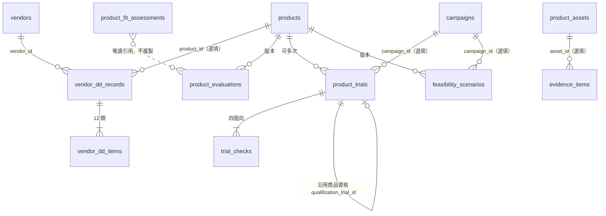

# SOP 02 商品選品與廠商開發、SOP 03 商品試用與商業可行性驗證

> **狀態**：設計與實作文件。範圍：把研究報告（`docs/2026-taiwan-group-buying-complete-research.md` §四「選品評分卡與供應商審查」「首次合作十二問」「試用驗證」）結構化進 ERP，產出給 G1 選品核准查閱。
> **不改動**：G1–G5 的檢查項與核准語意、商品審核流程（DRAFT→PENDING_REVIEW→APPROVED／REJECTED）、既有任務與狀態機。**分數與評估只是決策建議，不會自動核准商品或 G1**。
> **資料原則**：只用虛構 DEMO 資料；附件**只存連結與中繼資料**，不存檔案本體；不放真實客戶、廠商機密、金鑰或未授權素材。
> **口徑原則**：評分權重、門檻、有效期都是**待 Owner 確認的建議值**（§12），可設定、有版本。可行性試算的收入／分潤口徑沿用 `docs/biz-model/04-FINANCE_AND_COMMISSION.md` 的提案，仍待 Owner 確認（該文件的 B-01、B-08、B-09）。

## 1. 盤點結論：沿用／擴充／新增／待核准

> 已讀程式與 migration（不只讀文件）：`products.ts`（審核流程、成本權限）、`vendors.ts`、`tasks.ts`（任務證據欄位）、`fulfillment.ts`（寄樣批次 `kind=SAMPLE`）、`gates.ts`（G1 檢查）、`fit.ts`／`segments.ts`（SOP 01）、`system_settings`、`permissions.ts`、`migrations 001–013`。

| 需求 | 既有結構（已核對程式） | 判定 | 說明 |
|---|---|---|---|
| 商品審核 DRAFT→PENDING_REVIEW→APPROVED／REJECTED | `products.review_status`、`setProductReview`（核准需 `product.review`） | **沿用，不動** | 評估與試用不參與、不取代此流程 |
| 廠商與聯絡人、商品、SKU、素材連結 | `vendors`、`vendor_contacts`、`products`、`skus`、`product_assets` | **沿用** | 證據可引用既有 `product_assets`（不複製連結） |
| 合作協議 | `agreements`（僅 Schema，**沒有任何程式使用**） | **不動** | 以 `contract_version`／`contract_ref` 文字記錄版本；日後做協議 CRUD 再關聯（待決策 D-36） |
| 客群與商品適配 | SOP 01：`customer_segments`、`partner_segment_links`、`product_fit_assessments` | **沿用（唯讀引用）** | 商品通用評估只**引用**適配結果，不複製、不重算（§3.4） |
| 寄樣→到貨→試用→回饋→G1 任務 | `tasks`（`SAMPLE_SHIP`、`TRIAL_ARRIVAL`、`TRIAL_FEEDBACK`、`LAUNCH_APPROVAL`＝G1）；任務有 `evidence_url`／`evidence_note` | **沿用，不新增任務狀態機** | 試用紀錄只存「資料」（日期、物流、結果），任務狀態仍由任務模組管理（§6.3） |
| 寄樣批次 | `fulfillment_batches.kind='SAMPLE'`＋`shipments` | **沿用（可選關聯）** | 試用可關聯寄樣批次；不重複建立出貨單 |
| 評分設定與版本 | `system_settings`（鍵值 JSON；SOP 01 已用 `fit.scoring`） | **沿用** | 新增鍵 `selection.scoring` |
| 稽核、樂觀鎖、軟刪除、冪等 | `audit_logs`、`version`、`forbid_delete`、`idempotency` | **沿用** | 所有新表比照 |
| 成本與分潤敏感欄位 | `product.cost.read`（管理者、營運主管、財務）、`commission.read` | **沿用（欄位投影）** | 營運小編沒有，維持沒有（§9） |
| 選品 6 項評分、12 類盡職調查、試用結果、可行性假設、證據 | **無** | **新增 7 張表** | §2 |
| G1 統一決策摘要 | `gates.ts` 的 G1 檢查（廠商可合作、商品與規格、團主確認、廠商資料完整度） | **新增唯讀摘要，不改檢查** | §8 |
| 將結果納入 G1 阻擋或 WARN、商品送審前必須有評估 | — | **待 Owner 核准（不做）** | D-26、D-33 |

## 2. 資料模型（migration 014）

> 編號說明：`docs/biz-model` 的路線圖曾**提案**把 014～018 留給合作案與費用規則（尚未實作）；本功能先取用 014，該提案的 migration 編號順延（屬提案，不影響已核准規格）。

| 資料表 | ID | 用途 | 與既有資料的關係 |
|---|---|---|---|
| `evidence_items` | `EVI-000001` | 證據連結（憑證、檢驗報告、合約、報價、照片、影片、授權、法務意見），含**有效期限**；可掛在盡職調查項目、評估、試用、試用檢核、可行性 | 可選擇引用 `product_assets`（`asset_id`），不複製連結 |
| `vendor_dd_records` | `VDD-000001` | 廠商首次合作盡職調查（表頭）：廠商、可選商品、**合約版本**、受規範品類、核准結果與有效期 | `vendor_id`→`vendors`、`product_id`→`products` |
| `vendor_dd_items` | `VDI-000001` | 12 類問題各一列：狀態、**負責人**、**責任方**、結構化條款（jsonb）、法務審查狀態、證據 | `record_id`、`owner_user_id`→`users` |
| `product_evaluations` | `SEL-000001` | 商品**通用**選品評估（6 項 1–5 分）＋獨立的安全合規查核；版本化 | `product_id`；**不含**客群適配分（引用 SOP 01） |
| `product_trials` | `TRL-000001` | 試用（商品資格／團主適配）：日期、物流、回收、結論、覆核 | `product_id`、`sku_id`、`host_id`、`campaign_id`、`sample_batch_id` |
| `trial_checks` | `TCK-000001` | 試用檢核項（四大面向）：結果、客觀證據、缺陷嚴重度、風險 | `trial_id` |
| `feasibility_scenarios` | `FSB-000001` | 商業可行性情境（假設與來源、試算結果、小團實際回寫）；每次儲存一個新版本 | `product_id`、`campaign_id`、`host_id`、`trial_id` |



### 2.1 資料庫層保證
- 全部帶 `organization_id`、建立／更新者與時間、`version`（樂觀鎖），掛 `touch_row`、`forbid_delete`；**只軟刪除**（`deleted_at` 或狀態）。
- `evidence_items`：URL 只接受 http(s)；`valid_until ≥ valid_from`。
- `vendor_dd_items`：`(record_id, category_key)` 唯一；`NOT_APPLICABLE` 必填原因、`AT_RISK` 必填風險說明（CHECK）。
- `product_evaluations`：送出後評分內容不可改（觸發器），只可補覆核與「被新版取代」；同商品同時只有一份草稿（部分唯一索引）。
- `product_trials`：同一商品＋規格＋團主＋檔期＋試用類型，**進行中（OPEN）只能一筆**（部分唯一索引）；日期先後順序 CHECK；`DESIGNATED_HOST` 必填團主、`MINI_GROUP` 必填檔期。
- `feasibility_scenarios`：新增即不可修改（只可補寫實際回寫欄位）。

## 3. SOP 02：商品選品評估

### 3.1 六項評分（待 Owner 確認的建議值，D-25）
| 項目 | 鍵 | 預設權重 |
|---|---|---:|
| 客群需求符合度 | `need` | 25 |
| 商品品質與安全性 | `quality` | 25 |
| 利潤與價格競爭力 | `profit` | 20 |
| 供應商履約能力 | `supply` | 15 |
| 內容展示與說服力 | `content` | 10 |
| 複購潛力 | `repeat` | 5 |

- 每項 1–5 分（人工評分，**每項必填理由**），總分＝`Σ（權重 × 分數 ÷ 5）`（100 分制）；**未評分的項目是「未知」，不當 0 分**：只用已知項目重新正規化，並回報完整度與信心（同 SOP 01 的原則）。
- 門檻預設：`≥80` 建議進入商務審查（`PROCEED`）、`65–79` 補測／補件（`SUPPLEMENT`）、`<65` 暫緩（`HOLD`）；沿用研究報告切點，但僅是建議值。
- 權重與門檻存於 `system_settings['selection.scoring']`，合計必須 100，儲存即新版本、寫稽核；每份評估保存當時的設定快照。

### 3.2 商品安全與合規：獨立必要查核
- 評估內另有 `compliance`（`PASS｜FAIL｜UNKNOWN｜NEEDS_LEGAL`＋說明＋證據），**不併入加權**。
- `FAIL` → 建議 `BLOCKED`（總分僅供參考）；`UNKNOWN`／`NEEDS_LEGAL` → 建議最多「補測／補件」。
- 食品、保健食品、醫材、化妝品、兒童用品等受規範品類：系統只**標示需法務或合規審查**，不判斷合法（§4.3）。

### 3.3 建議等級（依序判斷）
| 條件 | 建議 |
|---|---|
| 合規 `FAIL` | `BLOCKED` 硬性條件未過 |
| 完整度 < 最低完整度 | `INSUFFICIENT_DATA` 資料不足 |
| 總分 ≥ 建議門檻、合規 `PASS`、信心不為低、**品質與供應兩項都附有證據** | `PROCEED` 建議進入商務審查 |
| 總分 ≥ 補測門檻（含上列被降級者） | `SUPPLEMENT` 補測／補件 |
| 其他 | `HOLD` 暫緩 |

### 3.4 與 SOP 01 的關係（不重複）
- SOP 01 的 `product_fit_assessments`＝「商品 × **團主**」的客群適配（計算出來、含硬性檢查、人工覆核）。
- SOP 02 的 `product_evaluations`＝商品**本身**的通用評估（人工評分）。
- 兩者**不互相寫入**。評估頁的「客群需求符合度」旁以唯讀方式顯示 SOP 01 的現行適配統計（各建議等級的團主數、最高分）作為**評分參考**；評估人可採用或不採用，須自行填寫分數與理由。

### 3.5 紀錄與版本
評估人、評估日期、每項理由與證據、審核者、審核意見、設定版本、評估版本號（每次重新評估＋1，舊版標記被取代）。審核結果 `ACCEPTED｜REJECTED｜NEEDS_MORE`；`REJECTED`／`NEEDS_MORE` 必填原因。**審核只記錄意見，不改商品審核狀態、不核准 G1。**

## 4. 廠商首次合作盡職調查（12 類）

### 4.1 結構
一份調查（`vendor_dd_records`）＝某廠商（可限定某商品）在某**合約版本**下的 12 類問題。建立時自動產生 12 個項目（狀態「待補件」）。

| # | 類別鍵 | 問題 | 結構化條款（`terms`，節錄） | 必附證據才可標「已確認」 |
|---|---|---|---|:-:|
| 1 | `SOURCE_LICENSE_QA` | 商品來源、品牌授權與品質檢驗 | 來源類型、授權人、授權到期日、檢驗報告 | ✅ |
| 2 | `PRICING` | 售價、團購價與價格條件 | 原價、團購價、最低價、價格說明 | — |
| 3 | `MOQ` | MOQ 與最低採購承諾 | MOQ 數量、最低採購承諾金額 | — |
| 4 | `STOCK_LEADTIME` | 現貨／預購與出貨交期 | 現貨或預購、交期天數 | — |
| 5 | `INVENTORY_OVERSELL` | 庫存、缺貨與超賣機制 | 庫存上限、超賣處理、缺貨通知時限 | — |
| 6 | `DELIVERY_METHOD` | 逐單代發、集貨等配送方式 | 配送方式、物流商 | — |
| 7 | `PAYMENT_LIABILITY` | 收款、發票與售後責任方 | 收款方、開票方、售後責任方 | ✅ |
| 8 | `RETURNS_LIABILITY` | 退貨、瑕疵、運損、遺失與補寄責任 | 退貨期限、瑕疵／運損／遺失／補寄各責任方 | ✅ |
| 9 | `SAMPLE_MEDIA_LICENSE` | 試用品、圖片與影片授權 | 試用品政策、圖片授權、影片授權、授權期限 | ✅ |
| 10 | `COMMISSION_TERMS` | 分潤基礎、比例、結算週期 | 基礎、比例、結算週期（**敏感，見 §9**） | ✅ |
| 11 | `EXCLUSIVITY_RESALE` | 競業、排他、價格限制及素材條款 | 是否排他、**是否有轉售價格限制**、素材條款 | ✅ |
| 12 | `CONTINGENCY` | 延遲出貨、缺貨與停止供應的應變 | 延遲處理、缺貨處理、停止供應處理 | — |

每項另有：**狀態**（`CONFIRMED` 已確認／`PENDING_DOCS` 待補件／`NOT_APPLICABLE` 不適用／`AT_RISK` 有風險）、**負責人**（內部使用者）、**責任方**（`BRAND｜COMPANY｜HOST｜SHARED｜TBD`）、證據連結（含有效期）、備註、更新者與時間、審核者與時間、法務審查狀態。**不是純勾選框**：條款欄位（責任方、期限、金額、比例）以結構化欄位保存並驗證。

### 4.2 規則
- 標「已確認」：必填類別須至少有一筆**有效（未過期）**證據；`NOT_APPLICABLE` 必填原因；`AT_RISK` 必填風險說明。
- 整份調查送審／核准（`product.review`）的條件：12 項皆為「已確認」或「不適用」、沒有「有風險」、沒有過期證據、沒有未結案的法務審查。核准後記錄**有效期限**（預設 365 天，D-27），到期自動視為失效（顯示「已到期」，不改資料）。
- 核准結果**不會**阻擋或放行 G1，只在 G1 摘要與廠商頁顯示（D-26）。

### 4.3 法務／合規審查標示（不自行假定合法）
系統自動把項目標為「需法務或合規審查」（`legal_status=REQUIRED`）的情況：
1. 第 11 類勾選**有轉售價格限制**（可能涉及公平交易規範）；
2. 調查表頭選了**受規範品類**（食品、保健食品、醫材、化妝品、兒童用品、其他受規範），或商品類別／名稱符合關鍵字（食品、保健、醫療、醫材、藥、化妝、嬰幼兒…）——自動標示為「疑似」，需人工確認；
3. 任何人手動標示。
`CLEARED`（已確認無虞）必須附一筆法務意見類證據與說明，且只有 `product.review` 角色可設；`BLOCKED` 代表不得合作。系統**不判斷合法性**，只管理「有沒有被審、誰審的」。

## 5. SOP 03：商品試用

### 5.1 兩個層級與三種類型
- **層級**：`QUALIFICATION` 商品資格驗證（商品本身能不能賣）／`HOST_FIT` 團主或檔期適配試用（這位團主、這個檔期適不適合）。
- **類型**：`INTERNAL` 內部試用／`DESIGNATED_HOST` 指定團主試用／`MINI_GROUP` 小規模測試團（需關聯檔期，可回寫實際訂單）。
- 同一商品**可有多次試用**；進行中的相同組合不可重複建立；已結論的可再開新一次（例如改良後重測）。

### 5.2 資料
商品、SKU、廠商、試用人（內部使用者或團主）、團主、檔期；日期：寄樣、到貨、開始試用、回饋、結案；物流（物流商、追蹤碼）、試用品回收（需否回收、回收狀態、日期、備註）；可關聯寄樣批次。

### 5.3 四大面向檢核（研究報告「試用驗證」）
| 面向 | 預設檢核項 |
|---|---|
| 商品本身 `PRODUCT` | 品質、規格符合、包裝完整、保存期限／效期、使用限制、安全標示 |
| 顧客體驗 `CUSTOMER` | 開箱體驗、使用難易、效果感受、容易誤解之處、客服疑問 |
| 內容素材 `CONTENT` | 可示範性、素材品質、賣點差異 |
| 商業效益 `BUSINESS` | 預估毛利、需求、退貨風險、供應風險 |

每項：結果（`NOT_TESTED｜PASS｜CONCERN｜FAIL`）、**客觀證據**（`PASS` 必填）、缺陷嚴重度（`NONE｜MINOR｜MAJOR｜CRITICAL`）、缺陷與風險說明（`FAIL`／缺陷必填）、驗證人與時間、證據連結。

### 5.4 結論、覆核與歷史
- 系統先給**建議結論**：任何嚴重缺陷或商品面向有 `FAIL` → `FAIL`；仍有未測 → `RETEST`；有 `CONCERN` 或重大缺陷 → `CONDITIONAL`；否則 `PASS`。
- 人工填寫**最終建議**（`PASS｜CONDITIONAL｜FAIL｜RETEST`）與說明；**不得比系統建議更樂觀，除非由 `product.review` 角色填寫覆寫原因**。
- 審核者（`product.review`）覆核 `ACCEPTED｜REJECTED`。歷史＝`version`＋稽核（前後值）。
- **沿用商品資格**：資格試用結論為 `PASS` 或 `CONDITIONAL` 且已被接受、**未過期**（預設 180 天，D-27）、且商品指紋（名稱、類別、規格編號、合規備註）未變，才算「仍有效」；團主適配試用可記錄 `qualification_trial_id`，只需補做客戶、內容與商業面向。商品資料改變後資格自動視為失效並顯示原因。

### 5.6 不新增任務狀態機
- 試用紀錄**不**有自己的流程狀態機；只有 `OPEN｜CONCLUDED｜CANCELLED` 三個資料狀態。
- 檔期關聯的試用，畫面**唯讀顯示**該檔 `SAMPLE_SHIP`、`TRIAL_ARRIVAL`、`TRIAL_FEEDBACK`、G1 任務的現況；任務的完成與證據仍在任務頁處理。試用結論不會自動完成任務，任務的 `evidence_url` 可貼試用頁連結。

## 6. 商業可行性試算

### 6.1 輸入（全部可空；**缺少就是未知，不捏造、不預設**）
預估訂單數、團購價、退款率、商品成本、運費／單、平台費（比例或每單）、其他變動成本／單、固定費用、品牌端服務費（比例與固定費）、團主分潤比例、分潤基礎（`NSV｜GMV`）、**團主分潤付款方**（`COMPANY｜BRAND`）、收款模式（`BRAND_COLLECTS｜HOST_COLLECTS｜COMPANY_ESCROW`）、每個成本項目的**負擔方**（`BRAND｜COMPANY｜HOST`）。每個輸入可記錄**假設來源**（`VENDOR_QUOTE｜TRIAL_ACTUAL｜HISTORICAL_DATA｜CONTRACT｜MANUAL_ESTIMATE`）與說明；每次儲存＝新版本。

### 6.2 輸出（口徑沿用 biz-model 04；**試算，待 Owner 確認**）
```
GMV             = 預估訂單 × 團購價
退款            = GMV × 退款率             （未提供退款率 → 淨銷售額為未知，不假設 0）
有效淨銷售額 NSV = GMV − 退款
商品成本         = 單位成本 × 預估訂單（保守：以出貨量計）
公司營業收入     = 品牌端服務費 = 比例 × 分潤基礎 + 固定費       （比例與固定費都要明確填，0 也要填）
團主分潤         = 比例 × 分潤基礎
公司貢獻利潤     = 公司營業收入 − [付款方=公司 ? 團主分潤 : 0] − 公司負擔的成本
品牌利潤         = NSV − 商品成本 − 公司營業收入 − [付款方=品牌 ? 團主分潤 : 0] − 品牌負擔的成本
團主收入         = 團主分潤 − 團主負擔的成本
```
- **GMV 與代收款不是公司收入**；公司營業收入只有服務費。四個數字（GMV、NSV、品牌利潤、公司收入）分開呈現。
- 只支援單一費率與固定費；階梯、保底、更正等進階口徑尚未納入（待 biz-model 的費用規則落地）。
- 任何必要輸入缺少，對應結果為「未知」並列出缺哪些輸入。
- 平台費比例預設以 GMV 為基礎（假設，標示於結果）。

### 6.3 小規模測試團回寫
`POST /feasibility/:id/actuals`（需 `selection.write`）從該檔期的訂單、售後案件、出貨單讀取：實際有效訂單、GMV、退款、NSV、客單價、退款率、客訴件數、出貨例外率，與預測值並列差異；**不寫利潤**（避免在缺成本資料時捏造）。

## 7. 權限與欄位投影（§9 詳述）
新增 3 個權限：`selection.read`、`selection.write`、`selection.config`。覆核與法務確認沿用 `product.review`。

## 8. G1 統一決策摘要（唯讀，不改 G1）
`GET /campaigns/:id/g1-summary`（檔期資料範圍內、`selection.read`）：對檔期內每個商品彙整——
1. 商品通用評估（現行版本、分數、建議、合規、覆核）；
2. 廠商盡職調查（狀態、有效期、未結風險、過期證據、法務審查）；
3. 試用（商品資格是否仍有效、本檔的試用與結論、缺陷與風險）；
4. 商業可行性（最新版；成本與利潤欄位需 `product.cost.read`，否則顯示「無權限」）；
5. SOP 01 客群適配統計；
6. **風險清單**（等級、說明、連結）與總燈號：🔴 有阻礙性風險（合規未過、法務封鎖、試用不通過、關鍵證據過期、商品被退回）／🟡 有缺口（尚無評估、調查未核准、尚未試用）／🟢 無已知缺口。
摘要的 `gateImpact` 恆為 `NONE`：**不改變 G1 的檢查項、申請與核准結果**。檔期頁新增「選品與試用」分頁，G1 核准區顯示同一份摘要。

## 9. 權限矩陣與敏感資料
| 角色 | selection.read | selection.write | selection.config | 覆核／法務確認（`product.review`） | 成本與利潤欄位（`product.cost.read`） |
|---|:-:|:-:|:-:|:-:|:-:|
| 系統管理者 | ✅ | ✅ | ✅ | ✅ | ✅ |
| 營運主管 | ✅ | ✅ | ✅ | ✅ | ✅ |
| 營運小編（PM） | ✅ | ✅ | — | — | — |
| 財務 | ✅ | — | — | — | ✅ |
| 團主／廠商 | — | — | — | — | — |

- **PM 可以填報**：評估分數、盡職調查項目、試用、可行性的**非敏感輸入**。
- **敏感欄位**（沿用既有權限，後端強制）：第 10 類（分潤基礎、比例、結算週期）條款、可行性的成本、運費、平台費、其他變動成本、固定費、品牌端服務費、團主分潤比例，以及所有由它們算出的收入／利潤。沒有 `product.cost.read` 的角色：讀取時這些欄位為 `null` 並標 `restricted`；寫入時 **403**。
- 資料範圍：商品、廠商層級屬主檔資料，內部角色可見；**檔期層級**（試用關聯檔期、G1 摘要、檔期試用清單）一律經 `campaignScope`，營運小編只看自己負責的檔期，越權＝404。

## 10. 附件與安全
- 只存**連結（http／https）與中繼資料**（標題、種類、來源說明、有效期、備註）；`javascript:`、`data:` 等被拒。
- 檔案本體應放在公司核准的雲端空間或文件系統，**不得放進 GitHub 儲存庫**；系統不上傳、不轉存檔案。
- 可在 `selection.scoring` 設定網域白名單（預設不限制；設定後只接受名單內網域，D-32）。
- 證據內文與備註不得含電話或 Email（沿用 `containsPii`）；真實合約內容、價格機密不應貼入備註，貼連結即可。

## 11. API 與畫面
| 範圍 | API | 畫面 |
|---|---|---|
| 設定 | `GET/PUT /api/selection/config` | `/fit?tab=…` 旁新增「選品設定」於 `/selection` |
| 證據 | `POST /api/evidence`、`POST /api/evidence/:id/remove` | 各面板內嵌 |
| 盡職調查 | `GET/POST /api/vendors/:id/diligence`、`GET/PATCH /api/diligence/:id`、`POST …/submit`、`POST …/review`、`PATCH /api/diligence-items/:id`、`POST /api/diligence-items/:id/legal` | 廠商詳情「合作資格審查」；`/diligence/[id]` |
| 商品評估 | `GET/POST /api/products/:id/evaluations`、`PATCH /api/evaluations/:id`、`POST …/submit`、`POST …/review` | 商品詳情「選品評估」 |
| 試用 | `GET/POST /api/products/:id/trials`、`GET/PATCH /api/trials/:id`、`PATCH /api/trial-checks/:id`、`POST …/conclude`、`POST …/review`、`POST …/cancel`、`GET /api/campaigns/:id/trials` | 商品詳情「商品資格試用」；`/trials/[id]`；檔期「選品與試用」 |
| 可行性 | `GET/POST /api/products/:id/feasibility`、`GET /api/feasibility/:id`、`POST /api/feasibility/:id/actuals` | 商品詳情與檔期 |
| G1 摘要 | `GET /api/campaigns/:id/g1-summary` | 檔期「選品與試用」分頁、核准區 |

## 12. 與核准規格的差異（最小必要）
| # | 差異 | 影響 |
|---|---|---|
| S-1 | 新增 7 張表（58→65）、migration 014 | 既有表不動 |
| S-2 | 新增 3 個權限（49→52） | `permissions.ts`、權限測試、文件同步 |
| S-3 | 新增模組 `evidence.ts`、`diligence.ts`、`selection.ts`、`trials.ts`、`feasibility.ts`、`decision-summary.ts` 與純函式 `lib/selection-score.ts`、`lib/dd-catalog.ts`、`lib/trial-catalog.ts`、`lib/feasibility-calc.ts` | 無相依既有模組的內部變更（僅讀取） |
| S-4 | `system_settings` 新增鍵 `selection.scoring` | 無 schema 變更 |
| S-5 | **不修改** `gates.ts`、`state.ts`、`products.ts` 的審核流程、`tasks.ts`、模板 | G1–G5、商品審核、任務語意不變（回歸測試） |

## 13. 驗收與測試
| 項目 | 測試 |
|---|---|
| 加權評分、1–5 分、未知不當 0、完整度與信心、門檻、版本化設定、合規獨立、PROCEED 需品質與供應證據 | `unit/selection-score.test.ts` |
| 12 類目錄、結構化條款驗證、必附證據、法務觸發 | `unit/dd-catalog.test.ts`、`diligence.test.ts` |
| 證據過期、核准條件、合約版本、負責人／責任方 | `diligence.test.ts` |
| 試用：重複進行中被擋、日期順序、四面向、客觀證據、結論不得比建議樂觀、沿用資格與失效、回收資訊 | `trials.test.ts` |
| 可行性：缺資料不捏造、GMV≠公司收入、付款方、負擔方、版本、回寫 | `unit/feasibility-calc.test.ts`、`feasibility.test.ts` |
| 權限隔離：營運小編不能讀寫敏感欄位（403／null）、團主與廠商無入口、檔期層級越權 404、跨組織 404 | 各測試檔、`security-fuzz`（既有，自動涵蓋） |
| **G1 不變條件**：有無評估／調查／試用／可行性，G1 檢查項與核准結果相同；商品審核流程不變；不新增核准列、不發通知 | `selection-g1.test.ts` |
| 附件：非 http(s)、含個資被拒 | `diligence.test.ts` |
| 畫面：廠商資格審查、商品評估／試用／可行性、檔期選品與試用、G1 摘要、非授權角色 | E2E（`scripts/e2e-smoke.ts`） |
| 突變驗證（規則 7）：未知當 0、合規被總分抵銷、過期證據仍算有效、PM 讀到成本、試用重複 | 各單元／整合測試 |

## 14. 待 Owner 決策（一次列出）
| # | 決策 | 選項 | 目前實作 |
|---|---|---|---|
| D-25 | 選品權重（25/25/20/15/10/5）與門檻（80／65） | 採用／調整 | 建議值，可設定 |
| D-26 | 盡職調查核准、商品評估是否納入 G1 檢查（WARN／BLOCK） | 僅查閱／WARN／BLOCK | **僅查閱** |
| D-27 | 調查有效期與資格試用有效期 | 365／180 天或其他 | 365／180 |
| D-28 | 新商品是否一律要做商品資格試用 | 必要／建議／不強制 | 不強制 |
| D-29 | 受規範品類清單與法務／合規審查的負責人與流程 | 指定窗口 | 只標示，不判斷 |
| D-30 | 敏感欄位可見範圍（PM 是否可見成本與分潤） | 維持／開放給 PM | 維持不可見 |
| D-31 | 可行性試算口徑（收入、分潤基礎、付款方；同 biz-model B-01／B-08／B-09） | 待確認 | 單一費率＋固定費，標「試算」 |
| D-32 | 附件存放位置與網域白名單 | 指定雲端與網域 | 只存連結，不限制網域 |
| D-33 | 商品送審前是否必須有已提交的評估 | 必須／不必須 | 不必須（不動既有審核流程） |
| D-34 | 試用品回收逾期的處理與責任 | 人工追蹤／例外自動化 | 人工（只記錄） |
| D-35 | 哪些類別必附證據才可標「已確認」 | 目前 1、7、8、9、10、11 | 如左，可調整 |
| D-36 | 是否建立協議（`agreements`）CRUD 並與調查關聯 | 做／維持文字版本 | 維持文字版本 |

## 15. 已知限制
關鍵字式「疑似受規範品類」會漏判或誤判（只作提醒）；可行性只支援單一費率；試用結果由人工填寫，沒有 AI 或外部資料；證據只存連結，連結失效不會被偵測；商品指紋不含價格（價格變動不使資格失效）。

## 16. 實作補充（寫程式時定下的細節，與 §1–§15 一致、不擴大範圍）

| 項目 | 實作 |
|---|---|
| 評估中的證據與分數 | 每個評分可勾選這份評估自己的證據（`scores[key].evidenceIds`）；送出時以**當下有效（未過期）**的證據數寫入 `evidenceCount`，品質與供應兩項為 0 則不得建議進入商務審查 |
| 第 10 類（分潤）的權限 | 沒有 `product.cost.read` 者：條款、狀態、備註、法務標示都不可讀寫（讀到空值並標 `restricted`，寫入 403）；仍可**指派負責人與責任方**。該類的證據連結同樣隱藏標題與連結，也不能新增。稽核與回應都不含分潤數值 |
| 調查可編輯狀態 | 只有 `DRAFT`、`REJECTED` 可改項目與證據；`IN_REVIEW` 凍結（審核者仍可處理法務標示）；`APPROVED` 可被 `product.review` 撤銷（需原因）回到 `REJECTED` 再編輯，或以新合約版本另開一份 |
| 法務標示 | 任何填報者可「標示需審」；「確認無虞」限 `product.review`，且需先附一筆**有效**的「法務意見」類證據；「封鎖」代表不得合作；自動觸發條件仍成立時不能直接「解除」 |
| 試用類型限制 | 團主／檔期適配層級不可為「內部試用」；指定團主必選團主；小規模測試團必選檔期且商品必須在該檔期內 |
| 試用檢核「預估毛利」 | 說明可能含成本，沒有 `product.cost.read` 者只能填結果、看不到也不能寫該項的文字說明；稽核以「[敏感]」取代內容 |
| 結論的有效期 | 通過／有條件通過預設 `trialValidDays`（180）天，可填較短但不可超過；不通過與需重測沒有有效期；沿用中的資格若在結論前已失效，不能結論（要先重做資格） |
| 回收 | 試用品回收狀態與日期可在**結論後**補寫（其餘結論欄位由觸發器鎖定）；已取消的試用不可改 |
| 可行性版本 | 新版本＝在上一版的基礎上套用這次填的欄位；沒有成本權限者新增版本時，上一版的敏感欄位原樣沿用（不會被清掉）；每個非空輸入都要有假設來源；成本／報價類證據需 `product.cost.read` |
| 回寫 | `POST /feasibility/:id/actuals` 可重複執行（以最新為準，稽核保留前後值）；指定團主時依歸因計算，否則為檔期合計；客訴、退款、換貨件數與出貨例外為檔期層級 |
| 路由數 | 共 33 條（含 `GET /campaigns/:id/g1-summary`）；`security-fuzz` 自動涵蓋 |
| 畫面 | 另有 `/feasibility/[id]`（試算結果、輸入與來源、實際 vs 預測、版本）；`/selection` 總覽含待覆核評估／審查中調查／待覆核試用／到期證據／待回收件數 |
| DEMO 種子 | `npm run db:seed:demo:selection`（需先 `db:seed:demo`；冪等；連結為保留網域 `docs.example.invalid`；已納入 `bootstrap:demo`） |

### 驗證證據（2026-10-29）
`npm test` 30 檔 592 項全綠（新增 187）；E2E 122/122；22 種突變驗證全部轉紅；G1／商品審核回歸測試通過。細節見 [TEST_REPORT §6](../TEST_REPORT.md) 與 [DEVELOPMENT_LOG](../DEVELOPMENT_LOG.md)。

