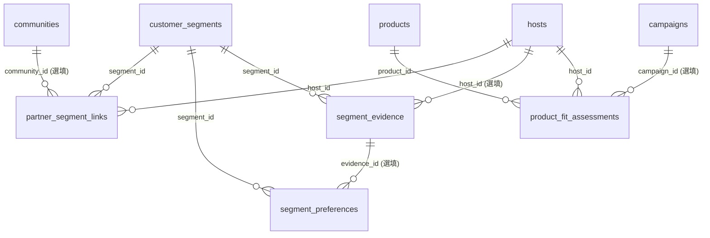
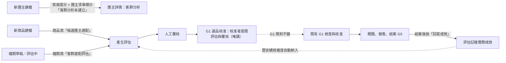

# SOP 01 市場定位與客群分析：客群輪廓、商品適配、G1 選品決策支援

> **狀態**：設計與實作文件（本次交付）。範圍是 SOP 01「客群定位」的系統化，產出給 G1 選品核准使用；**不改變 G1–G5 的核准語意，不自動核准任何檔期**。
> **資料原則**：全程只用 DEMO／測試資料；不接真實名單、不寄通知、不切 LIVE。
> **口徑原則**：評分權重與門檻是**待 Owner 確認的建議值**（見 §9），系統可設定、可追溯，不假裝是正式核准規則。這不是佣金／結算公式，沒有新增任何金額分潤口徑。

## 1. 為什麼要做、做到哪

SOP 01 的產出是「客群研究、需求清單」（研究報告 §四、`docs/2026-taiwan-group-buying-complete-research.md`）：先找到穩定客群需求，再找商品。現況系統只有 `hosts.audience_note` 一個自由文字欄位，無法回答：

1. 這位團主的客群是誰、要什麼、卡在哪、在哪個通路活躍？哪些是事實、哪些是估計、哪些根本不知道？
2. 這個新商品適合推給哪些團主？依據是什麼、資料夠不夠、有沒有合規／品質硬傷？
3. G1 核准時，主管能否看到「這檔選的團主與商品適不適配」以及人工審查的結果？
4. 結案後，預測與實際成效能否回寫，讓下次判斷更準？

## 2. 盤點結論：沿用什麼、新增什麼

| 需求 | 既有結構 | 判斷 |
|---|---|---|
| 團主主檔 | `hosts`（`audience_note` 自由文字） | **沿用**。`audience_note` 保留為「一句話描述」，不遷移、不刪除；新增 1 欄 `partner_type`（合作對象類型） |
| 社群／通路 | `communities`（平台、人數）、`host_communities`（多對多） | **沿用**。客群連結可指向其中一個社群（選填）；「活躍通路」偏好沿用同一組平台代碼 |
| 商品 | `products`（類別、賣點、說明、合規備註、審核狀態）、`skus`（團購價） | **沿用**。適配規則只讀這些欄位，**不新增商品欄位**、不讀成本 |
| 檔期、團主、商品關聯 | `campaigns`、`campaign_hosts`、`campaign_products` | **沿用** |
| 歷史績效 | `orders`、`attributions`、`kpi.ts` 的 `SALES_STATUSES` | **沿用**同一個「計入銷售的訂單狀態」定義，只做排序用的相對比較，不算佣金 |
| 供應履約 | `shipments`、`service_cases`、`vendors.status` | **沿用** |
| 評分設定 | `system_settings`（鍵值 JSON，已被組織設定使用） | **沿用**，新增鍵 `fit.scoring`，不新增設定表 |
| 變更紀錄 | `audit_logs`（前後值）、各表 `version` 樂觀鎖 | **沿用**；不另建版本快照表 |
| 客群輪廓、偏好、團主↔客群、研究證據、適配評估 | **無** | **新增 5 張表**（不是既有表的同義複製，見 §3） |

> 禁止重複：沒有再建「團主」「社群」「商品」「通路」類資料表；`customer_segments` 描述的是**受眾**，不是合作對象。

## 3. 資料模型（migration 013）

候選邏輯表與實際命名對照：

| 候選 | 實際資料表 | ID 格式 | 說明 |
|---|---|---|---|
| CustomerSegments | `customer_segments` | `SEG-0001` | 客群輪廓：名稱、年齡層、家庭型態、消費週期、價格帶、整體依據（事實／估計） |
| SegmentPreferences | `segment_preferences` | `SPF-000001` | 一列一個偏好值：種類（動機／阻力／偏好品類／活躍通路）、值、依據、可指向一筆證據 |
| PartnerSegmentLinks | `partner_segment_links` | `LNK-000001` | 團主 ↔ 客群（多對多）：占比（選填）、依據、對應社群（選填）、結束時間 |
| SegmentEvidence | `segment_evidence` | `EVD-000001` | 研究證據：種類、摘要、來源、觀察日期、依據；可掛在特定團主 |
| ProductFitAssessments | `product_fit_assessments` | `FIT-000001` | 一次評估一個版本：商品 × 團主（× 檔期）；維度分數、硬性檢查、理由、信心、覆核、成效回寫 |
| （既有 `hosts`） | `hosts.partner_type` 新增欄位 | — | 團媽／社群主／網紅／其他；未填＝未知 |



### 3.1 欄位重點與資料庫層保證

- 全部帶 `organization_id`（多租戶）、`created_at/by`、`updated_at/by`、`version`（樂觀鎖），並掛 `touch_row` 與 `forbid_delete` 觸發器：**只軟刪除**。
- `customer_segments`：`normalized_name` 在組織內唯一（未刪除者）；`age_band` ∈ `U25｜25_29｜30_44｜45_59｜60P`；`family_type` ∈ `SINGLE｜COUPLE｜PARENTING｜TEEN｜MULTI_GEN｜EMPTY_NEST｜OTHER`；`cycle` ∈ `WEEKLY｜BIWEEKLY｜MONTHLY｜QUARTERLY｜OCCASIONAL`；`price_min/price_max`（TWD 整數、`min ≤ max`，單品團購價可接受區間）；**以上欄位為空＝未知，不是「無」**。
- `segment_preferences`：`kind` ∈ `MOTIVE｜BARRIER｜CATEGORY｜CHANNEL`；`basis` ∈ `FACT｜ESTIMATE`；同客群同種類同值（正規化）唯一（未刪除者）；`CHANNEL` 值限平台代碼（LINE、FACEBOOK、INSTAGRAM、THREADS、YOUTUBE、OTHER、OFFLINE）。
- `partner_segment_links`：同團主同客群只能有一筆進行中連結；`share_percent` 0–100（選填）；`basis` ∈ `FACT｜ESTIMATE`；解除＝寫 `ended_at`（比照 `host_communities`），不刪列。
- `segment_evidence`：`kind` ∈ `OBSERVATION｜INTERVIEW｜SURVEY｜ORDER_DATA｜PLATFORM_STAT｜OTHER`；`basis` ∈ `FACT｜ESTIMATE`；**`FACT` 必須有來源（來源說明或連結）**（CHECK 約束）。
- `product_fit_assessments`：評估內容（分數、維度、理由、設定快照）**寫入後不可改**，只有覆核欄位、`superseded_*`、`outcome*` 三組欄位可被後續寫入（觸發器強制）；同商品×團主×檔期只能有一筆「未被取代」的評估（部分唯一索引）。

### 3.2 與核准規格的差異（最小必要）

| # | 差異 | 原因 | 影響 |
|---|---|---|---|
| S-1 | 新增 5 張表（53 → 58 張）、1 欄 `hosts.partner_type` | 客群結構化是新需求，既有表沒有對應 | 向後相容：舊欄位與舊 API 行為不變 |
| S-2 | 新增 6 個權限（43 → 49）：`segment.read/write`、`fit.read/assess/review/config` | 比照既有粒度；團主／廠商／財務**不給** | `permissions.ts`、RBAC 文件、`unit/misc` 權限測試同步更新 |
| S-3 | 新增服務模組 `segments.ts`、`fit.ts`、`lib/fit-score.ts`（純函式）、`lib/segment-vocab.ts` | 評分引擎為純函式，方便單元測試 | 無相依既有模組的內部變更 |
| S-4 | `system_settings` 新增鍵 `fit.scoring` | 權重可設定 | 無 schema 變更 |
| S-5 | **不修改** `gates.ts`、`state.ts`、`campaigns.ts` | 守住 G1–G5 語意 | G1 檢查項、核准者、狀態轉移不變（有回歸測試） |

## 4. 評分與推薦（第一版，可解釋規則）

### 4.1 設定（待 Owner 確認）

存於 `system_settings['fit.scoring']`，預設值如下，**標示 `approved: false`**，介面上顯示「建議值，待確認」：

| 維度 | 鍵 | 預設權重 |
|---|---|---:|
| 需求 | `need` | 30 |
| 品類 | `category` | 20 |
| 價格 | `price` | 15 |
| 歷史績效 | `history` | 20 |
| 供應履約 | `supply` | 15 |

- 權重為非負整數、**合計必須 = 100**；每次儲存版本 +1、寫稽核。
- 門檻預設：`recommend = 80`、`review = 65`（借用研究報告選品評分卡的 80／65 分切點，**該卡的維度與本卡不同，所以僅是暫用建議**）；`minCompleteness = 0.5`；`highConfidence = 0.85`；`mediumConfidence = 0.6`；`minHistoryCampaigns = 2`；`minShipments = 3`。
- 關鍵字別名（需求／品類比對用）放在程式 `lib/segment-vocab.ts`，隨設定快照記錄 `lexiconVersion`。

### 4.2 每個維度怎麼算（1–5 分；資料不足＝**未知**，不是 0 分）

| 維度 | 輸入 | 規則 | 未知條件 |
|---|---|---|---|
| 品類 | 客群「偏好品類」× 商品類別／名稱 | 商品類別與任一偏好直接相符（互相包含）＝5；僅以別名／商品名稱命中＝4；有偏好資料但完全沒命中＝1 | 客群沒有品類偏好；或商品無類別且名稱也沒命中 |
| 需求 | 客群「購買動機」「購買阻力」× 商品賣點／說明／備註／名稱 | 動機：賣點含該動機或其別名＝命中；阻力：商品有對應的化解依據（認證、試用、退換、保固…）＝已化解。涵蓋率 = (命中動機 + 已化解阻力) ÷ (動機數 + 阻力數)；≥75%＝5、≥50%＝4、≥25%＝3、>0＝2、0＝1 | 客群沒有動機也沒有阻力；或商品賣點／說明皆空 |
| 價格 | 客群價格帶 × 商品啟用規格團購價平均 | 落在價格帶內＝5；超出邊界 20% 以內＝3；更遠＝1（只有下限或上限者視為開放區間） | 客群沒有價格帶；或商品沒有任何團購價 |
| 歷史績效 | 該團主歸因淨銷售（計入狀態同 `SALES_STATUSES`）、已進入結單後的檔期 | 優先取「同類別」檔期；同類別不足 `minHistoryCampaigns` 時退而用全部檔期（依據降為估計並標示「跨品類」）。團主平均每檔淨銷售 ÷ 同範圍全體（檔期×團主）平均：≥1.2＝5、≥0.9＝4、≥0.6＝3、≥0.3＝2、其他＝1；團主退款率比全體高 10 個百分點以上再 −1（最低 1） | 檔期數不足；或全體樣本少於 3 筆（無基準） |
| 供應履約 | 該商品廠商歷次出貨單（排除寄樣、取消）、客訴／退款案件 | 例外率 ≤2%/5%/10%/20% → 5/4/3/2、其他 1；案件率（每百筆訂單）≤1/3/6/10 → 5/4/3/2、其他 1；兩者取較低 | 出貨單少於 `minShipments` |

多客群團主：先逐客群算分，再依連結的 `share_percent` 加權平均；占比未填就平均；被標為未知的客群不拉低分數。

### 4.3 總分、完整度、信心

```
已知權重和 Wk = Σ 已知維度的權重
總分     = 100 × Σ(權重 × 分數 ÷ 5) ÷ Wk          （只用已知維度重新正規化；未知維度不計為 0）
完整度   = Wk ÷ Σ 全部權重
估計占比 = Σ(已知且依據為「估計」的權重) ÷ Wk
信心     = HIGH   完整度 ≥ 0.85 且 估計占比 ≤ 0.5
           MEDIUM 完整度 ≥ 0.6
           LOW    完整度 ≥ minCompleteness (0.5)
           INSUFFICIENT  其餘（完整度 < 0.5）
```

依據規則：需求維度是關鍵字比對，**一律視為估計**；品類／價格取決於客群、偏好列、連結三者是否都標「事實」；歷史績效與供應履約來自系統紀錄，視為事實。

### 4.4 硬性檢查（不得被總分抵銷）

| 檢查 | 不通過（FAIL） | 未知（UNKNOWN） | 通過（PASS） |
|---|---|---|---|
| 合規 `COMPLIANCE` | 廠商黑名單或暫停 | 商品沒有登錄檢驗／認證／法規備註 | 已登錄備註，且廠商可合作（備註內容仍須人工審查） |
| 商品品質 `QUALITY` | 商品審核被退回 | 商品尚未通過審核（草稿／待審） | 商品已通過審核 |

### 4.5 建議等級

| 條件（依序判斷） | 建議 |
|---|---|
| 任何硬性檢查 FAIL | `BLOCKED` 硬性條件未過（總分僅供參考） |
| 完整度 < `minCompleteness` | `INSUFFICIENT_DATA` 資料不足，先補客群／商品資料 |
| 總分 ≥ `recommend` 且信心不為 LOW 且硬性檢查全 PASS | `RECOMMEND` 建議合作 |
| 總分 ≥ `review`（含上一列被硬性 UNKNOWN／LOW 信心降級者） | `REVIEW` 需人工評估 |
| 其他 | `NOT_RECOMMENDED` 不建議 |

**系統建議不等於決定**：每筆評估都要由人工覆核（`ACCEPTED｜REJECTED｜NEEDS_DATA`，後兩者必填原因）；覆核只記錄意見，不改任何檔期狀態。

### 4.6 每筆評估保留的證據鏈

`config_snapshot`（當時的權重／門檻／別名版本）、`dimensions`（每維度：分數或未知、依據、信心、理由、命中的偏好與商品文字片段、樣本數）、`hard_checks`、`reasons`（人話摘要，含「缺資料：…」）、`sources`（用了哪些客群、連結、證據、檔期筆數）、`assessed_by/at`、`input_hash`。**輸入完全相同再次評估不會新增一列**；輸入或設定變動則新增新版並讓舊版標記 `superseded`。

### 4.7 範例（Owner 提供的團主輪廓）

輸入（虛構 DEMO）：合作對象類型＝團媽、客群「育兒家庭 30–44 歲」、通路 LINE、週期每月、動機＝省時間＋品質安心、阻力＝陌生品牌＋怕踩雷、偏好品類＝家庭清潔＋親子用品、觀察紀錄一筆。

- 價格帶**未提供** → 價格維度＝未知（完整度 85%），不會被當成 0 分。
- 商品「[DEMO] 家庭除菌洗衣精」類別＝家庭清潔 → 品類 5；賣點含「省時」「SGS 檢驗」「七天退換」→ 動機 2/2、阻力 2/2 → 需求 5。
- 其餘維度依系統紀錄；整張評估顯示分數、完整度、信心（需求為估計，故不會是 HIGH）與缺資料提醒。

## 5. 流程串接（不自動核准、不外送）



| 串接 | 實作 | 刻意不做 |
|---|---|---|
| 新團主 → 客群分析 | 團主清單「客群分析」欄（未建立／N 個客群）；詳情頁有空狀態導引 | 不自動建客群、不自動排程 |
| 新商品 → 候選團主 | 商品頁面板：「產生候選團主評估」按鈕，列出排名 | 不自動發出邀請 |
| 檔期草稿 → 適配評估 | 檔期頁面板：對該檔商品 × 已邀請（未婉拒）的團主評估 | 不修改檔期、不新增團主 |
| G1 → 查閱評估 | 檔期頁（G1 核准區同頁）與「客群適配」總覽；顯示最新評估與覆核 | **不新增 G1 檢查項、不擋核准、不改核准者**（是否納入 WARN 檢查＝決策 D-19） |
| 結案 → 回寫 | `POST /campaigns/:id/fit/outcome`，僅 `CLOSED`／`SETTLED`；寫入實際淨銷售、訂單數、退款率、目標達成率 | 不自動觸發（是否排進自動化＝決策 D-20）、不改評分 |

## 6. API

| 方法／路徑 | 權限 | 說明 |
|---|---|---|
| `GET/POST /api/segments` | `segment.read`／`segment.write` | 列表（q、狀態、是否被使用）／建立 |
| `GET/PATCH /api/segments/:id` | 同上 | 詳情（含偏好、證據、連結團主、變更歷史）／更新（含四類偏好陣列） |
| `POST /api/segments/:id/archive` | `segment.write` | 軟刪除；仍有進行中連結則 412 |
| `POST /api/segments/:id/evidence`、`POST /api/segment-evidence/:id/remove` | `segment.write` | 新增／移除（軟刪除）證據 |
| `GET /api/hosts/:id/segments` | `segment.read` | 團主客群分析彙整 |
| `POST /api/hosts/:id/segments` | `segment.write` | 連結既有客群，或一併建立新客群＋證據 |
| `PATCH /api/segment-links/:id`、`POST /api/segment-links/:id/end` | `segment.write` | 調整占比／依據／社群；結束連結 |
| `GET/PUT /api/fit/config` | `fit.read`／`fit.config` | 評分設定 |
| `GET/POST /api/products/:id/fit` | `fit.read`／`fit.assess` | 候選團主排名／產生評估 |
| `GET/POST /api/campaigns/:id/fit` | 同上＋檔期資料範圍 | 檔期適配 |
| `POST /api/campaigns/:id/fit/outcome` | `fit.assess`＋檔期資料範圍 | 結案回寫 |
| `GET /api/fit`、`GET /api/fit/:id` | `fit.read` | 總覽（待覆核）／單筆明細 |
| `POST /api/fit/:id/review` | `fit.review` | 人工覆核 |

權限矩陣：

| 角色 | segment.read | segment.write | fit.read | fit.assess | fit.review | fit.config |
|---|:-:|:-:|:-:|:-:|:-:|:-:|
| 系統管理者 | ✅ | ✅ | ✅ | ✅ | ✅ | ✅ |
| 營運主管 | ✅ | ✅ | ✅ | ✅ | ✅ | ✅ |
| 營運小編 | ✅ | ✅ | ✅ | ✅ | — | — |
| 財務／團主／廠商 | — | — | — | — | — | — |

資料範圍：商品／團主層級的評估屬主檔分析，內部角色皆可看；**檔期層級**（`/campaigns/:id/fit`、回寫）一律經 `campaignScope`，營運小編只看自己負責的檔期，越權＝404。團主與廠商無任何入口（評估含其他團主的比較資訊與內部判斷）。

## 7. 畫面

見 [`docs/wireframes/16-host-segments.svg`](../wireframes/16-host-segments.svg)、[`17-product-fit.svg`](../wireframes/17-product-fit.svg)；上線後實際畫面見 `docs/wireframes/AS_BUILT_SCREENS.md`。

1. **團主詳情「客群分析」**：基本輪廓、需求動機、購買阻力、偏好品類、消費週期、活躍通路、觀察來源；每項顯示「事實／估計／未知」標籤；可新增／編輯客群、記錄證據、調整占比。
2. **商品頁「候選團主適配」**、**檔期頁「客群適配評估」**：表格顯示總分、建議、信心、資料完整度、理由（可展開看各維度）、人工覆核狀態與覆核操作。
3. **客群適配總覽**（導覽 `客群適配`）：待覆核清單、尚未建立客群分析的團主、評分設定（含「建議值，待確認」標示）。

## 8. 驗收標準與測試對應

詳細需求編號與測試對應見 SRS §4.16（FR-SEG／FR-FIT）。摘要：

| 驗收項 | 測試 |
|---|---|
| 一團主多客群、多通路、複選需求；事實／估計／未知可區分 | `segments.test.ts` |
| 事實證據必須有來源；證據、偏好不得含電話／Email | `segments.test.ts` |
| 軟刪除、樂觀鎖、稽核前後值、重複名稱回報既有 ID | `segments.test.ts` |
| RBAC：團主／廠商／財務 403；小編不能覆核與改設定；檔期層級越權 404 | `segments.test.ts`、`fit.test.ts` |
| 未知不當 0 分、完整度與信心、重新正規化 | `unit/fit-score.test.ts` |
| 合規／品質為硬性，高分也不能抵銷 | `unit/fit-score.test.ts`、`fit.test.ts` |
| 權重可設定且合計 100；評估保存設定快照；改設定後舊評估不變 | `fit.test.ts` |
| 相同輸入不重複建立；輸入變動取代舊版 | `fit.test.ts` |
| 人工覆核：REJECTED／NEEDS_DATA 必填原因；覆核不改檔期狀態 | `fit.test.ts` |
| G1–G5 語意不變：有評估或覆核與否，G1 檢查項與核准結果相同 | `fit.test.ts`（G1 回歸）、`lifecycle.test.ts`（既有） |
| 結案才可回寫；重複回寫冪等 | `fit.test.ts` |
| 每條新路由在壞輸入下不得 5xx | `security-fuzz.test.ts`（既有，自動涵蓋新路由） |
| 畫面：團主客群分析、商品候選團主、檔期適配、覆核、非授權角色看不到 | E2E（`scripts/e2e-smoke.ts`「客群分析與商品適配（SOP 01）」區塊，37 項） |
| DEMO 資料：Owner 範例輪廓、未知欄位、未建立客群的團主、已覆核與待覆核評估 | `scripts/seed-demo-segments.ts`（已串入 `bootstrap:demo`；冪等） |

## 9. 風險與待 Owner 決策（一次列出）

| # | 決策 | 選項 | 目前實作 |
|---|---|---|---|
| D-18 | 評分權重（30/20/15/20/15）與門檻（80／65）是否採用 | 採用／調整數值／改維度 | 暫用建議值，可在介面調整，版本留存 |
| D-19 | 適配評估是否納入 G1 檢查（WARN／BLOCK）或僅供查閱 | 僅查閱／WARN 提醒／BLOCK 必須有覆核 | **僅查閱**（不改 G1 語意） |
| D-20 | 結案成效回寫是否排進自動化（預設停用）或維持人工按鈕 | 人工／自動化工作 | 人工按鈕 |
| D-21 | 價格帶的定義（單品團購價區間 vs 客單價區間）與誰負責維護 | 單品／客單價 | 單品團購價 |
| D-22 | 關鍵字別名表由誰維護（程式 vs 管理介面） | 程式／介面 | 程式（版本號記錄） |
| D-23 | 供應履約的例外率／案件率切點是否合理 | 沿用／調整 | 暫用建議切點 |
| D-24 | 客群「事實」的認定標準（需要幾筆什麼來源才算事實） | 單一來源／雙來源 | 單一來源說明即可，標示為事實由填寫者負責 |

**已知限制**：需求維度是關鍵字比對，可能漏判同義詞（因此一律標為估計，並讓人工覆核）；歷史績效在樣本少時一律顯示未知；供應履約只看出貨與案件，不含品質檢驗結果；沒有 AI／外部資料來源，所有判斷都能追溯到系統內的資料列。

## 10. 實作現況與驗證證據（本次交付）

| 項目 | 結果 |
|---|---|
| migration | `013_segments_fit.sql`（5 張新表＋`hosts.partner_type`）；既有 12 支未動 |
| 後端 | `modules/segments.ts`、`modules/fit.ts`、`lib/fit-score.ts`（純函式）、`lib/segment-vocab.ts`；22 條新路由（見 §6） |
| 介面 | 團主詳情「客群分析」、團主清單「客群分析」欄、商品頁「候選團主適配」、檔期「客群適配」分頁與 G1 區唯讀提示、`/fit` 總覽與評分設定、`/segments` 清單與詳情 |
| 單元測試 | `tests/unit/fit-score.test.ts` 32 項 |
| 整合測試 | `tests/segments.test.ts` 23 項、`tests/fit.test.ts` 27 項（含 G1 檢查項與核准結果不變、不發通知、不新增核准列的回歸） |
| 回歸 | 全部 20 個測試檔、405 項通過（開工前基準 17 檔、323 項）；既有 API 模糊測試自動涵蓋新路由，無 5xx |
| 突變驗證（規則 7） | 「未知當 0 分」「硬性 FAIL 被抵銷」「相同輸入也新增版本」三種故意改壞的版本，對應測試全部轉紅；還原後全綠 |
| E2E | Playwright 86 項通過（既有 49 ＋ 新增 37），連跑 3 次穩定 |
| 未做／限制 | 見 §9：需求維度為關鍵字比對；歷史績效在樣本少時為未知；不含 AI 或外部資料；不自動排程回寫；G1 不納入檢查項（待 D-19） |
