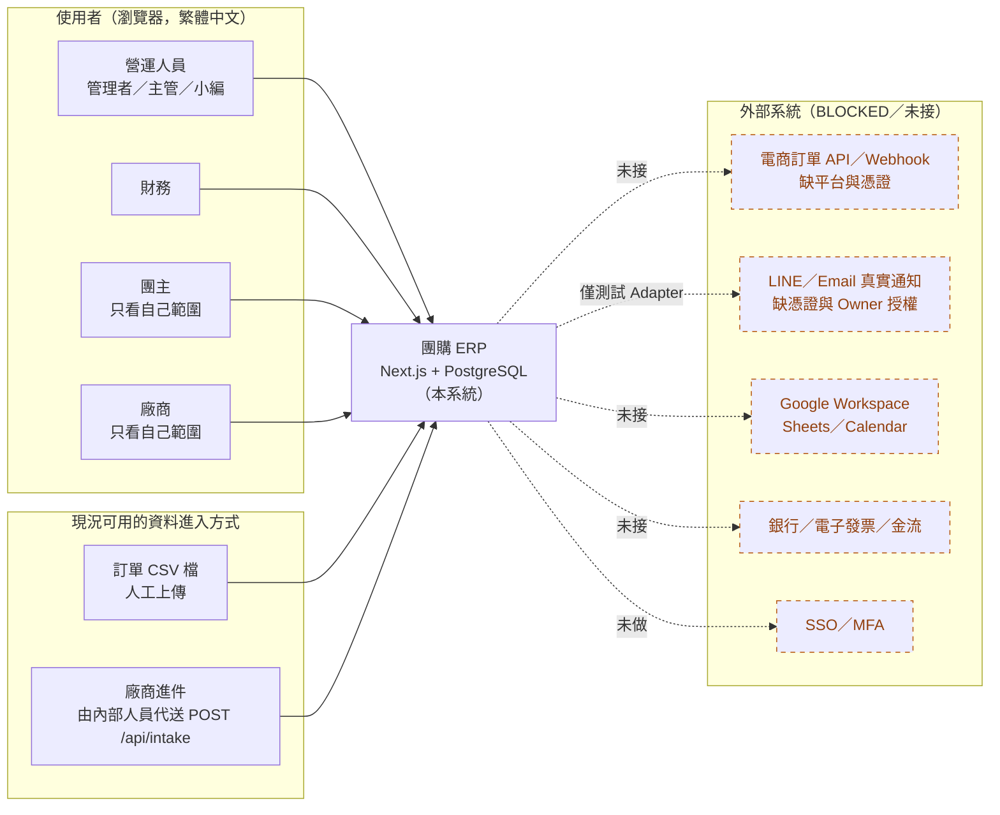
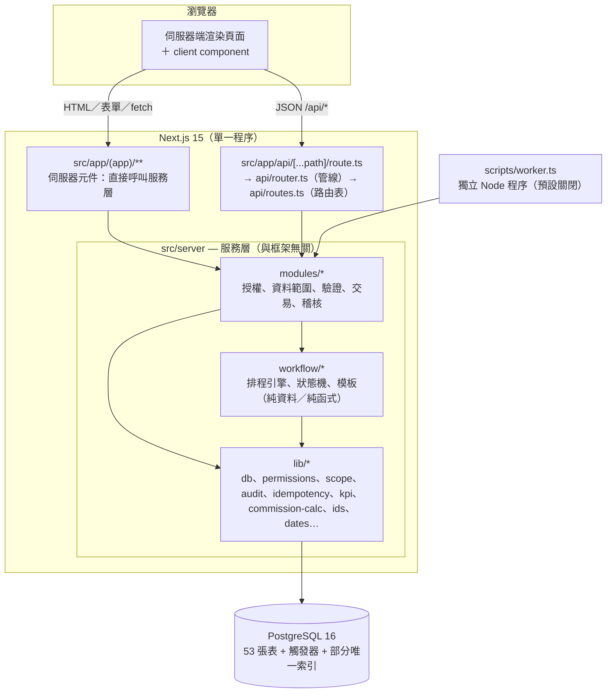
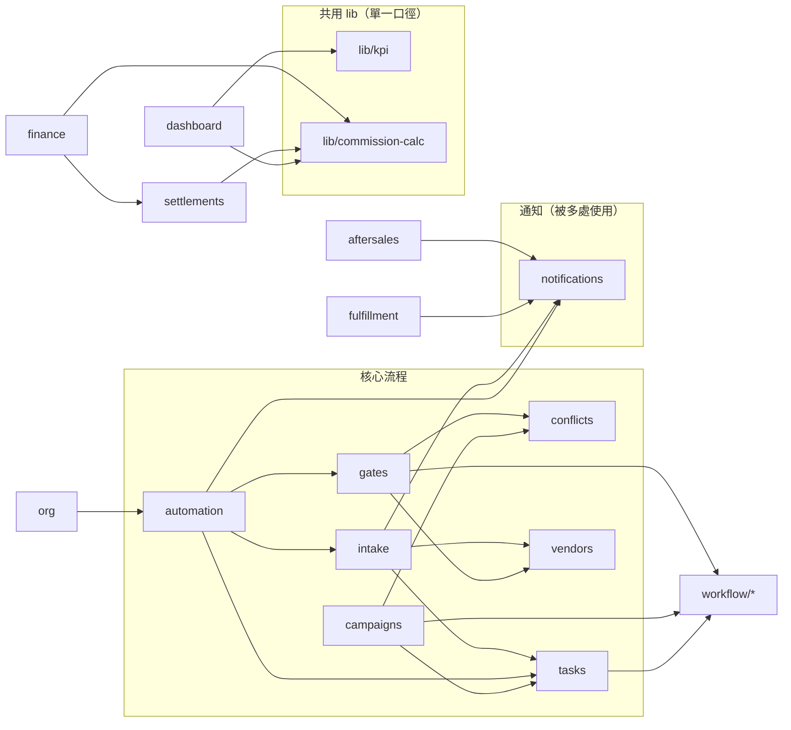
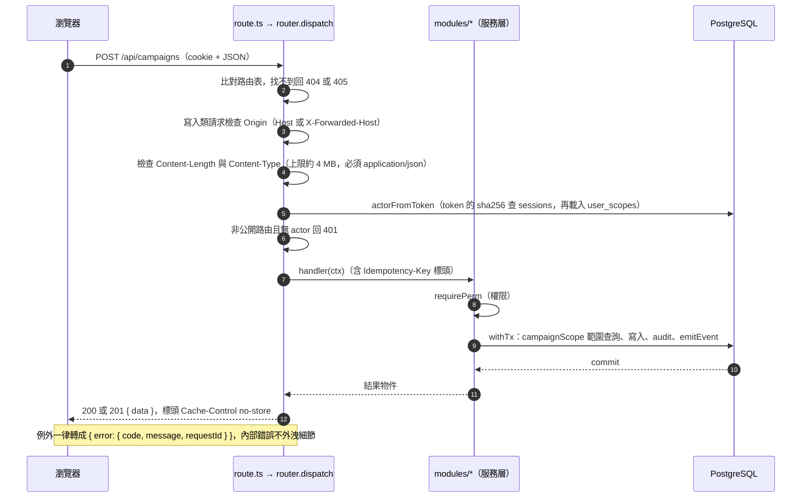
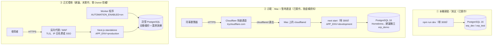
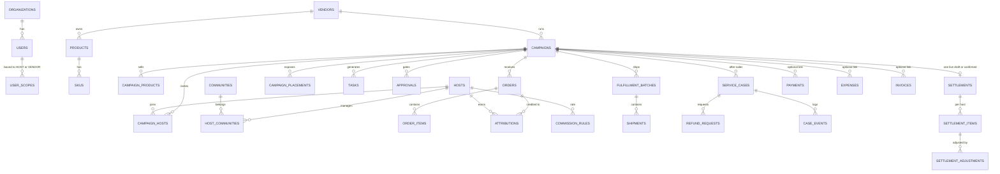
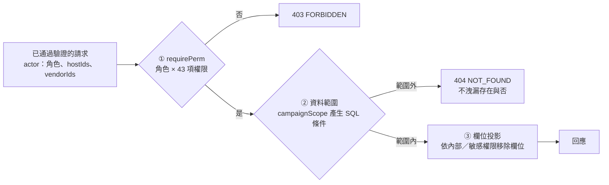
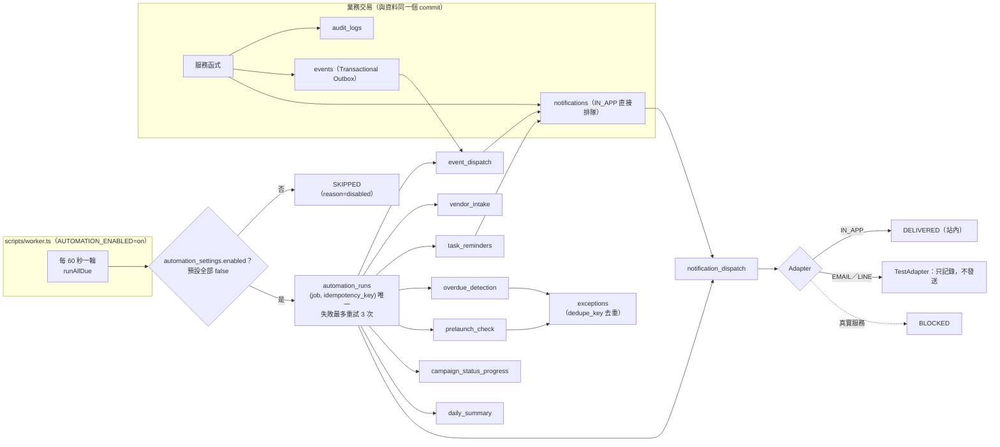

# SAD 系統架構文件（System Architecture Description）

> 對象：Owner、顧問、後續接手的工程師。
> 狀態：對**已實作系統**的逆向整理（Phase 1 MVP ＋ Phase 2 切片），逐項與 `src/`、`migrations/`、`tests/` 核對；不是事前設計。索引與約定見 [README](README.md)。
> 基準版本：已提交程式 HEAD `3be9a94`；撰寫期間另有未提交的安全強化變更未納入，會影響的項目見 [README §4](README.md)。
> 範圍邊界：只在本機／隔離環境驗證；**沒有任何 Production 部署、真實通知、真實金流、真實資料**。金額口徑一律「待 Owner 確認」。
> 標記：✅ 已對照程式確認；❓ 列於 §13「核對未決」；`BLOCKED` ＝ 需要外部資源或 Owner 授權才能做。

---

## 1. 系統概述

**一句話**：一套給「團購營運公司」用的內部 ERP——管理廠商、團主、商品與檔期，依標準流程（15 步、5 道核准關卡）自動排程與追蹤，匯入訂單算業績與預估佣金，並涵蓋履約出貨、售後退款、財務結算試算。

**架構風格**：模組化單體（modular monolith）。一個 Next.js 專案，內含與框架無關的服務層（`src/server/`）；資料放在單一 PostgreSQL；背景工作用獨立的 Node worker（預設關閉）。

| 項目 | 現況（✅ 已核對） |
|---|---|
| 技術棧 | Next.js 15.5（App Router）、React 19、TypeScript 5.9、PostgreSQL 16、`pg` 8（無 ORM）、zod 3.25、vitest 3、Playwright 1.63（`package.json`） |
| 規模 | 53 張資料表（11 支 migration）、130 個 API 端點、6 個角色、43 項權限、14 種檔期狀態、8 個自動化工作 |
| 使用者介面 | 繁體中文、桌面為主；`src/app` 共 37 個頁面檔（`page.tsx`，含登入頁與首頁導向） |
| 測試 | 14 個測試檔、245 項，使用真實 PostgreSQL；另有 Playwright E2E（`scripts/e2e-smoke.ts`、`scripts/e2e-aftersales.ts`） |

---

## 2. 目標與品質屬性

| 品質屬性 | 目標 | 現況與證據 | 缺口 |
|---|---|---|---|
| **資料正確與可稽核** | 任何資料變更可追溯；資料不可被默默刪除或竄改 | ✅ 42 張表有 `forbid_delete` 觸發器；4 張表（`audit_logs`、`case_events`、`inventory_movements`、`settlement_adjustments`）禁止 UPDATE／DELETE；每個寫入在同一交易寫 `audit_logs`（前後值、原因、requestId）。`database.test.ts` | 7 張系統／暫存表沒有刪除保護（§7.3） |
| **安全（授權）** | 後端強制授權，前端隱藏只是體驗 | ✅ 三層：權限 → 資料範圍 → 欄位投影（§8）。`rbac.test.ts`（21 項）、各模組越權測試 | 無 SSO／MFA／密碼重設；cookie 的 `Secure` 旗標只在 `APP_ENV=production` 才加（§8.1） |
| **一致性與冪等** | 重複送出、重複匯入、重複執行不產生重複資料 | ✅ 14 個 `Idempotency-Key` 範圍、自然鍵部分唯一索引、匯入 checksum、自動化 `(工作, 冪等鍵)` 唯一 | 冪等鍵的範圍是「組織＋範圍＋key」，不含使用者（§8.6） |
| **可維護性** | 規則集中、可獨立測試 | ✅ 排程／狀態機／KPI／佣金口徑都是純函式或單一來源；服務層與框架無關 | `routes.ts` 單檔 255 行，持續成長 |
| **可靠性** | 失敗可重試、可查 | ✅ 自動化 run 最多重試 3 次並留紀錄；通知失敗不影響主流程（`automation.test.ts`） | 無備份／還原演練；worker 無監控告警 |
| **可觀測性** | 能追問題 | ✅ 每個請求有 `requestId`（回應與稽核都帶）；`GET /api/health` 檢查資料庫 | 只有 `console` 日誌，沒有集中式日誌、指標或告警（§10） |
| **效能** | 小團隊規模下流暢 | `pg` 連線池上限 10；列表一律分頁（上限 200）；訂單匯入上限 2 MB／20,000 列 | 沒有負載測試；Dashboard 即時彙總，無快照或快取（功能矩陣 #17 已註明） |
| **可攜性** | 容易在別台機器重現 | ✅ Node ≥ 20 ＋ PostgreSQL 16 ＋ npm；不需 Docker（`docs/DEPLOYMENT.md`） | 沒有 Dockerfile／compose |
| **可測試性** | 核心規則有自動化測試 | ✅ 真實資料庫、一檔一組織、可平行；E2E 煙霧測試 | E2E 不在 CI 內（`.github/workflows/ci.yml` 只跑 typecheck／lint／test／build） |

---

## 3. 系統脈絡

**說明**

- ✅ 外部角色（團主、廠商）是系統的「登入使用者」，不是外部系統；兩者的資料範圍由 `user_scopes` 綁定（§8.3）。
- ✅ 通知只有站內通知（`IN_APP`）會真正送達；`EMAIL`／`LINE` 只進測試 Adapter，`NOTIFY_ADAPTER` 設成 `test` 以外的值會直接拋出 `BLOCKED` 錯誤（`notifications.ts` `getAdapter`）。
- ✅ 廠商進件目前只有 `POST /api/intake`，且需要登入並具備 `intake.write`（內部角色）；**沒有公開表單**（功能矩陣 #21、#30）。
- 與既有招財兔系統的關係：不連線、不修改、不遷移（ADR-019）；過渡期以 CSV 對照。

---

## 4. 邏輯架構與模組邊界

### 4.1 分層

**不變條件**（✅ 已核對）

1. 每個服務函式簽名為 `fn(actor, input)`：授權、資料範圍、驗證、交易、稽核都在服務層；頁面與 API 只是呼叫者，因此不存在「前端隱藏、後端沒擋」的路徑。
2. `lib/` 不 import `modules/`（以 grep 核對無相依）；`workflow/` 只依賴 `lib/`。
3. 沒有全域 middleware：驗證登入在兩處——API 管線（`router.ts` 的 `actorFromToken`）與頁面（`src/server/ui/session.tsx` 的 `requireActor`／`withActor`）。
4. 日期一律 `YYYY-MM-DD` 字串，資料庫 `date` 以字串回傳（`db.ts` 型別解析 1082）；`bigint`／`numeric` 轉成 JavaScript `number`（金額欄位程式上限 10¹²，在安全整數範圍內）。

### 4.2 模組清單與相依

| 模組（`src/server/modules/`） | 職責 | 主要資料表 | 直接相依的模組 |
|---|---|---|---|
| `auth` | 登入／登出／session、使用者管理 | users、user_scopes、sessions | — |
| `org` | 建立組織與初始管理者（種子用） | organizations | automation、workflow/templates |
| `vendors` | 廠商與聯絡人 | vendors、vendor_contacts | — |
| `hosts` | 團主、可承接區間、社群與關聯 | hosts、host_availability、communities、host_communities | — |
| `products` | 商品、規格（SKU）、素材連結、審核 | products、skus、product_assets | — |
| `campaigns` | 檔期、商品／團主／曝光安排、日期重排 | campaigns、campaign_products、campaign_hosts、campaign_placements | conflicts、tasks、workflow |
| `conflicts` | 檔期衝突偵測（只提醒） | （唯讀） | — |
| `tasks` | 依模板產生任務、狀態、指派、日期鎖定 | tasks、task_dependencies | workflow |
| `gates` | G1–G5 關卡檢查、申請與核准、取消／暫緩／恢復 | approvals | conflicts、vendors、workflow/state |
| `orders` | 訂單 CSV 匯入、錯誤佇列 | import_batches、import_errors、orders、order_items、attributions | — |
| `commission` | 佣金規則（版本化） | commission_rules | — |
| `dashboard` | 管理者／團主 Dashboard 彙總 | （唯讀） | lib/kpi、lib/commission-calc |
| `automation` | 8 個自動化工作、例外 | automation_settings、automation_runs、exceptions、events、daily_summaries | gates、intake、notifications、tasks |
| `notifications` | 通知佇列與 Adapter | notifications | — |
| `intake` | 廠商進件處理 | vendor_intake_submissions | notifications、tasks、vendors |
| `fulfillment` | 出貨批次／出貨單／簽收／庫存異動 | fulfillment_batches、shipments、inventory_movements | notifications |
| `aftersales` | 售後案件、處理紀錄、退款申請 | service_cases、case_events、refund_requests | notifications |
| `settlements` | 結算試算、覆寫、調整項、確認 | settlements、settlement_items、settlement_adjustments | lib/commission-calc |
| `finance` | 入帳、發票、費用、財務總覽 | payments、invoices、expenses | settlements |
| `audit-read` | 稽核紀錄查詢 | （唯讀 audit_logs） | — |

> 圖中只畫模組之間的 import；所有模組都另外依賴 `lib/`（db、permissions、audit…）。依賴關係由 `grep "from './"` 核對；`dashboard` 與 `finance` 對 `lib/` 的口徑依賴也已核對。

### 4.3 請求處理管線（API）

---

## 5. 執行時期視圖（程序與資料流）

| 程序 | 啟動方式 | 說明 |
|---|---|---|
| Web（Next.js） | `npm run dev`／`npm run build && npm start` | 同時提供頁面與 `/api/*`；每個請求用連線池（上限 10）連資料庫 |
| Worker | `npm run worker`／`npm run worker:once` | 預設關閉：需 `AUTOMATION_ENABLED=on`，且每個工作在 `automation_settings` 被明確啟用（§9） |
| 種子／工具 | `db:migrate`、`db:seed`、`db:seed:demo`、`bootstrap:demo`、`docs:gen` | 一次性指令 |

---

## 6. 部署視圖

### 6.1 三種環境

### 6.2 環境差異與守門

| 項目 | ① 本機 | ② Mac + 通道 | ③ 正式（建議） |
|---|---|---|---|
| `APP_ENV` | development | development（`.env.example` 預設） | production |
| Cookie `Secure` | 否 | **否**（即使經 https 通道也不加，見 §8.1） | 是 |
| 資料 | 假資料 `[DEMO]` 或測試資料 | 只能放虛構資料 | 真實資料（尚未獲授權） |
| 資料庫重設 | `db:reset`（production 拒絕） | 同左 | 禁止 |
| 示範資料 | `db:seed:demo`（production 拒絕） | `bootstrap:demo` 需 `ALLOW_DEMO_IN_PRODUCTION=yes` | 不可設定 |
| 備份／還原 | 無 | 無 | **必須**（K2，未做） |
| 通知 | 測試 Adapter | 測試 Adapter | 需 Owner 授權後接真實服務 |

✅ 守門機制已核對：`resetDatabase()` 在 `APP_ENV=production` 拒絕；`db:seed:demo` 在 production 拒絕，`bootstrap:demo` 必須顯式設定 `ALLOW_DEMO_IN_PRODUCTION=yes`；測試的 `global-setup.ts` 要求資料庫名稱含 `test`，避免清空開發／正式資料庫。

### 6.3 環境變數（來自 `.env.example`；不含任何真實值）

| 變數 | 用途 | 備註 |
|---|---|---|
| `APP_ENV` | development／test／production | 影響 Secure cookie、重設保護 |
| `DATABASE_URL`／`TEST_DATABASE_URL` | 連線字串 | 測試庫名稱必須含 `test` |
| `SESSION_SECRET` | ≥32 字元；production 必設 | ✅ 已於整合時移除（K4） |
| `ADMIN_EMAIL`、`ADMIN_INITIAL_PASSWORD`、`ADMIN_NAME` | `db:seed` 建立初始管理者 | 只放 `.env.local` |
| `DEMO_PASSWORD` | DEMO 帳號共用密碼 | 只放 `.env.local` |
| `NOTIFY_ADAPTER` | 通知 Adapter | 僅支援 `test` |
| `AUTOMATION_ENABLED` | worker 總開關 | 預設 `off` |
| `ALLOW_DEMO_IN_PRODUCTION` | 公開示範環境專用 | 真實資料環境絕不可設 |

---

## 7. 資料架構

### 7.1 多租戶

- ✅ 業務資料表帶 `organization_id`（53 張表中 46 張直接帶；`user_scopes`、`sessions`、`workflow_template_steps`、`task_dependencies` 經父表隔離；`organizations`、`roles`、`id_counters` 為全域）。所有查詢帶組織條件；檔期相關資料另經 `campaignScope`（§8.3）。
- 未使用 PostgreSQL Row-Level Security（ADR-003）；隔離靠服務層＋測試（`rbac.test.ts` 有跨組織讀／寫測試）。
- ❓ `id_counters` 沒有 `organization_id`，業務 ID 的序號在**所有組織間共用**（例如 `VEN-0001` 全域唯一）。單一組織部署不受影響；多組織時序號會跳號但不衝突。

### 7.2 領域分組（53 張表）

| 領域 | migration | 資料表 |
|---|---|---|
| 平台／身分 | 001 | organizations、roles、users、user_scopes、sessions、id_counters、audit_logs、idempotency_keys、system_settings、events |
| 主檔 | 002 | hosts、host_availability、communities、host_communities、vendors、vendor_contacts、products、product_assets、skus、agreements |
| 檔期 | 003 | campaigns、campaign_products、campaign_hosts、campaign_placements、approvals、exceptions |
| 流程 | 004 | workflow_templates、workflow_template_steps、tasks、task_dependencies |
| 訂單／財務基礎 | 005 | import_batches、import_errors、orders、order_items、attributions、commission_rules、settlements、settlement_items |
| 自動化 | 006 | automation_settings、automation_runs、notifications、vendor_intake_submissions、daily_summaries |
| 履約 | 009 | fulfillment_batches、shipments、inventory_movements |
| 售後 | 010 | service_cases、case_events、refund_requests |
| 財務 | 011 | settlement_adjustments、payments、invoices、expenses |

> `agreements`（合約）只有資料表，**沒有任何服務函式或 API**（以 grep 核對）。完整欄位見 [DATA_DICTIONARY](../generated/DATA_DICTIONARY.md)，關聯見 [ERD](../generated/ERD.md)。

### 7.3 資料保證（資料庫層，✅ 逐支 migration 核對）

| 保證 | 做法 | 範圍 |
|---|---|---|
| 不實體刪除 | `forbid_delete()` 觸發器（`restrict_violation`）；以 `deleted_at` 或狀態欄軟刪除 | 53 張表中 **42 張** |
| 不可改不可刪（append-only） | `forbid_modify()` 觸發器（UPDATE／DELETE 皆擋） | `audit_logs`、`case_events`、`inventory_movements`、`settlement_adjustments` |
| 版本與更新時間 | `touch_row()`：UPDATE 時 `version+1`、`updated_at=now()`（樂觀鎖用） | 26 張表 |
| 防重複 | 部分唯一索引（`WHERE deleted_at IS NULL` 等）：正規化名稱、統編、檔期自然鍵、追蹤碼、發票號碼、同檔期同時只有一份有效結算… | 見各模組 |
| 結算鎖定 | `settlements_guard()`、`settlement_children_guard()`：非草稿的結算，其項目與調整項不可新增／修改；VOID 為終態 | 011 |
| 業務 ID | 資料庫計數器原子遞增（`INSERT … ON CONFLICT DO UPDATE n=n+1 RETURNING`），格式見 `lib/ids.ts` | 全部業務實體 |
| Migration | 依檔名排序套用；已套用的檔案以 sha256 驗證不可修改，被改動即拒絕啟動 | `lib/migrate.ts` |

> ❓ 沒有刪除保護的 7 張表：`organizations`、`roles`、`sessions`、`id_counters`、`idempotency_keys`、`system_settings`、`automation_settings`。ADR-007 只提到 `sessions`、`idempotency_keys` 允許刪除，其餘 5 張未說明（多為系統設定／計數資料）。

---

## 8. 安全架構

### 8.1 認證與 session

| 項目 | 實作（✅） |
|---|---|
| 密碼 | scrypt（N=16384、r=8、p=1、32 bytes、隨機 16 bytes salt），`timingSafeEqual` 比對；至少 10 字元且同時含英文字母與數字 |
| 登入 | Email（不分大小寫）＋密碼；帳號不存在也做一次雜湊；錯誤訊息一律「帳號或密碼錯誤」 |
| 鎖定 | 連續失敗 5 次 → 鎖 15 分鐘（記在資料庫 `users.locked_until`，多實例有效） |
| 限流 | 每 IP 30 次／分、每帳號 10 次／分（**單機記憶體**，多實例不共用） |
| Session | 隨機 32 bytes token，資料庫只存 sha256；有效 12 小時，**不滑動延長**；停用帳號立即撤銷其所有 session |
| Cookie | `erp_session`；`HttpOnly`；`SameSite=Lax`；`Path=/`；**只有 `APP_ENV=production` 才加 `Secure`** |
| 登出 | 標記 `sessions.revoked_at`，Cookie 清除 |
| 未做 | SSO／OAuth、MFA、密碼重設、首次登入強制改密碼（`users.must_change_password` 欄位存在但沒有程式使用） |

> ❓ 示範環境（Mac + 通道）因為 `APP_ENV=development`，即使使用者是透過 `https://*.trycloudflare.com` 連入，session cookie 也**不帶 `Secure`**。通道本身是 HTTPS，實務風險有限，但這是示範專用設定，**正式環境必須用 `APP_ENV=production`**。

### 8.2 CSRF 與請求防護

- ✅ 寫入類請求（POST／PATCH 等）：`Origin` 標頭若存在，必須等於 `Host` 或 `X-Forwarded-Host`（逗號分隔多值皆可）其中之一；沒有 `Origin`（腳本、測試）放行。搭配 `SameSite=Lax` cookie。
- ✅ 請求本文必須是 `application/json`，上限約 4 MB（超過回 413）；訂單 CSV 另有 2 MB 與 20,000 列上限。
- ✅ 回應標頭（`next.config.mjs`）：`X-Frame-Options: DENY`、`X-Content-Type-Options: nosniff`、`Referrer-Policy: same-origin`、`Cache-Control: no-store`；`poweredByHeader` 關閉。**沒有** HSTS 或 CSP。
- ✅ 使用者輸入的連結欄位只接受 `http(s)`（`isHttpUrl`）；API 沒有任何 DELETE 路由（`route.ts` 雖匯出 DELETE／PUT 處理函式，但路由表沒有登記，會回 404／405）。

### 8.3 授權三層（RBAC ＋ 資料範圍 ＋ 欄位投影）

| 角色 | ② 資料範圍（`lib/scope.ts`） |
|---|---|
| SYSTEM_ADMIN、OPS_MANAGER、FINANCE | 整個組織（未軟刪除的檔期） |
| OPS_EDITOR | 自己負責的檔期，或被指派任務的檔期 |
| HOST | 自己被邀請且未婉拒（`status<>'DECLINED'`）的檔期；沒有綁定團主則什麼都看不到 |
| VENDOR | `vendor_id` 屬於自己綁定廠商的檔期；沒有綁定廠商則什麼都看不到 |

| ③ 欄位投影（舉例，✅） | 規則 |
|---|---|
| 檔期 `targetRevenue` | 需 `campaign.sensitive.read`（管理者、主管、財務） |
| 檔期／廠商／團主 `internalNote` | 只給內部角色（`isInternal`） |
| SKU `costPrice` | 需 `product.cost.read`（管理者、主管、財務） |
| 履約 `note`、售後 `internalNote`／`description`／`buyerRef`／內部紀錄 | 外部角色看不到（`project`／`EXTERNAL_FIELDS`） |
| 結算 | 團主只能看自己、**已確認**的結算項摘要（`GET /api/settlements/mine`），不含其他團主、覆寫／調整原因、費用、入帳、發票 |
| 庫存 | 僅內部角色可讀（`fulfillment.read` 之外再要求 `isInternal`） |

> ❓ 範圍外的處理**不完全一致**：多數模組回 404；少數路徑回 403——`GET /api/campaigns/:id/audit`（`listCampaignAudit` 對範圍外丟 `forbidden('找不到此檔期或沒有權限')`）、團主 Dashboard 查他人（`forbidden`）、結算在「角色完全沒有範圍」時丟 `forbidden`。實務上不洩漏資料內容，但會洩漏「權限不足」與「找不到」的差別。

完整的角色 × 權限矩陣見 SDD §1（由 `permissions.ts` 直接產生）。

### 8.4 稽核

- ✅ `audit_logs`：操作者、角色、來源（`WEB`／`API`／`WORKER`／`SEED`／`IMPORT`／`TEST`）、動作、實體、檔期、前後值（敏感欄位 `password_hash`、`token_hash` 以 `[REDACTED]` 取代）、原因、`requestId`、IP。
- ✅ 每個寫入與稽核在**同一個交易**；交易失敗兩者一起回滾。
- ❓ 財務角色（`audit.read`）查稽核時，只看得到 `FINANCE_ENTITIES = order、import_batch、import_error、commission_rule、settlement`（`audit-read.ts`）。Phase 2 新增的 `settlement_item`、`settlement_adjustment`、`payment`、`invoice`、`expense`、`refund_request`、`shipment` 等實體**不在清單內**，財務角色看不到自己操作的這些紀錄（管理者與主管不受影響）。
- ❓ IP 取自 `X-Forwarded-For` 的第一段（`router.ts`、`session.tsx`、`routes.ts` 登入限流）。如果前面沒有可信任的反向代理，這個值可由用戶端偽造：IP 限流可被繞過（帳號限流與資料庫鎖定仍有效），稽核的 IP 欄位也不可信。

### 8.5 個資政策

- ✅ 訂單只存去識別化購買人代號 `buyer_ref`（不存姓名、電話、地址）；售後案件的描述、備註、退款原因會做「手機號碼／Email」盡力偵測並拒絕（`containsPii`，不是完整的個資偵測）。
- ✅ 發票抬頭／統編欄位（`title_text`、`tax_id_text`）與入帳參考號註明請用佔位字，不接銀行、電子發票。

### 8.6 冪等

- ✅ `lib/idempotency.ts`：在與業務寫入相同的交易內，以 `(organization_id, scope, key)` 為主鍵插入；第二次相同請求回傳第一次結果（`replayed:true`）；並發請求在唯一索引上等待第一個 commit；`request_hash`（payload 的 sha256）不同則回 422。
- ❓ 鍵的唯一範圍**不含使用者**：同組織內，使用者 B 若帶上與使用者 A 相同的 `Idempotency-Key` 與相同內容，會得到 A 的結果。實務上 key 由前端隨機產生，風險低，但屬設計限制。

---

## 9. 自動化與通知架構

| 護欄（✅） | 實作 |
|---|---|
| 雙重開關 | worker 需 `AUTOMATION_ENABLED=on`；每個工作另需在資料庫被啟用 |
| 預設關閉 | 建立組織時 8 個工作皆 `enabled=false` |
| 冪等 | `automation_runs UNIQUE(org, job, idempotency_key)`；預設鍵粒度：每日／每小時／每分鐘（`defaultKey`）；每個工作本身也有業務去重 |
| 可重試 | 失敗的 run 在 `attempts < 3` 時再執行會重試同一筆 |
| 不影響主流程 | 通知 Adapter 失敗 → `FAILED`，3 次後 `DEAD` 並開例外 |
| 例外是一級資料 | `exceptions`（`dedupe_key` 部分唯一索引，同一事件只開一次，條件解除後自動結案） |

> ❓ 全域開關 `AUTOMATION_ENABLED` **只在 worker 腳本檢查**（`scripts/worker.ts`）。管理者透過 `POST /api/automation/jobs/:key {action:'run'}` 手動執行時，只檢查資料庫中的「該工作是否啟用」，不檢查環境變數。文件（AUTOMATION.md、ADR-012）寫「兩者都要」是指 worker 排程。
> ❓ `events` 目前發出 6 種：`campaign.created`、`campaign.dates_changed`、`campaign.status_changed`、`approval.requested`、`import.completed`、`task.completed`；`event_dispatch` 只處理前 5 種，`task.completed` 會被標為已處理但沒有動作。履約、售後、財務沒有發事件。

---

## 10. 可觀測性與營運

| 面向 | 現況（✅） | 缺口 |
|---|---|---|
| 健康檢查 | `GET /api/health`（公開）：資料庫連線、延遲、環境、時間 | 沒有 readiness／liveness 分離 |
| 日誌 | 伺服器 `console.error`（含 `requestId`）；內部錯誤不回傳細節 | 無集中式日誌、無結構化日誌 |
| 追蹤 | 每個 API 請求產生 `requestId`（UUID），回應、稽核、錯誤皆帶 | 頁面（伺服器元件）的 `requestId` 不回傳給使用者 |
| 稽核 | 管理者／主管／財務可查（`/audit`）；單一檔期有「異動紀錄」分頁 | 無匯出 |
| 自動化 | `automation_runs` 有每次執行的狀態、統計、錯誤 | 無外部告警 |
| 指標／告警 | 無 | 全部（K5） |
| 備份／還原 | 無 | **必須**在上線前建立並實際演練（K2） |
| 資料保存 | `sessions`、`idempotency_keys` 沒有清理工作 | 長期會成長（K6） |

---

## 11. 技術選型理由（摘要，詳見 [ADR](../ARCHITECTURE_DECISIONS.md)）

| 選擇 | 理由 | ADR |
|---|---|---|
| 模組化單體（Next.js ＋ 服務層） | 團隊小、交易一致性重要、先求可維護而非可擴張；藍圖 §8.1 建議 | 001 |
| PostgreSQL 16 | 約束、觸發器、部分唯一索引是核心保證（防重複、軟刪除、append-only） | 001、002 |
| `pg` ＋ 手寫 SQL migration（無 ORM） | 保證直接寫在 SQL，最透明；migration 有 checksum | 002 |
| `organization_id` ＋ 服務層範圍（無 RLS） | 簡單、可測；RLS 列為日後可選 | 003 |
| 自建 Email＋密碼認證 | 先可用；SSO／MFA 待 Owner 決定 | 006 |
| 觸發器強制不刪除、稽核不可改 | 即使有人繞過應用層也擋得住 | 007 |
| Outbox ＋ 獨立 worker、預設關閉 | 避免未經授權的自動行為；可重試、可查 | 012 |
| 業務 ID 即主鍵 | 人類可讀、可跨文件引用 | 014 |
| Idempotency-Key ＋ 自然鍵唯一索引 | 重複送出是團購營運的實際痛點 | 015 |
| 日期用字串、組織時區 Asia/Taipei | 避免時區位移 | 016 |
| 伺服器元件直呼服務層、純 CSS | 授權只有一份；少依賴 | 017 |
| 真實 PostgreSQL 整合測試 | 約束與觸發器才測得到；mock 會漏 | 018 |
| 不與招財兔系統連線 | 不碰正式資料；只對照 | 019 |

---

## 12. 風險與技術債

引用 [KNOWN_ISSUES](../KNOWN_ISSUES.md)（K1–K7、T 系列、P2-1～P2-6），並加上本次核對新發現的項目（標「新」）。

| 等級 | 項目 | 影響 | 出處 |
|:-:|---|---|---|
| 🔴 | 無 SSO／MFA、無密碼重設 | 管理者帳號只靠密碼 | K1 |
| 🔴 | 無備份與還原演練、無 RLS、無靜態加密 | 資料遺失／隔離風險 | K2 |
| 🟡 | 限流為單機記憶體 | 多實例不共用 | K3 |
| ✅ | `SESSION_SECRET` 未被使用 | 已於整合時移除 | K4 |
| 🟡 | `Idempotency-Key` 紀錄不清理（`sessions` 過期紀錄同樣沒有清理工作，為本次新增觀察） | 長期佔空間 | K6 |
| 🟡 | 相依套件高風險弱點（zod 3、next 15 經 postcss）需升級主版本 | 安全 | KNOWN_ISSUES T3 |
| 🟡 | 結算口徑未定（階梯、扣項、退款扣回時點）、G4 不自動串接 | 數字僅供討論 | P2-1、P2-2 |
| 🟡 | **新**：財務角色看不到 Phase 2 實體的稽核紀錄 | 財務無法自行追查自己的操作 | §8.4 |
| 🟡 | **新**：IP 取自 `X-Forwarded-For` 且無可信代理設定 | IP 限流可被繞過；稽核 IP 不可信 | §8.4 |
| 🟡 | **新**：示範環境 cookie 無 `Secure` | 僅限示範；正式環境必須 production | §8.1 |
| 🟢 | **新**：範圍外回應 404／403 不一致 | 資訊洩漏程度輕微 | §8.3 |
| 🟢 | **新**：`approval.require_distinct_actor`、`publishTemplateVersion` 沒有 API／UI 入口 | 功能存在但無法由使用者操作（§13） | §13 |
| 🟢 | **新**：`agreements` 只有資料表 | 合約管理未實作 | 功能矩陣 #5 |

---

## 13. 核對未決與文件落差

> 這些是「文件說的」與「程式做的」不一致、或無法確認的地方。**預設以程式為準**，由 Owner 決定要改程式還是改文件。

| # | 項目 | 文件怎麼說 | 程式實際 | 建議 |
|:-:|---|---|---|---|
| 1 | `docs/ARCHITECTURE.md` 的資料表數量與模組清單 | 「43 張表」、8 支 migration、模組不含 fulfillment／aftersales／settlements／finance | 53 張表、11 支 migration、模組已含四者 | 更新 ARCHITECTURE.md（Phase 2 後沒有同步） |
| 2 | G4 關卡檢查 `settlement_module` | ✅ 訊息已於整合時改為「結算試算與確認（需人工確認）」；仍固定為 WARN 未通過（`gates.ts`） | 結算試算已實作（`settlements.ts`） | 是否實際串接（待 Owner 決定 P2-2） |
| 3 | ADR-013 | 「`settlements`／`settlement_items` 只建 Schema」 | 已實作試算、覆寫、調整、確認鎖定 | 新增 ADR 或更新 ADR-013 |
| 4 | ADR-007 | 「`sessions`、`idempotency_keys` 允許刪除」 | 另有 5 張表（organizations、roles、id_counters、system_settings、automation_settings）無刪除保護 | 補述或補觸發器 |
| 5 | `approval.require_distinct_actor` | ADR-008：「可用組織設定 `approval.require_distinct_actor=true` 要求申請人≠核准人」 | `gates.ts` 會讀此設定，但**沒有任何 API 或 UI 可以設定**（只有測試直接寫資料庫） | 補入口，或在文件註明只能由 DBA 設定 |
| 6 | 工作流程模板發佈新版本 | 功能矩陣 #13／K10：「只能調整天數參數版本」（暗示可發佈新版本） | `publishTemplateVersion` 只被測試呼叫，**沒有 API／UI 入口** | 補入口，或註明為內部工具 |
| 7 | `must_change_password` | ARCHITECTURE.md：欄位已預留 | 欄位存在，無任何程式讀寫 | 與 K1 一併決定 |
| 8 | `package.json` 的 DEMO 種子 script | — | 只有 `db:seed:demo:aftersales`；履約與財務的種子要用 `npx tsx scripts/seed-demo-fulfillment.ts`／`seed-demo-finance.ts`（`bootstrap:demo` 已串接三者） | 補兩個 script |
| 9 | ✅ 業務 ID 前綴 `INV-`（已於整合時修正：庫存異動對新資料改用 `STK-`） | — | 原狀：發票（`invoices`）與庫存異動（`inventory_movements`）**共用前綴 `INV-` 與同一個計數器**（`ids.invoice`／`ids.inventoryMovement` 的 key 都是 `INV`）。兩者主鍵在各自的表，不會衝突，但編號會交錯、容易混淆 | 其中一個改前綴（需新 migration 與資料處理，屬異動既有編號，需 Owner 同意） |
| 10 | `docs/ARCHITECTURE.md` §4 | 「回應標頭：X-Frame-Options DENY、nosniff、no-store」 | 另有 `Referrer-Policy: same-origin`；無 HSTS／CSP | 補述 |
| 11 | `migrations/004_workflow.sql` 內註解 | 註解引用 `docs/adr/ADR-004` 與 `row_version` 欄位 | 實際檔案是 `docs/ARCHITECTURE_DECISIONS.md`；`workflow_templates` 沒有 `row_version` 欄位 | 僅註解錯誤（migration 不可修改，新增文件說明即可） |
| 12 | 事件 `task.completed` | — | 會被寫入 `events` 但 `event_dispatch` 沒有對應處理 | 確認是否預期 |
| 13 | `docs/KNOWN_ISSUES.md` K12 | 「G4 只能人工確認；結算試算／佣金結算／調整批次未做」 | 結算試算、覆寫、調整項、確認鎖定已實作（P2-1 已另列口徑限制）；G4 仍不自動串接 | 更新 K12 文字 |
| 14 | 環境判斷不一致 | 文件統稱「production 拒絕重設」 | `resetDatabase()`（`lib/migrate.ts`）只看 `process.env.APP_ENV === 'production'`；其他守門使用 `appEnv()`（`APP_ENV ?? NODE_ENV`）。若某環境只設了 `NODE_ENV=production` 而沒設 `APP_ENV`，`db:reset` 不會拒絕 | 統一改用 `appEnv()`（小改動，屬程式修正，需 Owner 同意再做） |

---

## 14. 文件自檢

- 以上數字（53 表、130 端點、43 權限、245 測試）皆以指令重新計算：`CREATE TABLE` 計數、`routes.ts` 的 `R(`／`P(` 計數（與 `API_ENDPOINTS.md` 一致）、`permissions.ts` 匯入計算、`vitest` 各檔 `it(` 計數。
- 模組相依圖由 `grep "from './"` 產生，非憑印象繪製。
- 本文件 8 張 Mermaid 圖已用 mermaid 11.4.1 在 headless Chromium 逐一 `parse` 與 `render`，無錯誤（細節見 SDD §22）。
