# SDD 詳細設計文件（Software Design Description）

> 對象：要修改、擴充或驗收這套系統的工程師與顧問。
> 狀態：對**已實作系統**的逆向整理（Phase 1 MVP ＋ Phase 2 切片），逐項與 `src/`、`migrations/`、`tests/` 核對；不是事前設計。系統層面的架構、部署與安全見 [SAD](SAD.md)，索引與約定見 [README](README.md)。
> 基準版本：已提交程式 HEAD `3be9a94`；撰寫期間另有未提交的安全強化變更未納入，會影響的項目見 [README §4](README.md)。
> 標記：✅ 已對照程式確認；❓ 列於 §20「核對未決」。所有金額口徑一律「**待 Owner 確認**」。
> 不重貼的內容：資料表逐欄定義 → [DATA_DICTIONARY](../generated/DATA_DICTIONARY.md)；130 個端點完整清單 → [API_ENDPOINTS](../generated/API_ENDPOINTS.md)；請求格式範例 → [API.md](../API.md)。本文件只寫「設計上重要的欄位、約束與規則」。

---

## 0. 通用約定

### 0.1 回應與錯誤

| 項目 | 規則（✅ `api/router.ts`、`lib/errors.ts`） |
|---|---|
| 成功 | `200`（或 `201` 建立）`{ "data": … }` |
| 失敗 | `{ "error": { "code", "message", "details?", "requestId" } }` |
| 標頭 | 一律 `Cache-Control: no-store`；內容 `application/json; charset=utf-8` |
| 追蹤碼 | `requestId`（UUID）出現在每個回應；內部錯誤不回傳細節，只寫伺服器日誌 |

| 錯誤碼 | HTTP | 典型情境 |
|---|:-:|---|
| `UNAUTHENTICATED` | 401 | 沒有登入、session 無效／過期／已撤銷、帳號停用；登入帳密錯誤 |
| `FORBIDDEN` | 403 | 角色沒有該權限；寫入請求跨來源（Origin 不符） |
| `NOT_FOUND` | 404 | 資料不存在，或**不在你的資料範圍內**（不洩漏存在與否）；沒有此 API |
| `VALIDATION` | 422 | zod 驗證失敗（`details` 為逐欄訊息）；業務規則不符；`Idempotency-Key` 與內容不符；資料庫 CHECK／外鍵／型別錯誤 |
| `CONFLICT` | 409 | 重複（唯一索引，`details.existingId` 指向既有資料）；樂觀鎖版本不符；請求處理中；死鎖／序列化失敗 |
| `PRECONDITION_FAILED` | 412 | 狀態不允許（例如已結案不可編輯）、關卡檢查未通過、前置條件不足 |
| `RATE_LIMITED` | 429 | 登入嘗試過多、帳號被鎖定 |
| `INTERNAL` | 500 | 未預期錯誤 |
| （特例） | 400／413／415／405 | JSON 格式錯誤（400，`code=VALIDATION`）、本文過大（413）、非 JSON（415）、方法不支援（405，`code=NOT_FOUND`） |

> ❓ JSON 格式錯誤回 400，而其他驗證錯誤回 422，同樣使用 `VALIDATION` 碼；405 使用 `NOT_FOUND` 碼。屬小的不一致，客戶端以 HTTP 狀態判斷即可。

PostgreSQL 錯誤對應（`pgToApp`）：`23505`→409、`23503`→422、`23514`／`22P02`／`22007`／`22003`→422、`23001`（`restrict_violation`，禁止刪除／改動）→403、`40001`／`40P01`→409。

### 0.2 服務層共通機制

| 機制 | 位置 | 說明 |
|---|---|---|
| 簽名 | 全部 `modules/*` | `fn(actor, input, idemKey?)`；`Actor` 含 `role`、`orgId`、`hostIds`、`vendorIds`、`requestId`、`source` |
| 交易 | `lib/db.ts withTx` | callback 成功 commit，丟例外 rollback；寫入與稽核同交易 |
| 樂觀鎖 | `lib/repo.ts patchEntity` | 鎖列（`FOR UPDATE`）→ 比對 `version`（不符回 409）→ 只更新有變動的欄位 → 寫稽核（前後值）；`touch_row` 觸發器遞增 `version` |
| 清空欄位 | `applyClears` | 允許用 `""` 把可清空欄位設為 NULL |
| 分頁 | `lib/repo.ts listPaged` | `limit` 預設 50、上限 200；`page` 從 1；回 `{ items, total, limit, offset }` |
| 冪等 | `lib/idempotency.ts` | 14 個範圍（§19.1）；同交易寫入鍵與結果 |
| 稽核 | `lib/audit.ts audit` | `action`、`entityType`、`entityId`、`campaignId`、前後值、原因；`password_hash`、`token_hash` 以 `[REDACTED]` 取代 |
| 事件 | `lib/audit.ts emitEvent` | 寫入 `events`（Outbox），`dedupe_key` 去重 |
| 欄位大小寫 | `lib/case.ts` | 資料庫 snake_case → API camelCase |
| 日期 | `lib/dates.ts` | `YYYY-MM-DD` 字串；運算用 UTC 午夜；「今天」= 台北日曆日 |

### 0.3 業務 ID（`lib/ids.ts`，資料庫計數器）

| 前綴 | 實體 | 格式 |
|---|---|---|
| ORG／USR | 組織／使用者 | `ORG-0001`、`USR-0001` |
| VEN／VCT | 廠商／聯絡人 | `VEN-0001`、`VCT-000001` |
| OWN／GRP／AVL | 團主／社群／可承接區間 | `OWN-0001`、`GRP-0001`、`AVL-000001` |
| PRD／SKU／AST／AGR | 商品／規格／素材／合約 | `PRD-000001`… |
| CMP | 檔期 | `CMP-YYYYMM-0001`（月計數） |
| CPR／CHS／PLC／APR／EXC | 檔期商品／檔期團主／曝光／核准／例外 | `…-000001` |
| WFT／TSK | 模板／任務 | `WFT-0001`、`TSK-YYYYMMDD-0001`（日計數） |
| ORD／OIT／IMP | 訂單／訂單品項／匯入批次 | `ORD-000001`、`IMP-YYYYMMDD-0001` |
| CMR／SET／SIT／ADJ | 佣金規則／結算／結算項目／調整項 | `CMR-0001`、`SET-YYYYMMDD-0001` |
| FBT／SHP／INV | 出貨批次／出貨單／**庫存異動與發票共用 `INV-`** | ❓ 見 §20 #9 |
| CAS／RFD | 售後案件／退款申請 | `CAS-000001`、`RFD-000001` |
| PAY／EXP | 入帳／費用 | `PAY-000001`、`EXP-000001` |
| RUN／NTF／INT | 自動化執行／通知／進件 | `RUN-YYYYMMDD-0001`、`NTF-YYYYMMDD-000001`、`INT-000001` |

> 時間分段的計數（CMP、TSK、IMP、SET、RUN、NTF）以台北日期或月份為 `period`，跨期自動重新從 1 起算。

---

## 1. 角色與權限矩陣

> **本節矩陣由 `src/server/lib/permissions.ts` 直接產生**（腳本 `import ROLE_PERMISSIONS` 後輸出，非手抄）。43 項權限；各角色持有數：管理者 43、主管 36、小編 26、團主 10、廠商 7、財務 22。

| 權限 | 管理者 | 主管 | 小編 | 團主 | 廠商 | 財務 |
|---|:-:|:-:|:-:|:-:|:-:|:-:|
| `aftersales.read` | ● | ● | ● | ● | ● | ● |
| `aftersales.write` | ● | ● | ● |  |  |  |
| `approval.read` | ● | ● | ● |  |  | ● |
| `approval.request` | ● | ● | ● |  |  |  |
| `audit.read` | ● | ● |  |  |  | ● |
| `automation.manage` | ● | ● |  |  |  |  |
| `automation.run` | ● | ● |  |  |  |  |
| `campaign.read` | ● | ● | ● | ● | ● | ● |
| `campaign.sensitive.read` | ● | ● |  |  |  | ● |
| `campaign.transition` | ● | ● | ● |  |  |  |
| `campaign.write` | ● | ● | ● |  |  |  |
| `commission.read` | ● | ● |  | ● |  | ● |
| `commission.write` | ● |  |  |  |  | ● |
| `community.read` | ● | ● | ● | ● |  | ● |
| `community.write` | ● | ● | ● |  |  |  |
| `dashboard.admin` | ● | ● | ● |  |  | ● |
| `dashboard.host` | ● | ● |  | ● |  |  |
| `exception.manage` | ● | ● | ● |  |  |  |
| `exception.read` | ● | ● | ● |  |  | ● |
| `finance.read` | ● | ● |  |  |  | ● |
| `finance.write` | ● |  |  |  |  | ● |
| `fulfillment.read` | ● | ● | ● | ● | ● | ● |
| `fulfillment.write` | ● | ● | ● |  |  |  |
| `host.read` | ● | ● | ● |  |  | ● |
| `host.self` | ● |  |  | ● |  |  |
| `host.write` | ● | ● | ● |  |  |  |
| `intake.write` | ● | ● | ● |  |  |  |
| `order.import` | ● | ● | ● |  |  |  |
| `order.read` | ● | ● | ● |  |  | ● |
| `product.cost.read` | ● | ● |  |  |  | ● |
| `product.read` | ● | ● | ● | ● | ● | ● |
| `product.review` | ● | ● |  |  |  |  |
| `product.write` | ● | ● | ● |  |  |  |
| `refund.approve` | ● | ● |  |  |  |  |
| `refund.complete` | ● |  |  |  |  | ● |
| `settlement.confirm` | ● |  |  |  |  | ● |
| `task.complete` | ● | ● | ● | ● | ● | ● |
| `task.read` | ● | ● | ● | ● | ● | ● |
| `task.write` | ● | ● | ● |  |  |  |
| `user.manage` | ● |  |  |  |  |  |
| `vendor.read` | ● | ● | ● |  |  | ● |
| `vendor.self` | ● |  |  |  | ● |  |
| `vendor.write` | ● | ● | ● |  |  |  |

**關鍵設計**

- 權限只回答「能不能做這類動作」；「能碰哪些資料列」由 `campaignScope`（SAD §8.3）決定。
- `OPS_MANAGER` ＝ 全部權限，**扣除** `user.manage`、`commission.write`、`host.self`、`vendor.self`、`refund.complete`、`finance.write`、`settlement.confirm`（程式用 `ALL.filter(…)`）。
- 核准關卡的決定者另有一張表（`GATE_APPROVER_ROLES`），**不用** `approval.*` 權限判斷：G1／G2／G5 ＝ 管理者、主管；G3 ＝ 管理者、主管、財務；G4 ＝ 管理者、財務。
- 測試鎖定：`tests/unit/misc.test.ts`「權限矩陣（不可被默默放寬）」、`tests/aftersales.test.ts`「權限矩陣（定義）」、`tests/rbac.test.ts`。

---

## 2. 認證與使用者（`modules/auth.ts`）

**職責**：登入／登出／session 驗證、使用者建立與停用。

**資料表**：`users`（`email` 唯一索引 `lower(email)`，`status` ∈ ACTIVE／DISABLED，`failed_login_count`、`locked_until`、`last_login_at`）、`user_scopes`（`scope_type` ∈ HOST／VENDOR／COMMUNITY，`revoked_at`）、`sessions`（`token_hash` 為主鍵，`expires_at`、`revoked_at`）。

| 方法／路徑 | 權限 | 輸入驗證 | 說明 |
|---|---|---|---|
| `POST /api/auth/login`（公開） | — | zod：`email`、`password` 必填 | 先限流（IP 30／分、帳號 10／分，記憶體），再驗證；成功設 cookie |
| `POST /api/auth/logout`（公開） | — | — | 標記 session 撤銷，清 cookie |
| `GET /api/auth/me` | 登入 | — | 回 `id、name、role、roleLabel、permissions、hostIds、vendorIds` |
| `GET /api/users` | `user.manage` | — | 使用者清單（含範圍） |
| `POST /api/users` | `user.manage` | `createUserSchema`：email、name（≤80）、role 必須是 6 角色之一、password（強度檢查）、`hostIds`／`vendorIds` | 團主必綁 ≥1 位團主、廠商必綁 ≥1 家廠商；其他角色不可綁範圍；綁定對象必須存在；Email 不可重複 |
| `POST /api/users/:id/status` | `user.manage` | `status` ∈ ACTIVE／DISABLED | 不可停用自己；停用時撤銷該使用者所有 session |
| `GET /api/health`（公開） | — | — | `SELECT 1`，回延遲與環境 |

**關鍵規則（✅）**

- 密碼強度：≥10 字元，且同時含英文字母與數字（`validatePasswordStrength`）。雜湊 scrypt（N=16384、r=8、p=1）。
- 登入失敗：帳號不存在時仍做一次雜湊（降低以回應時間枚舉帳號）；帳號 `status≠ACTIVE` 一律模糊錯誤；失敗 5 次 → 鎖 15 分鐘（`RATE_LIMITED`）。
- Session：`crypto.randomBytes(32)` base64url，資料庫只存 sha256，12 小時，不滑動。`actorFromToken` 每次請求都查資料庫（含載入未撤銷的 `user_scopes`）。
- 稽核：`user.login`、`user.create`、`user.set_status`。

**序列圖：登入**

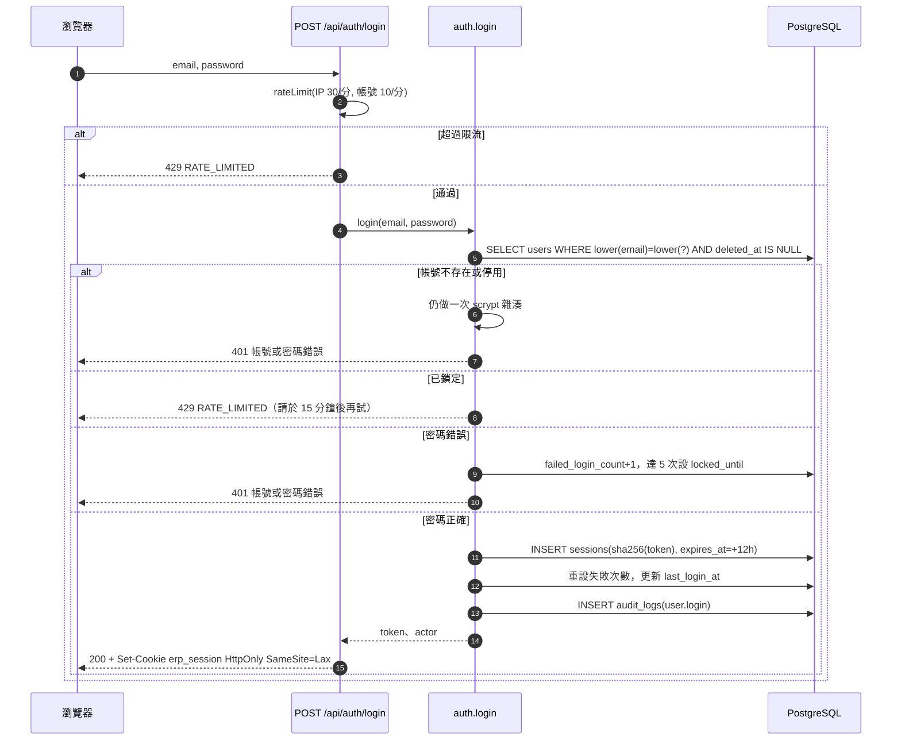

**測試**：`tests/rbac.test.ts`「未登入與認證」「CSRF 與請求格式」；`tests/unit/misc.test.ts`「密碼」「限流」。

---

## 3. 組織與初始化（`modules/org.ts`、`scripts/seed*.ts`）

**職責**：建立組織時一併建立預設流程模板與 8 個自動化開關（全部停用）；建立初始使用者（種子用，不走 API）。

**資料表**：`organizations`（`timezone` 預設 Asia/Taipei、`currency` 預設 TWD）、`roles`（007 內建 6 角色，`is_internal`）、`system_settings`（`(organization_id, key)`）。

**關鍵規則（✅）**

- `createOrganization(name)`：新增組織 → `ensureDefaultTemplate`（GROUPBUY_STANDARD v1）→ 稽核 `organization.create` → `ensureAutomationSettings`。
- `createInitialUser`：同一套密碼強度檢查，直接寫入（不稽核操作者，因為是種子）。
- `system_settings` 目前只有一個被程式讀取的鍵：`approval.require_distinct_actor`（見 §9）；**沒有 API 或 UI 可以設定**（❓ §20 #5）。
- 種子：`db:seed`（組織＋管理者）、`db:seed:demo` 與三支 Phase 2 DEMO 種子（皆冪等，拒絕 production 除非 `ALLOW_DEMO_IN_PRODUCTION=yes`）；`bootstrap:demo` 依序串接。

---

## 4. 廠商（`modules/vendors.ts`）

**職責**：廠商與聯絡人主檔；重複偵測；「待補資料」提示；封存。

**資料表**：`vendors`（`normalized_name` 唯一、`tax_id` 唯一，皆限未軟刪除；`status` ∈ PROSPECT／CONTACTED／ACTIVE／PAUSED／BLACKLISTED；`internal_note`）、`vendor_contacts`（每廠商最多一位主要聯絡人：部分唯一索引 `is_primary AND deleted_at IS NULL`）、`agreements`（**僅有資料表，無任何程式**）。

| 方法／路徑 | 權限 | 驗證／規則 |
|---|---|---|
| `GET /api/vendors` | `vendor.read`（內部）或 `vendor.self`（廠商只看自己綁定的） | 篩選 `q`（ILIKE，跳脫 `%_\`）、`status`、`category`；回傳每筆 `missingFields` |
| `POST /api/vendors` | `vendor.write` | `vendorCreateSchema`：name 必填（≤120）、`taxId` 8 碼數字、`website` 僅 http(s)、contacts ≤20；`Idempotency-Key` |
| `GET /api/vendors/:id` | `vendor.read` 或 自己的 `vendor.self` | 非內部角色看不到 `internalNote` |
| `PATCH /api/vendors/:id` | `vendor.write` | 樂觀鎖 `version`；可用空字串清空欄位 |
| `POST /api/vendors/:id/archive` | `vendor.write` | 必填原因；若仍有未結案（非 CLOSED／CANCELLED／SETTLED）的檔期則 412；寫 `deleted_at` |
| `POST /api/vendors/:id/contacts`、`POST /api/vendor-contacts/:id/archive` | `vendor.write` | 新增主要聯絡人會把舊的主要聯絡人降級 |

**重複偵測**：`normalizeName`（NFKC、轉小寫、移除空白與常見標點）相同，或統編相同 → `409 CONFLICT`，`details.existingId` 指向既有廠商。
**待補資料**（`computeVendorMissing`）：缺公司全名、統編、類別、主要聯絡人，或主要聯絡人沒有任何聯絡方式。
**稽核**：`vendor.create`、`vendor.update`、`vendor.archive`、`vendor_contact.create`…

**測試**：`tests/scenarios.test.ts`（重複送出、API 層）、`tests/rbac.test.ts`（廠商資料隔離）。

---

## 5. 團主與社群（`modules/hosts.ts`）

**職責**：團主主檔、可承接區間、社群（多平台）、團主與社群的關聯。

**資料表**：`hosts`（`normalized_name` 唯一；`status` ∈ ACTIVE／PAUSED／ENDED）、`host_availability`（`kind` ∈ AVAILABLE／BLOCKED，`start_date ≤ end_date`）、`communities`（`(platform, normalized_name)` 唯一；`platform` ∈ LINE／FACEBOOK／INSTAGRAM／THREADS／YOUTUBE／OTHER）、`host_communities`（`PRIMARY KEY (host_id, community_id)`，`role` ∈ OWNER／ADMIN／MEMBER，以 `ended_at` 結束關聯）。

| 方法／路徑 | 權限 | 規則 |
|---|---|---|
| `GET /api/hosts`、`GET /api/hosts/:id` | `host.read` 或 `host.self`（團主只看自己） | 團主看不到 `internalNote` |
| `POST /api/hosts`、`PATCH /api/hosts/:id`、`POST /api/hosts/:id/archive` | `host.write` | 封存時若仍參與未結案檔期（非 DECLINED）則 412；重複名稱 409 |
| `POST /api/hosts/:id/availability`、`POST /api/availability/:id/remove` | `host.write` | 區間驗證；移除為軟刪除 |
| `POST /api/hosts/:id/communities`、`…/communities/:cid/unlink` | `community.write` | 重新關聯會清除 `ended_at`；解除關聯時若仍有未完成曝光安排則 412 |
| `GET/POST/PATCH /api/communities…` | `community.read`／`community.write` | 建立時可一併關聯團主；`url` 僅 http(s) |

**測試**：`tests/scenarios.test.ts`（一檔多團主／同團主多社群、更新時可清空欄位／團主社群角色）。

---

## 6. 商品與規格（`modules/products.ts`）

**職責**：商品、規格（SKU）、素材連結、審核流程；成本欄位受權限保護。

**資料表**：`products`（`(vendor_id, normalized_name)` 唯一；`review_status` ∈ DRAFT／PENDING_REVIEW／APPROVED／REJECTED）、`skus`（`(product_id, lower(sku_code))` 唯一；`list_price`、`group_price`、`cost_price`，皆 ≥0 的 `bigint` 整數 TWD）、`product_assets`（`kind`、`url` 僅 http(s)）。

| 方法／路徑 | 權限 | 規則 |
|---|---|---|
| `GET /api/products`、`GET /api/products/:id` | `product.read` | 可見範圍 `productScope`：內部＝全組織；廠商＝自己的；團主＝自己可見檔期內的商品。`costPrice` 只回給有 `product.cost.read` 者 |
| `POST /api/products` | `product.write` | 可帶 `skus`（≤50）；填成本需 `product.cost.read`（否則 403）；同廠商同名 409；團購價不可高於原價 |
| `PATCH /api/products/:id`、`POST /api/products/:id/skus`、`PATCH /api/skus/:id` | `product.write` | 樂觀鎖；規格編號不可改 |
| `POST /api/products/:id/review` | 送審／退回草稿：`product.write`；核准／退回：`product.review` | 轉移表見下；退回需原因；送審前至少一個啟用中的規格 |
| `POST /api/products/:id/assets` | `product.write` | 連結只收 http(s) |

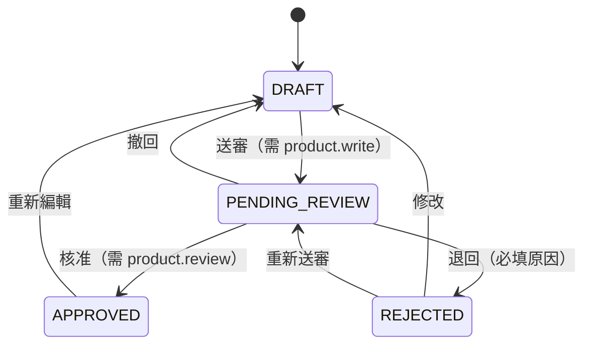

> `REVIEW_TRANSITIONS`（`products.ts`）：DRAFT→PENDING_REVIEW；PENDING_REVIEW→APPROVED／REJECTED／DRAFT；REJECTED→DRAFT／PENDING_REVIEW；APPROVED→DRAFT。商品需 APPROVED 才能通過 G2。

**測試**：`tests/scenarios.test.ts`、`tests/rbac.test.ts`（敏感財務資料與角色分權）。

---

## 7. 檔期（`modules/campaigns.ts`）

**職責**：檔期主檔、檔期內的商品／團主／曝光安排、日期與天數參數的變更（先預覽再套用）。

**資料表**

| 表 | 重點約束 |
|---|---|
| `campaigns` | `status` CHECK 14 種；`open_date ≤ close_date`；自然鍵部分唯一索引 `campaigns_natural_uq (org, vendor, normalized_title, COALESCE(open_date,'1900-01-01')) WHERE deleted_at IS NULL AND status<>'CANCELLED'`（防重複建檔）；`workflow_template_id`／`workflow_template_version`／`workflow_params`（建立當下的天數參數快照）；`previous_status`（取消／暫緩前的狀態，供恢復）；`target_revenue`（內部目標） |
| `campaign_products` | 唯一 `(campaign_id, product_id, COALESCE(sku_id,''))`（軟刪除除外）；`sku_id` 為空代表整個商品 |
| `campaign_hosts` | 唯一 `(campaign_id, host_id)`；`role` ∈ PRIMARY／CO；`status` ∈ INVITED／CONFIRMED／DECLINED／NO_RESPONSE；`commission_rule_id`（可綁定專屬佣金規則）；`target_revenue`（該團主目標） |
| `campaign_placements` | 唯一 `(campaign_id, host_id, community_id, placement_type, scheduled_on)`（未取消）；`placement_type` ∈ LAUNCH／POST／STORY／LIVE_TALK／TOPIC／REMINDER |

| 方法／路徑 | 權限 | 重點規則 |
|---|---|---|
| `GET /api/campaigns` | `campaign.read` | 經 `campaignScope` |
| `POST /api/campaigns` | `campaign.write` | 見下方序列圖；`Idempotency-Key` |
| `GET /api/campaigns/:id` | `campaign.read` | 欄位投影見 §7.2 |
| `PATCH /api/campaigns/:id` | `campaign.write` | **嚴格 schema**（`.strict()`）：只能改 title、description、campaignType、ownerUserId、targetRevenue、internalNote；日期不在此改；已取消／結案不可修改；改 `targetRevenue` 需 `campaign.sensitive.read` |
| `POST /api/campaigns/:id/reschedule` | `campaign.write` | `confirm=false`→預覽；`confirm=true`＋`token`→套用（§7.3） |
| `POST …/products`、`PATCH …/products/:cpId`、`POST …/products/:cpId/remove` | `campaign.write` | 只能在 DRAFT／EVALUATING／PREPARING 異動；商品必須屬於檔期的廠商；規格必須屬於該商品 |
| `POST …/hosts`、`POST …/hosts/:hostId/remove` | `campaign.write` | 可異動狀態：DRAFT、EVALUATING、PREPARING、PENDING_G1、PENDING_G2、SCHEDULED；已結束合作的團主不可邀請；移除前需先取消該團主未完成曝光 |
| `POST …/hosts/:hostId/respond` | 團主本人（自己綁定的團主）或 `campaign.write` | `CONFIRMED`／`DECLINED`（需原因）／`NO_RESPONSE`（團主本人不可設）；已取消／結案／暫緩的檔期不可回覆；回覆後自動結案對應的「團主未回覆」例外 |
| `POST …/placements`、`POST …/placements/:pid/status` | `campaign.write` | 可異動狀態＝團主可異動狀態＋RUNNING；曝光日需落在檔期區間；團主必須在檔期內、社群必須屬於該團主；`MISSED`／`CANCELLED` 需原因；新增後回傳最新衝突 |
| `POST …/status`、`GET …/gates/:gate`、`POST …/gates/:gate/request`、`GET …/audit` | 見 §9（`GET …/audit` 見 §19.3） | — |

### 7.1 建立檔期（序列圖）

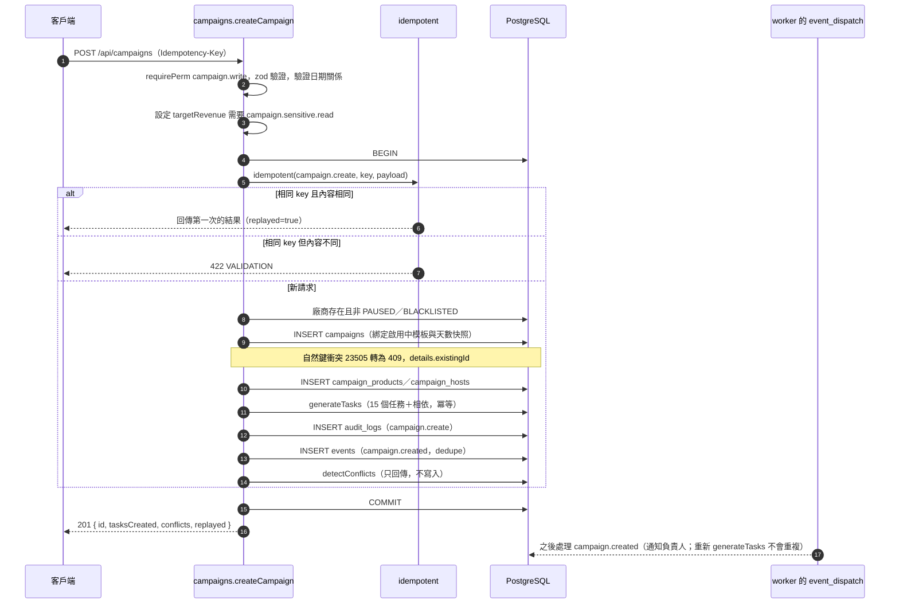

### 7.2 欄位投影（`getCampaign`，✅）

| 欄位／區塊 | 誰看得到 |
|---|---|
| `targetRevenue`（檔期與團主目標） | 有 `campaign.sensitive.read`；團主看自己那一列的目標 |
| `internalNote`、`workflowParams`、`statusReason`、`previousStatus` | 內部角色 |
| `hosts`、`placements` | 內部角色；團主只看自己的列；廠商看不到 |
| `tasks` | 全部角色可見，但團主只看 `owner_role='HOST'` 的任務、廠商只看 `owner_role='VENDOR'` 的任務 |
| `approvals`、`conflicts`、`exceptions`（未結） | 內部角色 |
| `allowedTransitions` | 有 `campaign.transition` 的內部角色；只列 `MANUAL` 類轉移（關卡類必須走核准） |

### 7.3 日期／天數參數變更：預覽 → 確認

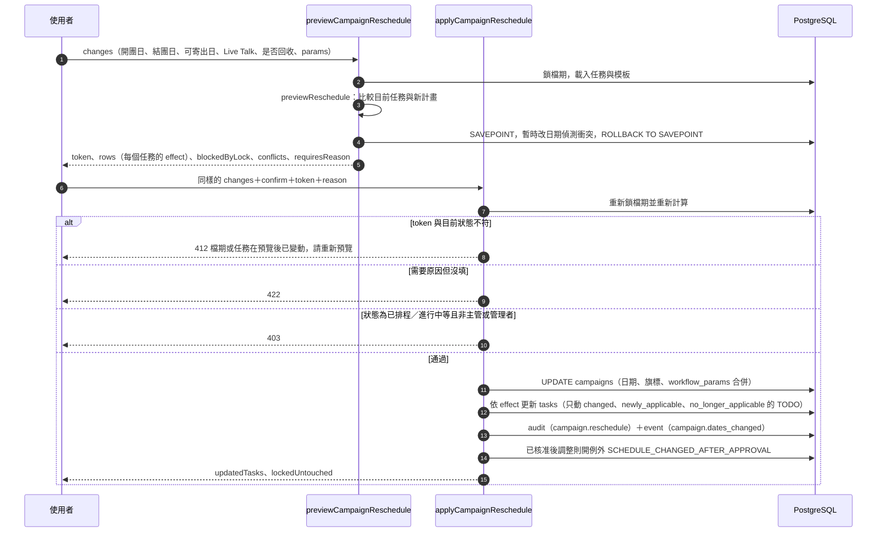

**預覽 token**：`sha256(JSON{ campaign.version, changes, rows[stepKey, after, effect] })` 取前 32 字元——它是「狀態指紋」，不是祕密也無過期時間；預覽與確認之間檔期版本、變更內容或任務計畫有任何差異就失效。

**`effect` 分類**（`workflow/schedule.ts previewReschedule`）

| effect | 條件 | 套用時 |
|---|---|---|
| `done_untouched` | 任務已 DONE／CANCELLED | 不動 |
| `blocked_by_lock` | 任務被人工鎖定日期，且這次變更本來會移動它 | 不動，列在 `lockedUntouched` |
| `changed` | 未鎖定且新計畫日期不同 | 更新日期與排程問題 |
| `newly_applicable` | 原為 SKIPPED，條件現在成立 | 改回 TODO 並排日期 |
| `no_longer_applicable` | 原為非 SKIPPED，條件不再成立 | 僅 TODO 的會改為 SKIPPED |
| `unchanged` | 其他 | 只同步 `schedule_issue` |

**限制規則（✅）**：已取消／結案／暫緩／已結算的檔期不可調整日期；RUNNING／PENDING_CLOSE_CHECK／FULFILLING／PENDING_SETTLEMENT 不可更改開團日；SCHEDULED／RUNNING／PENDING_CLOSE_CHECK／FULFILLING／PENDING_SETTLEMENT／PENDING_G2 需填原因且只有管理者／主管可確認；SCHEDULED／RUNNING 遇到 HIGH 衝突也需原因。
**測試**：`tests/reschedule.test.ts`（8）、`tests/unit/schedule.test.ts`（15）。

---

## 8. 流程引擎（`workflow/*`）

**職責**：把「標準團購流程」定義成資料（模板），依檔期關鍵日期自動算出每個任務的預定日期；定義檔期狀態機。純函式，不連資料庫（`templates.ts` 負責載入與存放）。

### 8.1 模板結構

| 概念 | 說明 |
|---|---|
| 模板 | `workflow_templates`（`key` ＋ `version` 唯一；`params` 為預設天數）；`workflow_template_steps`（每步驟：`step_key`、`seq`、`phase`1–8、`owner_role`、`kind` ∈ TASK／GATE／MILESTONE、`gate_key`、`start_rule`、`duration`、`depends_on[]`、`optional`、`condition_key`） |
| 起算規則 `StartRule` | `campaign_field`（檔期日期欄位 ± offset）、`after`（某步驟結束 ± offset）、`after_all`（多個步驟中最晚結束 ± offset） |
| 持續天數 `DurationRule` | `param`（參數鍵與預設值）或 `fixed`；必須為 1–365 的整數 |
| 條件 | `needs_sample_recovery`（檔期旗標）、`has_live_talk`（檔期有 Live Talk 日期） |
| 預設模板 | `GROUPBUY_STANDARD` v1：15 步、8 個階段；參數 `ship_days=7`、`trial_days=14`、`feedback_days=3`、`recovery_days=7`、`design_days=7`、`settle_days=14`、`invoice_days=14` |
| 快照 | 檔期建立時 `workflow_params` 存入當下參數；之後發佈新版模板**不會**改動既有檔期（`reschedule.test.ts`） |

> ❓ `publishTemplateVersion`（發佈只改天數參數的新版本）只被測試呼叫，**沒有 API 或 UI 入口**（§20 #6）。

### 8.2 排程演算法（`computeSchedule`）

1. `validateTemplate`：檢查無重複 `step_key`、相依步驟存在、起算規則用到的步驟必須列在 `dependsOn`、**無循環**（Kahn 拓撲排序），回傳拓撲順序。
2. 依拓撲順序逐步驟處理：
   - **條件不成立**且沒有固定日期 → `applicable=false`，不排程。
   - **固定日期**（任務已 DONE／CANCELLED 或日期被人工鎖定）→ 沿用既有日期，自動重排不得覆寫。
   - 否則算開始日：`campaign_field` ＝ 檔期欄位 + offset（欄位為空 → 問題「缺少…，無法排程」）；`after`／`after_all` ＝ 前置步驟的**有效結束日**（取最晚者）+ offset（任一前置無日期 → 「前置步驟尚無日期」）。
   - **結束日 = 開始日 + 天數 − 1**（含頭尾）；下一步通常 = 前一步結束 + 1（SOP 為 offset +1）。
3. **穿透（pass-through）**：不成立（`applicable=false`）的步驟，其「有效結束日」等於它自己所有前置步驟中最晚的有效結束日，因此依賴它的後續步驟會直接接在更早的前置步驟後面。
4. **排程衝突**：以檔期固定日期為錨點（`campaign_field`）且有 `dependsOn` 的步驟，若前置步驟的最晚結束日 ≥ 本步驟開始日 → 在該任務標 `schedule_issue`（例如「前置步驟預計 … 才結束，晚於本步驟開始日 …」）。

> ❓ 預設模板中**沒有任何步驟相依於選擇性步驟**（SAMPLE_RECOVERY、LIVE_TALK 無人相依），所以「穿透」規則由單元測試用自訂模板驗證，預設模板本身不會觸發。❓ 衝突訊息說「晚於」，但判斷是「不早於」（`latest >= start`），結束日等於開始日時也會標出。

**算例（實際執行 `computeSchedule` 的輸出）**：開團日 2026-12-10、結團日 2026-12-20、試用品可寄出日 2026-11-02、需要回收、無 Live Talk、預設參數：

| seq | 步驟 | 起算 | 開始 | 結束 |
|--:|---|---|---|---|
| 1 | `SAMPLE_SHIP` | sample_ready_date+0 | 2026-11-02 | 2026-11-08 |
| 2 | `TRIAL_ARRIVAL` | SAMPLE_SHIP 結束+1 | 2026-11-09 | 2026-11-22 |
| 3 | `TRIAL_FEEDBACK` | TRIAL_ARRIVAL 結束+1 | 2026-11-23 | 2026-11-25 |
| 4 | `LAUNCH_APPROVAL`（G1） | TRIAL_FEEDBACK 結束+1 | 2026-11-26 | 2026-11-26 |
| 5 | `SAMPLE_RECOVERY`（選擇性） | TRIAL_FEEDBACK 結束+1 | 2026-11-26 | 2026-12-02 |
| 6 | `CREATIVE_ASSETS` | LAUNCH_APPROVAL 結束+1 | 2026-11-27 | 2026-12-03 |
| 7 | `PRELAUNCH_CHECK`（G2） | open_date−1 | 2026-12-09 | 2026-12-09 |
| 8 | `LAUNCH` | open_date+0 | 2026-12-10 | 2026-12-10 |
| 9 | `LIVE_TALK`（選擇性） | live_talk_date+0 | —（條件不成立） | — |
| 10 | `TOPIC_PROMO` | open_date+2 | 2026-12-12 | 2026-12-12 |
| 11 | `CLOSING_REMINDER` | close_date−1 | 2026-12-19 | 2026-12-19 |
| 12 | `CLOSE_CONFIRM`（G3） | close_date+1 | 2026-12-21 | 2026-12-21 |
| 13 | `VENDOR_SETTLE` | close_date+1 | 2026-12-21 | 2027-01-03 |
| 14 | `INVOICE_REQUEST` | VENDOR_SETTLE 結束+1 | 2027-01-04 | 2027-01-17 |
| 15 | `CLOSURE_REVIEW`（G5） | INVOICE_REQUEST 結束+1 | 2027-01-18 | 2027-01-18 |

若把開團日提前到 2026-11-30，`PRELAUNCH_CHECK` 會被標記「前置步驟預計 2026-12-03 才結束，晚於本步驟開始日 2026-11-29」。

> 15 個步驟分屬 8 個階段：1 籌備與寄樣、2 試用與回饋、3 開團審核、4 素材與賣場準備、5 開團與曝光、6 銷售與催單、7 結單與請款、8 復盤與結案（ADR-004，`PROPOSED`）。G4 沒有對應的模板任務（結算確認由狀態 PENDING_SETTLEMENT 的核准承擔）。

### 8.3 檔期狀態機（`workflow/state.ts`）

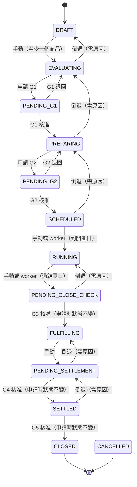

> 圖中未畫出三個不經 `TRANSITIONS` 表的動作（由 `gates.ts` 的獨立函式處理，各有自己的狀態限制）：
> **取消（cancel）**——進入履約中（FULFILLING）之前才可取消，所有未完成任務、待核准申請、已排定曝光一併取消，未結例外自動結案；
> **暫緩（hold）**——除 CLOSED、CANCELLED、SETTLED、ON_HOLD 之外皆可，進入 `ON_HOLD` 並記下 `previous_status`；
> **恢復（resume）**——只有 `ON_HOLD` 可恢復，回到 `previous_status`。三者都需填原因。

| 轉移類型 | 規則 |
|---|---|
| `MANUAL` | `POST …/status {action:'transition', to}`；需 `campaign.transition`；倒退需原因；倒退會自動取消待處理的核准申請 |
| `GATE` | **不能用「變更狀態」繞過**，必須走核准流程（§9），否則 412 |
| 強制 | `force=true` 且有原因，且為管理者／主管：可略過「尚未到開團日」「尚未過結團日」的時間檢查 |
| 特殊檢查 | DRAFT→EVALUATING 需至少一個檔期商品；SCHEDULED→RUNNING 需到開團日；RUNNING→PENDING_CLOSE_CHECK 需過結團日 |

`GATE_REQUEST`（申請時狀態）：G1 EVALUATING→PENDING_G1；G2 PREPARING→PENDING_G2；G3／G4／G5 狀態不變（PENDING_CLOSE_CHECK／PENDING_SETTLEMENT／SETTLED）。`GATE_OUTCOME`（核准／退回後）：G1→PREPARING／EVALUATING；G2→SCHEDULED／PREPARING；G3→FULFILLING／（維持）；G4→SETTLED／（維持）；G5→CLOSED／（維持）。

**測試**：`tests/lifecycle.test.ts`（8）、`tests/unit/misc.test.ts`「檔期狀態機」。

---

## 9. 關卡與核准（`modules/gates.ts`）

**職責**：G1–G5 的系統檢查、申請、核准／退回；取消、暫緩、恢復。

**資料表**：`approvals`（`gate_key` ∈ G1–G5；`status` ∈ PENDING／APPROVED／REJECTED／CANCELLED；**每檔期每關卡最多一筆 PENDING**——部分唯一索引；`check_snapshot` 存申請與核准當下的檢查結果）。

| 方法／路徑 | 權限 | 規則 |
|---|---|---|
| `GET /api/campaigns/:id/gates/:gate` | `approval.read` | 回傳檢查項（不寫入） |
| `POST /api/campaigns/:id/gates/:gate/request` | `approval.request` | 檔期須在該關卡的申請狀態；有 PENDING 則 409；**不可放行的 BLOCK 檢查未通過** → 412；成功後任務 WAITING_APPROVAL，G1／G2 檔期改為 PENDING_Gn；發 `approval.requested` 事件 |
| `POST /api/approvals/:id/decision` | 依 `GATE_APPROVER_ROLES`（不是 `approval.*`） | `APPROVED`／`REJECTED`；退回必填原因；若組織設定 `approval.require_distinct_actor=true` 則申請人不得為核准人（預設關）；核准時**重新跑檢查**，BLOCK 未過且不可放行 → 412；可放行（`ackable`）的 BLOCK 需填 `acknowledge` 風險確認 |
| `GET /api/approvals` | `approval.read` | 經資料範圍 |
| `POST /api/campaigns/:id/status`（`cancel`／`hold`／`resume`） | `campaign.transition`（取消另限管理者／主管） | 取消：進入履約中（FULFILLING）起不可取消；取消會把未完成任務→CANCELLED、待核准→CANCELLED、PLANNED 曝光→CANCELLED、未結例外→RESOLVED；暫緩／恢復需原因 |

**檢查項（✅ `runGateChecks`；BLOCK 必須通過，WARN 只提醒）**

| 關卡 | 檢查（level） |
|---|---|
| 全部 | `deps_done` 前置任務皆 DONE／SKIPPED（BLOCK） |
| G1 | `vendor_ok` 廠商非 PAUSED／BLACKLISTED（BLOCK）；`has_products` 至少一商品且規格皆啟用（BLOCK）；`has_confirmed_host` 至少一位團主 CONFIRMED（BLOCK）；`vendor_info` 廠商資料完整（WARN） |
| G2 | `dates_set`、`open_not_past`、`products_approved`（所有商品 APPROVED）、`prices_set`、`has_confirmed_host`、`has_placement`（BLOCK）；`no_high_conflicts`（BLOCK，**可放行**：核准者填風險確認原因）；`no_medium_conflicts`（WARN） |
| G3 | `past_close` 已過結團日（BLOCK）；`orders_present` 已有訂單（WARN）；`orders_fresh` 訂單資料截至結團日之後（WARN） |
| G4 | `invoice_done` 請款任務 INVOICE_REQUEST 已完成或略過（BLOCK）；`settlement_module`（WARN，固定未通過，訊息仍寫「Phase 2 尚未實作」，❓ §20 #2） |
| G5 | `no_open_high_exceptions`（BLOCK）；`no_open_tasks` 沒有未完成任務（BLOCK，不含 G5 自己） |

**序列圖：G1 申請與核准**

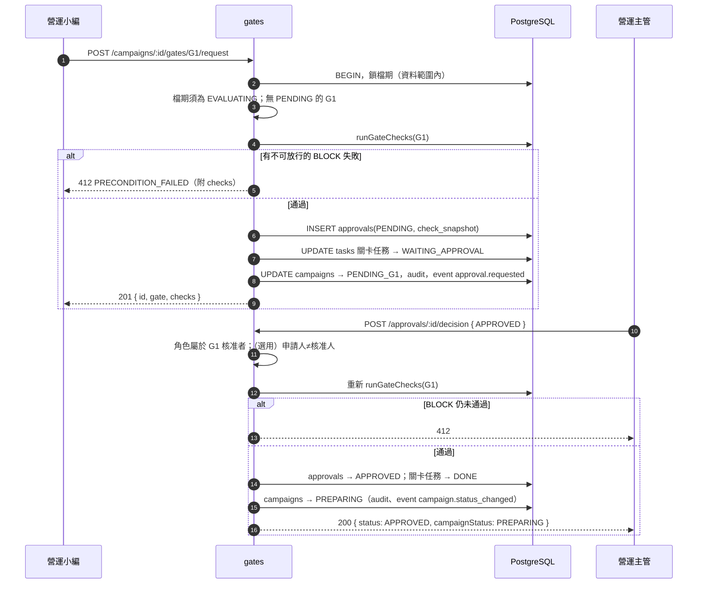

**測試**：`tests/lifecycle.test.ts`（完整生命週期含 G1–G5、狀態機防呆、取消與暫緩、團主回覆）。

---

## 10. 任務（`modules/tasks.ts`）

**職責**：依模板產生任務；任務狀態、指派、人工調整日期（鎖定）、逾期判斷。

**資料表**：`tasks`（`UNIQUE (campaign_id, step_key)`；`status` ∈ TODO／IN_PROGRESS／BLOCKED／WAITING_APPROVAL／DONE／SKIPPED／CANCELLED；`date_locked`＋`date_lock_reason`；`evidence_url`、`evidence_note`；`schedule_issue`；`overdue_flagged_at`）、`task_dependencies`（`task_id ≠ depends_on_task_id`）。

| 方法／路徑 | 權限 | 規則 |
|---|---|---|
| `GET /api/tasks` | `task.read` | 篩選 `campaignId`、`status`、`ownerRole`、`mine`、`open`、`overdue`、`dueTo`；團主只看 `owner_role='HOST'`、廠商只看 `'VENDOR'`；不含已取消檔期 |
| `GET /api/tasks/:id` | `task.read` | 範圍外／他角色的任務回 404 |
| `POST /api/tasks/:id/status` | `task.complete`（另需負責角色本人或 `task.write`） | 規則見下 |
| `PATCH /api/tasks/:id` | `task.write` | 指派（對象必須啟用中）；人工改日期（需原因，並自動鎖定）；解除鎖定（需原因）；已完成／略過／取消的任務不可修改；樂觀鎖 |
| `GET /api/workflow/template` | `task.read` | 回傳啟用中模板 |

**`setTaskStatus` 規則（✅）**：關卡任務（`kind=GATE`）不能直接變更（必須走核准）；已取消／暫緩／結案的檔期不可變更；`BLOCKED`、`SKIPPED`、重開已完成的任務都需原因，且只有選擇性任務可略過，重開需 `task.write`；`IN_PROGRESS`／`DONE` 要求前置任務皆 DONE／SKIPPED，除非 `force=true` 且有原因且持有 `campaign.transition`；`evidenceUrl` 只收 http(s)；完成或略過時自動結案該任務的逾期例外並發 `task.completed` 事件。
**`generateTasks`**：冪等——已存在的 `(campaign_id, step_key)` 不重建、不覆寫；條件不成立的選擇性步驟建為 SKIPPED（保留紀錄）；`OPS_EDITOR`／`OPS_MANAGER` 角色的任務預設指派給檔期負責人。
**逾期判斷**：`planned_end < 今天（台北）` 且狀態不是 DONE／SKIPPED／CANCELLED。

**測試**：`tests/lifecycle.test.ts`、`tests/rbac.test.ts`（非負責角色寫入回 404／403）、`tests/campaign-basic.test.ts`。

---

## 11. 衝突偵測（`modules/conflicts.ts`）

**職責**：檔期之間與團主可承接區間的衝突**提醒**（只讀，不阻擋；G2 的 HIGH 衝突是「可放行」的 BLOCK）。檔期缺開團日或結團日時不做判斷（資料不足不亂報）。比較範圍：狀態在 DRAFT～PENDING_CLOSE_CHECK 的其他檔期。

| 類型 | 嚴重度 | 條件 |
|---|:-:|---|
| `SAME_PRODUCT_OVERLAP` | HIGH | 同一商品出現在日期重疊的其他進行中檔期 |
| `COMMUNITY_OVERLAP` | HIGH | 同一社群在重疊期間有其他檔期的曝光安排（兩邊都有未取消曝光） |
| `HOST_BLOCKED` | HIGH | 檔期內的團主（非 DECLINED）在檔期區間內有 `BLOCKED` 可承接區間 |
| `HOST_OVERLAP` | MEDIUM | 團主同時參與的其他檔期數 ≥ 2（`HOST_CONCURRENT_LIMIT` 固定為 2，不可設定，K11） |

`HOST_NOT_AVAILABLE_WINDOW` 出現在型別宣告中，但程式沒有任何地方產生它（❓ §20 #15）。
**測試**：`tests/scenarios.test.ts`「日期衝突」「同一商品重複開團」。

---

## 12. 訂單匯入（`modules/orders.ts`）

**職責**：把訂單 CSV 匯入成訂單、品項與團主歸因；去重；錯誤列進入錯誤佇列，不會默默消失，也不擋住其他正確的列。目前**沒有 API／Webhook**（BLOCKED，缺平台與憑證）。

**資料表**

| 表 | 重點約束 |
|---|---|
| `import_batches` | `UNIQUE (organization_id, checksum)`（同一份檔案內容只能匯入一次）；`status` ∈ PROCESSING／COMPLETED／PARTIAL／FAILED；`data_origin` ∈ IMPORT／DEMO；計數欄位（總列、新增、更新、重複、錯誤）；`data_as_of` |
| `import_errors` | `status` ∈ OPEN／RESOLVED／IGNORED；`raw_row` 保留原始列 |
| `orders` | `UNIQUE (organization_id, source_system, source_order_id)`；`status` ∈ PAID／PENDING／CANCELLED／REFUNDED／PARTIAL_REFUND；`refund_amount ≤ gross_amount`；`buyer_ref`（去識別化代號，不存姓名／電話／地址）；`data_origin` ∈ IMPORT／DEMO／MANUAL |
| `order_items` | `quantity>0`、`unit_price≥0`、`line_amount`；`sku_id` 可為空（`sku_code_raw` 保留原文） |
| `attributions` | 主鍵 `(order_id, host_id)`；`share_percent` ∈ (0,100]；`method` ∈ CODE／LINK／MANUAL／IMPORT。匯入時有 `host_id` 欄位就建立 100% 歸因，沒有就不歸因 |

| 方法／路徑 | 權限 | 規則 |
|---|---|---|
| `POST /api/imports` | `order.import` | body：`sourceSystem`（≤60）、`csv`、選填 `fileName`、`dataAsOf`（ISO 8601 含時區）、`origin`（`DEMO` 只允許 SEED／TEST 來源） |
| `GET /api/imports`、`GET /api/imports/:id/errors` | `order.read` | 批次與錯誤列（最多 500） |
| `POST /api/import-errors/:id/resolve` | `order.import` | `RESOLVED`／`IGNORED`，必填處理說明；寫稽核 |
| `GET /api/orders` | `order.read` | 經 `campaignScope`；可依 `campaignId`、`status` 篩選 |

**CSV 格式**：必要欄位 `source_order_id、campaign_id、ordered_at、status、quantity、unit_price`；選填 `sku_code、buyer_ref、host_id、community_id、refund_amount`；未知欄位整檔拒絕；每列＝一個品項，同 `source_order_id` 合併成一張訂單。上限 2 MB、20,000 列。`ordered_at` 只接受台北時間 `YYYY-MM-DD HH:mm[:ss]`（空白分隔）或含時區的 ISO 8601（無時區的 `T` 格式有歧義，拒絕）；晚於現在 +1 天視為未來訂單。

**訂單層驗證（失敗的整張訂單的每一列進錯誤佇列）**：缺訂單編號／數量非正整數／單價為負；同訂單各列 campaign、狀態不一致；檔期不存在或已取消；狀態不在 5 種之內；退款金額與狀態不相容（PAID／PENDING／CANCELLED 不可有退款；REFUNDED 需等於訂單金額；PARTIAL_REFUND 需介於 0 與訂單金額之間；退款不可大於訂單金額）；團主不在檔期內；社群不存在；規格不在檔期的商品內。

**去重與更新**（`FOR UPDATE` 鎖列）

| 情況 | 結果 |
|---|---|
| 同一檔案內容 sha256 已匯入 | 整檔 409，`details.existingBatchId` |
| 來源訂單已存在、檔期不同 | 錯誤 `CAMPAIGN_CHANGED` |
| 已存在、品項金額或品項數不同 | 錯誤 `ITEMS_CHANGED`（人工處理） |
| 已存在、狀態與退款相同 | 計為重複（略過） |
| 已存在、狀態或退款不同 | 更新訂單的狀態與退款，稽核 `order.update_from_import` |

整個匯入在單一交易內，並取 `pg_advisory_xact_lock(hashtext('import:'+org))`，因此同一組織的匯入互相序列化。完成後發 `import.completed` 事件（有錯誤列時通知管理者）。批次狀態：全部成功＝COMPLETED；部分成功＝PARTIAL；全部失敗＝FAILED。

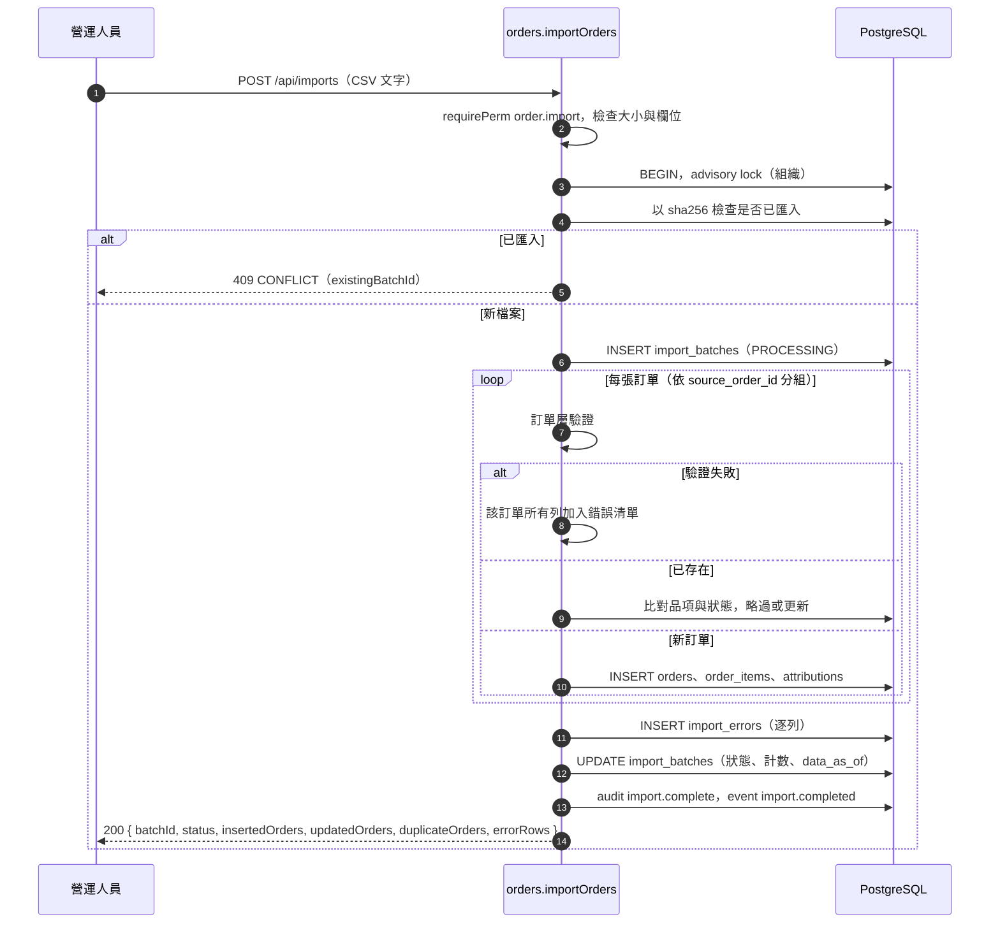

**測試**：`tests/orders-dashboard.test.ts`「訂單 CSV 匯入」（去重、更新、錯誤佇列）。

---

## 13. 佣金規則（`modules/commission.ts`、`lib/commission-calc.ts`）

**職責**：版本化的團主佣金費率；以及「預估佣金」的單一口徑（Dashboard 與結算試算共用）。**金額口徑待 Owner 確認**（ADR-013）。

**資料表**：`commission_rules`（`scope_type` ∈ HOST_DEFAULT／CAMPAIGN_HOST；`CHECK ((scope_type='CAMPAIGN_HOST') = (campaign_id IS NOT NULL))`；`rate_percent` 0–100；`basis` 目前只有 `NET_SALES`；`rule_version`；`effective_from`／`effective_to`；`status` ∈ ACTIVE／ARCHIVED）。

| 方法／路徑 | 權限 | 規則 |
|---|---|---|
| `POST /api/commission-rules` | `commission.write`（管理者、財務） | 修改＝新增一版並把同一範圍（團主＋類型＋檔期）的舊 ACTIVE 版本封存，舊版保留；`CAMPAIGN_HOST` 需團主在該檔期內，建立時同步把規則綁到 `campaign_hosts.commission_rule_id`；結束日不可早於生效日 |
| `GET /api/commission-rules` | `commission.read` | 團主只看自己的；其他需 `commission.write` 或為營運主管，否則 403；預設只列 ACTIVE（`all=1` 列全部） |

**費率選取（`pickCommissionRule`，單一定義）**

1. 檔期團主已綁定的規則（`campaign_hosts.commission_rule_id`，且該規則仍 ACTIVE）；
2. 否則該檔期的 `CAMPAIGN_HOST` 規則；
3. 否則該團主的 `HOST_DEFAULT` 規則，且基準日（檔期開團日；沒有則今天）落在生效區間內。

沒有規則就回傳 `undefined`（顯示「尚未設定」），**不猜費率**。❓ 第 1、2 種規則**不檢查生效區間**（§20 #20）。

**預估佣金公式（`lib/kpi.ts`、`lib/commission-calc.ts`，待 Owner 確認）**

```
歸因淨銷售 = Σ ( 訂單金額 − 退款 ) × 歸因比例% ÷ 100        （僅計入狀態 PAID、PARTIAL_REFUND、REFUNDED 的訂單）
預估佣金   = round( 歸因淨銷售 × 費率% ÷ 100 )              （四捨五入到整數元；沒有規則時為 null）
```

特例：淨銷售為 0 時不論有無費率，佣金為 0（`campaignHostCommission`，不是新公式）；有銷售卻沒有費率則為 null。
**測試**：`tests/orders-dashboard.test.ts`、`tests/finance.test.ts`「結算試算：重用既有預估佣金口徑」（驗證兩處數字一致）。

---

## 14. KPI 與 Dashboard（`lib/kpi.ts`、`modules/dashboard.ts`）

**職責**：管理者 Dashboard 與團主 Dashboard 的指標彙總。KPI 口徑只在 `lib/kpi.ts` 定義一次（SQL 彙總與測試共用）。**口徑待 Owner 確認**（ADR-010）。

| KPI | 定義（`KPI_DEFS`） |
|---|---|
| GMV | Σ 訂單金額（狀態 PAID、PARTIAL_REFUND、REFUNDED 的訂單；下單時間落在本月，台北） |
| 退款 | Σ 退款金額（同上範圍） |
| 有效淨銷售額 | GMV − 退款 |
| 有效訂單數 | 狀態為 PAID 或 PARTIAL_REFUND 的訂單數（全額退款不算） |
| AOV | 有效淨銷售額 ÷ 有效訂單數（無有效訂單為 null） |
| 退款率 | 有退款的訂單數 ÷ 計入銷售的訂單數 |
| 目標達成率 | 與本月重疊且設有目標的檔期：累計有效淨銷售額 ÷ 目標合計（目標為空或 0 → null；期間定義待確認，K16） |
| 預估佣金 | 見 §13 |

**資料品質狀態**（`dataStatus`）：`NO_DATA`（沒有任何訂單 → 所有業績指標顯示「待串接」，不顯示 0）、`DEMO`、`IMPORT`、`MIXED`；另附最近一次匯入資訊、未處理匯入錯誤數、超過 3 天未更新等警示。

| Dashboard | 權限 | 內容與限制 |
|---|---|---|
| `GET /api/dashboard/admin?month=YYYY-MM` | `dashboard.admin`（管理者、主管、小編、財務） | 檔期管線、未來 30 天開團／結團、任務（未完成／逾期／今日到期／未指派／卡關／待核准）、逾期清單、例外（需 `exception.read`）、廠商概況、社群與團主統計、待核准數；**銷售區塊需 `order.read`；目標區塊另需 `campaign.sensitive.read`**（小編看不到目標） |
| `GET /api/dashboard/host?hostId=&month=` | 團主：`dashboard.host`（只能看自己綁定的團主）；內部角色：`dashboard.admin`（必須指定 `hostId`） | 我的檔期、我的業績（歸因分攤）、預估佣金（沒有費率標「尚未設定」）、待辦、邀請、日曆、試用與素材進度、結算進度；**不含成本與淨利** |

> ❓ 管理者 Dashboard 的「達成率」把「檔期累計淨銷售（全期）」與「檔期目標」比，但選檔期的條件是「與本月重疊」，因此跨月檔期可能被重複計入多個月份（K16）。

**測試**：`tests/orders-dashboard.test.ts`（尚無訂單、Dashboard 口徑與一致性、DEMO 標示、敏感欄位不經 Dashboard 外洩）、`tests/unit/kpi.test.ts`（8）。

---

## 15. 自動化、通知與進件

### 15.1 自動化（`modules/automation.ts`）

**資料表**：`automation_settings`（`PRIMARY KEY (org, job_key)`；`enabled` 預設 false）、`automation_runs`（`UNIQUE (org, job_key, idempotency_key)`；`status` ∈ RUNNING／SUCCEEDED／FAILED／SKIPPED；`attempts`、`stats`、`error`）、`events`（Outbox）、`exceptions`、`daily_summaries`。

| 方法／路徑 | 權限 | 說明 |
|---|---|---|
| `GET /api/automation/jobs` | `automation.manage` | 8 個工作與最近一次執行 |
| `POST /api/automation/jobs/:key` | `automation.manage`（啟用／停用）；`automation.run`（手動執行） | 手動執行用獨立鍵 `job:manual:<時間>:<使用者>`；仍受「該工作是否啟用」限制（❓ 不檢查 `AUTOMATION_ENABLED`，§20 #14） |
| `GET /api/automation/runs` | `automation.manage` | 最近 200 筆 |
| `GET /api/exceptions`、`POST /api/exceptions/:id/status` | `exception.read`／`exception.manage` | 結案／確認需填說明；小編只看自己負責檔期的例外 |

**`runJob` 語意**：未啟用 → `SKIPPED(disabled)`；同一冪等鍵已成功或執行中 → `SKIPPED`；失敗的 run 在 `attempts < 3` 時重試同一筆；超過 → `SKIPPED(max_attempts_reached)`。預設冪等鍵粒度（`defaultKey`）：`daily_summary`／`task_reminders`／`overdue_detection`／`prelaunch_check` 每日；`campaign_status_progress` 每小時；其餘每分鐘。

| 工作 | 動作（✅ 已核對程式） |
|---|---|
| `event_dispatch` | 取最多 200 筆未處理且 `attempts<5` 的事件，逐筆交易處理（`FOR UPDATE SKIP LOCKED`）：`campaign.created` → `generateTasks`＋通知負責人；`campaign.dates_changed` → 通知任務負責人與檔期負責人；`approval.requested` → 通知該關卡的核准者角色；`campaign.status_changed` → 通知負責人；`import.completed`（有錯誤）→ 通知管理者／主管 |
| `vendor_intake` | 處理 `NEW` 的進件（§15.3） |
| `task_reminders` | 團主／廠商角色且到期日 ≤ 明天、狀態 TODO／IN_PROGRESS／BLOCKED 的任務 → 通知負責人與團主帳號；試用回饋（`TRIAL_FEEDBACK`）逾期時，對仍未回覆（INVITED 或 NO_RESPONSE）的團主開例外 `HOST_NO_RESPONSE`（逾期 ≥3 天為 HIGH），INVITED 者同時改標為 `NO_RESPONSE` |
| `overdue_detection` | 逾期任務開例外 `TASK_OVERDUE`（≥3 天 HIGH）；不再逾期者自動結案 |
| `prelaunch_check` | 狀態 SCHEDULED 且 3 天內開團的檔期跑 G2 檢查；BLOCK 未過 → 例外 `PRELAUNCH_CHECK_FAILED`（HIGH）＋通知；通過則自動結案該例外 |
| `campaign_status_progress` | `SCHEDULED` 且 `open_date ≤ 今天` → `RUNNING`；`RUNNING` 且 `close_date < 今天` → `PENDING_CLOSE_CHECK`（並補產生任務、通知申請 G3）；以系統身分呼叫 `transitionCampaign` |
| `daily_summary` | 寫入 `daily_summaries`（每日一筆）並排入給管理者的 EMAIL 摘要通知（測試 Adapter） |
| `notification_dispatch` | 派送通知佇列（§15.2） |

**例外**（`exceptions`）：`dedupe_key` 部分唯一索引（`WHERE status<>'RESOLVED'`）→ 同一事件只開一次；嚴重度可升級不可降級；類型：`TASK_OVERDUE`、`HOST_NO_RESPONSE`、`PRELAUNCH_CHECK_FAILED`、`SCHEDULE_CHANGED_AFTER_APPROVAL`、`NOTIFICATION_DEAD`。

**測試**：`tests/automation.test.ts`（17）。

### 15.2 通知（`modules/notifications.ts`）

- `notifications`：`channel` ∈ IN_APP／EMAIL／LINE；`status` ∈ QUEUED／DELIVERED／SENT_TEST／FAILED／DEAD／READ；`dedupe_key` 部分唯一索引（同一通知只排一次）。
- `queueNotification` 冪等（`ON CONFLICT DO NOTHING`）。`dispatchNotifications`：`IN_APP` 直接標 `DELIVERED`；`EMAIL`／`LINE` 交給 Adapter——目前只有 `TestAdapter`（只記錄不發送，狀態 `SENT_TEST`）；其他 `NOTIFY_ADAPTER` 值 → 拋 `BLOCKED` 錯誤。Adapter 失敗 → `FAILED`，達 3 次 → `DEAD` 並開 `NOTIFICATION_DEAD` 例外。
- API：`GET /api/notifications`（自己的站內通知，`unread=1` 篩選）、`POST /api/notifications/:id/read`、`GET /api/notifications/all`（`automation.manage`）。

### 15.3 廠商進件（`modules/intake.ts`）

- `vendor_intake_submissions`：`UNIQUE (org, external_submission_id)`（同一份表單只收一次）；`status` ∈ NEW／CREATED／MATCHED／NEEDS_REVIEW／REJECTED。
- `POST /api/intake`（`intake.write`，內部角色）：驗證 `intakePayloadSchema`（廠商名、聯絡人、品項名必填；統編 8 碼；連結僅 http(s)…）；已存在回 `200 replayed:true`，新增回 `201`。**沒有公開表單**。
- `processIntake`（由 `vendor_intake` 工作呼叫，單一交易、`FOR UPDATE`）：以正規化名稱或統編配對廠商，沒有就建立（`CONTACTED`）；廠商為 PAUSED／BLACKLISTED → `NEEDS_REVIEW`；商品同廠商同名沿用，否則建商品與 `DEFAULT` 規格；建立**草稿檔期**（沿用同廠商同名、無開團日的既有草稿）並產生任務。
- 「分潤／合作 %」文字只做解析與備註（`parseCommissionText`：`20`、`20%`、`0.2` → 20；剛好 `1` 或無法解析 → 需人工確認），**不寫入任何佣金規則**。
- **測試**：`tests/automation.test.ts`「新廠商資料進件」。

---

## 16. 履約與出貨（`modules/fulfillment.ts`，Phase 2）

**職責**：出貨批次、出貨單、簽收確認、庫存異動。不接任何物流 API（物流商與追蹤碼是人工輸入的文字）。

**資料表**

| 表 | 重點約束 |
|---|---|
| `fulfillment_batches` | `kind` ∈ SAMPLE／ORDER；`status` ∈ PENDING／PACKED／SHIPPED／DELIVERED／EXCEPTION／CANCELLED（**由出貨單彙總，只有取消是人工**）；`CHECK (status<>'CANCELLED' OR cancel_reason IS NOT NULL)`；`note` 為內部備註 |
| `shipments` | `quantity>0`；`CHECK` 異常需原因、取消需原因、已簽收必為 DELIVERED、送達日不早於出貨日；**唯一索引**：同一組織同一物流商＋追蹤碼（不分大小寫）只能出現在一張未取消的出貨單 |
| `inventory_movements` | **append-only**（`forbid_modify`）；`delta ≠ 0`；`reason_code` ∈ INITIAL／RESTOCK／ADJUST／DAMAGE／RETURN／SHIPPED_OUT／CORRECTION；`reverses_id` 唯一（同一筆只能被更正一次）；目前庫存 ＝ `SUM(delta)` |

| 方法／路徑 | 權限 | 規則 |
|---|---|---|
| `GET /api/fulfillment/batches`、`…/batches/:id`、`GET /api/campaigns/:id/fulfillment` | `fulfillment.read` | 經 `campaignScope`；團主／廠商看不到 `note`、建立者等內部欄位；檔期總覽附「提醒」（只提醒，不擋任何關卡） |
| `POST /api/fulfillment/batches`、`POST /api/campaigns/:id/fulfillment/batches` | `fulfillment.write` | `ORDER` 批次最早從 SCHEDULED 起；`SAMPLE` 不限；已取消／結案／暫緩的檔期唯讀 |
| `PATCH /api/fulfillment/batches/:id`、`POST …/cancel` | `fulfillment.write` | 取消需原因；批次內已有送達的出貨單則不能整批取消 |
| `POST /api/fulfillment/batches/:id/shipments`、`PATCH /api/fulfillment/shipments/:id` | `fulfillment.write` | 填追蹤碼需物流商；規格必須在檔期商品內；追蹤碼重複 → 409；已出貨不可改數量 |
| `POST /api/fulfillment/shipments/:id/status` | `fulfillment.write` | 轉移表見下；異常／取消需原因；出貨前需物流商；日期不可是未來；送達日不可早於出貨日 |
| `POST /api/fulfillment/shipments/:id/receipt` | `fulfillment.write` | 只能對 DELIVERED 做；簽收人必填；重複送出不覆蓋（冪等） |
| `GET /api/inventory/stock`、`GET /api/inventory/movements` | `fulfillment.read` **且** 內部角色 | 團主／廠商 403 |
| `POST /api/inventory/movements`、`POST …/movements/:id/correct` | `fulfillment.write` | 見下 |

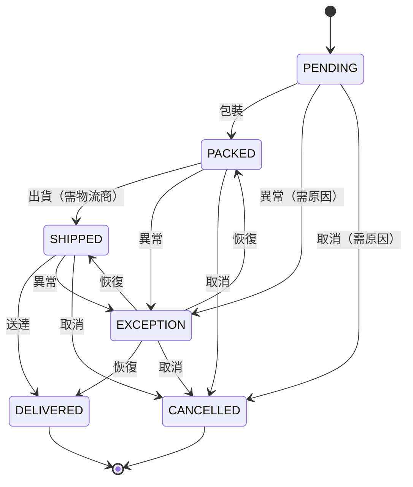

> 出貨單的 `SHIPMENT_TRANSITIONS`（`fulfillment.ts`）。**批次彙總（`rollupBatchStatus`，排除已取消）**：無有效出貨單→PENDING；任一 EXCEPTION→EXCEPTION；全部 DELIVERED→DELIVERED；任一 SHIPPED／DELIVERED→SHIPPED；全部 PACKED→PACKED；其他→PENDING。每次出貨單變動後重算並稽核。為避免死結，所有同時動到批次與出貨單的操作都先鎖批次、再鎖出貨單。

**庫存規則（✅）**：`adjustStock` 的原因碼限 INITIAL／RESTOCK／ADJUST／DAMAGE／RETURN；INITIAL／RESTOCK／RETURN 必須為正，DAMAGE 必須為負；`INITIAL` 每個規格只能一次；異動後庫存不可為負（應用層檢查；先鎖 SKU 列）；更正＝新增一筆數量相反的 `CORRECTION`，原紀錄保留，且更正後也不可使庫存為負。❓ `SHIPPED_OUT` 原因碼存在於資料庫 CHECK，但**沒有任何程式使用**——出貨不會自動扣庫存（P2-4）。
**提醒（`fulfillmentWarnings`）**：履約中以後沒有批次；出貨單異常；已過預計出貨日仍未出貨；檔期進入結算但仍有未送達；已送達未簽收（INFO）。
**通知**：出貨單轉為 EXCEPTION 時通知檔期負責人（`dedupe_key = shipment_exception:<id>:<version>`）。
**測試**：`tests/fulfillment.test.ts`（29）。

---

## 17. 售後（`modules/aftersales.ts`，Phase 2）

**職責**：售後案件（退款／客訴／換貨／其他）、處理紀錄、退款申請與核准／完成，並可選擇把退款寫回訂單。**不處理真實金流退款**。

**資料表**：`service_cases`（`case_type`、`status` ∈ OPEN／IN_PROGRESS／WAITING_VENDOR／RESOLVED／CLOSED／CANCELLED、`priority`、`buyer_ref`、`assignee_user_id`、`due_date`、`resolution`、`internal_note`）；`case_events`（**append-only**，`is_internal=false` 的紀錄外部角色才看得到）；`refund_requests`（`amount>0`；`status` ∈ REQUESTED／APPROVED／REJECTED／COMPLETED；`CHECK`：已決定需有決定者、已完成需有完成者、`writeback_applied` 只能在 COMPLETED 且有訂單時為真）。

| 方法／路徑 | 權限 | 規則 |
|---|---|---|
| `GET /api/aftersales/cases`、`…/cases/:id`、`GET /api/aftersales/overview` | `aftersales.read` | 經 `campaignScope`；外部角色只看到 `EXTERNAL_FIELDS`（id、檔期、類型、狀態、優先級、標題、到期日、處理結果、時間戳記、`overdue`），不含描述、買家代號、訂單、負責人、內部備註；紀錄只含非內部 |
| `POST /api/aftersales/cases` | `aftersales.write` | 檔期須在自己範圍；訂單須屬於該檔期；負責人須為啟用中的內部使用者；描述／標題／備註**偵測手機號碼與 Email**，命中即拒絕；`Idempotency-Key` |
| `PATCH …/cases/:id`、`POST …/cases/:id/status`、`POST …/cases/:id/notes` | `aftersales.write` | 狀態轉移表見下；`RESOLVED` 前需處理結果；`CANCELLED` 與重新開啟需原因；仍有 REQUESTED／APPROVED 的退款時不可 RESOLVED／CLOSED／CANCELLED；備註預設為內部，`public:true` 才對外 |
| `POST …/cases/:id/refunds` | `aftersales.write` | 只有處理中的案件；有訂單時：訂單須 PAID／PARTIAL_REFUND，金額 ≤ 訂單金額 − 已退 − 其他申請中的金額；通知主管／管理者 |
| `GET /api/aftersales/refunds` | `aftersales.read` 且內部角色 | — |
| `POST …/refunds/:id/decision` | `refund.approve`（管理者、主管） | `APPROVED`／`REJECTED`（退回需原因） |
| `POST …/refunds/:id/complete` | `refund.complete`（管理者、財務） | 只有 APPROVED 可完成；`writeback` **預設 false** |

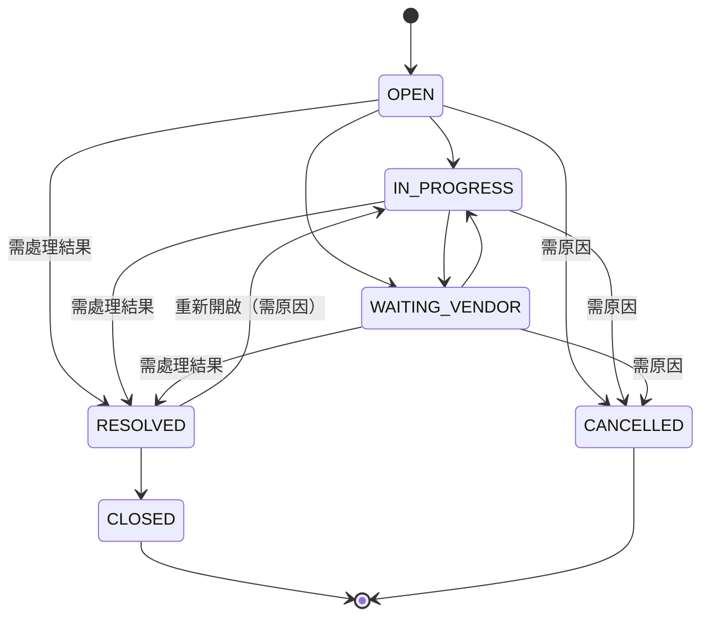

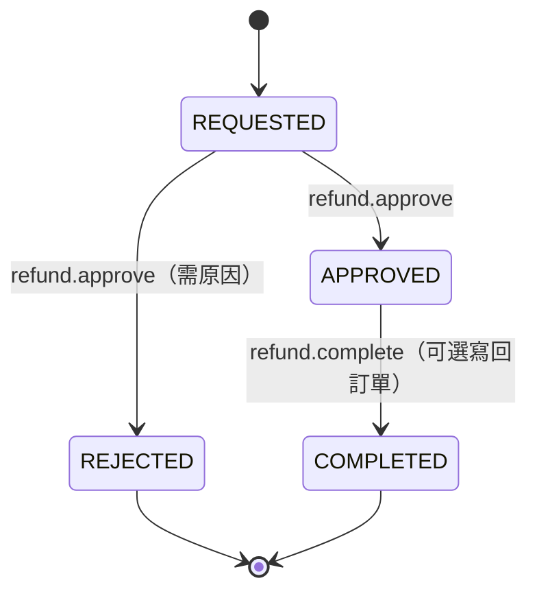

**退款寫回（`completeRefund`，`writeback=true`，同一交易）**：鎖訂單 → 訂單須 PAID／PARTIAL_REFUND → 新退款總額 = 原退款 + 本次金額，不得超過訂單金額 → 新狀態 = 總額等於訂單金額 ? `REFUNDED` : `PARTIAL_REFUND` → 更新訂單、稽核 `order.refund_writeback`、標記 `writeback_applied`。任何一步失敗整筆回滾。

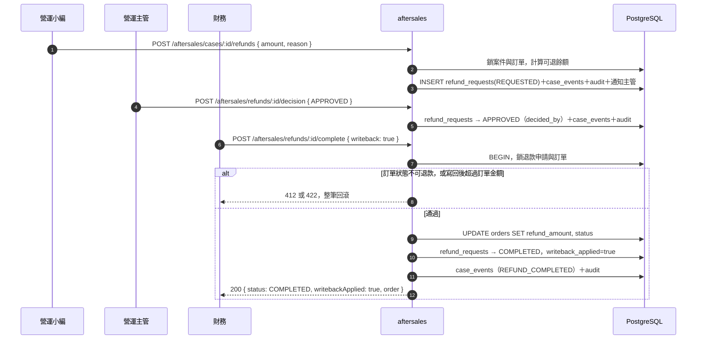

> ❓ 核准退款時**沒有「申請人≠核准人」的限制**，小團隊可能同一人兼任（§20 #19）。再匯入較舊的 CSV 會用檔案內容覆蓋 `orders.refund_amount`（P2-3，以流程規避）。
> **測試**：`tests/aftersales.test.ts`（31）、`scripts/e2e-aftersales.ts`。

---

## 18. 財務與結算試算（`modules/settlements.ts`、`modules/finance.ts`，Phase 2）

**職責**：結算試算（以檔期為單位）、人工覆寫與調整、確認鎖定；入帳／付款確認紀錄、發票紀錄、費用紀錄。**全部只是紀錄**，不接銀行、金流、電子發票。**所有結算頁面固定顯示：「試算，口徑待 Owner 確認；非正式付款依據」。**

**資料表**

| 表 | 重點約束 |
|---|---|
| `settlements` | 以 `campaign_id` 為單位；`status` ∈ DRAFT／CONFIRMED／VOID；**同檔期同時只能有一份 DRAFT 或 CONFIRMED**（部分唯一索引）；`rule_version_note`（確認時的規則版本快照）、`data_as_of`、`data_status`；`settlements_guard()` 觸發器限制狀態轉移 |
| `settlement_items` | `UNIQUE (settlement_id, host_id)`；`net_sales`、`commission_auto`（試算）、`commission_override`＋`override_reason`（覆寫須 ≥0 且原因非空，CHECK）；`rate_percent`、`rule_id`、`rule_version` 為試算當下快照；非 DRAFT 的結算不可新增／修改（`settlement_children_guard`） |
| `settlement_adjustments` | **append-only**；`amount ≠ 0`（可正可負）；`reason` 非空；非 DRAFT 不可新增 |
| `payments` | `direction` ∈ IN／OUT；`counterparty_type` ∈ VENDOR／HOST／PLATFORM（PLATFORM 不帶對象編號）；`match_status` ∈ UNMATCHED／MATCHED（核對前必須已關聯檔期或結算項目）；`status` ∈ ACTIVE／VOID（作廢需原因） |
| `invoices` | `status` ∈ DRAFT／ISSUED／VOID；同組織同發票號碼只能有一張未作廢；抬頭／統編欄位請用佔位字 |
| `expenses` | `category` ∈ SHIPPING／MARKETING／SAMPLE／PLATFORM_FEE／OTHER；`status` ∈ RECORDED／VOID |

| 方法／路徑 | 權限 | 規則 |
|---|---|---|
| `GET /api/settlements`、`GET /api/settlements/:id`、`GET /api/finance/overview`、`GET /api/payments`、`/invoices`、`/expenses` | `finance.read`（管理者、主管、財務） | 經 `campaignScope`；`getSettlement` 附 `stale`（資料或規則在試算後有變動） |
| `POST /api/settlements` | `finance.write`（管理者、財務） | 檔期狀態須為 RUNNING 以後（RUNNING、PENDING_CLOSE_CHECK、FULFILLING、PENDING_SETTLEMENT、SETTLED、CLOSED）；已有有效結算 → 409；`Idempotency-Key` |
| `POST /api/settlements/:id/recalculate` | `finance.write` | 只限草稿；用最新訂單與規則重算，**覆寫與調整項保留** |
| `POST /api/settlement-items/:id/override` | `finance.write` | 只限草稿；金額 ≥0，須填原因；`amount:null` 清除覆寫 |
| `POST /api/settlements/:id/adjustments` | `finance.write` | 只限草稿；金額非 0、原因必填 |
| `POST /api/settlements/:id/confirm` | `settlement.confirm`（管理者、財務） | 見下 |
| `POST /api/settlements/:id/void` | `finance.write`；作廢**已確認**者另需 `settlement.confirm` | 原因必填；有已核對（MATCHED）的入帳關聯此結算時不可作廢 |
| `GET /api/settlements/mine` | `commission.read` 且角色為團主 | 只回自己、**已確認**結算項的摘要（淨銷售、費率、佣金）；不含覆寫／調整原因、其他團主、費用、入帳、發票 |
| `POST /api/payments`、`…/match`、`…/unmatch`、`…/void`；`POST /api/invoices`、`…/issue`、`…/void`；`POST /api/expenses`、`…/void`；及對應 `PATCH` | `finance.write` | 已核對的入帳不可改／不可作廢（需先取消核對並填原因）；只有草稿發票可修改，已開立只能作廢；`Idempotency-Key` |

**結算金額（待 Owner 確認；沒有任何新公式）**

```
試算佣金  commission_auto = 見 §13 預估佣金（重用 lib/commission-calc.ts）
基準      commissionBase  = commission_override ?? commission_auto        （兩者皆無 → null）
最終      commissionFinal = commissionBase + Σ 調整項金額                 （基準為 null → null）
```

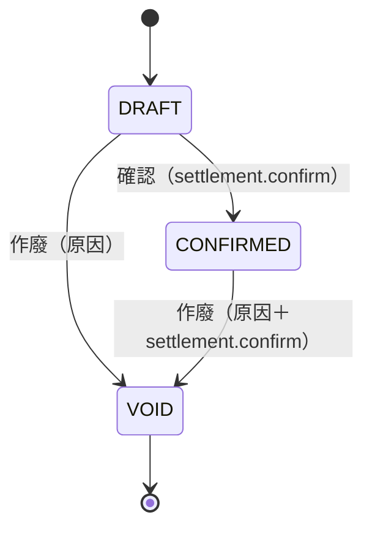

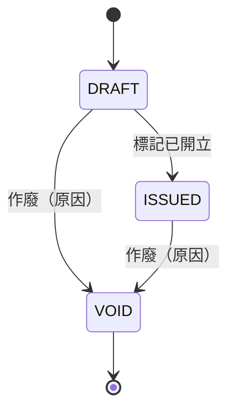

**確認前的檢查（`confirmSettlement`）**：只有 DRAFT；至少一個團主項目；**重新計算並與草稿比對**，有差異即 412 `STALE_CALCULATION`（需先重新試算）；每個項目都要有可用金額（有費率或已覆寫）；確認時寫入 `rule_version_note`（各團主所用規則 ID／版本／費率）、`data_as_of`、`data_status`。確認後由資料庫觸發器鎖定：項目與調整項不可改，狀態只能再轉 VOID。

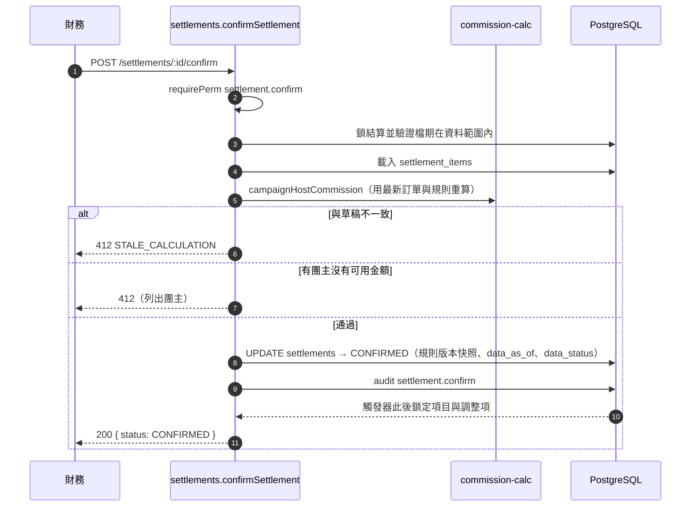

> ❓ 結算確認**不會**自動推進檔期的 G4 或狀態（P2-2）；G4 的檢查訊息仍寫「Phase 2 尚未實作」（§20 #2）。❓ 財務角色在 `/api/audit` 看不到 `payment`、`invoice`、`expense`、`settlement_item`、`settlement_adjustment`、`refund_request`、`shipment` 等實體的稽核（§20 #10）。
> **尚未做（需 Owner 定義口徑後才可實作）**：階梯費率、扣項（運費、平台費）、退款扣回時點、分潤比例與順序。
> **測試**：`tests/finance.test.ts`（22）。

---

## 19. 橫切設計

### 19.1 去重與冪等鍵總表

| 對象 | 機制 | 鍵 |
|---|---|---|
| 建立類 API（14 個範圍） | `Idempotency-Key` ＋ `request_hash` | `(org, scope, key)`；範圍：`vendor.create`、`host.create`、`community.create`、`product.create`、`campaign.create`、`fulfillment_batch.create`、`shipment.create`、`inventory.adjust`、`aftersales.case.create`、`aftersales.refund.request`、`settlement.create`、`payment.create`、`invoice.create`、`expense.create` |
| 廠商 | 部分唯一索引 | 正規化名稱、統編 |
| 團主／社群／商品／規格 | 部分唯一索引 | 正規化名稱；`(platform, 正規化名稱)`；`(vendor, 正規化名稱)`；`(product, lower(sku_code))` |
| 檔期 | 部分唯一索引 | `(vendor, 正規化標題, 開團日)`，未取消 |
| 檔期商品／團主／曝光 | 部分唯一索引 | 見 §7 |
| 核准申請 | 部分唯一索引 | 每檔期每關卡最多一筆 PENDING |
| 任務 | 唯一 | `(campaign_id, step_key)`；產生任務 `ON CONFLICT DO NOTHING` |
| 訂單匯入 | 唯一 | 檔案 sha256；`(來源系統, 來源訂單編號)` |
| 廠商進件 | 唯一 | `(org, external_submission_id)` |
| 自動化執行 | 唯一 | `(org, job_key, idempotency_key)` |
| 事件／通知／例外 | 部分唯一索引 | `dedupe_key` |
| 出貨單 | 部分唯一索引 | `(org, lower(carrier), lower(tracking_no))`，未取消 |
| 庫存更正 | 唯一 | `reverses_id` |
| 結算 | 部分唯一索引 | 每檔期一份 DRAFT／CONFIRMED；`(settlement_id, host_id)` |
| 發票 | 部分唯一索引 | `(org, invoice_no)`，未作廢 |

### 19.2 樂觀鎖

下列更新 API 帶 `version`，不符回 409 `CONFLICT`（`details.currentVersion`）：廠商、團主、社群、商品、規格、檔期（PATCH）、任務（PATCH）、出貨批次／出貨單、售後案件、入帳／發票／費用（PATCH）。實作多半經 `patchEntity`。

### 19.3 稽核查詢（`modules/audit-read.ts`）

| 方法／路徑 | 權限 | 規則 |
|---|---|---|
| `GET /api/audit` | `audit.read`（管理者、主管、財務） | 篩選 `entityType`、`entityId`、`campaignId`、`actorUserId`、`action`，上限 500 筆；**財務角色只看得到 `order、import_batch、import_error、commission_rule、settlement` 五類實體**（❓ §20 #10） |
| `GET /api/campaigns/:id/audit` | 內部角色，且檔期在資料範圍內 | 範圍外回 403（❓ §20 #13） |

---

## 20. 核對未決與文件落差

> 預設以程式為準；由 Owner 決定改程式或改文件。與 [SAD §13](SAD.md) 重疊的項目只簡述。

| # | 項目 | 說明 | 建議 |
|:-:|---|---|---|
| 1 | 文件過期 | `ARCHITECTURE.md`（43 表、8 支 migration、模組清單）、ADR-013、ADR-007、KNOWN_ISSUES K12 在 Phase 2 後未同步（SAD §13 #1、#3、#4、#13） | 更新文件 |
| 2 | G4 檢查訊息 | `gates.ts` 的 `settlement_module` 固定為未通過（WARN）；✅ 訊息已於整合時改為「結算試算與確認（需人工確認）」 | 是否串接結算（P2-2，待 Owner） |
| 3 | 錯誤碼小不一致 | JSON 格式錯誤回 400，其他驗證錯誤回 422；405 使用 `NOT_FOUND` 碼 | 客戶端以 HTTP 狀態判斷；日後可統一 |
| 4 | 刪除保護缺口 | 7 張系統／暫存表沒有 `forbid_delete`（SAD §7.3） | 補觸發器或補文件 |
| 5 | `approval.require_distinct_actor` | `gates.ts` 會讀此設定，但沒有 API／UI 可設定 | 補入口或註明只能 DBA 設定 |
| 6 | `publishTemplateVersion` | 只有測試呼叫，沒有 API／UI | 補入口或註明為內部工具 |
| 7 | 未使用的設定 | `SESSION_SECRET`（✅ 已於整合時移除，K4）、`users.must_change_password`（無程式讀寫） | 與身分機制（K1）一併決定 |
| 8 | npm script 不齊 | 只有 `db:seed:demo:aftersales`；履約與財務種子需 `npx tsx scripts/seed-demo-*.ts`（`bootstrap:demo` 已串接） | 補 script |
| 9 | ID 前綴重疊 | ✅ 已於整合時修正：庫存異動對新資料改用 `STK-`（既有紀錄不變） | — |
| 10 | 財務稽核可見度 | `FINANCE_ENTITIES` 只列 5 類，看不到 Phase 2 新實體 | ✅ 整合時已由安全審查擴充 |
| 11 | 信任 `X-Forwarded-For` | 登入 IP 限流與稽核 IP 取第一段，用戶端可偽造（帳號限流與鎖定仍有效） | 正式環境設定可信代理並只取代理附加的位址 |
| 12 | ✅（已修正，審查 R1）冪等鍵不含使用者 | 同組織內相同 key＋相同內容會回傳他人的結果 | 風險低（key 由前端隨機產生）；可把使用者納入範圍 |
| 13 | 範圍外 404／403 不一致 | 多數 404；`GET /campaigns/:id/audit`、團主 Dashboard 查他人、結算（角色無範圍時）回 403 | 統一為 404 |
| 14 | `AUTOMATION_ENABLED` 只在 worker 檢查 | 手動執行 API 只檢查工作是否啟用 | 文件註明或在 API 補檢查 |
| 15 | 未使用的衝突型別 | `HOST_NOT_AVAILABLE_WINDOW` 在型別宣告中，程式未產生 | 移除或實作 |
| 16 | 匯入的資料範圍 | `importOrders` 只檢查檔期存在於組織內，**不檢查**呼叫者的 `campaignScope`；`GET /imports`、`/imports/:id/errors` 也是全組織可見（含原始列）。小編（`order.import`、`order.read`）因此可匯入／查看自己範圍外的檔期訂單與錯誤 | 確認小編是否應受限；若是，匯入與批次清單加範圍檢查 |
| 17 | 衝突訊息用字 | 判斷為「前置結束日 ≥ 本步驟開始日」，訊息寫「晚於」 | 改為「不早於」 |
| 18 | `task.completed` 事件 | 寫入 `events`，`event_dispatch` 無對應處理 | 確認是否預期 |
| 19 | 退款核准無雙人限制 | `decideRefund` 不檢查申請人≠核准人 | 待 Owner 決定（小團隊可能同一人） |
| 20 | 佣金規則選取的生效區間 | 檔期綁定規則與 `CAMPAIGN_HOST` 規則不看 `effective_from／to`；只有 `HOST_DEFAULT` 看 | 確認預期；若要看需改 `pickCommissionRule`（金額邏輯，需 Owner 同意） |
| 21 | `agreements` | 只有資料表，無服務函式或 API | 合約管理屬後續（K17） |

---

## 21. 測試對應總表

| 測試檔 | 項數 | 對應章節 |
|---|--:|---|
| `tests/unit/schedule.test.ts` | 15 | §8 排程引擎、模板驗證、預覽 |
| `tests/unit/kpi.test.ts` | 8 | §14 KPI 口徑 |
| `tests/unit/misc.test.ts` | 26 | §0 日期／名稱正規化／CSV／密碼／權限矩陣／狀態機／稽核／限流／資料範圍／自動化鍵粒度／CSRF |
| `tests/database.test.ts` | 14 | SAD §7.3 migration、不刪除、稽核不可改、約束、`user_scopes` |
| `tests/campaign-basic.test.ts` | 1 | §7、§10 檔期建立與任務產生 |
| `tests/scenarios.test.ts` | 26 | §4–§7 重複建檔、多 SKU、多團主、衝突、重複送出、API 層、連結 scheme、清空欄位 |
| `tests/lifecycle.test.ts` | 8 | §8.3、§9 完整生命週期 G1–G5、防呆、取消暫緩、團主回覆 |
| `tests/reschedule.test.ts` | 8 | §7.3 預覽→確認、已排程限制、模板版本不覆寫 |
| `tests/rbac.test.ts` | 21 | SAD §8、§1 認證、CSRF、團主／廠商隔離、財務分權 |
| `tests/orders-dashboard.test.ts` | 19 | §12–§14 |
| `tests/automation.test.ts` | 17 | §15 |
| `tests/fulfillment.test.ts` | 29 | §16 |
| `tests/aftersales.test.ts` | 31 | §17 |
| `tests/finance.test.ts` | 22 | §13、§18 |
| **合計** | **245** | 14 個檔案；真實 PostgreSQL；一檔一組織 |

> 項數以 `grep -cE "^\s*(it|test)\("` 計算，加總為 245，與 `vitest run` 的輸出一致。E2E（Playwright）：`scripts/e2e-smoke.ts`（49 項）、`scripts/e2e-aftersales.ts`（52 項）。

---

## 22. 文件自檢

- **計數類**（以指令重新計算，非引用舊文件）：資料表 53（`CREATE TABLE`）、端點 130（`routes.ts` 的 `R(`／`P(` 與 `API_ENDPOINTS.md` 一致）、權限 43 與各角色持有數（匯入 `permissions.ts` 計算）、測試 245（14 個檔案逐檔 `it(` 計數；`vitest run` 同為 245）、有 `forbid_delete` 的表 42、append-only 的表 4、無刪除保護的表 7、`touch_row` 的表 26、冪等範圍 14、自動化工作 8、事件類型 6、模板步驟 15／階段 8／檔期狀態 14／關卡 5。
- **規則類**：每個模組都讀過對應的 `modules/*.ts`、相關 migration 與路由登記後才寫；表格中的「權限」欄以 `requirePerm`／`can` 呼叫與 `permissions.ts` 為準。
- **算例**：§8.2 的日期表是實際執行 `computeSchedule(DEFAULT_STEPS, …)` 的輸出。
- **未做的核對**：沒有實際對資料庫執行 SQL 驗證每個 CHECK 約束的行為（以 migration 文字與既有測試為準）；沒有重新執行 E2E（引用 `docs/uat/e2e-results.json` 與 `docs/phase2/aftersales-e2e.json` 的紀錄：49／49、52／52）。
- **圖的語法檢查**：SAD 8 張、SDD 14 張、共 22 張 Mermaid 圖，已用 mermaid 11.4.1 在 headless Chromium（Playwright）逐一 `parse` 並 `render`，全部無錯誤（共 22 張 `failed=0`）。這只證明語法與渲染引擎可處理，不代表在你的閱讀工具上版面一定相同。
