# 線框圖（Wireframes）

> 低擬真、灰階，只表達**版面區塊、資料來源、互動與角色差異**，不代表最終視覺。
> 每張圖上的黑色圓圈編號，對應下方同編號的說明表。實際畫面見 [AS_BUILT_SCREENS.md](AS_BUILT_SCREENS.md)，全部路由見 [SCREEN_INVENTORY.md](SCREEN_INVENTORY.md)。
> 這些線框圖是**依已實作的畫面整理的現況線框**（先有系統、後補線框），用途是讓團隊與顧問討論調整方向；要改版時請先改線框、再改畫面。
> 全部資料皆為示意，不含任何真實資料。圖中「〔…〕」是會被實際資料取代的位置。

| 圖 | 畫面 | 階段 |
|---|---|---|
| [01-login](#01-login) | 登入 | P1 |
| [02-dashboard-admin](#02-dashboard-admin) | 管理者儀表板 | P1 |
| [03-campaigns](#03-campaigns) | 檔期清單 | P1 |
| [04-campaign-detail](#04-campaign-detail) | 檔期詳情（概覽／任務／核准） | P1 |
| [05-reschedule](#05-reschedule) | 日期重排預覽 | P1 |
| [06-approvals](#06-approvals) | 核准頁 | P1 |
| [07-tasks](#07-tasks) | 任務清單 | P1 |
| [08a-vendor-detail](#08a-vendor-detail) | 廠商詳情 | P1 |
| [08b-host-detail](#08b-host-detail) | 團主詳情 | P1 |
| [09-imports](#09-imports) | 訂單匯入 | P1 |
| [10-fulfillment-batch](#10-fulfillment-batch) | 履約批次詳情 | P2 |
| [11-aftersales-case](#11-aftersales-case) | 售後案件詳情與退款核准 | P2 |
| [12-settlement-detail](#12-settlement-detail) | 財務結算詳情 | P2 |
| [13-host-my-settlements](#13-host-my-settlements) | 團主「我的結算」 | P2 |
| [14-notifications](#14-notifications) | 通知中心 | P1 |

## 01-login
**登入**（P1）　現況畫面：`screens/anon-login.png`

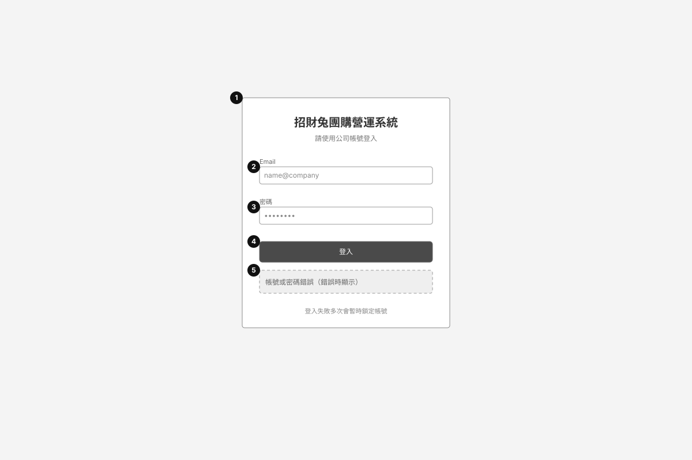

| # | 元件 | 資料來源 | 互動與規則 | 角色差異 |
|---|---|---|---|---|
| 1 | 登入卡片 | — | 未登入造訪任何受保護頁面都會導到此頁 | 全部角色共用 |
| 2 | Email 欄位 | users.email（不分大小寫） | 必填、email 格式驗證 | — |
| 3 | 密碼欄位 | users.password_hash（scrypt） | 必填；不顯示密碼；不提供「忘記密碼」（尚未實作，見 KNOWN_ISSUES K1） | — |
| 4 | 登入按鈕 | POST /api/auth/login | 成功 → 導向角色首頁（團主 /dashboard/host，其他 /dashboard）；處理中按鈕停用 | — |
| 5 | 錯誤橫幅 | API 錯誤訊息 | 帳密錯誤統一訊息（不洩漏帳號是否存在）；多次失敗鎖定；過多請求回 429 | — |

## 02-dashboard-admin
**管理者儀表板**（P1）　現況畫面：`screens/manager-dashboard.png`

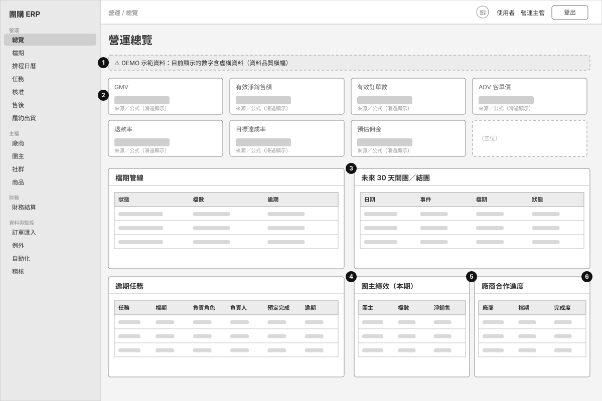

| # | 元件 | 資料來源 | 互動與規則 | 角色差異 |
|---|---|---|---|---|
| 1 | 資料品質橫幅 | orders.data_origin 判斷 NO_DATA／DEMO／IMPORT／MIXED | 無資料時引導到「訂單匯入」；DEMO 時明示非真實 | 全部可看儀表板者 |
| 2 | KPI 卡（GMV、淨銷售、訂單數、AOV、退款率、目標達成率、預估佣金） | kpi.ts（單一口徑）；orders、campaigns.target_revenue、commission_rules | 每張卡顯示來源與公式；無數字顯示「—」而非 0 | 無 campaign.sensitive.read 者隱藏「目標達成率」；無業績權限者整區改顯示說明橫幅 |
| 3 | 檔期管線／未來 30 天 | campaigns、campaign_exposures | 點檔期連到檔期詳情 | — |
| 4 | 逾期任務 | tasks（due_date < 今天且未完成） | 點任務連到檔期；空狀態顯示「目前沒有逾期任務」 | — |
| 5 | 團主績效 | attributions × orders | 依歸因計算；無歸因訂單時顯示空狀態 | — |
| 6 | 廠商合作進度 | campaigns × tasks | 顯示任務完成度與廠商端逾期 | — |

## 03-campaigns
**檔期清單**（P1）　現況畫面：`screens/manager-campaigns.png`

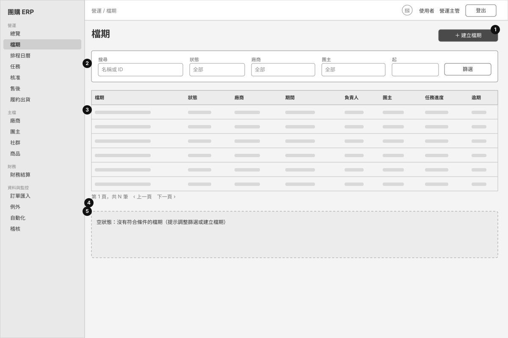

| # | 元件 | 資料來源 | 互動與規則 | 角色差異 |
|---|---|---|---|---|
| 1 | 建立檔期按鈕 | — | → /campaigns/new（需 campaign.write） | 營運主管、營運小編、系統管理者；團主與廠商不顯示 |
| 2 | 篩選列 | GET /api/campaigns?q&status&vendorId&hostId&from&to | 條件放在網址，可分享連結 | — |
| 3 | 檔期表格 | campaigns + 任務進度彙總 | 點名稱進詳情；逾期數大於 0 以警示色顯示 | 團主／廠商只看到自己範圍的檔期（後端資料範圍） |
| 4 | 分頁 | limit／offset（預設 50） | 上一頁／下一頁 | — |
| 5 | 空狀態 | — | 無資料時顯示說明，不顯示空表格 | — |

## 04-campaign-detail
**檔期詳情（概覽／任務／核准）**（P1）　現況畫面：`screens/manager-campaign-overview.png`

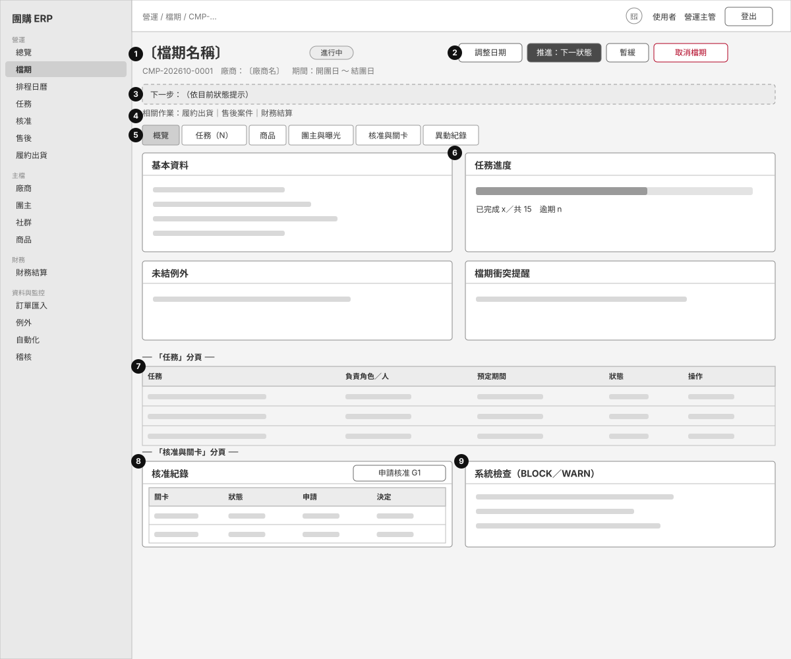

| # | 元件 | 資料來源 | 互動與規則 | 角色差異 |
|---|---|---|---|---|
| 1 | 標題與狀態徽章 | GET /api/campaigns/:id | 顯示 14 種狀態之一（草稿…結案／取消／暫緩） | — |
| 2 | 動作按鈕列：調整日期、推進／退回、暫緩／恢復、取消 | POST /api/campaigns/:id/status、POST /api/campaigns/:id/reschedule | 推進只列出狀態機允許的下一步；退回需填原因；取消只有主管且無法恢復 | 僅 campaign.write／transition；團主與廠商整列不顯示 |
| 3 | 下一步提示 | NEXT_HINT（依狀態） | 告訴使用者目前該做什麼 | — |
| 4 | 相關作業連結 | — | 連到履約出貨（帶 campaignId）、售後、財務 | 僅內部角色顯示 |
| 5 | 分頁籤 | 網址 ?tab= | 概覽／任務／商品／團主與曝光／核准與關卡／異動紀錄 | 團主多一個「團主與曝光」；核准與異動紀錄只有內部角色 |
| 6 | 概覽區塊：基本資料、任務進度、未結例外、衝突提醒 | campaigns、tasks、exceptions、conflicts | 衝突為提醒，不阻擋 | 目標營收等敏感欄位僅 campaign.sensitive.read 看得到 |
| 7 | 任務分頁表格 | tasks | 指派、完成、標記阻擋、回填證據備註 | 團主／廠商只能操作自己角色的任務；越權回 404 |
| 8 | 核准分頁：核准紀錄＋申請按鈕 | approvals、gates.ts | 申請 G1–G5；狀態先進入「待…核准」 | 申請 approval.request；決定只在「核准」頁，由有權限者進行 |
| 9 | 系統檢查 | runGateChecks | BLOCK 必須通過才能核准；WARN 只提醒 | — |

## 05-reschedule
**日期重排預覽**（P1）　現況畫面：`screens/manager-campaign-reschedule.png`

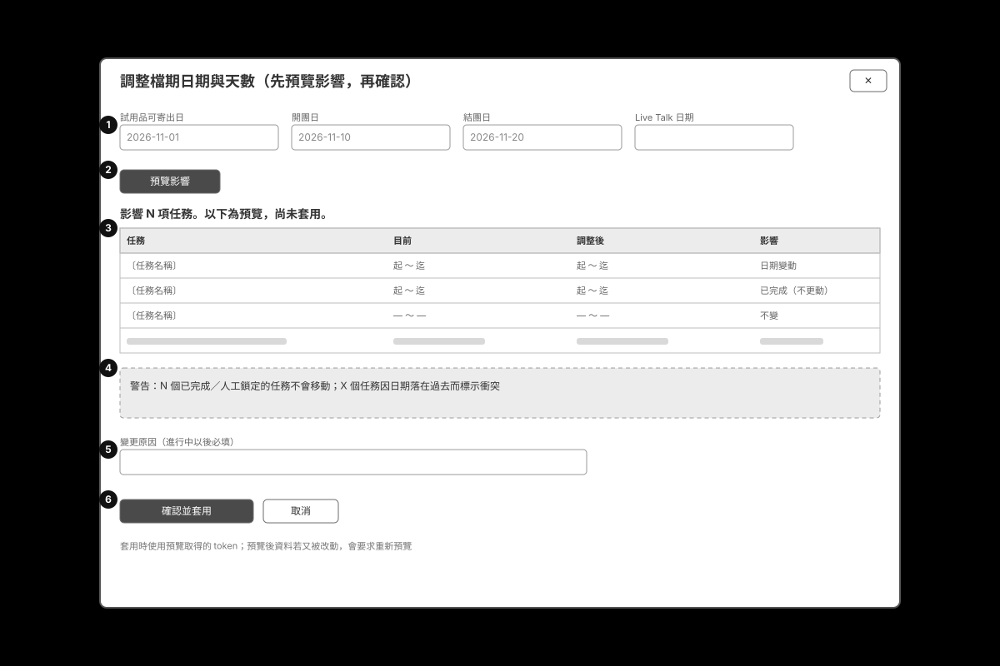

| # | 元件 | 資料來源 | 互動與規則 | 角色差異 |
|---|---|---|---|---|
| 1 | 四個日期欄位 | campaigns 現有日期 | 修改任一日期；空白＝不變 | 僅 campaign.write |
| 2 | 預覽影響按鈕 | POST /api/campaigns/:id/reschedule（不帶 confirm 即為預覽） | 只計算、不寫入；回傳 token | — |
| 3 | 影響預覽表 | schedule.ts（依 SOP 天數往前／往後推算） | 逐任務列出舊→新日期；手動鎖定的日期標示且不移動 | — |
| 4 | 警告橫幅 | previewReschedule | 列出衝突、被鎖定任務、日期落在過去的任務 | — |
| 5 | 變更原因 | — | 開團後調整日期必填（requiresReason）；進稽核紀錄 | — |
| 6 | 確認並套用 | POST /api/campaigns/:id/reschedule（confirm:true＋預覽 token＋Idempotency-Key） | 寫入新日期、連動任務、寫稽核；重複送出同一請求不會重複套用 | — |

## 06-approvals
**核准頁**（P1）　現況畫面：`screens/manager-approvals.png`

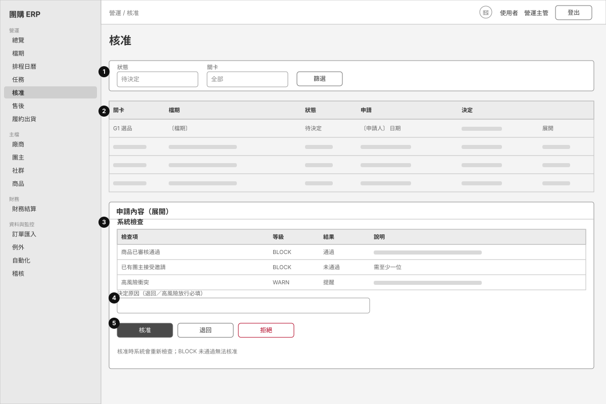

| # | 元件 | 資料來源 | 互動與規則 | 角色差異 |
|---|---|---|---|---|
| 1 | 篩選 | GET /api/approvals | 依狀態、關卡篩選 | — |
| 2 | 核准清單 | approval_requests（gates.ts） | 每列＝一次申請；空狀態顯示「沒有核准申請」 | 看得到的範圍依 approval.read；營運小編只看自己提出的相關檔期 |
| 3 | 系統檢查表 | runGateChecks（BLOCK／WARN） | 核准時重新檢查，避免用舊結果放行 | — |
| 4 | 決定原因 | — | 退回、拒絕、高風險衝突放行需填原因；原因進稽核 | — |
| 5 | 核准／退回／拒絕按鈕 | POST /api/approvals/:id/decision | 只有該關卡的核准角色看得到：G1/G2 主管與管理者；G3 加財務；G4 財務與管理者；G5 主管與管理者 | 其他角色按鈕不顯示；直接呼叫 API 回 403 |

## 07-tasks
**任務清單**（P1）　現況畫面：`screens/manager-tasks.jpg`

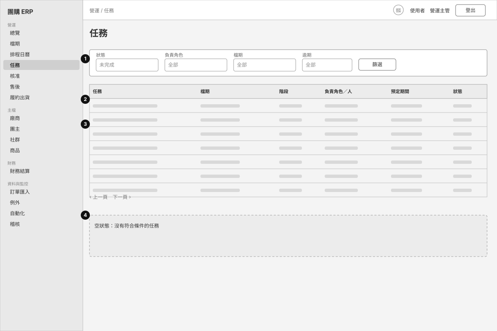

| # | 元件 | 資料來源 | 互動與規則 | 角色差異 |
|---|---|---|---|---|
| 1 | 篩選列 | GET /api/tasks | 依狀態／負責角色／檔期／逾期篩選 | — |
| 2 | 任務表 | tasks（來自檔期的 15 步流程） | 點任務進檔期詳情的任務分頁；逾期以警示色標示 | 團主／廠商只看到指派給自己角色或自己範圍檔期的任務 |
| 3 | 階段欄 | 八個階段（ADR-004，PROPOSED） | 按階段分組概念；階段定義待 Owner 確認 | — |
| 4 | 空狀態 | — | 顯示說明 | — |

## 08a-vendor-detail
**廠商詳情**（P1）　現況畫面：`screens/manager-vendor-detail.png`

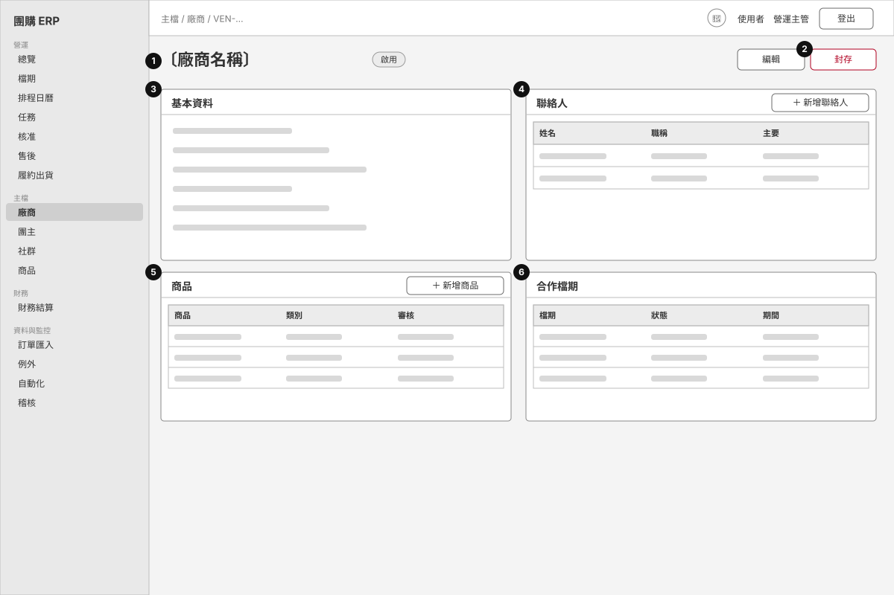

| # | 元件 | 資料來源 | 互動與規則 | 角色差異 |
|---|---|---|---|---|
| 1 | 標題＋狀態 | GET /api/vendors/:id | 啟用／停用／封存 | — |
| 2 | 編輯／封存 | PATCH /api/vendors/:id、POST …/archive | 封存＝軟刪除（資料保留）；編輯用樂觀鎖版本，衝突時提示重新整理 | 需 vendor.write；廠商本人只能看自己 |
| 3 | 基本資料 | vendors | 公司名、統編、類別、備註；缺漏欄位標示「待補資料」 | 內部備註僅內部角色可見 |
| 4 | 聯絡人 | vendor_contacts | 新增、設主要聯絡人、封存 | — |
| 5 | 商品 | products | 連到商品詳情；顯示審核狀態 | 成本欄位在商品頁，只有 product.cost.read 看得到 |
| 6 | 合作檔期 | campaigns | 點選進檔期詳情 | 廠商本人只看到自己的檔期；看不到別家廠商（404） |

## 08b-host-detail
**團主詳情**（P1）　現況畫面：`screens/manager-host-detail.png`

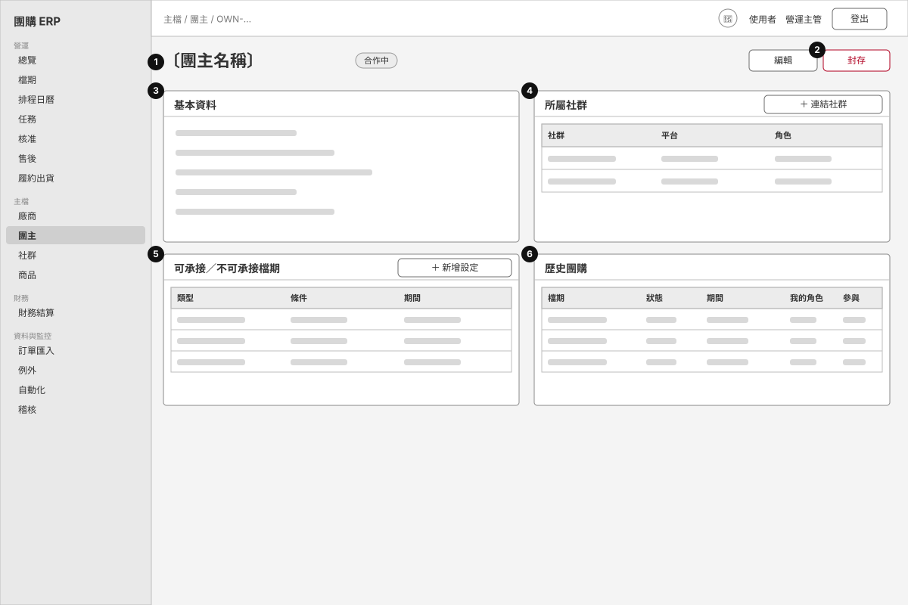

| # | 元件 | 資料來源 | 互動與規則 | 角色差異 |
|---|---|---|---|---|
| 1 | 標題＋狀態 | GET /api/hosts/:id | — | 團主本人只能開自己的詳情；其他團主回 404 |
| 2 | 編輯／封存 | PATCH /api/hosts/:id、POST …/archive | 封存＝軟刪除 | 需 host.write |
| 3 | 基本資料 | hosts | 顯示名稱、聯絡方式、合作條件（文字欄位） | 分潤比例不在此頁顯示 |
| 4 | 所屬社群 | host_communities、communities | 連結／解除社群 | 需 community.write |
| 5 | 可承接／不可承接 | host_availability | 衝突檢查會參考；移除只標記失效 | — |
| 6 | 歷史團購 | campaign_hosts | 顯示參與過的檔期與回覆狀態 | — |

## 09-imports
**訂單匯入**（P1）　現況畫面：`screens/manager-imports.png`

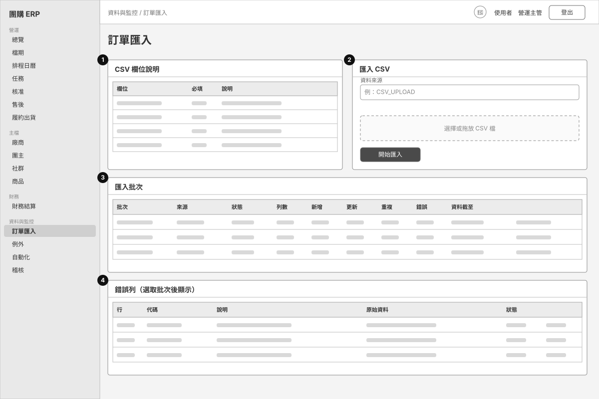

| # | 元件 | 資料來源 | 互動與規則 | 角色差異 |
|---|---|---|---|---|
| 1 | CSV 欄位說明 | orders.ts 的欄位定義 | 列出必填欄位（來源訂單編號、檔期、下單時間、金額、狀態…） | — |
| 2 | 匯入表單 | POST /api/imports | 整檔 checksum 去重：同一檔重複匯入會被擋；來源訂單編號去重；逐列驗證 | 需 order.import；財務僅能檢視批次 |
| 3 | 匯入批次 | import_batches | 顯示新增／更新／重複／錯誤列數與資料截至時間 | — |
| 4 | 錯誤列 | import_errors | 可標記已處理；空狀態「沒有錯誤列」 | — |

## 10-fulfillment-batch
**履約批次詳情**（P2）　現況畫面：`screens/manager-fulfillment-batch.png`

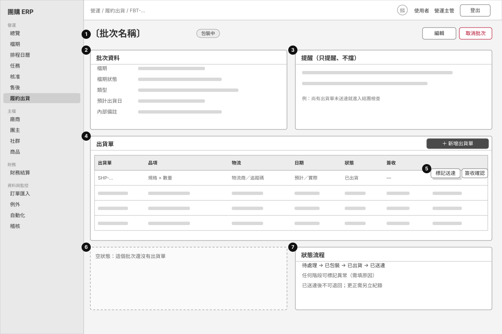

| # | 元件 | 資料來源 | 互動與規則 | 角色差異 |
|---|---|---|---|---|
| 1 | 標題＋批次狀態 | GET /api/fulfillment/batches/:id | 批次狀態由出貨單彙總 | — |
| 2 | 批次資料 | fulfillment_batches | 檔期、類型、預計出貨日、內部備註 | 內部備註對團主／廠商不顯示（欄位投影） |
| 3 | 提醒區 | fulfillment 總覽 | 提醒不阻擋任何狀態轉換（不影響 G 閘門） | — |
| 4 | 出貨單表 | shipments | 新增出貨單、編輯、取消（軟取消） | 寫入需 fulfillment.write；財務、團主、廠商唯讀 |
| 5 | 出貨進程操作：已包裝／出貨／標記送達／簽收確認／標記異常 | POST /api/fulfillment/shipments/:id/status、/receipt | 只顯示目前狀態允許的下一步；簽收由內部人員代登 | 團主與廠商不能簽收（廠商入口未解凍） |
| 6 | 空狀態 | — | 提示新增出貨單 | — |
| 7 | 庫存 | inventory_movements（append-only） | 庫存異動在「履約出貨」的庫存分頁；更正以反向異動呈現，不改舊紀錄；庫存不隨出貨自動扣 | — |

## 11-aftersales-case
**售後案件詳情與退款核准**（P2）　現況畫面：`screens/manager-aftersales-case.png`

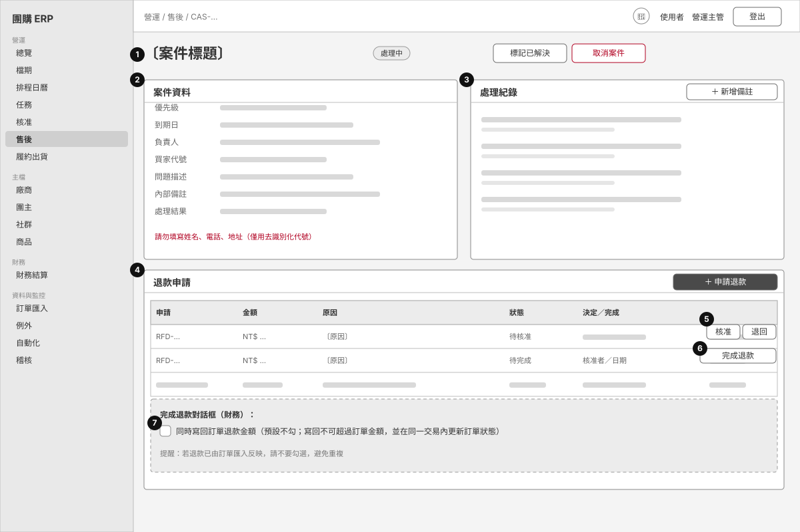

| # | 元件 | 資料來源 | 互動與規則 | 角色差異 |
|---|---|---|---|---|
| 1 | 標題＋案件狀態 | GET /api/aftersales/cases/:id | 開啟／處理中／等待廠商／已解決／已結案／已取消 | — |
| 2 | 案件資料 | service_cases | 內部備註、處理結果可編輯；提醒不填個資 | 團主／廠商唯讀摘要，看不到內部備註（欄位投影） |
| 3 | 處理紀錄 | case_events（append-only） | 新增備註；紀錄不可修改刪除 | — |
| 4 | 退款申請表 | refund_requests | 營運小編可申請；狀態：待核准／待完成／已完成／已退回 | 申請需 aftersales.write |
| 5 | 核准／退回 | POST /api/aftersales/refunds/:id/decision | 只有營運主管與系統管理者；核准者可否為申請者本人 → 待 Owner 決定 | 其他角色不顯示按鈕 |
| 6 | 完成退款 | POST /api/aftersales/refunds/:id/complete | 只有財務（refund.complete）與系統管理者；完成後鎖定 | 營運主管不能完成退款（權責分離） |
| 7 | 寫回訂單選項 | orders.refund_amount、orders.status | 預設關閉；開啟時同交易驗證不超過訂單金額、更新為部分退款／全額退款、寫稽核 | — |

## 12-settlement-detail
**財務結算詳情**（P2）　現況畫面：`screens/finance-settlement-draft.png`

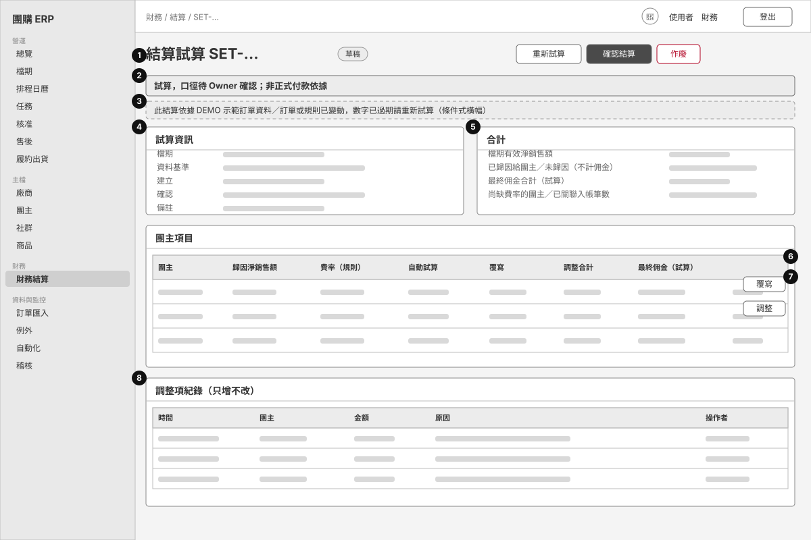

| # | 元件 | 資料來源 | 互動與規則 | 角色差異 |
|---|---|---|---|---|
| 1 | 標題＋狀態＋操作 | GET /api/settlements/:id；POST …/recalculate、/confirm、/void | 草稿可重新試算與確認；已確認鎖定，只能作廢後另開 | 確認需 settlement.confirm（財務、系統管理者）；營運主管僅檢視 |
| 2 | 固定警示橫幅 | FINANCE_NOTICE | 每個結算頁都顯示「試算，口徑待 Owner 確認；非正式付款依據」 | — |
| 3 | 條件式橫幅 | settlements.data_status、stale 判斷 | DEMO 資料提示；訂單或規則在試算後變動 → 標示過期，確認前必須重新試算 | — |
| 4 | 試算資訊 | settlements | 檔期、資料基準（DEMO／匯入、截至時間）、使用的規則版本、建立與確認時間、備註 | — |
| 5 | 合計 | settlement_items 彙總 | 檔期有效淨銷售、已歸因與未歸因金額、最終佣金合計、尚缺費率的團主、已關聯入帳筆數；佣金＝歸因淨銷售 × 生效中的版本化費率（沿用既有口徑，未新增公式） | — |
| 6 | 團主項目表 | settlement_items、commission_rules | 無適用費率的團主不猜金額，顯示空值 | 團主只在「我的結算」看到自己已確認的那一列 |
| 7 | 覆寫與調整 | POST /api/settlement-items/:id/override、/api/settlements/:id/adjustments | 覆寫金額與調整都必填原因；確認後不可再改 | 需 finance.write |
| 8 | 調整項紀錄 | settlement_adjustments（資料庫禁止修改刪除） | 只增不改；顯示操作者與原因 | — |

## 13-host-my-settlements
**團主「我的結算」**（P2）　現況畫面：`screens/host-finance-mine.png`

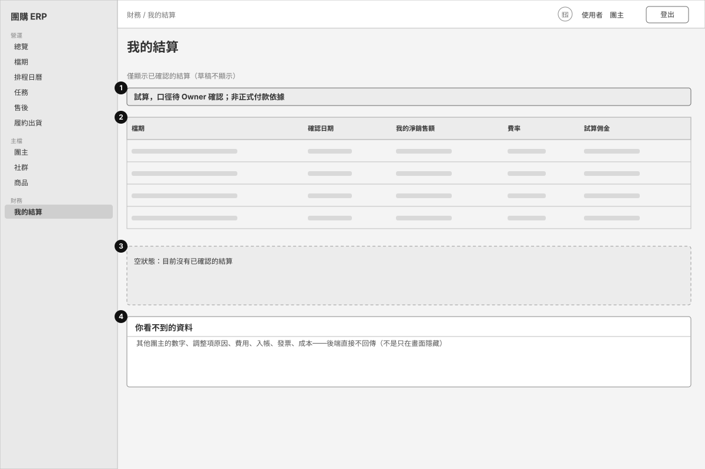

| # | 元件 | 資料來源 | 互動與規則 | 角色差異 |
|---|---|---|---|---|
| 1 | 固定警示 | FINANCE_NOTICE | 與財務頁相同 | — |
| 2 | 結算表 | GET /api/settlements/mine（settlement_items，僅 CONFIRMED） | 只含自己的列：淨銷售、費率、試算佣金 | 僅 HOST 角色顯示導覽項「我的結算」 |
| 3 | 空狀態 | — | 尚無已確認結算時說明 | — |
| 4 | 資料界線 | settlements.ts 欄位投影 | 測試鎖住：看不到其他團主、調整原因、草稿 | 廠商完全無財務權限 |

## 14-notifications
**通知中心**（P1）　現況畫面：`screens/host-notifications.png`

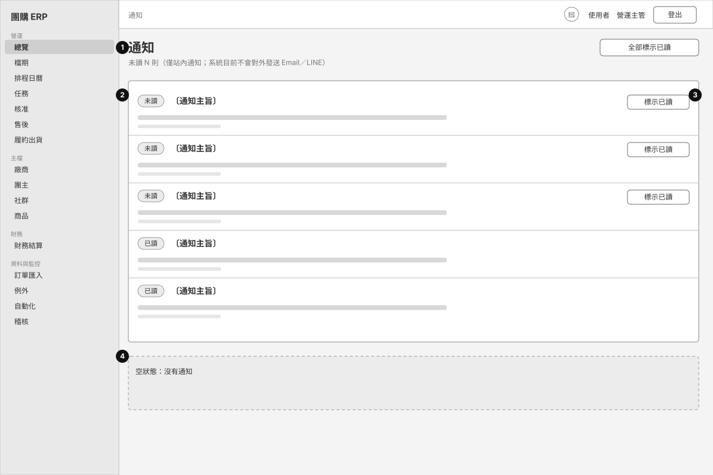

| # | 元件 | 資料來源 | 互動與規則 | 角色差異 |
|---|---|---|---|---|
| 1 | 標題與未讀數 | GET /api/notifications | 明示：僅站內通知，系統不會對外發送 | 每位使用者只看到自己的通知 |
| 2 | 通知列 | notifications（佇列＋TestAdapter） | 點通知依類型導向檔期、核准、任務、匯入或自動化頁；未讀有徽章 | — |
| 3 | 標示已讀 | POST /api/notifications/:id/read | 單筆標示；已讀不再顯示按鈕 | — |
| 4 | 空狀態 | — | — | — |

## 設計共通規則

- 狀態一律用「徽章＋文字」，不只靠顏色。
- 每個列表頁都有空狀態說明；有篩選條件的頁面，條件放在網址上可分享。
- 危險操作（取消檔期、作廢、封存）用紅色外框按鈕並要求確認或填原因。
- 敏感欄位（成本、目標營收、內部備註、他人結算）由**後端**決定是否回傳，畫面不是唯一防線。
- 所有寫入都留稽核紀錄；沒有真正的刪除，只有封存、取消或作廢。
- 結算相關頁面固定顯示「試算，口徑待 Owner 確認；非正式付款依據」。
